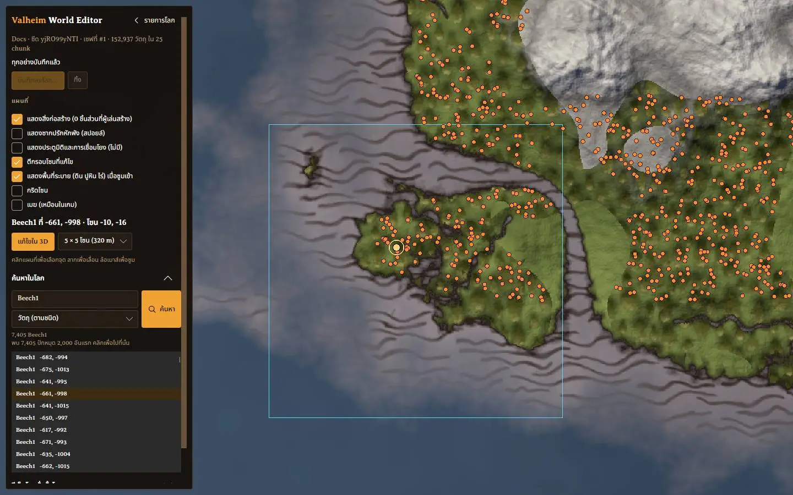

<!-- source: 1ca7ded6 -->
# หาวัตถุ ไอเทมในหีบ หรือป้าย

ค้นหาวัตถุ ไอเทมในหีบใดก็ได้ หรือข้อความบนป้ายหรือประตูมิติ ทั่วทั้งโลก แล้วเปิดใน 3D

**สิ่งที่ต้องมี:** โลกที่เปิดอยู่บน[แผนที่](../map.md)

1. ในแผงด้านข้างของแผนที่ เปิด **ค้นหาในโลก**
2. พิมพ์บางส่วนของสิ่งที่ต้องการหา: ชนิด (`portal`, `chest`, `Beech`) ไอเทม (`Silver`, `Wood`) หรือคำบนป้าย
   ตัวพิมพ์เล็กหรือใหญ่ไม่มีผล
3. เลือกสิ่งที่จะค้นหา: **วัตถุ (ตามชนิด)** **ไอเทมในภาชนะ** หรือ **ข้อความ (ป้าย ประตูมิติ Ward…)**
4. กด **ค้นหา** (หรือ `Enter`) ผลลัพธ์ทุกรายการ จะถูกปักหมุดสีส้มบนแผนที่ และแสดงในรายการ พร้อมจำนวนของแต่ละชนิด
5. คลิกผลลัพธ์ในรายการ แผนที่จะเลื่อนไปไว้ตรงกลาง และเลือกโซนของผลลัพธ์นั้น
6. กด **แก้ไขใน 3D** เอดิเตอร์จะเปิดขึ้น โดยเลือกวัตถุนั้นไว้ สำหรับไอเทมหรือข้อความ ข้อมูลของวัตถุจะเปิดขึ้นด้วย
7. ไม่บังคับ: เปลี่ยนของในหีบ หรือข้อความบนป้าย (ดู
   [เปลี่ยนของในหีบ หรือข้อความบนป้าย](fill-a-chest.md)) แล้วกด **บันทึกลงโลก** (หรือ **นำไปใช้แบบไลฟ์**)

*หมุดแต่ละอันคือวัตถุหนึ่งชิ้นที่พบ ชิ้นที่เลือกในรายการ จะใหญ่กว่าและมีวงแหวนสีทอง*

## ตรวจว่าได้ผล

- บรรทัดเหนือผลลัพธ์ บอกจำนวนที่พบ รายการแสดง 300 รายการแรก และปักหมุดได้สูงสุด 2,000 รายการ
- **ไม่พบอะไรเลย?** ตรวจการสะกด และสิ่งที่เลือกให้ค้นหา การค้นหาเห็นโลก ตามที่เป็นอยู่ในเอดิเตอร์:
  วัตถุที่ลบแล้วแต่ยังไม่ได้บันทึก จะไม่ถูกพบ วัตถุสำหรับจัดการภายใน ของเกมเอง (`_ZoneCtrl`…)
  จะถูกพบ เฉพาะเมื่อข้อความของคุณ ขึ้นต้นด้วย `_`

## เลิกทำ

การค้นหาไม่เปลี่ยนอะไร การเปลี่ยนแปลงที่คุณทำกับวัตถุ คือหนึ่งขั้นตอน: `Ctrl+Z` ย้อนกลับได้

## หัวข้อที่เกี่ยวข้อง

- [แผนที่โลก](../map.md#คนหาในโลก)
- [เปลี่ยนของในหีบ หรือข้อความบนป้าย](fill-a-chest.md)
- [เลือก](../select.md)
