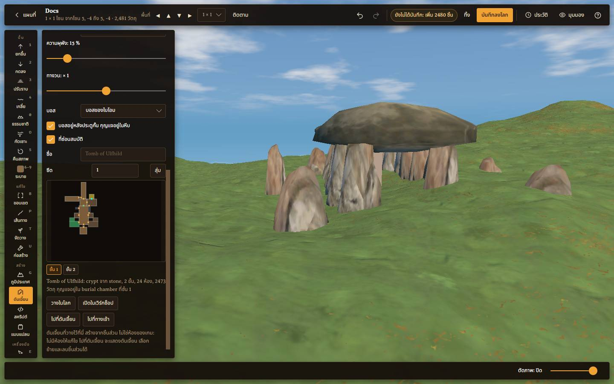

<!-- source: 89221403 -->
# สร้างดันเจี้ยนแล้ววางลงในโลก

สร้างดันเจี้ยนทั้งหลัง จากตัวเลือกไม่กี่อย่าง แล้ววางไว้หลังทางเข้า แบบที่เกมทำ กับดันเจี้ยนของเกมเอง

**สิ่งที่ต้องมี:** โลกที่เปิดอยู่ในเอดิเตอร์ โดยเปิดพื้นที่ที่จะวางทางเข้า ในโซนที่ยังไม่มีทางเข้าดันเจี้ยน
(สำรองไว้ก่อน: ดู [สำรองโลก](back-up-a-world.md))

## ขั้นตอน

1. คลิก **ดันเจี้ยน** บนแถบเครื่องมือ (ส่วน สร้าง)
2. ใต้ **สร้างดันเจี้ยน** เลือก **ไบโอม**: ไบโอมกำหนดมอนสเตอร์ สมบัติ และทางเข้าบนพื้น
3. เลือก **ขนาด** และ **ชั้น** และเลือกบอสใต้ **บอส**
4. ดูแผนผัง คลิก **ชั้น 1** **ชั้น 2**... ใต้แผนผัง เพื่อดูแต่ละชั้น
5. ไม่บังคับ: คลิก **สุ่ม** จนกว่าจะถูกใจแผนผัง หรือพิมพ์ **ชื่อ** สำหรับป้ายในโถงทางเข้า
6. หมุนมุมมอง ให้หันไปทางจุดที่จะวางทางเข้า โดยให้จุดนั้นอยู่กลางมุมมอง
7. คลิก **วางในโลก** ทางเข้าจะปรากฏบนพื้น โดยประตูหันมาทางคุณ
8. คลิก **ไปที่ดันเจี้ยน** เพื่อดูข้างในจากด้านบน โดยตัดหลังคาออก
9. คลิก **ไปที่ทางเข้า** เพื่อกลับลงมา
10. คลิก **บันทึกลงโลก** (หรือ **นำไปใช้แบบไลฟ์**)

*ทางเข้าหลัง **วางในโลก**: เนินของห้องฝังศพ ประตูหันเข้าหากล้อง*

ถ้าจะเปลี่ยนดันเจี้ยนด้วยมือ ก่อนวาง (ย้ายเฟอร์นิเจอร์ ใส่ของในหีบ) ให้บันทึก (หรือนำไปใช้)
การเปลี่ยนแปลงของคุณ แล้วคลิก **เปิดในเวิร์กช็อป** แทนขั้นตอนที่ 7: เวิร์กช็อปจะเปิดแทนโลก
เปลี่ยนดันเจี้ยน คลิก **บันทึกพิมพ์เขียว** เปิดโลกอีกครั้ง แล้ววางลงไป: ดู
[วางพิมพ์เขียวลงในโลก](paste-a-blueprint.md)

## ตรวจว่าได้ผล

แถบสถานะบอกว่า *สร้าง … แล้ว: … วัตถุ สูงกว่าตรงนี้ 5000 m* **ไปที่ดันเจี้ยน** แสดงห้องต่างๆ
หลังบันทึกแล้ว เปิดโลกในเกม เดินไปที่ทางเข้า แล้วผ่านประตูเข้าไป: คุณจะมาถึงโถงทางเข้า

## เลิกทำ

- ก่อนบันทึก: `Ctrl+Z` ย้อนการวางทั้งหมด ในขั้นตอนเดียว
- หลังบันทึก: ดู [เลิกทำขั้นตอน ย้อนการเปลี่ยนแปลงหนึ่งรายการ หรือทิ้งทั้งหมด](undo-changes.md) หรือ
  [คืนสภาพพื้นที่หนึ่ง จากข้อมูลสำรอง](restore-from-backup.md)

## เคล็ดลับ

- *มีบางอย่างอยู่ข้างบนนั้นแล้ว*: แต่ละโซน (64 × 64 m) มีดันเจี้ยนได้หนึ่งแห่ง วางทางเข้าในโซนอื่น
- ตัวเลือกและซีดเดียวกัน จะสร้างดันเจี้ยน จากชิ้นส่วนก่อสร้าง แบบเดิมเสมอ: จด **ซีด** ไว้เพื่อสร้างซ้ำ
  ดันเจี้ยนจากห้องของเกมเอง จะถูกวางผังใหม่จากทางเข้า ตอนวาง จึงต้องใช้จุดและทิศทางเดิมด้วย
- **ทำจาก: ห้องของเกมเอง** สร้างดันเจี้ยนจากห้องของเกมแทน เพื่อแก้ไขทีละห้อง

## หัวข้อที่เกี่ยวข้อง

- [ดันเจี้ยน](../dungeons.md)
- [เกมเก็บดันเจี้ยนอย่างไร](../concepts/dungeons.md#วธทเกมเกบดนเจยน)
- [เวิร์กช็อป](../workshop.md)
