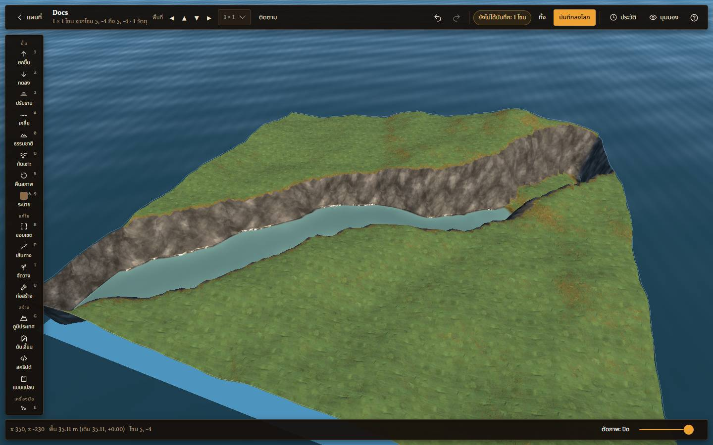

<!-- source: d55dc125 -->
# ขุดแม่น้ำหรือบ่อน้ำ

ขุดแม่น้ำ คลอง หรือบ่อน้ำ ที่มีน้ำเติมเข้ามา

**สิ่งที่ต้องมี:** โลกที่เปิดอยู่ใน 3D โดยปิดเกมไว้ หรืออยู่ใน[โหมดไลฟ์](edit-your-game-live.md) พื้นที่ต่ำ
ใกล้ทะเล ทำได้ง่ายที่สุด

Valheim ไม่มีน้ำไหล: น้ำในแม่น้ำคือทะเล ที่ระดับ 30 m ทุกที่ แม่น้ำหรือบ่อจะมีน้ำ
เฉพาะตรงที่ท้องน้ำต่ำกว่า 30 m

1. เลื่อนเคอร์เซอร์ไปตามแนว แล้วอ่านความสูงของพื้น ในแถบสถานะ ถ้าไม่เปิด ไม่จำกัด คุณขุดลงได้แค่
   8 m ดังนั้นพื้นที่สูงกว่าประมาณ 36 m จะไม่มีน้ำ
2. กด `P` ([เส้นทาง](../path.md)) แล้วคลิกจุดต่างๆ ตามแนวแม่น้ำ จากทะเลหรือทะเลสาบ เข้าไปในแผ่นดิน
3. ในแผง เลือก **แม่น้ำ / คลอง (น้ำ)**
4. ตั้ง **ความกว้าง** (ความกว้างของน้ำ) **ขอบนุ่ม** (ตลิ่ง) และ **ความลึก** (ท้องน้ำตรงกลาง
   ต่ำกว่าระดับทะเลเท่าไร เริ่มต้นที่ 2 m)
5. กด **นำไปใช้ (Enter)** ท้องน้ำจะมีน้ำเต็ม
6. สำหรับบ่อน้ำ กด `B` ([ขอบเขต](../area.md)) เลือก **รูปหลายเหลี่ยม** คลิกรอบบ่อ แล้วดับเบิลคลิก
   มุมสุดท้าย เพื่อปิดรูปทรง
7. ในกลุ่ม **พื้นดิน** เลือก **ปรับราบ** ใน **การกระทำ** พิมพ์ **ความสูง** ที่ต่ำกว่า 30 m (28 m
   ทำให้น้ำลึก 2 m) ตั้ง **ขอบนุ่ม** ประมาณ 5 m ให้ตลิ่งลาดเอียงเบาๆ แล้วกด **ปรับราบ (Enter)**
8. คลิก **บันทึกลงโลก** (หรือ **นำไปใช้แบบไลฟ์**)

*แม่น้ำที่ขุดด้วย แม่น้ำ / คลอง (น้ำ): ทะเลเติมน้ำเข้ามา*

## ตรวจว่าได้ผล

- น้ำจะแสดงในมุมมอง 3D ทันที ที่ท้องน้ำต่ำกว่า 30 m
- ถ้าแถบสถานะบอกว่า บางส่วนถึงขีดจำกัดของเกม แสดงว่าพื้นตรงนั้นสูงเกินไป: กดพื้นใกล้ทะเลให้ต่ำลงก่อน
  เดินตามพื้นที่ต่ำกว่า หรือเปิด **ไม่จำกัด** (ดู [ยกหรือขุดเกินขีดจำกัด 8 m
  ของเกม](raise-past-the-limit.md))

## เลิกทำ

`Ctrl+Z` ย้อน **นำไปใช้** หรือ **ปรับราบ** ครั้งล่าสุด หลังบันทึกแล้ว ให้เลิกทำแล้วบันทึกอีกครั้ง (ดู
[เลิกทำขั้นตอน ย้อนการเปลี่ยนแปลงหนึ่งรายการ หรือทิ้งทั้งหมด](undo-changes.md))

ถ้าจะถมแม่น้ำในภายหลัง เมื่อขั้นตอนเลิกทำหายไปแล้ว ให้วาดเส้นอีกครั้ง (หรือเก็บเส้นเดิมไว้) แล้วใช้
**คืนสภาพ** ของเครื่องมือ เส้นทาง: พื้นดินตามเส้น จะกลับไปเป็นแบบที่โลกสร้างไว้ แปรง **คืนสภาพ** (`5`)
ทำแบบเดียวกัน ในจุดเดียว

## หัวข้อที่เกี่ยวข้อง

- [เส้นทาง](../path.md#แมนำหรอคลอง)
- [การวัดและชั้นซ้อนทับ](../measure.md): ความลึกของน้ำ
- [ขีดจำกัดของพื้นดิน](../concepts/ground-limits.md)
