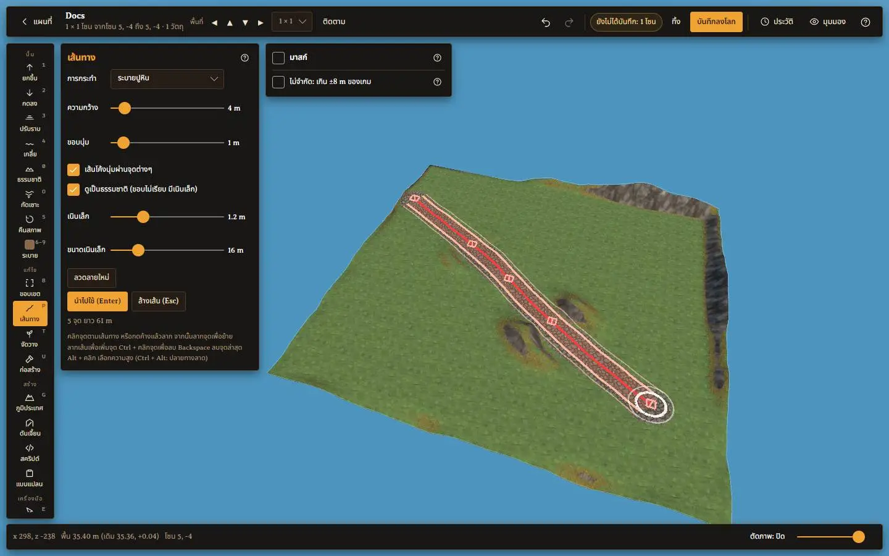

<!-- source: 20a95afa -->
# ทำถนน หรือทางลาดขึ้นเนิน

วาดถนนราบ พร้อมทางลาดสม่ำเสมอ ขึ้นเนิน และปูหินตรงกลาง

**สิ่งที่ต้องมี:** โลกที่เปิดใน 3D โดยปิดเกมไว้ หรืออยู่ใน [โหมดไลฟ์](edit-your-game-live.md)

1. ไม่บังคับ: ตรวจความชันก่อน กด `M` ([วัด](../measure.md)) คลิกที่ตีนเนิน แล้วคลิกที่ยอด: **ความชัน** คือค่าที่ทางลาด ระหว่างสองจุดนั้นจะได้
2. กด `P` ([เส้นทาง](../path.md)) แล้วคลิกจุด ตามส่วนที่ราบของถนน
3. ในแผง เลือก **ปรับราบ** `Alt`+คลิกพื้นดิน เพื่อใช้ความสูงของจุดนั้น หรือพิมพ์ใน **ความสูง**
4. ตั้ง **ความกว้าง** (8 m เหมาะกับถนน) และ **ขอบนุ่ม** (4 m กลืนถนนเข้ากับทางลาด)
5. ไม่บังคับ: ติ๊ก **ดูเป็นธรรมชาติ (ขอบไม่เรียบ มีเนินเล็ก)** สำหรับทางที่ดูผ่านการใช้มานาน
6. กด **นำไปใช้ (Enter)** แล้วกด **ล้างเส้น (Esc)**
7. สำหรับเนิน ให้คลิกจุดหนึ่งที่ตีนเนิน และอีกจุดที่ยอด แล้วเลือก **ทางลาด (เริ่ม → สิ้นสุด)** **เริ่ม** และ **สิ้นสุด** เป็นไปตามพื้นดิน ใต้ปลายทั้งสอง พิมพ์ความสูง เพื่อเปลี่ยนค่าใดค่าหนึ่ง
8. กด **นำไปใช้ (Enter)** เส้นยังอยู่
9. ถ้าจะปูหิน ให้เลือก **ระบายปูหิน** ลด **ความกว้าง** และ **ขอบนุ่ม** ลง (4 m และ 1 m) แล้วกด **นำไปใช้ (Enter)** อีกครั้ง บนเส้นเดิม
10. คลิก **บันทึกลงโลก** (หรือ **นำไปใช้แบบไลฟ์**)

*ถนนที่ทำด้วย ปรับราบ ผ่านเนินดินสองลูก แล้วตามด้วย ระบายปูหิน (ความกว้าง 4 m ขอบนุ่ม 1 m) บนเส้นเดิม*

## ตรวจว่าได้ผล

- วัดตามถนน: **ความชัน** เท่ากันตลอดทางลาด
- ถ้ามีจุดเป็นสีแดง แสดงว่าบางส่วนของถนน ถึงขีดจำกัด 8 m ของเกม: ดู [ยกหรือขุดเกินขีดจำกัด 8 m ของเกม](raise-past-the-limit.md)

## เลิกทำ

**นำไปใช้** แต่ละครั้ง เป็นการเลิกทำหนึ่งขั้นตอน: `Ctrl+Z` ย้อนครั้งล่าสุด **ล้างเส้น (Esc)** นำออกเฉพาะเส้น ไม่ใช่สิ่งที่คุณนำไปใช้ หลังบันทึก ให้เลิกทำ แล้วบันทึกอีกครั้ง (ดู [เลิกทำขั้นตอน ย้อนการเปลี่ยนแปลงหนึ่งรายการ หรือทิ้งทั้งหมด](undo-changes.md))

ถ้าจะเอาถนนออกภายหลัง เมื่อขั้นตอนเลิกทำหายไปแล้ว ให้วาดเส้นตามถนน แล้วใช้ **คืนสภาพ** ด้วย **ความกว้าง** ที่ครอบคลุมถนน: พื้นดินจะกลับเป็นแบบ ที่โลกสร้างไว้ และการระบายถูกนำออก

## หัวข้อที่เกี่ยวข้อง

- [เส้นทาง](../path.md)
- [การวัดและชั้นซ้อนทับ](../measure.md)
- [เคลียร์ต้นไม้และหิน ปรับพื้นที่ก่อสร้างให้ราบ](clear-an-area.md)
