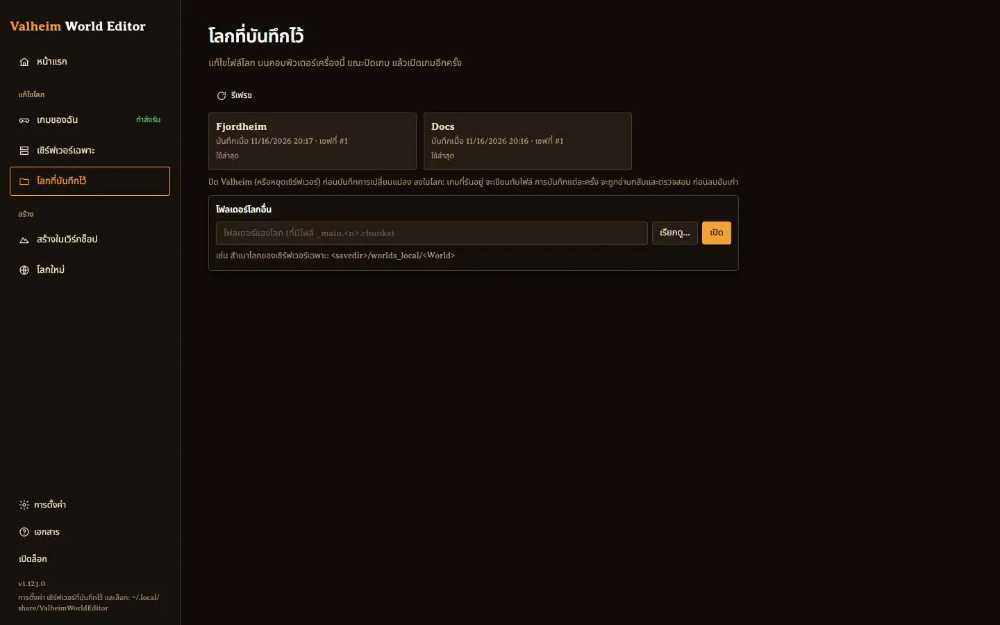

<!-- source: 289a125b -->
# เปิดโลกที่ไม่อยู่ในรายการ

เปิดโลกจากโฟลเดอร์ใดก็ได้ บนคอมพิวเตอร์เครื่องนี้: สำเนาโลกของเซิร์ฟเวอร์ ข้อมูลสำรอง หรือโลกบนไดรฟ์อื่น

**สิ่งที่ต้องมี:** โฟลเดอร์ของโลก (โฟลเดอร์ที่มีไฟล์ `_main.<n>.chunks`) และไม่มีเกม หรือเซิร์ฟเวอร์ใด
ที่กำลังรันโลกนั้น

1. ปิด Valheim หรือหยุดเซิร์ฟเวอร์ที่ใช้โลกนั้น: เกมที่กำลังรัน จะเขียนทับไฟล์ที่เอดิเตอร์บันทึก
2. สำหรับโลกของเซิร์ฟเวอร์เฉพาะ ให้คัดลอกโฟลเดอร์ `<savedir>/worlds_local/<World>` จากเซิร์ฟเวอร์
   มายังคอมพิวเตอร์เครื่องนี้
3. บนหน้าเริ่มต้น คลิก **โลกที่บันทึกไว้**
4. ใต้ **โฟลเดอร์โลกอื่น** คลิก **เรียกดู…** แล้วเลือกโฟลเดอร์ของโลก หรือวางพาธลงในช่อง
5. คลิก **เปิด** โลกจะเปิดบน [แผนที่](../map.md)
6. ไม่บังคับ: ถ้าต้องการให้โลก อยู่ในรายการทุกครั้ง ให้เปิด **การตั้งค่า** คลิก **เพิ่มโฟลเดอร์** ใต้ **โฟลเดอร์โลก**
   เลือกโฟลเดอร์ของโลก (หรือโฟลเดอร์ที่รวมโลก) ด้วย **เรียกดู…** แล้วกด **บันทึก**

*โลกที่เอดิเตอร์พบได้เอง ตามด้วย **โฟลเดอร์โลกอื่น** พร้อม **เรียกดู…** และ **เปิด***

## ตรวจว่าได้ผล

- แผนที่แสดงโลก พร้อมชื่อ และซีดที่ด้านบนของแผงด้านข้าง
- ใน **หน้าแรก** โลกจะอยู่ใต้ **ล่าสุด** ครั้งหน้าจึงเปิดได้ในคลิกเดียว
- เมื่อเพิ่มโฟลเดอร์ใน **การตั้งค่า** แล้ว **โลกที่บันทึกไว้** จะแสดงโลกนั้น โดยมี *ของคุณ* ใต้ชื่อ

## เลิกทำ

การเปิดโลก ไม่เปลี่ยนอะไรในโลก: มีแค่ **บันทึกลงโลก** ที่เขียนข้อมูล ถ้าต้องการเอาโฟลเดอร์ ออกจากรายการ ให้เปิด
**การตั้งค่า** คลิก **✕** ข้างโฟลเดอร์นั้น ใต้ **โฟลเดอร์โลก** แล้วกด **บันทึก**

## เคล็ดลับ

- เอดิเตอร์จะบอกว่า โฟลเดอร์มีปัญหาอะไร: "That folder holds worlds; pick one of them" (โฟลเดอร์นั้นมีหลายโลก:
  คุณเลือก `worlds_local` ให้เลือกโลกหนึ่งโลกข้างใน) หรือ "No Valheim world in that folder" (ไม่มีโลก Valheim
  ในโฟลเดอร์นั้น)
- โลกในรูปแบบไฟล์เดียวแบบเก่า (`<World>.db` และ `.fwl`) จะแสดงเป็นสีเทา: โหลดใน Valheim หนึ่งครั้ง
  แล้วเกมจะแปลงเป็นโฟลเดอร์โลก ที่เอดิเตอร์เปิดได้
- โลกที่สร้างด้วยม็อดสร้างโลก (Expand World, Riverheim) ต้องใช้แอดออนของม็อดนั้น: ดู
  [แก้ไขโลกที่สร้างด้วย Expand World, Riverheim หรือ Tunnelheim](use-mods-worlds.md)
- หลังแก้ไขโลกของเซิร์ฟเวอร์ที่นี่ ให้คัดลอกโฟลเดอร์ กลับไปที่เซิร์ฟเวอร์ ขณะที่เซิร์ฟเวอร์หยุดอยู่

## หัวข้อที่เกี่ยวข้อง

- [สำรองโลกก่อนแก้ไข](back-up-a-world.md)
- [แก้ไขเซิร์ฟเวอร์เฉพาะ ขณะที่มีคนเล่น](edit-a-server-live.md)
- [หน้าต่างเอดิเตอร์](../editor-basics.md)
- [แผนที่โลก](../map.md)
