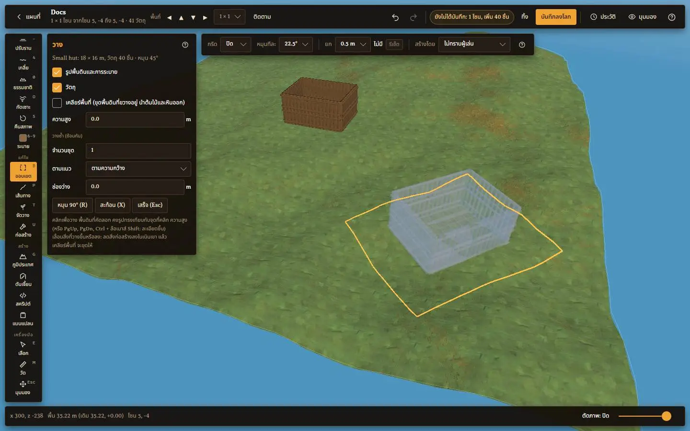

<!-- source: 45f0d395 -->
# วางพิมพ์เขียวลงในโลก

นำสิ่งก่อสร้าง จากคลังพิมพ์เขียวของคุณ (ที่สร้างในเวิร์กช็อป บันทึกจากโลก หรือนำเข้ามา) ไปใส่ในโลก

**สิ่งที่ต้องมี:** โลกที่เปิดอยู่ในเอดิเตอร์ โดยเปิดพื้นที่ที่จะวางสิ่งก่อสร้างไว้ และพิมพ์เขียวในคลัง
(ดู [เวิร์กช็อป](../workshop.md)) สำรองข้อมูลก่อน: ดู [สำรองโลก](back-up-a-world.md)

## ขั้นตอน

1. คลิก **แบบแปลน** บนแถบเครื่องมือ (ส่วน สร้าง)
2. ไม่บังคับ: ถ้าต้องการนำไฟล์ ที่มีคนส่งมาให้เข้ามา ให้คลิก **นำเข้าไฟล์…** แล้วเลือกไฟล์ `.blueprint` หรือ `.vbuild`
3. พิมพ์คำในชื่อ หรือแท็กของพิมพ์เขียว ใน **ค้นหาพิมพ์เขียว**
4. คลิก **วาง** ข้างพิมพ์เขียว แผงจะปิด และพิมพ์เขียวจะตามเคอร์เซอร์ แบบโปร่งใส
5. หมุนด้วย `R` (หนึ่งในสี่รอบ) หรือ `,` `.` (ตาม **หมุนทีละ** บนแถบก่อสร้าง) กด `X` เพื่อสะท้อน
6. ไม่บังคับ: ถ้าต้องการฝังลงในทางลาด ให้ลดลงด้วย `PgDn` (หรือ `Ctrl` + ล้อเมาส์) **เคลียร์พื้นที่** ในแผง วาง
   (เปิดอยู่ตั้งแต่แรก) จะขุดพื้นดินที่ขวางอยู่ และนำต้นไม้กับหินออก
7. คลิกตรงที่จะให้ตั้งอยู่ คลิกอีกครั้งที่อื่น เพื่อวางสำเนาเพิ่ม
8. กด `Esc` เพื่อหยุดวาง
9. คลิก **บันทึกลงโลก** (หรือ **นำไปใช้แบบไลฟ์**)

ชิ้นส่วนที่วางจะมีสิ่งที่พิมพ์เขียวมี: ของในหีบ ข้อความบนป้าย สิ่งมีชีวิต ผู้สร้างของชิ้นส่วน คือผู้เล่นที่เลือกไว้ใน
**สร้างโดย** บน [แถบก่อสร้าง](../build.md#แถบกอสราง) ซึ่งแสดงขณะวาง ส่วนชิ้นส่วนของซากปรักหักพัง
จะไม่มีผู้สร้าง ชิ้นส่วนจากม็อด ที่โลกนี้ไม่มี จะถูกข้ามไป และข้อความจะแสดงรายการไว้

*หลัง **วาง**: กระท่อมตามเคอร์เซอร์ แบบโปร่งใส มีเส้นรอบฐาน หมุน 45° (`หมุน 45°` ในแผง **วาง**)
**เคลียร์พื้นที่** ปิดอยู่ ด้านหลังคือกระท่อม ที่ใช้บันทึกพิมพ์เขียวนี้*

พิมพ์เขียวที่ทำเครื่องหมาย **ดันเจี้ยน** จะไม่ถูกวางบนพื้น: ทางเข้าจะไปอยู่ตรงที่คุณคลิก และตัวสิ่งก่อสร้าง
อยู่สูงขึ้นไป 5000 m ดู [ดันเจี้ยน](../dungeons.md)

## ตรวจว่าได้ผล

สิ่งก่อสร้างตั้งอยู่อย่างมั่นคง ตรงที่คุณคลิก มีจุดสีเขียว ที่ยังไม่บันทึก และแถบสถานะ บอกจำนวนวัตถุที่วาง
ดูใต้ขอบของสิ่งก่อสร้าง: ไม่ควรมีอะไรลอยอยู่ หลังบันทึก ให้เดินไปดูในเกม

## เลิกทำ

- ก่อนบันทึก: `Ctrl+Z` ย้อนการวางแต่ละครั้ง
- หลังบันทึก: ดู [เลิกทำขั้นตอน ย้อนการเปลี่ยนแปลงหนึ่งรายการ หรือทิ้งทั้งหมด](undo-changes.md)

## เคล็ดลับ

- สิ่งที่วาง ต้องอยู่ในพื้นที่ที่เปิดอยู่ ถ้าแสดง *ไม่ได้วาง* ให้เปิดพื้นที่ที่ใหญ่ขึ้น รอบตำแหน่งนั้น
- ชิ้นส่วนที่เอดิเตอร์วางได้เอง (รูปปั้น ของประกอบฉาก สิ่งมีชีวิต) ก็ถูกวางด้วย แม้ค้อนของ Homestead จะข้ามไป
- ถ้าต้องการแก้พิมพ์เขียวก่อน ให้คลิก **เปิด** เพื่อเปิดในเวิร์กช็อป
- ถ้าต้องการเก็บบางอย่างจากโลก เป็นพิมพ์เขียว: คัดลอกไว้ (เครื่องมือ ขอบเขต หรือ `Ctrl+C` ใน เลือก) แล้วคลิก
  **บันทึกเป็นพิมพ์เขียว…** ที่แถว **คลิปบอร์ด** ของแผง

## หัวข้อที่เกี่ยวข้อง

- [เวิร์กช็อป](../workshop.md) · [ขอบเขต](../area.md)
- [ย้ายหรือคัดลอกสิ่งก่อสร้าง](move-a-building.md)
- [ชิ้นส่วนที่ผู้เล่นสร้าง](../concepts/objects.md#ชนสวนทผเลนสราง)
