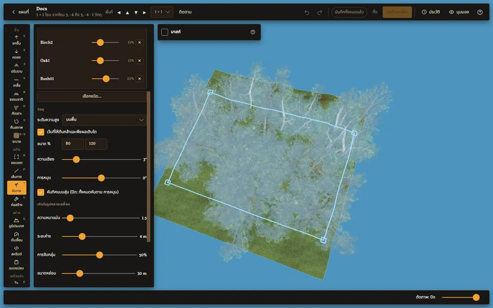

<!-- source: 78139bdb -->
# ปลูกป่า ไร่ หรือแนวพุ่มไม้

เติมผืนดิน ด้วยต้นไม้ที่ขึ้นเป็นดงตามธรรมชาติ ไร่พืชผลเป็นแถว หรือแนวพุ่มไม้ ตามเส้น

**สิ่งที่ต้องมี:** โลกที่เปิดในเอดิเตอร์ (สำรองก่อน: ดู [สำรองโลก](back-up-a-world.md))

## ป่า

1. กด `T` เพื่อเปิด [จัดวาง](../place.md)
2. ใต้ **เลือกพรีเซ็ต** เลือก **ป่าทุ่งหญ้า** (หรือ **แนวป่าดำ** **หนองน้ำ**)
3. ที่ด้านบนของแผง เลือก **รูปหลายเหลี่ยม**
4. คลิกจุดบนพื้นดิน รอบเส้นขอบของป่า หรือกดค้างแล้วลาก เพื่อวาดอย่างอิสระ
5. ไม่บังคับ: ใต้ **เติมในรูปหลายเหลี่ยม** เพิ่ม **การจับกลุ่ม** เป็นประมาณ 50% เพื่อให้เป็นดง มีที่โล่งคั่นระหว่างกัน และตั้ง **ขนาดหย่อม** ตามขนาดของดง ที่ต้องการ
6. กด `N` (**เลย์เอาต์ใหม่ (N)**) จนกว่าตัวอย่าง จะดูดี
7. กด `Enter` เพื่อปลูก
8. คลิก **บันทึกลงโลก** (หรือ **นำไปใช้แบบไลฟ์**)

*รูปหลายเหลี่ยมประมาณ 58 × 40 m ที่ **การจับกลุ่ม** 50% และ **ขนาดหย่อม** 30 m (และ **ความหนาแน่น** 1.5): ต้นไม้โปร่งใส รวมกันเป็นดง มีที่โล่งคั่นระหว่างกัน แถว **เติมในรูปหลายเหลี่ยม** อยู่ที่ด้านล่างของแผง*

## ไร่

1. ระบายไร่ด้วย **พรวนดิน** (แถบเครื่องมือ **ระบาย** หรือปุ่ม `7`): พืชผลขึ้นได้ เฉพาะบนดินพรวน
2. ใน จัดวาง คลิก **เลือกชนิด…** ค้นหา `carrot` ติ๊กพืชผลที่ต้องการ แล้วคลิก **เสร็จ**
3. เลือก **กริด** และตั้ง **ระยะห่าง** ใต้ **กริด** (1 m เหมาะกับแครอท)
4. ลากกล่องทับดินพรวน แล้วกด `Enter`

เปิด **เว้นที่ให้ต้นกล้าและพืชผลเติบโต** ไว้ เพื่อให้พืชผลทุกต้น มีที่ว่าง ที่เกมต้องการ สำหรับเติบโต

## แนวพุ่มไม้

1. ใน จัดวาง คลิก **เลือกชนิด…** ค้นหา `bush` และติ๊กพุ่มไม้หนึ่งหรือสองชนิด
2. เลือก **เส้น** แล้วเลือก **จุด**
3. คลิกจุดตามแนวพุ่มไม้ ตั้ง **ทุก** เป็นประมาณ 1.5 m และ **ความคดเคี้ยว** เป็น 0.25 m
4. กด `Enter`

## ตรวจว่าได้ผล

ตัวอย่างโปร่งใส จะทึบขึ้น ตรงที่คุณปลูก โดยมีจุดสีเขียว ที่บอกว่ายังไม่บันทึก บนวัตถุแต่ละชิ้น แถบสถานะบอกว่า วางวัตถุไปกี่ชิ้น ในเกม เดินไปที่นั่น หลังบันทึก

## เลิกทำ

- ก่อนบันทึก: `Ctrl+Z` ย้อนรูปหลายเหลี่ยม กริด เส้น หรือการลากแปรง ครั้งล่าสุด
- ถ้าจะนำออกบางส่วน: โหมด แปรง โดยติ๊กชนิดเดียวกันไว้ `Shift` + ลากทับวัตถุเหล่านั้น
- หลังบันทึก: ดู [เลิกทำขั้นตอน ย้อนการเปลี่ยนแปลงหนึ่งรายการ หรือทิ้งทั้งหมด](undo-changes.md)

## หัวข้อที่เกี่ยวข้อง

- [จัดวาง](../place.md)
- [กฎการเติบโต](../concepts/objects.md#กฎการเตบโต)
- [เคลียร์ต้นไม้และหิน ปรับพื้นที่ก่อสร้างให้ราบ](clear-an-area.md)
