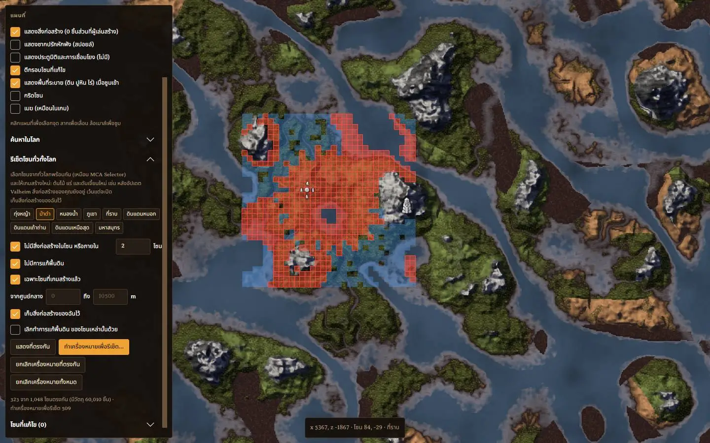

<!-- source: e87fa23c -->
# สร้างโซนใหม่

ให้เกมสร้างโซนที่เลือกใหม่จากซีด พร้อมต้นไม้ หิน แร่ และดันเจี้ยนใหม่ เช่น เพื่อให้ได้เนื้อหาใหม่ จากอัปเดตของ
Valheim ในที่ที่ยังไม่มีใครก่อสร้าง

**สิ่งที่ต้องมี:** โลกที่ปิดอยู่ในเกม (หรือหยุดเซิร์ฟเวอร์แล้ว) หรือ [โหมดไลฟ์](edit-a-server-live.md) และ
[ข้อมูลสำรองของโลก](back-up-a-world.md): การรีเซ็ตที่บันทึกแล้ว เลิกทำไม่ได้

1. ในเกม พาสัตว์ที่ฝึกแล้ว ออกจากที่ที่จะรีเซ็ต: ทุกอย่างในโซนที่รีเซ็ตจะหายไป ยกเว้นหลุมศพ และชิ้นส่วนที่ผู้เล่นสร้าง
   เมื่อเปิด **เก็บสิ่งก่อสร้างของฉันไว้** จากนั้นปิดเกม (หรือหยุดเซิร์ฟเวอร์) เว้นแต่คุณแก้ไขแบบไลฟ์
2. สำรองโลก
3. เปิดโลก [แผนที่](../map.md) ของโลกจะเปิดขึ้น
4. ในแผงด้านข้าง เปิด **รีเซ็ตโซนทั่วทั้งโลก**
5. ตั้งตัวกรอง: ไบโอมที่จะรีเซ็ต และเปิด **ไม่มีสิ่งก่อสร้างในโซน หรือภายใน N โซน** กับ **เก็บสิ่งก่อสร้างของฉันไว้**
   ไว้ เพื่อไม่ให้ฐานและผืนดินรอบๆ ถูกแตะต้อง ใช้ **จากศูนย์กลาง … ถึง … m** เพื่อรีเซ็ตเฉพาะบางส่วนของโลก
6. กด **แสดงที่ตรงกัน** ครั้งแรก เอดิเตอร์จะอ่านทุกโซน โซนที่ตรงกันจะเป็นสีน้ำเงิน และมีบรรทัดบอกว่า
   ตรงกันกี่โซน และมีวัตถุอยู่กี่ชิ้น
7. ปรับตัวกรอง จนโซนสีน้ำเงิน เป็นโซนที่คุณต้องการ
8. กด **ทำเครื่องหมายเพื่อรีเซ็ต…** คำถามจะบอกจำนวนโซน สิ่งที่จะหายไป และสิ่งก่อสร้างของคุณ ถูกเก็บไว้หรือไม่
   อ่านให้ดี แล้วยืนยัน โซนจะเปลี่ยนเป็นสีแดง
9. คลิก **บันทึกลงโลก** (หรือ **นำไปใช้แบบไลฟ์**)

*โซนสีน้ำเงินตรงกับตัวกรอง โซนสีแดงถูกทำเครื่องหมาย เพื่อรีเซ็ต*

ถ้าต้องการรีเซ็ตเฉพาะโซน ใต้ที่ใดที่หนึ่ง ให้ใช้เครื่องมือ [ขอบเขต](../area.md#รเซตโซน) แทน: วาดกล่องครอบโซนเหล่านั้น
เลือก **กู้คืน** แล้วเลือก **รีเซ็ตโซน** ใน **การกระทำ** และกด **รีเซ็ตโซน… (Enter)** เครื่องมือนี้มีสวิตช์
**เก็บสิ่งก่อสร้างของฉันไว้** และ **เลิกทำการแก้พื้นดิน ของโซนเหล่านั้นด้วย** เหมือนกับบนแผนที่

## ตรวจว่าได้ผล

- ก่อนบันทึก บรรทัดใต้ปุ่ม จะนับโซนที่ทำเครื่องหมาย เพื่อรีเซ็ต
- ในเกม ไปที่โซนที่รีเซ็ต: โซนจะถูกสร้างใหม่ เมื่อคุณเข้าใกล้ พร้อมต้นไม้ หิน และสถานที่ใหม่

## เลิกทำ

- **ก่อนบันทึก:** **ยกเลิกเครื่องหมายทั้งหมด** (บนแผนที่ หรือในเครื่องมือ ขอบเขต) จะยกเลิกการรีเซ็ต ที่ทำเครื่องหมายทั้งหมด
  และ **ยกเลิกเครื่องหมายที่ตรงกัน** จะยกเลิกเฉพาะโซน ที่ตรงกับตัวกรอง (โซนที่ทำเครื่องหมายด้วย **รีเซ็ตโซน**
  ของเครื่องมือ ขอบเขต: ใช้ `Ctrl+Z` ได้ด้วย)
- **หลังบันทึก:** เลิกทำในเอดิเตอร์ไม่ได้ ให้นำข้อมูลสำรองของโลก จากขั้นตอนที่ 2 กลับมาใช้ (ดู
  [สำรองโลกก่อนแก้ไข](back-up-a-world.md#เลกทำ))

## หัวข้อที่เกี่ยวข้อง

- [แผนที่โลก](../map.md#รเซตโซนทวทงโลก)
- [โซน](../concepts/areas-and-zones.md#โซน)
- [สำรองโลกก่อนแก้ไข](back-up-a-world.md)
