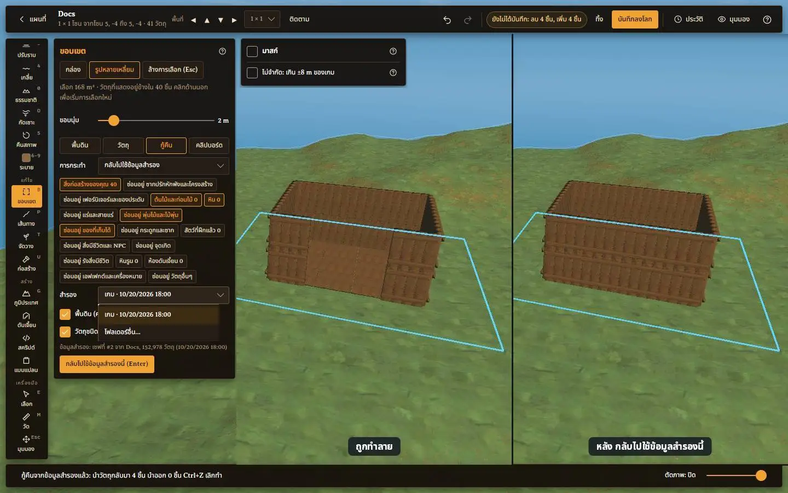

<!-- source: 0a333811 -->
# คืนสภาพพื้นที่หนึ่ง จากข้อมูลสำรอง

นำที่หนึ่งกลับเป็นแบบ ในข้อมูลสำรอง หลังการก่อกวน การบุกโจมตีที่เสียหายหนัก หรือการแก้ไขที่คุณเสียใจ โดยไม่ย้อนส่วนอื่นของโลก

**สิ่งที่ต้องมี:** ข้อมูลสำรองของโลก จากก่อนความเสียหาย: ข้อมูลสำรองของเกมเอง ข้างโฟลเดอร์โลก (`<World>_backup_auto-<date>`) หรือข้อมูลสำรองของเซิร์ฟเวอร์ ที่คัดลอกมาไว้ ในคอมพิวเตอร์เครื่องนี้ ปิดเกมไว้ หรือใช้ [โหมดไลฟ์](edit-a-server-live.md)

1. เปิดโลก และหาตำแหน่งนั้นบน [แผนที่](../map.md) กด **แก้ไขใน 3D**
2. กด `B` ([ขอบเขต](../area.md)) เลือก **รูปหลายเหลี่ยม** แล้วคลิกรอบที่ที่เสียหาย ให้กว้างกว่าเล็กน้อย
3. เลือก **กู้คืน** แล้วเลือก **กลับไปใช้ข้อมูลสำรอง** ใน **การกระทำ**
4. ใน **สำรอง** เลือกวันที่ก่อนความเสียหาย ("เกม · วันที่") สำหรับข้อมูลสำรองของเซิร์ฟเวอร์ หรือสำเนาอื่น ให้เลือก **โฟลเดอร์อื่น…** แล้วเลือกโฟลเดอร์นั้น (ในโหมดไลฟ์ นี่คือวิธีเดียว) บรรทัดข้างใต้ บอกว่าเป็นเซฟไหน
5. เลือกชิปชนิด ที่จะนำกลับมา สำหรับสิ่งก่อสร้าง ให้เปิด **สิ่งก่อสร้างของคุณ**
6. ติ๊ก **พื้นดิน (ความสูงและการระบาย)** และ **วัตถุชนิดที่เลือกไว้ด้านบน** ไว้ หรือเอาติ๊กออก จากอันที่คุณไม่ต้องการนำกลับมา
7. กด **กลับไปใช้ข้อมูลสำรองนี้ (Enter)**
8. ดูผลลัพธ์ ถ้าถูกต้อง ให้กด **บันทึกลงโลก** (หรือ **นำไปใช้แบบไลฟ์**)

*ซ้าย: รูปหลายเหลี่ยมรอบกระท่อม ที่ผนังด้านหน้าหายไปบางส่วน เลือก **กลับไปใช้ข้อมูลสำรอง** ไว้ รายการ **สำรอง** เปิดอยู่ ที่ข้อมูลสำรองของเกม และเปิด **สิ่งก่อสร้างของคุณ** ไว้ ขวา: หลัง **กลับไปใช้ข้อมูลสำรองนี้ (Enter)** ผนังกลับมาครบ บรรทัดเหนือปุ่ม บอกเซฟของข้อมูลสำรอง แถบสถานะนับสิ่งที่กลับมา*

## ตรวจว่าได้ผล

- แถบสถานะแสดง "กู้คืนจากข้อมูลสำรองแล้ว: พื้นดิน นำวัตถุกลับมา N ชิ้น นำออก M ชิ้น"
- "ไม่มีอะไรให้กู้คืน: ส่วนที่เลือก เหมือนในข้อมูลสำรองแล้ว" หมายความว่า ข้อมูลสำรองมีวัตถุ และพื้นดินตรงนั้น เหมือนกัน: ให้เลือกข้อมูลสำรอง ที่เก่ากว่า
- หีบที่คืนสภาพ จะมีของข้างในอีกครั้ง: คลิกหีบด้วย [เลือก](../select.md) (`E`) แล้วกด `I` เพื่อดูข้างใน

## เลิกทำ

`Ctrl+Z` ย้อนการคืนสภาพ: เป็นหนึ่งขั้นตอนใน ประวัติ หลังบันทึก ให้เลิกทำ แล้วบันทึกอีกครั้ง วัตถุของชนิดที่เลือก ที่ไม่อยู่ในข้อมูลสำรอง จะถูกนำออก ดังนั้นให้คืนสภาพอีกครั้ง จากข้อมูลสำรองที่ใหม่กว่า ถ้าคุณเสียสิ่งที่สร้างทีหลังไป

## หัวข้อที่เกี่ยวข้อง

- [ขอบเขต: กลับไปใช้ข้อมูลสำรอง](../area.md#กลบไปใชขอมลสำรอง)
- [สำรองโลกก่อนแก้ไข](back-up-a-world.md)
- [ข้อมูลสำรอง](../concepts/saving-and-history.md#ขอมลสำรอง)
