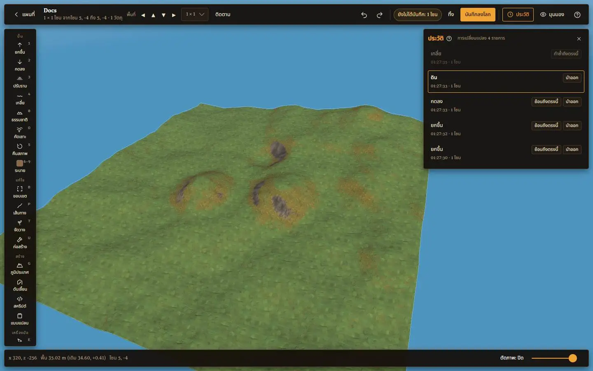

<!-- source: a0f30736 -->
# เลิกทำขั้นตอน ย้อนการเปลี่ยนแปลงหนึ่งรายการ หรือทิ้งทั้งหมด

ย้อนสิ่งที่คุณทำในเอดิเตอร์: ขั้นตอนล่าสุด การเปลี่ยนแปลงหนึ่งรายการ จากตรงกลาง โดยเก็บส่วนที่เหลือไว้ หรือทุกอย่างที่ยังไม่ได้บันทึก

**สิ่งที่ต้องมี:** โลกที่เปิดใน 3D (ที่บันทึกไว้ หรือไลฟ์) หรือเวิร์กช็อป ที่มีการเปลี่ยนแปลงใน **ประวัติ**

1. ถ้าจะเลิกทำการเปลี่ยนแปลงล่าสุด ให้กด `Ctrl+Z` (หรือลูกศรโค้ง ในแถบด้านบน) กดอีกครั้ง สำหรับขั้นตอนก่อนหน้า ข้อความเมื่อวางเมาส์บนลูกศร บอกชื่อขั้นตอน ที่จะเลิกทำ
2. ถ้าจะทำซ้ำสิ่งที่เพิ่งเลิกทำ ให้กด `Ctrl+Y` หรือ `Ctrl+Shift+Z`
3. ถ้าจะย้อนหลายขั้นตอนพร้อมกัน ให้เปิด **ประวัติ** (`L`) แล้วคลิก **ย้อนถึงตรงนี้** บนการเปลี่ยนแปลงสุดท้าย ที่จะเก็บไว้ รายการที่ตามมา จะเป็นสีเทา **ทำซ้ำถึงตรงนี้** บนรายการใดรายการหนึ่ง จะนำกลับมา
4. ถ้าจะย้อนการเปลี่ยนแปลง หนึ่งรายการ และเก็บทุกอย่างที่ทำหลังจากนั้นไว้ ให้คลิก **นำออก** บนการเปลี่ยนแปลงนั้น ใน **ประวัติ** รายการจะมีเส้นขีดทับ และการนำออก เป็นขั้นตอนของตัวเอง: `Ctrl+Z` นำการเปลี่ยนแปลงกลับมา
5. ถ้าจะย้อนทุกอย่างที่ Claude ทำ และเก็บการเปลี่ยนแปลง ของคุณเองไว้ ให้คลิก **ย้อนการเปลี่ยนแปลงของ Claude** ใน **ประวัติ** (แสดงเฉพาะเมื่อ Claude ทำการเปลี่ยนแปลง ในพื้นที่ที่เปิดอยู่) ทำในทุกพื้นที่ ที่ Claude เปลี่ยน: แถบสถานะบอกว่า การเปลี่ยนแปลงของ Claude ในพื้นที่อื่น ยังเก็บไว้กี่รายการ
6. ถ้าจะทิ้งทุกอย่าง ที่ยังไม่ได้บันทึก หรือนำไปใช้ ให้คลิก **ทิ้ง** ในแถบด้านบน แล้วยืนยัน การเปลี่ยนแปลงที่บันทึก และนำไปใช้แล้ว ยังอยู่: ขั้นตอนที่บันทึกแล้ว ที่คุณเลิกทำไว้ จะกลับมา ดังนั้นให้บันทึก หลังเลิกทำ ถ้าคุณต้องการให้หายไป
7. ถ้าจะย้อนการเปลี่ยนแปลง ที่บันทึกไปแล้ว ให้เลิกทำ (หรือ **นำออก**) แล้วกด **บันทึกลงโลก** อีกครั้ง ในโหมดไลฟ์ ให้เลิกทำ แล้วกด **นำไปใช้แบบไลฟ์** อีกครั้ง (หรือให้ **อัตโนมัติ** ส่งไป)

*ประวัติ: การเปลี่ยนแปลงล่าสุด ถูกเลิกทำด้วย **ย้อนถึงตรงนี้** เป็นสีเทา พร้อม **ทำซ้ำถึงตรงนี้***

> [!WARNING]
> การเปลี่ยนแปลงใหม่ ที่ทำหลังเลิกทำ จะทิ้งขั้นตอนสีเทา: ทำซ้ำขั้นตอนเหล่านั้นไม่ได้อีก การปิดเอดิเตอร์ จะทิ้งทุกการเปลี่ยนแปลง ที่คุณไม่ได้บันทึก หรือนำไปใช้

## ตรวจว่าได้ผล

- มุมมองแสดงพื้นดิน และวัตถุ แบบที่เคยเป็น และบรรทัดรอดำเนินการ ของแถบด้านบน นับได้น้อยลง (หรือแสดง "บันทึกทั้งหมดแล้ว")
- ใน **ประวัติ** แถวที่มีเส้นกรอบ คือขั้นตอนที่คุณย้อนไปถึง ขั้นตอนที่เลิกทำ เป็นสีเทา ขั้นตอนที่นำออก มีเส้นขีดทับ

## เลิกทำ

ทุกวิธีข้างต้น ย้อนกลับได้ จนกว่าคุณจะทำ การเปลี่ยนแปลงใหม่: `Ctrl+Y` ทำซ้ำการเลิกทำ **ทำซ้ำถึงตรงนี้** นำขั้นตอนสีเทากลับมา และ `Ctrl+Z` นำการเปลี่ยนแปลงที่นำออก กลับมา **ทิ้ง** ย้อนกลับไม่ได้: ด้วยเหตุนี้ จึงถามก่อน

## เคล็ดลับ

- ประวัติถูกเก็บไว้ หลังการบันทึก หรือการนำไปใช้แต่ละครั้ง: เปิดโลกอีกครั้ง แม้หลังปิดเอดิเตอร์ ขั้นตอนก็กลับมา พร้อมป้าย **เซสชันก่อน** ถ้าโลกเปลี่ยนไป ในระหว่างนั้น เอดิเตอร์จะถาม ก่อนเลิกทำ ดู [ประวัติ](../concepts/saving-and-history.md#ประวต)
- ขั้นตอนที่ทำในพื้นที่อื่น จะรออยู่ จนกว่าคุณจะเปิดพื้นที่ ที่มีขั้นตอนนั้น: แผงบอกจำนวน
- ถ้าจะย้อนไปไกลกว่า ประวัติ ของเอดิเตอร์ ให้ใช้สำเนาของโลก: ดู [สำรองโลกก่อนแก้ไข](back-up-a-world.md) หรือ [คืนสภาพพื้นที่หนึ่ง จากข้อมูลสำรอง](restore-from-backup.md)

## หัวข้อที่เกี่ยวข้อง

- [คืนสภาพพื้นที่หนึ่ง จากข้อมูลสำรอง](restore-from-backup.md)
- [สำรองโลกก่อนแก้ไข](back-up-a-world.md)
- [การบันทึกและประวัติ](../concepts/saving-and-history.md)
- [หน้าต่างเอดิเตอร์](../editor-basics.md#ประวต)
