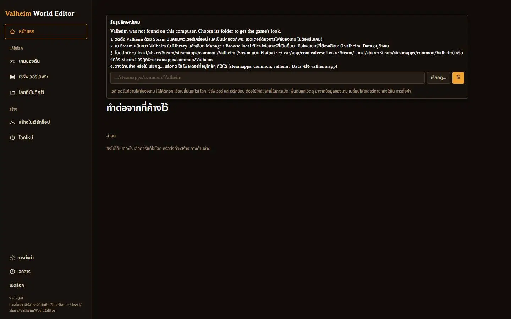
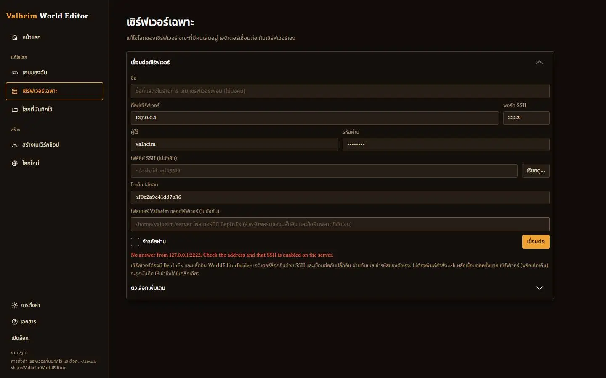
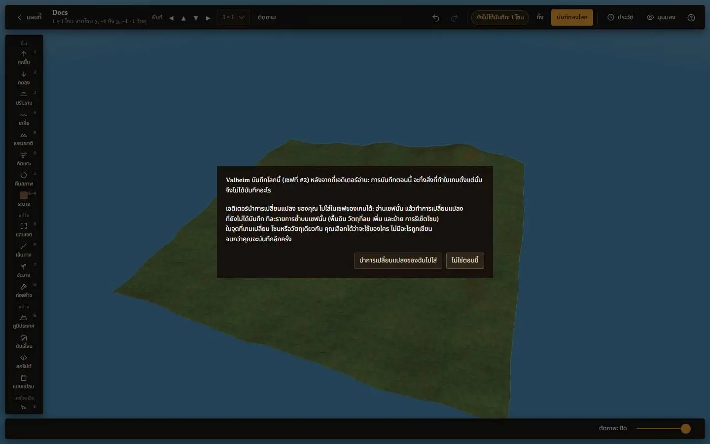

<!-- source: 5b752532 -->
# การแก้ปัญหา

หาสิ่งที่คุณเห็นในตาราง แล้วไปที่หัวข้อนั้น: แต่ละหัวข้อ บอกสาเหตุและวิธีแก้

| สิ่งที่คุณเห็น | ไปที่ |
|---|---|
| "ไม่พบ Valheim บนคอมพิวเตอร์เครื่องนี้" หรือเห็นกล่องแทนโมเดล | [ไม่พบ Valheim](#ไมพบ-valheim) |
| **เกมของฉัน** แสดงขั้นตอน หรือเกมที่รันอยู่ ไม่แสดงบน **หน้าแรก** | [เกมของฉัน แสดงขั้นตอนที่ต้องทำ](#เกมของฉน-แสดงขนตอนทตองทำ) |
| ข้อความใต้แบบฟอร์มเซิร์ฟเวอร์ หลังกด **เชื่อมต่อ** | [เซิร์ฟเวอร์เชื่อมต่อไม่ได้](#เซรฟเวอรเชอมตอไมได) |
| การ์ดโลกเป็นสีเทา หรือโลกเปิดไม่ได้ | [โลกเปิดไม่ได้หรือเป็นสีเทา](#โลกเปดไมไดหรอเปนสเทา) |
| การบันทึกจบด้วย "ไม่มีอะไรเปลี่ยน" หรือ "ไม่ได้บันทึก" | [การบันทึกบอกว่า ไม่มีอะไรเปลี่ยน](#การบนทกบอกวา-ไมมอะไรเปลยน) |
| "เกมบันทึกโลกนี้แล้ว" ตอนที่คุณบันทึก | [เกมบันทึกขณะที่คุณแก้ไข](#เกมบนทกขณะทคณแกไข) |
| ไลฟ์: ผู้เล่นไม่เห็นการเปลี่ยนแปลง หรือเอดิเตอร์ไม่เห็นของผู้เล่น | [การเปลี่ยนแปลงแบบไลฟ์ไม่แสดง](#การเปลยนแปลงแบบไลฟไมแสดง) |
| ภาพกะพริบ มีเส้น หรือมุมมอง 3D เป็นสีดำ บน Windows | [ภาพกะพริบหรือมีเส้น บน Windows](#ภาพกะพรบหรอมเสน-บน-windows) |
| "Windows protected your PC" หรือ macOS ไม่ยอมเปิดแอป | [Windows หรือ macOS บล็อกแอป](#windows-หรอ-macos-บลอกแอป) |
| Claude บอกว่าเข้าถึงเอดิเตอร์ไม่ได้ | [Claude เชื่อมต่อไม่ได้](#claude-เชอมตอไมได) |
| สคริปต์บอกว่า "ข้อผิดพลาด" หรือ "ไม่ได้เปลี่ยนอะไร" | [สคริปต์ล้มเหลว](#สครปตลมเหลว) |
| อย่างอื่น | [ล็อกและการรายงานบั๊ก](#ลอกและการรายงานบก) |

## ไม่พบ Valheim

เอดิเตอร์อ่านเท็กซ์เจอร์ โมเดล และภูมิประเทศของเกม จาก Valheim ที่ติดตั้งไว้ ถ้าไม่มี จะเปิดโลกหรือเวิร์กช็อปไม่ได้
หน้าเริ่มต้นจะแสดง **รับรูปลักษณ์เกม** พร้อม "ไม่พบ Valheim บนคอมพิวเตอร์เครื่องนี้"

1. ติดตั้ง Valheim ด้วย Steam บนคอมพิวเตอร์เครื่องนี้ แค่เป็นเจ้าของก็พอ: ไม่ต้องรันเกม
2. ใน Steam คลิกขวา Valheim ใน Library แล้วเลือก **Manage › Browse local files** โฟลเดอร์ที่เปิดขึ้นมา (โฟลเดอร์
   ที่มี `valheim_Data` หรือ `valheim.app` บน Mac) คือโฟลเดอร์ที่ต้องเลือก
3. วางพาธลงในการ์ด หรือใช้ **เรียกดู…** แล้วกด **ใช้** โฟลเดอร์ที่อยู่ใกล้ๆ ก็ใช้ได้ (`steamapps`, `common`,
   `valheim_Data`, `valheim.app`)

ตำแหน่งปกติ:

- Windows: `C:\Program Files (x86)\Steam\steamapps\common\Valheim`
- Linux: `~/.local/share/Steam/steamapps/common/Valheim` (Steam แบบ Flatpak:
  `~/.var/app/com.valvesoftware.Steam/.local/share/Steam/steamapps/common/Valheim`)
- macOS: `~/Library/Application Support/Steam/steamapps/common/Valheim`
- คลัง Steam อื่น: `<library>/steamapps/common/Valheim`

เปลี่ยนโฟลเดอร์ภายหลังได้ใน **การตั้งค่า** → **โฟลเดอร์เกม Valheim** (**ค้นหาอัตโนมัติ** ค้นหาคลัง Steam
อีกครั้ง) ถ้าการ์ดขึ้นว่า **อ่านรูปลักษณ์เกมไม่ได้** ให้กด **ลองอีกครั้ง** หรือตรวจโฟลเดอร์ใน การตั้งค่า
ถ้ายังล้มเหลวอีก ให้รายงานพร้อมล็อก ([ด้านล่าง](#ลอกและการรายงานบก))

*"ไม่พบ Valheim บนคอมพิวเตอร์เครื่องนี้": เลือกโฟลเดอร์ที่มี `valheim_Data` แล้วกด **ใช้***

## เกมของฉัน แสดงขั้นตอนที่ต้องทำ

**เกมของฉัน** บอกว่า Valheim ของคุณ ยังต้องมีอะไรอีก ก่อนที่ **แก้ไขแบบไลฟ์** จะปรากฏ:

| ข้อความ | สิ่งที่ต้องทำ |
|---|---|
| "เกมของคุณต้องมี BepInEx และปลั๊กอิน WorldEditorBridge" | ติดตั้งทั้งสองอย่าง: ดู [แก้ไขโลกที่คุณกำลังเล่น](../guides/edit-your-game-live.md) |
| "ติดตั้ง BepInEx แล้ว: เหลือเพียงขั้นตอนที่ 2 และ 3" | ใส่ปลั๊กอินลงใน `BepInEx/plugins` แล้วเปิด Valheim |
| "เปิด Valheim พร้อม BepInEx หนึ่งครั้ง" | ปลั๊กอินยังไม่เคยรัน เปิดเกมผ่าน BepInEx (**Start modded** ของตัวจัดการม็อด หรือสคริปต์เปิดของแพ็กบน Linux) ไม่ใช่ปุ่ม Steam ธรรมดา |
| "เปิด Valheim แล้วโหลดโลกของคุณ" | โหลดโลกในเกม (ผู้เล่นคนเดียว หรือโฮสต์เอง) เกมที่เข้าเซิร์ฟเวอร์ของคนอื่น แก้ไขไม่ได้ |

เอดิเตอร์ตรวจทุกๆ ไม่กี่วินาที โดยหาไฟล์การตั้งค่าของปลั๊กอิน ในทุกโฟลเดอร์ BepInEx ที่รู้จัก: โฟลเดอร์ Valheim
ของคุณ โปรไฟล์ตัวจัดการม็อด ที่ติดตั้งเอดิเตอร์ไว้ ทุกโปรไฟล์ของ r2modman และ Thunderstore Mod
Manager สำหรับ Valheim (บน Linux รวมถึง r2modman แบบ Flatpak) และโฟลเดอร์ใต้ **การตั้งค่า** → **โฟลเดอร์
BepInEx** ถ้าเกมหรือโปรไฟล์ของคุณ อยู่ที่อื่น ให้เพิ่มโฟลเดอร์ `BepInEx` โปรไฟล์ หรือโฟลเดอร์ที่รวมโปรไฟล์
ไว้ที่นั่น

**ยังไม่มีอะไรขึ้น ทั้งที่เกมรันอยู่?** ปลั๊กอินรอรับการเชื่อมต่อ ที่พอร์ต 5182 ถ้ามีโปรแกรมอื่นใช้พอร์ตนั้น (เช่น
ทันเนล `ssh -L 5182:…` ที่คุณเปิดเอง) ปลั๊กอินจะเริ่มทำงานไม่ได้ และ
`BepInEx/LogOutput.log` ของเกม จะมีบรรทัด `WorldEditorBridge: caught at … while listening on 127.0.0.1:5182 (the bridge does
not answer)` ปิดโปรแกรมนั้น หรือเปลี่ยน `Port` ใน[การตั้งค่าปลั๊กอิน](../live-mode.md#การตงคาปลกอน)

"ตรวจสอบเกมของคุณไม่ได้: …" หมายความว่า เอดิเตอร์อ่านโฟลเดอร์ BepInEx ไม่ได้: ส่วนที่เหลือของข้อความ บอก
สาเหตุ

## เซิร์ฟเวอร์เชื่อมต่อไม่ได้

ข้อความใต้แบบฟอร์ม บอกว่าเกิดอะไรผิดพลาด ข้อความที่ขึ้นต้นคล้ายกัน จะแสดงครั้งเดียว

| ข้อความ | สิ่งที่ต้องทำ |
|---|---|
| "ใส่ที่อยู่เซิร์ฟเวอร์" / "ใส่โทเค็นของปลั๊กอิน: …" | กรอก **ที่อยู่เซิร์ฟเวอร์** หรือ **โทเค็นปลั๊กอิน** |
| "The server refused the login: check the user name and the password or key." (เซิร์ฟเวอร์ปฏิเสธการล็อกอิน) | ตรวจ **ผู้ใช้** และ **รหัสผ่าน** หรือ **ไฟล์คีย์ SSH** คีย์ที่มีวลีรหัส ต้องใช้ **ตัวเลือกเพิ่มเติม** → **วลีรหัสของคีย์** |
| "No answer from <address>:<port>. Check the address and that SSH is enabled on the server." (ไม่มีการตอบกลับ) | ตรวจ **ที่อยู่เซิร์ฟเวอร์** และ **พอร์ต SSH** (22 ถ้าไม่ได้เปลี่ยน) และว่าเซิร์ฟเวอร์รับ SSH |
| "The server's identity changed (it was …, now …)." (ตัวตนของเซิร์ฟเวอร์เปลี่ยนไป) | ถ้าคุณติดตั้งเซิร์ฟเวอร์ใหม่ ให้ล้างบรรทัด `HostKey` ที่ข้อความระบุ ใน `servers.cfg` แล้วเชื่อมต่ออีกครั้ง ไม่เช่นนั้น อย่าเชื่อมต่อ: อาจมีคนแอบอ้าง เป็นเซิร์ฟเวอร์ของคุณ |
| "The server answered but refused the token." (เซิร์ฟเวอร์ปฏิเสธโทเค็น) | คัดลอกบรรทัด `Token` ของ `BepInEx/config/Tie.WorldEditorBridge.cfg` บนเซิร์ฟเวอร์อีกครั้ง ให้ครบทั้งบรรทัด |
| "That token cannot be sent (…)" (ส่งโทเค็นนั้นไม่ได้) | โทเค็นมีการขึ้นบรรทัดใหม่ หรือตัวอักษรแปลกปลอมอื่น: คัดลอกอีกครั้ง |
| "ทันเนลเปิดแล้ว แต่ปลั๊กอินบนเซิร์ฟเวอร์ไม่ตอบ: …" | เซิร์ฟเวอร์ไม่ได้รันอยู่ หรือไม่ได้รันพร้อม BepInEx และปลั๊กอิน กรอก **โฟลเดอร์ Valheim ของเซิร์ฟเวอร์ (ไม่บังคับ)** ในแบบฟอร์ม แล้วเชื่อมต่ออีกครั้ง เพื่อคำตอบที่แม่นยำ (ด้านล่าง) เซิร์ฟเวอร์ในคอนเทนเนอร์ (แผงควบคุมเกม เช่น Pterodactyl) จะไม่ตอบแบบนี้เลย: ดู [เซิร์ฟเวอร์ในคอนเทนเนอร์](../guides/edit-a-rented-server.md#เซรฟเวอรในคอนเทนเนอร) |
| "The plugin answered, but the game it runs in does not host the world" (เกมที่ปลั๊กอินรันอยู่ ไม่ได้โฮสต์โลก) | ปลั๊กอินอยู่ในเกม ที่เข้าเซิร์ฟเวอร์อื่น ติดตั้งปลั๊กอินบนเซิร์ฟเวอร์ ที่โฮสต์โลก |
| "The server answered with an error (…). Is it the WorldEditorBridge plugin?" (เซิร์ฟเวอร์ตอบกลับ ด้วยข้อผิดพลาด) | มีอย่างอื่นตอบอยู่ที่พอร์ตของปลั๊กอิน: ตรวจ **ตัวเลือกเพิ่มเติม** → **พอร์ตปลั๊กอิน** และ `Port` ในการตั้งค่าของปลั๊กอิน ถ้าเป็น 400 ผ่านทันเนล ไปยัง `BindAddress` ที่ไม่ใช่ `127.0.0.1`: ตั้ง `BindAddress = +` (ดู [เซิร์ฟเวอร์ในคอนเทนเนอร์](../guides/edit-a-rented-server.md#เซรฟเวอรในคอนเทนเนอร)) |
| "Could not connect: …" (เชื่อมต่อไม่ได้) | ความล้มเหลวอื่นๆ ส่วนที่เหลือของข้อความ บอกว่าเป็นอะไร |

เมื่อกรอก **โฟลเดอร์ Valheim ของเซิร์ฟเวอร์** ไว้ เอดิเตอร์จะเข้าไปดูที่นั่นผ่าน SSH และบอกว่าขาดอะไร อย่างแม่นยำ: "The
folder … does not exist on the server" (ไม่มีโฟลเดอร์) "BepInEx is not installed in …" (ไม่ได้ติดตั้ง BepInEx)
"The plugin is not in …/BepInEx/plugins" (ไม่มีปลั๊กอิน) "The plugin is installed but has never run: restart the
server with BepInEx" (ปลั๊กอินไม่เคยรัน) หรือ "The plugin is installed but does not answer: is the server running,
and started with BepInEx (not the plain start script)?" (ปลั๊กอินไม่ตอบ) ข้อความสุดท้ายนี้ บน
เซิร์ฟเวอร์ที่รันพร้อม BepInEx จริง มักหมายความว่า เซิร์ฟเวอร์รันในคอนเทนเนอร์ (Pterodactyl, Pelican, Docker): ดู
[เซิร์ฟเวอร์ในคอนเทนเนอร์](../guides/edit-a-rented-server.md#เซรฟเวอรในคอนเทนเนอร)

เซิร์ฟเวอร์เกม ที่เช่าจากผู้ให้บริการ ซึ่งมีแผงควบคุมบนเว็บและ FTP แต่ไม่มีการล็อกอิน SSH จะเข้าถึงแบบไลฟ์ไม่ได้:
ให้แก้ไขไฟล์ของโลกแทน แบบใน [เซิร์ฟเวอร์เกมที่เช่า](../guides/edit-a-rented-server.md#เซรฟเวอรเกมทเชา)

เมื่อใช้ **ฉันสร้างทันเนลเอง** ข้อความ "Nothing answers on 127.0.0.1:…" หรือ "No answer from 127.0.0.1:… within … s" (ไม่มีอะไรตอบ) หมายความว่า
ทันเนลของคุณไม่ได้เปิดอยู่ หรือเซิร์ฟเวอร์ ไม่ได้รันพร้อมปลั๊กอิน

*กด เชื่อมต่อ โดยไม่มีอะไรตอบที่ที่อยู่นั้น: "No answer from 127.0.0.1:2222. Check the address and that SSH
is enabled on the server." (ไม่มีการตอบกลับ) ตรวจ **ที่อยู่เซิร์ฟเวอร์** และ **พอร์ต SSH***

## โลกเปิดไม่ได้หรือเป็นสีเทา

การ์ดที่เป็นสีเทา ใต้ **โลกที่บันทึกไว้** จะบอกสาเหตุเป็นสีส้ม สาเหตุที่พบบ่อย:

- "Old save format: load this world in Valheim once, then it can be edited here." (รูปแบบเซฟเก่า:
  โหลดโลกนี้ใน Valheim หนึ่งครั้ง แล้วจึงแก้ไขที่นี่ได้) เกมจะแปลงโลกแบบไฟล์เดียว รุ่นเก่า
  ตอนโหลด
- "สร้างด้วยม็อดสร้างโลก (…) ที่ไม่มีแอดออนที่ใช้งานอยู่วาดได้" "… แอดออนถูกปิดอยู่" หรือ "… วาดได้ เมื่อ
  … อยู่ในโฟลเดอร์ปลั๊กอิน BepInEx": ติดตั้งแอดออน เปิดใช้ใน **การตั้งค่า → แอดออน** หรือเพิ่ม
  โฟลเดอร์ BepInEx ของม็อดใน การตั้งค่า ดู [แก้ไขโลกที่สร้างด้วย Expand World, Riverheim หรือ Tunnelheim](../guides/use-mods-worlds.md)
- โลก Riverheim ยังต้องมี Riverheim ที่รู้จักพรีเซ็ตของโลก (อัปเดตรุ่นเก่า) และ Riverheim 1.3 ขึ้นไป
  ต้องมี Worldhalla ในโฟลเดอร์ BepInEx เดียวกัน โลกที่สร้างด้วยรุ่นเบต้า ที่เลิกใช้แล้วของ Riverheim เปิดไม่ได้

สำหรับโฟลเดอร์ที่คุณพิมพ์ ใต้ **โฟลเดอร์โลกอื่น**: "That folder holds worlds; pick one of them (…)" (โฟลเดอร์นั้นมีหลายโลก) หมายความว่า คุณ
เลือกโฟลเดอร์ `worlds_local` แทนที่จะเป็นโลกเดียว "No Valheim world in that folder" (ไม่มีโลก Valheim ในโฟลเดอร์นั้น) หมายความว่า ไม่มีไฟล์
`_main.<n>.chunks` ดู [เปิดโลกที่ไม่อยู่ในรายการ](../guides/open-a-world.md)

"เปิดโลกไม่ได้: …" บอกสาเหตุหลังเครื่องหมายทวิภาค ล็อกมีรายละเอียด

## การบันทึกบอกว่า ไม่มีอะไรเปลี่ยน

เอดิเตอร์ตรวจการบันทึกทุกครั้ง ด้วยการอ่านกลับ: ถ้ามีอะไรผิด จะลบไฟล์ใหม่ และจบด้วย
"ไม่มีอะไรเปลี่ยน" โลกของคุณเหมือนเดิม และการเปลี่ยนแปลงของคุณ ยังอยู่ในเอดิเตอร์

| ข้อความ | สิ่งที่ต้องทำ |
|---|---|
| "ไม่มีการเปลี่ยนแปลง ที่ยังไม่ได้บันทึก" | ไม่มีอะไรรอบันทึก |
| "Valheim บันทึกโลกนี้ (เซฟที่ #…) หลังจากที่เอดิเตอร์อ่าน" | ดู [เกมบันทึกขณะที่คุณแก้ไข](#เกมบนทกขณะทคณแกไข) |
| "บันทึกล้มเหลว (…) ไม่มีอะไรเปลี่ยน" / "โลกที่บันทึกแล้ว อ่านกลับได้ไม่ถูกต้อง (…) ไม่มีอะไรเปลี่ยน" | ตรวจสาเหตุในวงเล็บ (ดิสก์เต็ม โฟลเดอร์ที่คุณเขียนไม่ได้) ปิด Valheim ถ้าใช้โลกนั้นอยู่ แล้วบันทึกอีกครั้ง |
| "โลกนี้ใช้รูปแบบเซฟ … เอดิเตอร์บันทึกได้เฉพาะรูปแบบ … ถึง …" | รูปแบบใหม่กว่า: อัปเดตเอดิเตอร์ รูปแบบเก่ากว่า: โหลดและบันทึกโลก ใน Valheim รุ่นล่าสุด แล้วเปิดอีกครั้ง |
| "ไม่ได้บันทึก: … zone …: not generated yet (…; visit it in game first)" (โซนยังไม่ถูกสร้าง) | ยังไม่มีผู้เล่นคนใดไปที่นั่น โลกจึงไม่มีข้อมูลให้เปลี่ยน เดินไปที่นั่นในเกม แล้วแก้ไขอีกครั้ง |
| "ไม่ได้บันทึก: … the world has no terrain object to copy yet (edit the ground once in game first)" (โลกยังไม่มีวัตถุภูมิประเทศ ให้คัดลอก) | ขุดหรือปรับพื้นให้ราบ ที่ใดก็ได้ในเกมหนึ่งครั้ง บันทึกเกม แล้วบันทึกอีกครั้ง |
| "บันทึกอะไรไม่ได้เลย" | ทุกอย่างอยู่ในรายการ "ไม่ได้บันทึก" ด้านบน |

การลากแปรงที่ไม่ทำอะไร พร้อม "ไม่มีอะไรเปลี่ยน: มาสก์ กันพื้นดินใต้แปรงออกทั้งหมด" คือ
[มาสก์](../masks.md) ทำงานอยู่: ตรวจการตั้งค่าความสูง ความชัน ไบโอม และการระบาย

## เกมบันทึกขณะที่คุณแก้ไข

เกมที่รันอยู่ เก็บโลกไว้ในหน่วยความจำ และเขียนทับไฟล์ ถ้าเกมบันทึก หลังจากที่เอดิเตอร์อ่านโลก
**บันทึกลงโลก** จะไม่บันทึกอะไร และถาม **เกมบันทึกโลกนี้แล้ว**:

1. กด **นำการเปลี่ยนแปลงของฉันไปใส่** เอดิเตอร์จะอ่านเซฟของเกม แล้วทำการเปลี่ยนแปลงของคุณ ทีละรายการซ้ำบนเซฟนั้น
2. ถ้าเกมเปลี่ยนโซนหรือวัตถุเดียวกัน จะถามหนึ่งครั้งต่อประเภท (พื้นดิน วัตถุที่เปลี่ยน วัตถุที่ถูกนำออก):
   **ใช้ของฉัน** หรือ **ใช้ของเกม**
3. ตรวจดูผลลัพธ์: ตอนนี้การเปลี่ยนแปลงของคุณ รออยู่บนเซฟของเกม ยังไม่มีอะไรถูกเขียน
4. ปิด Valheim (หรือหยุดเซิร์ฟเวอร์) แล้วกด **บันทึกลงโลก** อีกครั้ง

*การบันทึกถูกปฏิเสธ เพราะเกมบันทึกโลก หลังจากที่เอดิเตอร์อ่าน: **นำการเปลี่ยนแปลงของฉันไปใส่** ทำการเปลี่ยนแปลงของคุณซ้ำ บนเซฟของเกม*

**ไม่ใช่ตอนนี้** ปล่อยทุกอย่างไว้ตามเดิม การนำการเปลี่ยนแปลงไปใส่ อาจทิ้งขั้นตอนบางส่วนใน ประวัติ (ข้อความบอก
จำนวน)

เพื่อหลีกเลี่ยง ให้ปิดเกมก่อนบันทึก หรือแก้ไขแบบไลฟ์ ดูเพิ่มเติมใน
[การบันทึกโลก](../concepts/saving-and-history.md#การบนทกโลก)

## การเปลี่ยนแปลงแบบไลฟ์ไม่แสดง

- **ผู้เล่นไม่เห็นการเปลี่ยนแปลง ที่นำไปใช้แล้ว** ดู `BepInEx/LogOutput.log` ของเซิร์ฟเวอร์: บรรทัดหลังการนำไปใช้แต่ละครั้ง
  บอกว่าอะไรถูกทำลาย สร้าง และย้าย และมีอะไรสร้างวัตถุ ที่ถูกทำลายขึ้นมาใหม่หรือไม่ ดู
  [สิ่งที่ปลั๊กอินบันทึกลงล็อก](../live-mode.md#สงทปลกอนบนทกลงลอก)
- **"นำไปใช้แบบไลฟ์ไม่ได้: …" หรือ "เชื่อมต่อเกมไม่ได้: …"** เกมไม่ตอบภายใน 30 วินาที (กำลังโหลด
  หรือยุ่งอยู่) ไม่มีอะไรถูกทำ: กด **นำไปใช้แบบไลฟ์** อีกครั้ง
- **"ไม่ได้นำไปใช้: เกมเปลี่ยนพื้นดิน ในที่ที่คุณมีการเปลี่ยนแปลง"** คุณตอบ **ไม่ใช่ตอนนี้** กับ **นำไปใช้ทับ
  การเปลี่ยนแปลงของเกม**: นำไปใช้อีกครั้ง แล้วเลือก **นำไปใช้** หรือเลิกทำการเปลี่ยนแปลง ของคุณตรงนั้น
- **เอดิเตอร์ไม่เห็นสิ่งที่ผู้เล่นเปลี่ยน** และบอกว่า "ปลั๊กอิน WorldEditorBridge บนเซิร์ฟเวอร์ เก่ากว่าเอดิเตอร์นี้"
  อัปเดตปลั๊กอิน ระหว่างนี้ **โหลดใหม่** จะอ่านโลกอีกครั้ง

## ภาพกะพริบหรือมีเส้น บน Windows

บน Windows เอดิเตอร์วาดผ่าน Direct3D เหมือนเกมทั่วไป ถ้ามุมมอง 3D หรือแผนที่ กะพริบ มีเส้น
วาดผิด หรือช้า ให้ลองใช้ OpenGL ของไดรเวอร์การ์ดจอ:

1. ที่หน้าเริ่มต้น เปิด **การตั้งค่า**
2. ใต้ **การแสดงผล** เปิด **วาดด้วย OpenGL ของไดรเวอร์การ์ดจอ** แล้วกด **บันทึก**
3. ปิดเอดิเตอร์ แล้วเปิดอีกครั้ง

ถ้าแย่ลง ให้ปิดด้วยวิธีเดียวกัน การอัปเดตไดรเวอร์การ์ดจอ ก็ช่วยได้ การ์ด **การควบคุม** (`F3` ในมุมมอง
3D) แสดงใต้ **คอมพิวเตอร์เครื่องนี้** ว่าการ์ดจอ และ OpenGL เวอร์ชันใด วาดมุมมองอยู่

## Windows หรือ macOS บล็อกแอป

**Windows: "Windows protected your PC"** SmartScreen แสดงข้อความนี้ในครั้งแรก จนกว่าจะรู้จักลายเซ็น ของเอดิเตอร์
คลิก **More info** (แสดงผู้เผยแพร่) แล้วคลิก **Run anyway**

**macOS: "cannot be opened"** บิลด์ Mac มีการลงนาม แต่ไม่ได้ใช้ใบรับรอง Apple Developer macOS จึง
ตรวจไม่ได้ว่าใครสร้าง

1. ดับเบิลคลิก **ValheimWorldEditor.app** หนึ่งครั้ง แล้วปิดข้อความ
2. ใน **System Settings › Privacy & Security** คลิก **Open Anyway** ข้าง ValheimWorldEditor
3. หรือใน Terminal: `xattr -dr com.apple.quarantine /Applications/ValheimWorldEditor.app`

<!-- picture: os-blocked.jpg: two halves side by side: left, Windows SmartScreen "Windows protected your PC" after More info, showing the publisher and Run anyway; right, macOS System Settings › Privacy & Security scrolled to the "ValheimWorldEditor was blocked" line with Open Anyway -->

หลังจากนั้น จะเปิดได้ด้วยดับเบิลคลิก บิลด์ Mac ยังเป็นรุ่นทดลอง (Apple silicon, macOS 12 ขึ้นไป)

## Claude เชื่อมต่อไม่ได้

| ตรวจ | สิ่งที่ต้องทำ |
|---|---|
| เอดิเตอร์เปิดอยู่ | Claude เข้าถึงเอดิเตอร์ได้ เฉพาะขณะที่เอดิเตอร์เปิดอยู่ ให้เปิดเอดิเตอร์ |
| เปิด **อนุญาตให้ Claude เชื่อมต่อ** แล้ว | ใน **การตั้งค่า → Claude** เปิดสวิตช์นี้ แล้วกด **บันทึก** ส่วนนั้นควรขึ้นว่า "Listening on http://127.0.0.1:5731/mcp" (รอรับการเชื่อมต่อ) |
| "Could not listen on port …" (รอรับการเชื่อมต่อที่พอร์ตนั้นไม่ได้) | มีโปรแกรมอื่นใช้พอร์ตอยู่ เลือก **พอร์ต** อื่น กด **บันทึก** แล้วเพิ่มเอดิเตอร์ใน Claude อีกครั้ง ด้วยคำสั่งใหม่ |
| คุณกด **โทเค็นใหม่** | โทเค็นเก่าใช้ไม่ได้แล้ว: รันคำสั่ง Claude Code ใหม่อีกครั้ง |
| Claude Desktop | รีสตาร์ต หลังแก้ไขการกำหนดค่า ถ้าคุณย้ายโฟลเดอร์ของเอดิเตอร์ ให้คัดลอกบรรทัดจาก การตั้งค่า อีกครั้ง: บรรทัดเหล่านั้นมีพาธของโปรแกรม |
| Claude Code | `/mcp` ควรแสดง **valheim-editor** ว่าเชื่อมต่อแล้ว ถ้าไม่ ให้รันคำสั่งจาก การตั้งค่า อีกครั้ง |

Claude เชื่อมต่อแล้ว แต่ไม่เปลี่ยนอะไร? ขณะที่โลกแบบไลฟ์เปิด **อัตโนมัติ** อยู่ Claude เปลี่ยนได้แค่แผง มุมมอง: ปิด
อัตโนมัติ สคริปต์ต้องเปิด **Claude รันสคริปต์ได้** ดู [Claude](../claude.md)

## สคริปต์ล้มเหลว

ช่องผลลัพธ์ใต้สคริปต์ บอกว่าเกิดอะไรขึ้น และในทุกกรณี ไม่มีอะไรเปลี่ยน:

- "สคริปต์มีข้อผิดพลาด": ข้อผิดพลาดในการพิมพ์ หรือข้อผิดพลาด C# แสดงพร้อมบรรทัด (`line 4: The name 'Groud' does not exist
  in the current context`) แก้บรรทัดนั้น "สคริปต์ไม่มีคำสั่งให้รัน" ด้านล่าง หมายความว่าช่องว่างเปล่า หรือ
  มีแค่คอมเมนต์: เขียนโค้ดอย่างน้อยหนึ่งบรรทัด หรือโหลดตัวอย่าง
- "สคริปต์หยุดเพราะข้อผิดพลาด": ล้มเหลวระหว่างรัน ที่บรรทัดที่ระบุ (ชื่อวัตถุ ที่เอดิเตอร์สร้างไม่ได้
  พรีเซ็ตการระบายหรือภูเขา ที่ไม่รู้จัก ขนาด 0 หรือน้อยกว่า การหารด้วยศูนย์)
- "สคริปต์รันแล้ว และไม่ได้เปลี่ยนอะไร": ใช้ `Print` ตรวจว่าลูปของคุณ หาสิ่งที่คาดไว้เจอ
- "พื้นที่เปลี่ยนไป ระหว่างที่สคริปต์รัน": คุณแก้ไข เลิกทำ หรือบันทึก ระหว่างนั้น รันอีกครั้ง แล้วรอ
- "สคริปต์ถูกหยุด (หรือรันครบ 2 นาที)": ทำให้เบาลง เช่น `Area.Points(step: 4)`

ดูเพิ่มเติมใน [สคริปต์](../scripting.md#เมอมอะไรผดพลาด)

## ล็อกและการรายงานบั๊ก

ทุกอย่างที่เอดิเตอร์บอก จะไปอยู่ใน `ValheimWorldEditor.log` ซึ่งเริ่มใหม่ทุกครั้งที่รัน ในโฟลเดอร์ข้อมูลของเอดิเตอร์:

- Windows: `%LOCALAPPDATA%\ValheimWorldEditor`
- Linux: `~/.local/share/ValheimWorldEditor`
- macOS: `~/Library/Application Support/ValheimWorldEditor`

**เปิดล็อก** ที่ด้านล่างของเมนูด้านข้าง ในหน้าเริ่มต้น เปิดไฟล์นี้ และแสดงโฟลเดอร์ไว้ที่นั่นด้วย ข้อผิดพลาดทุกอย่าง
ที่เอดิเตอร์จัดการ คือบรรทัดที่ขึ้นต้นด้วย `Caught at` พร้อมตำแหน่งที่เกิด และสิ่งที่เอดิเตอร์กำลังทำ ข้อมูลส่วนตัว
จะถูกตัดออก: โฟลเดอร์บ้านของคุณ เขียนเป็น `~` และพาธ ที่อยู่ ชื่อบัญชี รหัสผ่าน และโทเค็น จะถูกแทนที่
ด้วยตัวยึดตำแหน่ง เช่น `<path>`

ถ้าจะรายงานปัญหา ให้[เปิด issue](https://github.com/Shuiei/valheim-world-editor/issues) พร้อม:

1. สิ่งที่คุณทำ และสิ่งที่คุณเห็น (ภาพหน้าจอช่วยได้)
2. ล็อกของเอดิเตอร์ จาก **เปิดล็อก** ทันทีหลังเกิดปัญหา (ก่อนเปิดเอดิเตอร์อีกครั้ง)
3. ไลฟ์: `BepInEx/LogOutput.log` ของเกมหรือเซิร์ฟเวอร์
4. สำหรับมุมมองที่ช้า: เปิด **บันทึกอัตราเฟรม** บนการ์ด **การควบคุม** (`F3`) ใช้มุมมอง แล้วแนบ
   `perf-native.log` จากโฟลเดอร์ข้อมูลเดียวกัน

พบปัญหาด้านความปลอดภัย? รายงานแบบส่วนตัว: ดู [SECURITY.md](../../../SECURITY.md)
