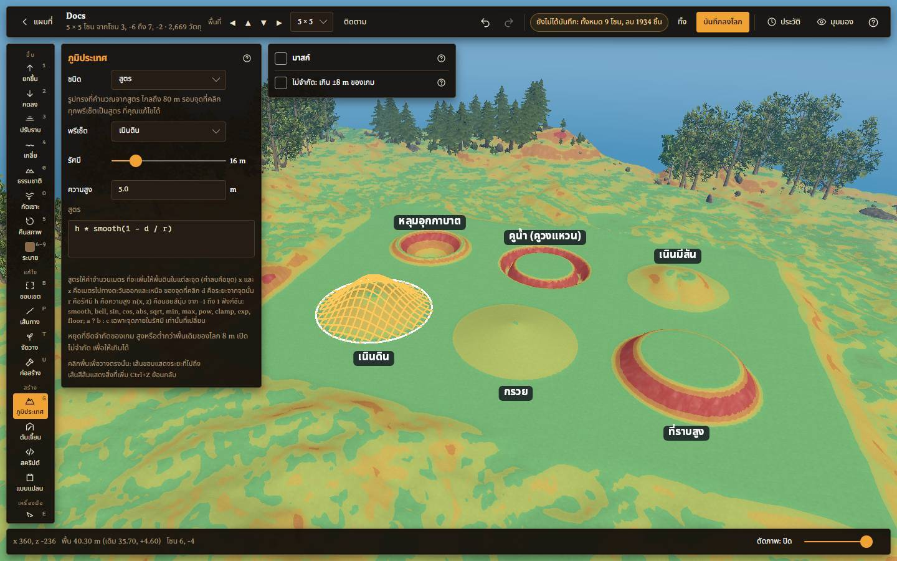
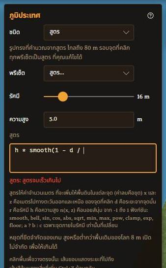
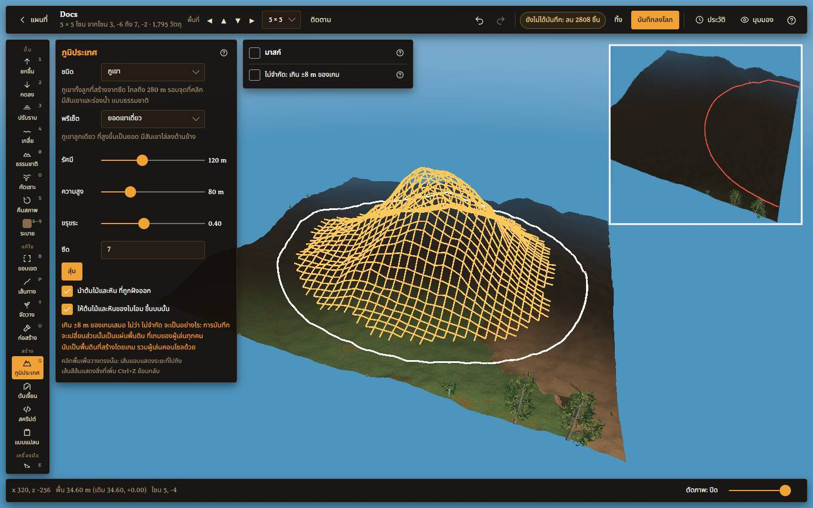
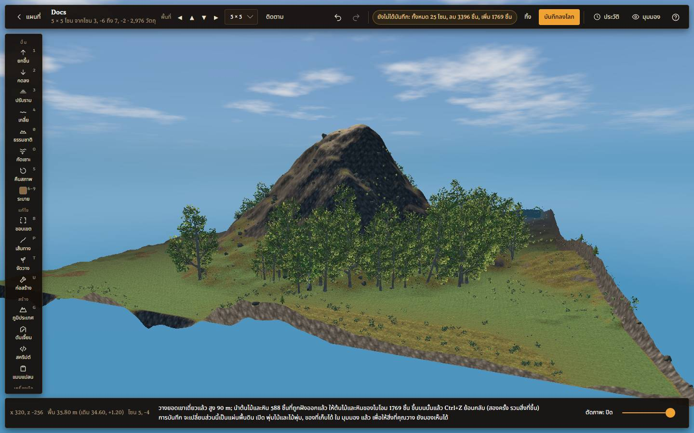
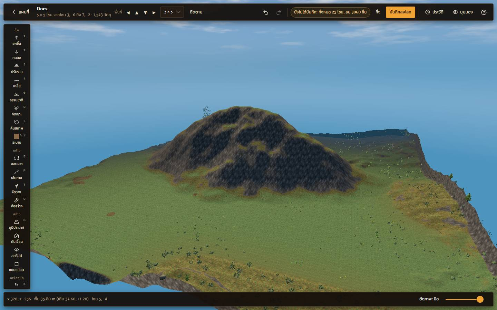
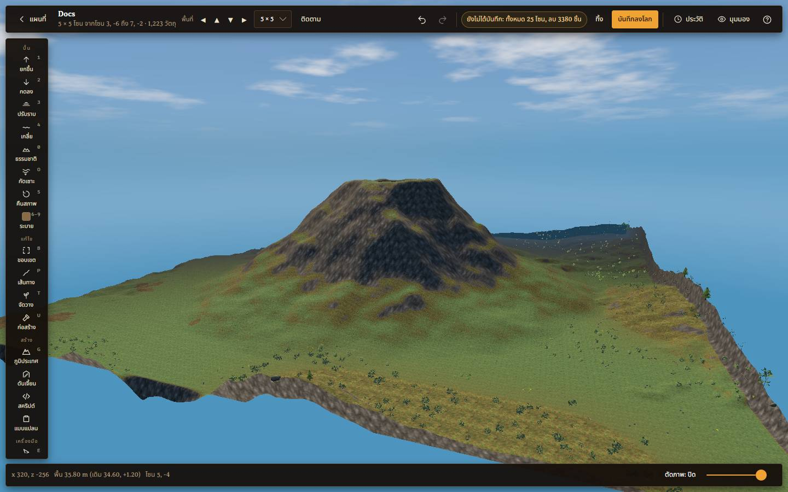
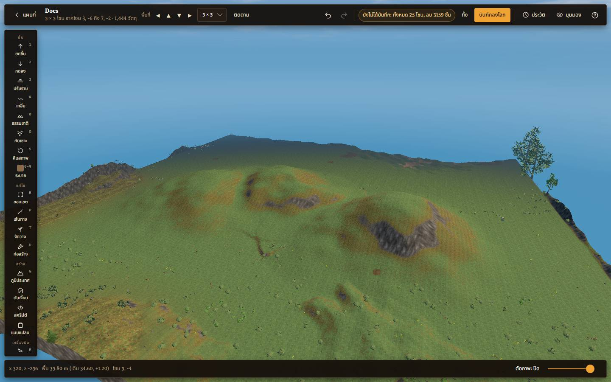
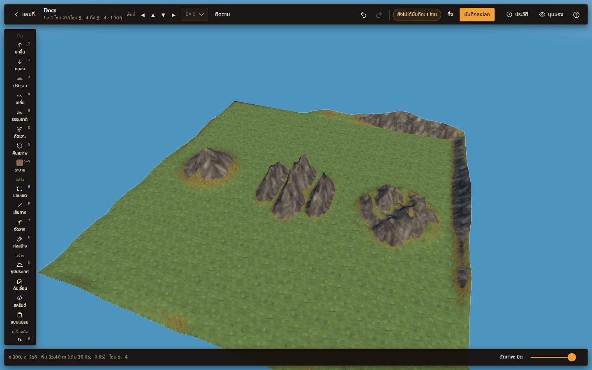
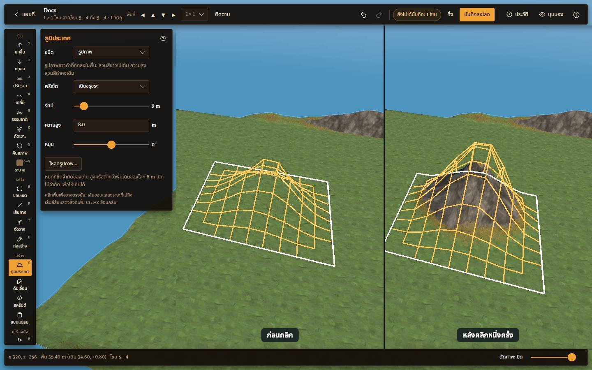

<!-- source: e6ef7a67 -->
# ภูมิประเทศ

ใส่ภูมิประเทศทั้งก้อน ลงในพื้นดินด้วยคลิกเดียว: เนินดินหรือหลุมอุกกาบาต ที่คำนวณจากสูตร ภูเขาที่สูงเกิน 8 m ของเกมไปมาก หรือรูปภาพของคุณเอง ที่กดลงไปในพื้น

**ที่อยู่:** แถบเครื่องมือ ส่วน **สร้าง** · **ปุ่ม:** `G` · **ใช้ได้กับ:** โลกที่บันทึกไว้ ไลฟ์

*ชนิด **สูตร** แถวหน้าจากซ้าย: เนินดิน กรวย ที่ราบสูง แถวหลังจากซ้าย: หลุมอุกกาบาต คูน้ำ (คูวงแหวน) เนินมีสัน แต่ละแบบใช้รัศมีเริ่มต้น 16 m และความสูง 5 m โดยเปิด **สีความชัน** ใน มุมมอง เพื่อให้อ่านความชันได้ แผงแสดง เนินดิน และสูตรของมัน บนเนิน เส้นขอบสีขาวคือรัศมี และเส้นสีส้ม คือสิ่งที่คลิกอีกครั้งจะเพิ่ม*

## ใช้งาน

1. ในแถบเครื่องมือ คลิก **ภูมิประเทศ** (`G`)
2. ในแผง เลือก **ชนิด**: **สูตร** **ภูเขา** หรือ **รูปภาพ** (ดู [สามชนิด](#สามชนด))
3. เลือก **พรีเซ็ต** แล้วตั้ง **รัศมี** และ **ความสูง**
4. เลื่อนตัวชี้ไปบนพื้นดิน เส้นขอบสีขาว แสดงว่าภูมิประเทศ แผ่ไปไกลแค่ไหน และเส้นสีส้ม แสดงสิ่งที่เพิ่ม สูงหรือลึก เท่าที่จะเป็นจริง
5. คลิก ภูมิประเทศจะถูกใส่ทันที
6. ยังไม่ใช่ `Ctrl+Z` ย้อนกลับ แต่ละคลิก เป็นการเลิกทำหนึ่งขั้นตอน ("ภูมิประเทศ: เนินดิน")

## สามชนิด

แต่ละชนิด มีพรีเซ็ตของตัวเอง ไม่มีพรีเซ็ตใด ที่มีชื่อซ้ำกันในสองชนิด ชื่อจึงบอกว่า คุณใช้ชนิดไหน

| ชนิด | สร้าง | รัศมี | ขีดจำกัด ±8 m ของเกม |
|---|---|---|---|
| **สูตร** | รูปทรงเรียบที่แม่นยำ คำนวณจากสูตร ที่คุณอ่านและเปลี่ยนได้ | 2 ถึง 80 m | เป็นไปตามขีดจำกัด เว้นแต่จะเปิด **ไม่จำกัด** |
| **ภูเขา** | ภูเขาธรรมชาติทั้งลูก จากซีด พร้อมสันเขาและร่องเขา และต้นไม้ที่ขึ้นอยู่ | 20 ถึง 280 m | เกินขีดจำกัดเสมอ |
| **รูปภาพ** | รูปภาพระดับสีเทา ที่กดลงไปในพื้น: รูปที่มีมาให้ หรือไฟล์รูปภาพใดก็ได้ | 2 ถึง 80 m | เป็นไปตามขีดจำกัด เว้นแต่จะเปิด **ไม่จำกัด** |

บรรทัดใกล้ด้านล่างของแผง บอกว่าชนิดที่คุณเลือก อยู่ในสถานะใด เทียบกับขีดจำกัดตอนนี้ บรรทัดจะเป็นสีเหลืองอำพัน เมื่อภูมิประเทศจะเกินขีดจำกัด ดู [ไม่จำกัด](terrain.md#ไมจำกด) เรื่องสวิตช์ และสิ่งที่การบันทึกทำ กับพื้นดินที่เกินขีดจำกัด

## การตั้งค่าที่ทุกชนิดมี

การตั้งค่าเหล่านี้ อยู่ที่เดียวกัน ใต้ชื่อเดียวกัน สำหรับทั้งสามชนิด แต่ละชนิดจำค่าของตัวเองไว้

| การตั้งค่า | สิ่งที่ทำ |
|---|---|
| **ชนิด** | ภูมิประเทศสร้างจากอะไร ระบบจำไว้ใช้ครั้งหน้า |
| **พรีเซ็ต** | ภูมิประเทศ: รายการของชนิดนั้นเอง |
| **รัศมี** | แผ่ไปไกลแค่ไหน จากจุดที่คลิก |
| **ความสูง** | สูงขึ้นแค่ไหน (m) สำหรับ **สูตร** และ **รูปภาพ** ความสูงติดลบ จะกลับหัว: เนินดินกลายเป็นหลุม คูน้ำกลายเป็นกำแพงวง |
| **หมุน** | ทิศทาง ในชนิดที่มี: สันเขาหรือเทือกเขาของ **ภูเขา** และ **รูปภาพ** ทุกรูป |

## สูตร

รูปทรงที่คำนวณทีละจุด พรีเซ็ตทุกอัน คือสูตรที่แสดงในช่อง เปลี่ยนสูตร แล้วรายการจะสลับเป็น **สูตร…** ซึ่งเป็นสูตรของคุณเอง ที่ระบบจำไว้ใช้ครั้งหน้า

| พรีเซ็ต | รูปทรง |
|---|---|
| **เนินดิน** | เนินกลมที่เรียบ |
| **กรวย** | ความชันตรง ไปถึงยอดแหลม |
| **ที่ราบสูง** | ยอดแบน มีทางลาดเรียบรอบๆ |
| **หลุมอุกกาบาต** | แอ่ง ที่มีขอบยกขึ้น |
| **คูน้ำ (คูวงแหวน)** | คูที่สามในสี่ของรัศมี เมื่อความสูงติดลบ จะเป็นกำแพงวง |
| **แอ่ง** | แอ่งกลม |
| **เนินมีสัน** | เนินดิน ที่มีสันพาดผ่าน |
| **สูตร…** | สูตรของคุณเอง |

| การตั้งค่า | สิ่งที่ทำ |
|---|---|
| **รัศมี** | 2 ถึง 80 m (ค่าเริ่มต้น 16 m) เฉพาะพื้นดินภายในรัศมี ที่เปลี่ยน |
| **ความสูง** | ค่าเริ่มต้น 5 m คือ `h` ในสูตร |
| **สูตร** | จำนวนเมตร ที่จะเพิ่มให้พื้นดิน ในแต่ละจุดภายในรัศมี ตัวเลขติดลบคือการขุด ข้อผิดพลาดจะแสดงใต้ช่อง และวางอะไรไม่ได้ จนกว่าจะแก้ |

*สูตรที่ยังไม่เสร็จ: รายการสลับเป็น **สูตร…** และบรรทัดใต้ช่อง บอกว่าผิดตรงไหน ("สูตรจบเร็วเกินไป")*

### เขียนสูตร

สูตรถูกคำนวณ สำหรับจุดพื้นดินทุกจุด ภายในรัศมี และผลลัพธ์ จะถูกเพิ่มให้พื้นดินตรงนั้น

| ชื่อ | ความหมาย |
|---|---|
| `x`, `z` | เมตรไปทางตะวันออก และทางเหนือ ของจุดที่คลิก |
| `d`, `r`, `h` | ระยะจากจุดที่คลิก รัศมี ความสูง |
| `n(x, z)` | สัญญาณรบกวนแบบเรียบ ประมาณ -1 ถึง 1 จากลวดลายของแปรง (**ลวดลายใหม่** ใน [ธรรมชาติ](terrain.md#ธรรมชาต) จะเปลี่ยนลวดลาย) ใช้ `n(x / 10, z / 10)` สำหรับเนินกว้าง |
| `pi` | 3.14159… |

ฟังก์ชัน: `abs`, `atan2(y, x)`, `bell(t)` (1 ที่ 0 จางหายไป ที่ประมาณ ±1), `ceil`, `clamp(v, a, b)`, `cos`, `exp`, `floor`, `log`, `max(…)` และ `min(…)` (กี่ค่าก็ได้), `pow(a, b)`, `round`, `sign`, `sin`, `smooth(t)` (0 เมื่อต่ำกว่า 0 1 เมื่อสูงกว่า 1 เป็นรูปตัว S เรียบ ในช่วงระหว่าง), `sqrt`, `tan`

ตัวดำเนินการ: `+ - * / %`, `^` (ยกกำลัง) การเปรียบเทียบ `< > <= >= == !=` (1 หรือ 0), `&&`, `||`, `!` และ `a ? b : c`

พรีเซ็ตแสดงให้เห็นว่า สูตรทำงานอย่างไร:

| พรีเซ็ต | สูตร |
|---|---|
| **เนินดิน** | `h * smooth(1 - d / r)` |
| **กรวย** | `h * max(0, 1 - d / r)` |
| **ที่ราบสูง** | `h * smooth((r - d) / (0.35 * r))` |
| **แอ่ง** | `-h * smooth(1 - (d / r) ^ 2)` |
| **คูน้ำ (คูวงแหวน)** | `-h * bell((d - 0.75 * r) / (0.12 * r))`: คูที่สามในสี่ของรัศมี |

อีกสองสูตร สำหรับเริ่มต้น: `h * smooth(1 - d / r) * (1 + 0.3 * n(x / 8, z / 8))` คือเนินขรุขระ และ `abs(x) < 3 ? -h : 0` ขุดร่องกว้าง 6 m พาดผ่านวงกลม

## ภูเขา

ภูเขาทั้งลูก ที่สร้างจากซีด เพิ่มลงบนพื้นดินที่มีอยู่ จึงยังคงลักษณะเดิมของพื้นที่ และค่อยๆ กลืนกลับไปที่ขอบ เส้นรอบของภูเขา ไม่เคยเป็นวงกลมสมบูรณ์ และ **ขรุขระ** จะเพิ่มเนินนูน สันเขา และร่องเขา ตามสัดส่วนขนาด

*ยอดเขาเดี่ยว สูง 80 m รัศมี 120 m ก่อนคลิก: เส้นสีส้มแสดงความสูง เท่าที่ภูเขาจะสูงขึ้นจริง และวงสีขาว แสดงว่าแผ่ไปไกลแค่ไหน ภาพเล็ก มุมขวาบน: เมื่อตัวชี้อยู่ใกล้ขอบพื้นที่ วงจะเป็นสีแดง และไม่แสดงตัวอย่าง เพราะใส่ไม่พอดี*

| พรีเซ็ต | ความสูง / รัศมีที่สุ่ม | รูปทรง |
|---|---|---|
| **ยอดเขาเดี่ยว** | 50–110 m / 120–240 m | ภูเขาลูกเดียว สูงขึ้นไปถึงยอด มีสันเขาลงมาตามด้านข้าง |
| **สันเขา** | 35–80 m / 140–260 m | สันยาว กว้างครึ่งหนึ่งของความยาว |
| **เทือกเขา** | 40–90 m / 180–280 m | ยอดเขาสามถึงห้ายอด เรียงเป็นแนว เชื่อมกันด้วยคอเขา |
| **เมซา** | 20–50 m / 70–150 m | ยอดแบน ด้านข้างชัน เป็นหิน: มีที่ให้สร้างบนนั้น ความขรุขระ มีเฉพาะด้านข้าง |
| **ภูเขาไฟ** | 45–100 m / 130–240 m | กรวย ที่มีปล่องที่ยอด |
| **เนินเขาลูกคลื่น** | 12–30 m / 100–220 m | เนินเขาลาดเอียงสามถึงหกลูก รวมกัน |

| ยอดเขาเดี่ยว | สันเขา |
|---|---|
|  |  |
| **ภูเขาไฟ** | **เนินเขาลูกคลื่น** |
|  |  |

*พรีเซ็ตสี่แบบ กลางพื้นที่ 5 × 5 ที่เคลียร์และปรับราบไว้ก่อน เพื่อให้แต่ละแบบเด่นชัด ยอดเขาเดี่ยว มีต้นไม้ของไบโอมขึ้นอยู่ แบบอื่นๆ ปล่อยโล่งไว้ เพื่อให้เห็นรูปทรง*

| การตั้งค่า | สิ่งที่ทำ |
|---|---|
| **พรีเซ็ต** | ชนิดของภูเขา การเลือกพรีเซ็ต จะสุ่มภูเขาใหม่ของพรีเซ็ตนั้น แบบเดียวกับ **สุ่ม** |
| **รัศมี** | 20 ถึง 280 m เส้นรอบไม่เรียบ อาจไกลกว่านั้นถึง 15%: วงจะแสดงไว้ |
| **ความสูง** | สูงขึ้นจากพื้นดินตรงนั้นแค่ไหน 5 ถึง 300 m |
| **หมุน** | เฉพาะ **สันเขา** และ **เทือกเขา**: ทิศที่ทอดไป 0° ถึง 179° |
| **ขรุขระ** | 0: ความชันเรียบ 1: ร่องเขาและสันเขาลึก |
| **ซีด** | ตัวเลขที่รายละเอียดมาจาก: พรีเซ็ต ค่า และซีดเดียวกัน สร้างภูเขาลูกเดิมอีกครั้ง |
| **สุ่ม** | ภูเขาใหม่ของพรีเซ็ต: ขนาด ความขรุขระ ทิศทาง และซีดใหม่ ถ้าใส่ไม่พอดี ในพื้นที่ที่เปิดอยู่ จะถูกย่อลงทั้งลูก รวมความสูงด้วย เพื่อให้ความชัน ยังลาดเท่าเดิม |
| **นำต้นไม้และหิน ที่ถูกฝังออก** | ตอนแรกเปิดอยู่ ต้นไม้ หิน แร่ พุ่มไม้ และของที่เก็บได้ ในที่ที่ภูเขายกพื้นขึ้นเกิน 2 m จะถูกนำออก (การบันทึกก็จะทำอยู่ดี) ชิ้นส่วนก่อสร้างยังอยู่ และสิ่งที่อยู่ในดันเจี้ยน สูงขึ้นไปข้างบน ก็เช่นกัน |
| **ให้ต้นไม้และหินของไบโอม ขึ้นบนนั้น** | ตอนแรกเปิดอยู่ ปลูกต้นไม้และหินของไบโอมเอง ตามกฎของเกม บนไหล่เขา ที่ภูเขายกขึ้นเกินหนึ่งเมตร ห่างจากสิ่งที่อยู่ตรงนั้นแล้ว เป็นการเลิกทำขั้นตอนที่สอง |

ภูเขาต้องอยู่ในพื้นที่ที่เปิดอยู่ ทั้งลูก รวมขอบที่ไม่เรียบด้วย: ตรงที่วงเป็นสีแดง การคลิกจะไม่ใส่อะไร

## รูปภาพ

รูปภาพระดับสีเทา ที่กดลงไปในพื้นดิน: ส่วนสีขาว สูงเต็ม **ความสูง** ส่วนสีเทา สูงบางส่วน ส่วนสีดำ คงเดิม รูปภาพครอบคลุมสี่เหลี่ยมจัตุรัส ที่กว้างสองเท่าของ **รัศมี** เส้นขอบแสดงไว้

*รูปภาพที่มีมาให้ สูง 6 m ที่รัศมี 8 m จากซ้าย: เนินขรุขระ เนินทราย พื้นหิน*

***เนินขรุขระ** **รัศมี** 9 m และ **ความสูง** 8 m ซ้าย: เส้นขอบสี่เหลี่ยม และตัวอย่างสีส้มบนพื้นราบ ก่อนคลิก ขวา: เนินทั้งลูก ที่ใส่ด้วยคลิกเดียว*

| พรีเซ็ต | รูปทรง |
|---|---|
| **เนินขรุขระ** | ยอดเขาเล็ก ด้านข้างขรุขระ |
| **เนินทราย** | สันขนานกัน ในหย่อมวงกลม |
| **พื้นหิน** | พื้นเป็นก้อน แตกระแหง |
| ของคุณเอง | รูปภาพทุกรูป ที่คุณโหลด ตามชื่อไฟล์ |

| การตั้งค่า | สิ่งที่ทำ |
|---|---|
| **รัศมี** | ครึ่งหนึ่งของด้านรูปภาพ 2 ถึง 80 m (ค่าเริ่มต้น 16 m) |
| **ความสูง** | ส่วนสีขาวสูงขึ้นแค่ไหน (m ค่าเริ่มต้น 4) ติดลบ: กดลงแทน |
| **หมุน** | หมุนรูปภาพ -180° ถึง 180° |
| **โหลดรูปภาพ…** | ใช้รูปภาพใดก็ได้ (PNG, JPEG…): แผนที่ความสูง จากเครื่องมืออื่น โลโก้ รูปทรงที่วาดด้วยมือ ความสว่าง คือความสูง ส่วนที่โปร่งใส นับเป็นสีดำ ถูกปรับขนาด เป็นสี่เหลี่ยม 128 × 128 จุด ดังนั้นรูปภาพกว้าง จะถูกบีบ และรายละเอียดเล็กๆ จะหายไป เก็บไว้ใช้ครั้งหน้า ตามชื่อไฟล์ |
| **ลืมรูปภาพ** | นำรูปภาพที่โหลดไว้ ที่เลือกอยู่ออก แสดงเฉพาะรูปภาพที่โหลดไว้: รูปที่มีมาให้ ยังอยู่ |

รูปภาพเหล่านี้ คือ [แสตมป์](terrain.md#แสตมป) ของแปรง: รูปที่คุณโหลดที่นี่ ก็เป็นรูปทรงของแปรงด้วย และรูปที่โหลดที่นั่น ก็มีให้เลือกที่นี่ แสตมป์ที่มีมาให้สองแบบ **เมซา (ยอดแบน)** และ **ขอบหลุมอุกกาบาต** เป็นรูปทรงของแปรงเท่านั้น: ในแบบภูมิประเทศ ชนิด **สูตร** สร้างได้ (**ที่ราบสูง** และ **คูน้ำ** ที่ความสูงติดลบ)

## ปุ่มลัด

| ปุ่มหรือเมาส์ | สิ่งที่ทำ |
|---|---|
| `G` | เลือก ภูมิประเทศ |
| คลิกพื้นดิน | ใส่ภูมิประเทศตรงนั้น |
| `Ctrl+Z` | ย้อนอันล่าสุด (กดสองครั้ง เมื่อมีต้นไม้ขึ้นบนภูเขา) |
| `Esc` | ออกจากเครื่องมือ (กลับไปที่ มุมมอง) |

## เคล็ดลับและข้อจำกัด

- **สูตร และ รูปภาพ หยุดที่ 8 m จากพื้นดินที่ถูกสร้าง** และแถบสถานะบอกไว้ สำหรับที่สูงกว่านั้น ให้ติ๊ก **ไม่จำกัด: เกิน ±8 m ของเกม** บนการ์ด **มาสก์** ข้างแผง (ดู [ไม่จำกัด](terrain.md#ไมจำกด)): สวิตช์จะเปิดค้างไว้ สำหรับเครื่องมือพื้นดินทุกอัน จนกว่าคุณจะปิด
- **ภูเขาเกิน 8 m ของเกมเสมอ** ไม่ว่า **ไม่จำกัด** จะตั้งไว้อย่างไร การบันทึก จะเปลี่ยนภูเขาเป็นแผ่นพื้นดิน และล้าง ประวัติ ของพื้นที่ เหมือน [ไม่จำกัด](terrain.md#ไมจำกด) ตรวจดูก่อนบันทึก
- **สำหรับภูเขาใหญ่ เปิดพื้นที่ที่ใหญ่ขึ้นก่อน** (รายการขนาดพื้นที่ ในแถบด้านบน): ในพื้นที่ 5 × 5 รัศมีได้ถึงประมาณ 137 m
- **[มาสก์](masks.md) มีผล**: ตรงที่มาสก์กันพื้นดินออก ภูมิประเทศจะหยุดเป็นขั้น ภูเขาจะหยุดเป็นหน้าผา
- **สูตรที่ให้ค่า 0 ทุกที่** ไม่เปลี่ยนอะไร และแถบสถานะบอกไว้ จุดที่สูตรไม่ให้ตัวเลข (หารด้วยศูนย์) จะคงเดิม
- **แนวจุดด้านนอกสุดของพื้นที่ ไม่เคยเปลี่ยน** (ดู [ขอบที่ล็อก](concepts/areas-and-zones.md#ขอบทลอก))
- **ถ้าจะทำให้ขอบนุ่มลง** ภายหลัง ให้ใช้แปรง **เกลี่ย** หรือ **ธรรมชาติ** ผ่านขอบนั้น
- **ความชันน้อย ยังมีหญ้าและต้นไม้ ความชันมาก จะเห็นหินเปลือย** แบบที่เกมวาด
- **ถ้าจะใช้รูปภาพเป็นแปรง** ขณะลาก ให้เลือกรูปนั้น เป็น **รูปทรง** ของแปรงแทน (ดู [แสตมป์](terrain.md#แสตมป)) ถ้าจะตั้งความสูงของทั้งพื้นที่ จากรูปภาพ ดู [แผนที่ความสูง](area.md#แผนทความสง)
- **[สคริปต์](scripting.md)** วางรูปทรงจากสูตร และภูเขาได้เช่นกัน ตามกฎที่กำหนด

## หัวข้อที่เกี่ยวข้อง

- [ยกหรือขุดเกินขีดจำกัด 8 m ของเกม](guides/raise-past-the-limit.md)
- [ไม่จำกัด](concepts/ground-limits.md#ไมจำกด): วิธีบันทึกพื้นดิน ที่เกิน 8 m
- [ภูเขาถูกสร้างอย่างไร](concepts/ground-limits.md#ภเขาสรางอยางไร)
- [กฎการเติบโต](concepts/objects.md#กฎการเตบโต): อะไรขึ้นบนภูเขาได้
- [ปั้นและระบาย](terrain.md): แปรงและแสตมป์
