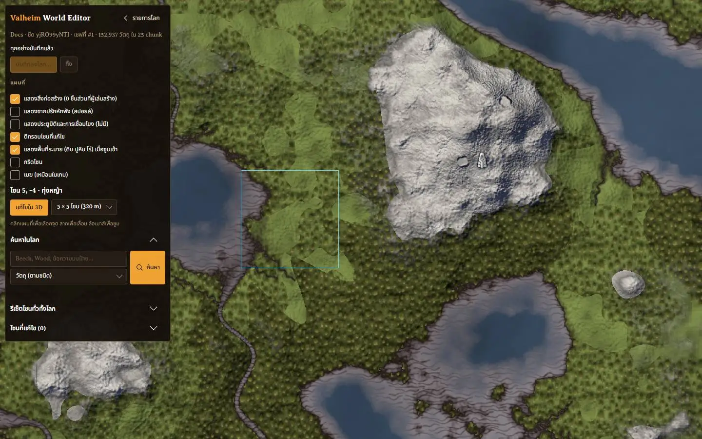
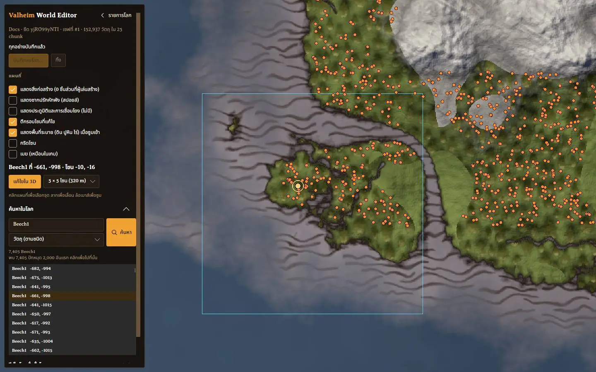
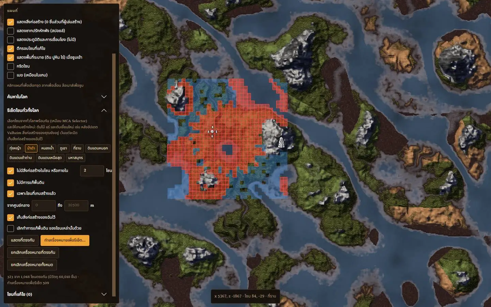
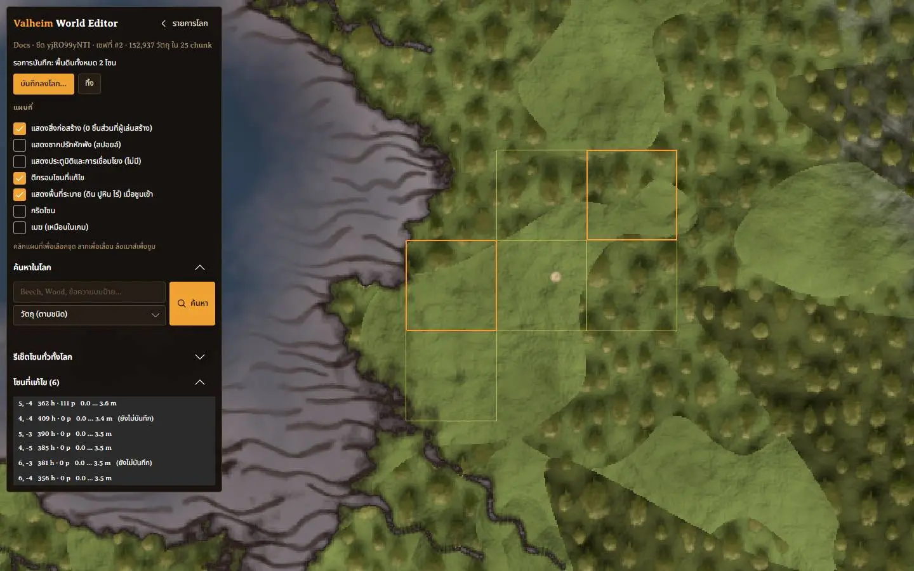

<!-- source: 2b176694 -->
# แผนที่โลก

ดูทั้งโลก เลือกที่ที่จะแก้ไขใน 3D ค้นหาทุกวัตถุ หีบ และป้าย รีเซ็ตโซนที่ใดก็ได้ในคราวเดียว
และบันทึกสิ่งที่รออยู่

**ที่อยู่:** เปิดขึ้นพร้อมทุกโลก **แผนที่** ในแถบด้านบนของเอดิเตอร์ จะกลับมาที่นี่ · **ปุ่ม:** ไม่มี (`F1` เปิดหน้านี้)
· **ใช้ได้กับ:**
โลกที่บันทึกไว้ ไลฟ์

> [!WARNING]
> **ปิดเกม หรือหยุดเซิร์ฟเวอร์ ก่อนบันทึกโลกแบบออฟไลน์** เกมที่รันอยู่ จะเขียนทับไฟล์โลก
> เมื่อบันทึก และการเปลี่ยนแปลงของคุณ รวมถึงการรีเซ็ตโซน จะหายไป หากต้องการเปลี่ยนโลก ขณะที่เกมรันอยู่ ให้ใช้
> [โหมดไลฟ์](live-mode.md)

*เลือกโซนแล้ว: สี่เหลี่ยมสีฟ้าอ่อน คือพื้นที่ที่ **แก้ไขใน 3D** จะเปิด ตามขนาดที่เลือกไว้ข้างปุ่ม*

แผนที่วาดแบบเดียวกับ ที่เกมวาดแผนที่ของตัวเอง จากข้อมูลของโลก จึงดูเหมือนแผนที่ในเกม ที่เปิดเผยทุกอย่างแล้ว
จุดเริ่มต้นและพ่อค้า (เมื่อโซนของพ่อค้าถูกสร้างแล้ว) แสดงไอคอนเหมือนในเกม

## ใช้งาน

1. ลากเพื่อเลื่อนแผนที่ หมุนล้อเมาส์ เพื่อซูมเข้าหาตัวชี้
2. คลิกจุดหนึ่ง แผงด้านข้างจะแสดง โซนและไบโอมของจุดนั้น ("โซน 12, -4 · ป่าดำ") และพื้นที่ที่จะเปิด
   จะมีกรอบสีฟ้าอ่อน
3. ในแผงด้านข้าง เลือกขนาดในรายการ ข้าง **แก้ไขใน 3D**
4. กด **แก้ไขใน 3D** [เอดิเตอร์ 3D](editor-basics.md) จะเปิดรอบโซนที่คุณคลิก

แผนที่จำตำแหน่งที่คุณดูล่าสุด รวมถึงครั้งถัดไปที่เปิดเอดิเตอร์ กล่องด้านล่างแสดงจุดใต้ตัวชี้:
พิกัด โซน และไบโอม ("x 812, z -260 · โซน 13, -4 · ทุ่งหญ้า") และไบโอมรองของพื้นที่ หากมี
("ไบโอมรอง Dark Meadows" แสดงไม่กี่วินาที หลังแผนที่เปิด)

## การตั้งค่า

ด้านบนของแผงด้านข้าง แสดงชื่อโลก ซีด หมายเลขเซฟ และจำนวนวัตถุในโลก (ไลฟ์: แสดงการเชื่อมต่อ
แทนหมายเลขเซฟ) หลังบันทึก จะแสดงหมายเลขเซฟใหม่ **รายการโลก** จะกลับไปที่หน้าเริ่มต้น:
หากมีการเปลี่ยนแปลงที่รออยู่ จะถามก่อน และ **ออกเลย** จะทิ้งการเปลี่ยนแปลงเหล่านั้น

| การตั้งค่า | สิ่งที่ทำ |
|---|---|
| **โหลดใหม่จากเกม** | เฉพาะไลฟ์: อ่านทั้งโลกใหม่ จากเกมที่รันอยู่ บรรทัดด้านบนแสดงผู้เล่นที่ออนไลน์ ("โลกไลฟ์ · ผู้เล่นออนไลน์ 2 คน: Ragnar, Freya") |
| **บันทึกลงโลก…** / **นำไปใช้แบบไลฟ์** | เขียนทุกการเปลี่ยนแปลงที่รออยู่ ลงในไฟล์โลก (ไลฟ์: ส่งไปยังเกมที่รันอยู่) บรรทัดด้านบนบอกว่ามีอะไรรออยู่ เช่น "รอการบันทึก: พื้นดินทั้งหมด 3 โซน, ลบ 12 ชิ้น, เพิ่ม 40 ชิ้น, รีเซ็ตโซน 25 รายการ" |
| **ทิ้ง** | ทิ้งทุกการเปลี่ยนแปลง ที่ยังไม่ได้บันทึกหรือนำไปใช้ หลังจากถามก่อน |
| **แสดงสิ่งก่อสร้าง (N ชิ้นส่วนที่ผู้เล่นสร้าง)** | วาดชิ้นส่วนทุกชิ้นที่ผู้เล่นสร้าง: เป็นรูปฐาน เมื่อดูใกล้ เป็นจุด เมื่อไกลออกไป และไม่แสดงเลย เมื่อซูมออกไกลมาก ซากปรักหักพัง ที่ผู้เล่นสร้างต่อเติม จะวาดไปพร้อมสิ่งก่อสร้าง เปิดอยู่ตั้งแต่แรก |
| **แสดงซากปรักหักพัง (สปอยล์)** | วาดซากปรักหักพังของโลกด้วย (หอคอยหิน บ้านร้าง ซากปรักหักพังใน ดินแดนหมอก และ ดินแดนเถ้าถ่าน) แบบจางกว่า ปิดอยู่ตั้งแต่แรก เพราะจะเผยว่าอยู่ที่ไหน |
| **แสดงประตูมิติและการเชื่อมโยง (N: เชื่อมเป็นคู่ P คู่, เดี่ยว A)** | วาดประตูมิติทุกบาน เป็นจุดสีม่วง พร้อมเส้นระหว่างสองบาน ที่ใช้แท็กเดียวกัน (คู่ที่เกมเชื่อมกัน) ประตูมิติที่ไม่มีคู่ จะเป็นจุดกลวง เมื่อซูมเข้า (8 m ต่อพิกเซล หรือใกล้กว่า) จะเขียนแท็กไว้ ข้างประตูมิติแต่ละบาน ("ไม่มีแท็ก" สำหรับแท็กว่าง) N นับประตูมิติ P นับคู่ที่เชื่อมกัน A นับประตูมิติที่ไม่มีคู่ ประตูมิติที่เพิ่มหรือลบในเอดิเตอร์ จะนับเมื่อแสดงแผนที่อีกครั้ง ปิดอยู่ตั้งแต่แรก เพราะจะเผยตำแหน่ง ของประตูมิติทุกบาน |
| **ตีกรอบโซนที่แก้ไข** | ตีกรอบโซนที่พื้นดินถูกเปลี่ยน: เส้นสีเหลืองบาง สำหรับการเปลี่ยนแปลง ที่อยู่ในโลกแล้ว เส้นสีส้มหนากว่า สำหรับการเปลี่ยนแปลง ที่ยังไม่ได้บันทึกหรือนำไปใช้ เปิดอยู่ตั้งแต่แรก |
| **แสดงพื้นที่ระบาย (ดิน ปูหิน ไร่) เมื่อซูมเข้า** | เมื่อดูใกล้ แผนที่จะวาดที่รายละเอียด 1 m พร้อมการเปลี่ยนแปลงพื้นดิน ที่รออยู่ของคุณ ซึ่งจะแสดงพื้นดิน พื้นปูหิน และพื้นดินพรวนด้วย เปิดอยู่ตั้งแต่แรก |
| **กริดโซน** | วาดเส้นระหว่าง [โซน](concepts/areas-and-zones.md#โซน) ขนาด 64 m เมื่อซูมเข้ามากพอ |
| **เมฆ (เหมือนในเกม)** | วาดเงาเมฆที่ลอยไปมา เหมือนแผนที่ในเกม |
| **แก้ไขใน 3D** | เปิดเอดิเตอร์ 3D บนพื้นที่รอบโซนที่เลือก |
| รายการขนาด (ข้าง **แก้ไขใน 3D**) | ปริมาณพื้นดินที่เอดิเตอร์โหลด: **3 × 3 โซน (192 m)** **5 × 5 โซน (320 m)** (ค่าเริ่มต้น) **7 × 7** **9 × 9** **13 × 13** หรือ **17 × 17 โซน (1088 m)** ใช้ 5 × 5 สำหรับงานส่วนใหญ่ ใช้ 9 × 9 ขึ้นไป เพื่อวางเมือง หรือยกภูเขาลูกใหญ่ พื้นที่ใหญ่ขึ้นจะช้าลง คุณเปลี่ยนได้ภายหลัง ในแถบด้านบน |

ในโหมดไลฟ์ ผู้เล่นที่ออนไลน์ จะแสดงเป็นจุดสีน้ำเงินพร้อมชื่อ อัปเดตทุก 5 วินาที การเปลี่ยนแปลงจะ
[รอดำเนินการ](concepts/saving-and-history.md#การเปลยนแปลงทรอดำเนนการ) ข้ามพื้นที่: แก้ไขพื้นที่หนึ่ง กลับมาที่แผนที่ เปิดอีกพื้นที่
แล้วบันทึกทุกอย่างในคราวเดียว

## ค้นหาในโลก

*หมุดสีส้มแต่ละอัน คือวัตถุหนึ่งชิ้นที่พบ ผลลัพธ์ที่เลือกในรายการ จะใหญ่กว่า มีวงสีทอง และแผนที่
จะอยู่ตรงกลางที่ผลลัพธ์นั้น*

1. เปิด **ค้นหาในโลก**
2. พิมพ์ส่วนหนึ่งของชื่อหรือข้อความ เช่น `Beech` `Wood` หรือคำบนป้าย ตัวพิมพ์เล็กใหญ่ไม่มีผล
3. เลือกสิ่งที่จะค้นหา (ด้านล่าง)
4. กด **ค้นหา** (หรือ `Enter`) ผลลัพธ์ทุกรายการ จะถูกปักหมุดบนแผนที่ และแสดงในรายการ
5. คลิกผลลัพธ์: แผนที่จะเลื่อนมาอยู่ตรงกลาง และเลือกโซนของผลลัพธ์นั้น จากนั้น **แก้ไขใน 3D** จะเปิด
   โดยเลือกวัตถุนั้นไว้

| ค้นหา | สิ่งที่พบ |
|---|---|
| **วัตถุ (ตามชนิด)** | ทุกวัตถุที่ชนิดมีข้อความนั้น: `portal`, `Beech`, `chest`, `guard_stone`… |
| **ไอเทมในภาชนะ** | ทุกหีบ เกวียน เรือ หรือภาชนะอื่น ที่มีไอเทมซึ่งชื่อมีข้อความนั้น: `Wood`, `Draugr`, `Silver`… ผลลัพธ์แต่ละรายการบอกจำนวน ("Wood ×50") |
| **ข้อความ (ป้าย ประตูมิติ Ward…)** | ทุกวัตถุที่มีข้อความซึ่งมีคำนั้น: ข้อความบนป้าย แท็กประตูมิติ ชื่อของ Ward และหลุมศพ ผลลัพธ์แต่ละรายการ แสดงข้อความที่ตรงกัน |

บรรทัดเหนือผลลัพธ์ นับสิ่งที่พบตามชนิด (ตามไอเทม สำหรับภาชนะ) และรวมทั้งหมด รายการแสดงผลลัพธ์
300 รายการแรก ปักหมุดได้สูงสุด 2,000 รายการ สำหรับไอเทมและข้อความ [ข้อมูล](select.md) ของวัตถุ
จะเปิดขึ้นด้วย คุณจึงเปลี่ยนของในหีบ หรือข้อความบนป้ายได้ทันที การเปลี่ยนสิ่งที่จะค้นหา
จะค้นหาใหม่ทันที

การค้นหาอ่านโลก ตามที่เป็นในเอดิเตอร์: วัตถุที่คุณวางแต่ยังไม่ได้บันทึก จะถูกพบ วัตถุที่คุณลบ
แต่ยังไม่ได้บันทึก จะไม่ถูกพบ วัตถุสำหรับจัดการภายในของเกม (ชื่อขึ้นต้นด้วย `_` เช่น `_ZoneCtrl`) จะถูกพบ
ก็ต่อเมื่อข้อความของคุณ ขึ้นต้นด้วย `_` เช่นกัน

## รีเซ็ตโซนทั่วทั้งโลก

*โซน ทุ่งหญ้า ถูกทำเครื่องหมายเพื่อรีเซ็ต (สีแดง) จากนั้นเลือก **ป่าดำ** และกด **แสดงที่ตรงกัน** (สีน้ำเงิน)
บรรทัดใต้ปุ่ม นับทั้งสองอย่าง*

เลือกโซนที่ใดก็ได้ในโลก ตามลักษณะของโซน แล้วให้เกมสร้างโซนเหล่านั้นใหม่: ต้นไม้ หิน แร่ และดันเจี้ยนใหม่
เช่น หลัง Valheim อัปเดต ในที่ที่ไม่มีใครก่อสร้าง หากต้องการรีเซ็ตโซน ใต้ส่วนที่เลือกหนึ่งส่วน ให้ใช้เครื่องมือ
[ขอบเขต](area.md#รเซตโซน) แทน ซึ่งมีสวิตช์สองตัวเดียวกัน และทำเครื่องหมายแบบเดียวกัน ทีละขั้นตอน:
[สร้างโซนใหม่](guides/reset-zones.md)

1. เปิด **รีเซ็ตโซนทั่วทั้งโลก**
2. ตั้งตัวกรอง (ด้านล่าง)
3. กด **แสดงที่ตรงกัน** ครั้งแรก เอดิเตอร์จะอ่านทุกโซน (สักครู่) โซนที่ตรงกัน จะเป็นสีน้ำเงิน และบรรทัดหนึ่ง
   จะแสดง "N จาก M โซนตรงกัน (มีวัตถุ K ชิ้น)" จากนั้น แผนที่จะเปลี่ยนตามตัวกรอง ขณะที่คุณเปลี่ยน
4. กด **ทำเครื่องหมายเพื่อรีเซ็ต…** แล้วยืนยัน โซนที่ตรงกัน จะเป็นสีแดง
5. **บันทึกลงโลก** (ออฟไลน์) หรือ **นำไปใช้แบบไลฟ์** จะทำการรีเซ็ต ก่อนหน้านั้น **ยกเลิกเครื่องหมายทั้งหมด** จะยกเลิก
   และ **ยกเลิกเครื่องหมายที่ตรงกัน** จะยกเลิกเฉพาะโซน ที่ตรงกับตัวกรองในตอนนี้

> [!CAUTION]
> **การรีเซ็ตย้อนกลับไม่ได้ เมื่อบันทึกหรือนำไปใช้แล้ว** ทุกวัตถุในโซนจะถูกนำออก ยกเว้นหลุมศพของผู้เล่น
> และชิ้นส่วนที่ผู้เล่นสร้าง เมื่อเปิด **เก็บสิ่งก่อสร้างของฉันไว้**: ต้นไม้ หิน แร่ ซากปรักหักพัง ทางเข้าดันเจี้ยน
> ไอเทมบนพื้น และสิ่งมีชีวิต รวมถึงสัตว์ที่ฝึกแล้ว ให้ย้ายสัตว์ที่ฝึกแล้วออกไปก่อน และ
> [สำรองโลก](guides/back-up-a-world.md)

| การตั้งค่า | สิ่งที่ทำ |
|---|---|
| ปุ่มไบโอม (**ทุ่งหญ้า** … **มหาสมุทร**) | เฉพาะโซนที่ตรงกลาง อยู่ในไบโอมที่เปิดไว้ หากไม่เปิดเลย: ทุกไบโอม |
| **ไม่มีสิ่งก่อสร้างในโซน หรือภายใน N โซน** | ไม่รวมโซนที่อยู่ภายใน N โซน จากชิ้นส่วนที่ผู้เล่นสร้าง รวมแนวทแยง (0 ถึง 50 เริ่มต้นที่ 2) เปิดอยู่ตั้งแต่แรก เมื่อปิดตัวเลือกนี้ โซนที่มีชิ้นส่วน ยังคงไม่ถูกรวม ขณะที่เปิด **เก็บสิ่งก่อสร้างของฉันไว้** |
| **ไม่มีการแก้พื้นดิน** | ไม่รวมโซนที่พื้นดินถูกเปลี่ยน (ในเกม หรือในเอดิเตอร์) เปิดอยู่ตั้งแต่แรก |
| **เฉพาะโซนที่เกมสร้างแล้ว** | เฉพาะโซนที่ผู้เล่นเคยเข้าใกล้แล้ว ปิด: รวมโซน ที่มีเพียงวัตถุ หรือการแก้พื้นดินจากเอดิเตอร์ด้วย เปิดอยู่ตั้งแต่แรก |
| **จากศูนย์กลาง … ถึง … m** | เฉพาะโซนที่อยู่ในระยะนี้ จากกลางโลก เว้นว่าง: ไม่จำกัด (ขอบโลกอยู่ที่ 10,500 m) เช่น รีเซ็ตเฉพาะวงนอก |
| **เก็บสิ่งก่อสร้างของฉันไว้** | เปิดอยู่ตั้งแต่แรก: สิ่งก่อสร้างไม่ถูกรีเซ็ต จากแผนที่เลย และโซนที่มีชิ้นส่วนที่ผู้เล่นสร้าง จะไม่ตรงกันเลย เมื่อปิด และปิด **ไม่มีสิ่งก่อสร้าง…** ด้วย โซนที่มีสิ่งก่อสร้าง จะตรงกันเหมือนโซนอื่น และสิ่งก่อสร้างจะหายไป พร้อมสิ่งอื่น คำถามก่อนทำเครื่องหมาย จะบอกไว้ |
| **เลิกทำการแก้พื้นดิน ของโซนเหล่านั้นด้วย** | การรีเซ็ตจะนำ การเปลี่ยนแปลงพื้นดิน ของโซนออกด้วย กลับเป็นพื้นดินของซีด มีผลเฉพาะเมื่อปิด **ไม่มีการแก้พื้นดิน** ที่นี่ปิดอยู่ตั้งแต่แรก (ของเครื่องมือ ขอบเขต เปิดอยู่ตั้งแต่แรก) |
| **แสดงที่ตรงกัน** | แรเงาโซนที่ตรงกัน เป็นสีน้ำเงิน และนับโซน และวัตถุในโซนเหล่านั้น |
| **ทำเครื่องหมายเพื่อรีเซ็ต…** | ทำเครื่องหมายทุกโซนที่ตรงกัน เพื่อรีเซ็ต (สีแดง) หลังจากถามก่อน |
| **ยกเลิกเครื่องหมายที่ตรงกัน** | ยกเลิกการรีเซ็ตของโซนที่ตรงกัน ที่ทำเครื่องหมายไว้ เครื่องหมายอื่นยังอยู่ |
| **ยกเลิกเครื่องหมายทั้งหมด** | ยกเลิกการรีเซ็ตโซน ที่ทำเครื่องหมายไว้ทั้งหมด รวมถึงที่ทำเครื่องหมาย ด้วยเครื่องมือ ขอบเขต |

ครั้งถัดไปที่ผู้เล่น เข้าใกล้โซนที่รีเซ็ต เกมจะสร้างโซนใหม่จากซีด รวมถึงสถานที่ของโซน (ซากปรักหักพัง
ดันเจี้ยน แท่นบูชา) ในโหมดไลฟ์ จะเกิดขึ้นทันที ในที่ที่มีผู้เล่น หลังรีเซ็ตแบบไลฟ์ เอดิเตอร์จะอ่านโลก
อีกครั้ง และประวัติจะตามมาด้วย โดยไม่มีสิ่งที่ทำไว้ในโซนที่รีเซ็ต

## โซนที่แก้ไข

**โซนที่แก้ไข (N)** แสดงทุกโซนที่พื้นดินถูกเปลี่ยน เรียงจากที่เปลี่ยนมากที่สุด แต่ละแถวแสดงโซน จำนวนจุดความสูง
(`h`) และจุดการระบาย (`p`) ที่ถูกเปลี่ยน ช่วงของความสูงที่เปลี่ยน (`-2.4 … 6.0 m`) และ "(ยังไม่บันทึก)"
เมื่อมีการเปลี่ยนแปลงที่รออยู่ ("(ยังไม่นำไปใช้)" ในโลกไลฟ์) คลิกแถว เพื่อซูมเข้าที่โซนนั้นและเลือกโซน
พร้อมสำหรับ **แก้ไขใน 3D**

*สี่โซนบันทึกแล้ว (สีเหลืองบาง) และอีกสองโซน ถูกแก้ไขหลังจากนั้น (สีส้มหนากว่า): รายการทำเครื่องหมาย โซนที่รออยู่ว่า "(ยังไม่บันทึก)"*

## ปุ่มลัด

| ปุ่มหรือเมาส์ | สิ่งที่ทำ |
|---|---|
| ลาก | เลื่อนแผนที่ |
| ล้อเมาส์ | ซูมเข้าหาตัวชี้ |
| คลิก | เลือกโซนตรงนั้น |
| `Enter` ในช่องค้นหา | ค้นหา |

## เคล็ดลับและข้อจำกัด

- **แผนที่แสดงโลก ตามที่อ่านไว้** ในโหมดไลฟ์ เอดิเตอร์ 3D จะติดตามสิ่งที่ผู้เล่นเปลี่ยน ในพื้นที่ที่เปิดอยู่ แต่
  ส่วนที่เหลือของแผนที่ จะเปลี่ยนเฉพาะเมื่อกด **โหลดใหม่จากเกม**
- **เมื่อซูมเข้าใกล้กว่า ประมาณ 6 m ต่อพิกเซล** ส่วนที่มองเห็น จะถูกวาดใหม่ที่รายละเอียด 1 m พร้อมการเปลี่ยนแปลง
  พื้นดินที่รออยู่ของคุณ
- **เฉพาะโซนภายในโลก** ที่แสดงให้รีเซ็ต เซิร์ฟเวอร์เฉพาะ ที่ไม่มีใครออนไลน์ ก็สร้างโซนที่อยู่ไกล
  นอกโลกด้วย: โซนเหล่านั้นจะไม่ถูกรวม
- **หากต้องการย้อนการเปลี่ยนแปลง** **ยกเลิกเครื่องหมายทั้งหมด** จะยกเลิกการรีเซ็ต ที่ทำเครื่องหมายไว้ และ **ทิ้ง**
  จะทิ้งทุกอย่างที่รออยู่ หากต้องการเลิกทำ
  การเปลี่ยนแปลงหนึ่ง ให้เปิดพื้นที่นั้นใน 3D แล้วกด `Ctrl+Z` หรือใช้ ประวัติ: ดู
  [เลิกทำขั้นตอน ย้อนการเปลี่ยนแปลงหนึ่งรายการ หรือทิ้งทั้งหมด](guides/undo-changes.md)
- **ค้นหาแล้วไม่พบอะไร?** ตรวจการสะกด และตัวเลือกสิ่งที่จะค้นหา วัตถุสำหรับจัดการภายใน ต้องขึ้นต้นด้วย `_`
- **โลกที่สร้างด้วย Expand World**: เมื่อติดตั้งและเปิด แอดออนของม็อดนี้ โลกที่กว้างขึ้นจะแสดงทั้งหมด ไอคอนสถานที่
  มาจากข้อมูลของม็อด และค่าที่อ่านได้ จะเพิ่มอาณาเขต และเอฟเฟกต์สถานะ ที่ผู้เล่นได้รับตรงนั้น ("อาณาเขต
  frost · เอฟเฟกต์ Freezing (กลางคืน)") ดู
  [แก้ไขโลกที่สร้างด้วย Expand World, Riverheim หรือ Tunnelheim](guides/use-mods-worlds.md)

## หัวข้อที่เกี่ยวข้อง

- [หาวัตถุ ไอเทมในหีบ หรือป้าย](guides/find-things.md)
- [สร้างโซนใหม่](guides/reset-zones.md)
- [สำรองโลกก่อนแก้ไข](guides/back-up-a-world.md)
- [พื้นที่และโซน](concepts/areas-and-zones.md)
- [หน้าต่างเอดิเตอร์](editor-basics.md) [โหมดไลฟ์](live-mode.md)
