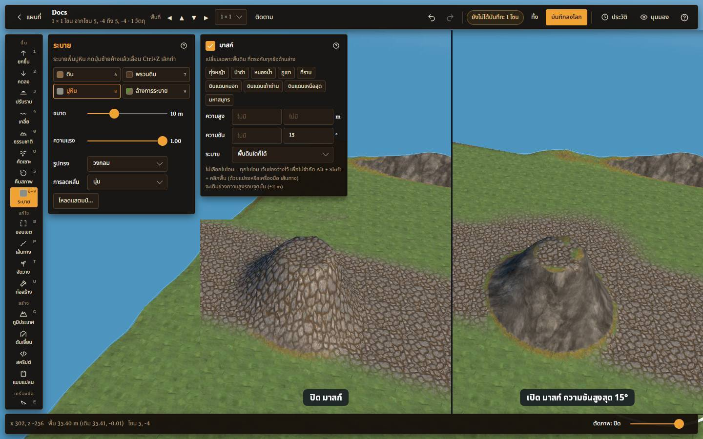
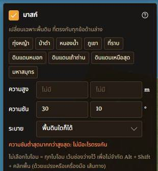

<!-- source: 1cb7e459 -->
# มาสก์

ให้เครื่องมือเปลี่ยน เฉพาะพื้นดินที่คุณเลือก ตามไบโอม ความสูง ความชัน หรือการระบาย: ปูหินเฉพาะส่วนที่ราบของเนิน ปรับพื้นหุบเขาให้ราบ โดยไม่แตะไหล่เขา ปลูกเฉพาะบนพื้นที่ยังไม่ได้ระบาย

**ที่อยู่:** การ์ด **มาสก์** ข้างแผงของเครื่องมือ · **ปุ่ม:** ไม่มี (`Alt`+`Shift`+คลิก ตั้งช่วงความสูง) · **ใช้ได้กับ:** โลกที่บันทึกไว้ ไลฟ์

*การลากระบาย ปูหิน กว้างแบบเดียวกัน ผ่านเนินดิน ซ้าย ปิด มาสก์: ปูหินทั้งหมด ขวา เปิด มาสก์ ที่ความชันต่ำกว่า 15°: พื้นที่ราบถูกปูหิน ไหล่ชันของเนิน ไม่ถูกปู การ์ด มาสก์ อยู่ข้างแผงของเครื่องมือ*

มาสก์ทำงานกับแปรงปั้น และแปรง ระบาย [ภูมิประเทศ](landform.md) [เส้นทาง](path.md) การกระทำของเครื่องมือ [ขอบเขต](area.md) การวาง และ [จัดวาง](place.md) มาสก์ไม่ขวาง [ก่อสร้าง](build.md): ชิ้นส่วนไปอยู่ตรงที่คุณชี้

## ใช้งาน

1. เลือกเครื่องมือที่ใช้มาสก์ การ์ด **มาสก์** จะแสดงข้างแผงของเครื่องมือ
2. บนการ์ด ติ๊ก **มาสก์** การตั้งค่าจะเปิดด้านล่าง
3. ตั้งไบโอม ความสูง ความชัน และการระบาย ที่คุณต้องการ เว้นการตั้งค่าใดว่างไว้ เพื่อไม่จำกัดด้วยค่านั้น
4. ใช้เครื่องมือตามปกติ: เครื่องมือจะเปลี่ยน เฉพาะพื้นดินที่ตรงกับทุกการตั้งค่า
5. เมื่อเสร็จแล้ว เอาติ๊ก **มาสก์** ออก มาสก์จะเปิดค้างไว้ พร้อมการตั้งค่า เมื่อคุณเปลี่ยนเครื่องมือ

## การตั้งค่า

| การตั้งค่า | สิ่งที่ทำ |
|---|---|
| **มาสก์** | เปิด: เครื่องมือเปลี่ยน เฉพาะพื้นดินที่ตรงกับทุกข้อด้านล่าง ปิด: ไม่จำกัด |
| ชิปไบโอม | **ทุ่งหญ้า** **ป่าดำ** **หนองน้ำ** **ภูเขา** **ที่ราบ** **ดินแดนหมอก** **ดินแดนเถ้าถ่าน** **ดินแดนเหนือสุด** **มหาสมุทร**: เฉพาะไบโอมเหล่านี้ ไม่ได้เลือก: ทุกไบโอม |
| **ความสูง** ต่ำสุด / สูงสุด | เฉพาะพื้นดิน ระหว่างความสูงเหล่านี้ (m ทะเลอยู่ที่ 30 m) เว้นช่องว่างไว้ ("ไม่มี") เพื่อไม่จำกัดด้านนั้น |
| **ความชัน** ต่ำสุด / สูงสุด | เฉพาะพื้นดิน ระหว่างความชันเหล่านี้ 0° ถึง 90° ค่าสูงสุด 0 ให้ผ่าน เฉพาะพื้นที่ราบสนิท |
| **ระบาย** | **พื้นดินใดก็ได้** **เฉพาะที่ไม่ได้ระบาย** **เฉพาะที่ระบายแล้ว** **เฉพาะดิน** **เฉพาะดินพรวน** หรือ **เฉพาะปูหิน** |

คำเตือนสีส้ม จะแสดงใต้การตั้งค่า เมื่อการตั้งค่า ไม่ให้อะไรผ่านเลย: ความชันสูงสุด 0° หรือค่าต่ำสุด มากกว่าค่าสูงสุด

*ความชันต่ำสุด 30° มากกว่าสูงสุด 10° การ์ดจึงเตือนเป็นสีส้ม: "ความชันต่ำสุดมากกว่าสูงสุด: ไม่มีอะไรตรงกัน"*

### ไม่จำกัด บนการ์ดเดียวกัน

ใต้มาสก์ การ์ดมีการตั้งค่าอีกตัว ที่เครื่องมือพื้นดินทุกอันใช้ร่วมกัน:

| การตั้งค่า | สิ่งที่ทำ |
|---|---|
| **ไม่จำกัด: เกิน ±8 m ของเกม** | เปิด: เครื่องมือพื้นดิน ทำได้ถึง 400 m จากพื้นดินที่ถูกสร้าง ไม่ใช่แค่ 8 m ของเกม สวิตช์เดียว สำหรับแปรงปั้น [ภูมิประเทศ](landform.md) (สูตรและรูปภาพ) [เส้นทาง](path.md) และ [ขอบเขต](area.md) เปิดค้างไว้ จนกว่าคุณจะปิด และปิดทุกครั้ง ที่เอดิเตอร์เริ่มทำงาน ดู [ไม่จำกัด](terrain.md#ไมจำกด) |

สวิตช์นี้ไม่ใช่ส่วนของมาสก์ (ทำงานได้ ไม่ว่าจะเปิดหรือปิดมาสก์) และการ์ดแสดงสวิตช์นี้ เฉพาะกับเครื่องมือที่สวิตช์ควบคุม: ไม่แสดงกับแปรง ระบาย และ [จัดวาง](place.md) ซึ่งไม่ขยับพื้นดิน ภูเขาของ ภูมิประเทศ เกินขีดจำกัดเสมอ ไม่ว่าสวิตช์จะตั้งไว้อย่างไร

## ปุ่มลัด

| ปุ่มหรือเมาส์ | สิ่งที่ทำ |
|---|---|
| `Alt`+`Shift`+คลิกพื้นดิน | ด้วยแปรงปั้น หรือแปรงระบาย หรือเครื่องมือ เส้นทาง: เปิดมาสก์ และเติม **ความสูง** ตั้งแต่ 2 m ต่ำกว่า ถึง 2 m สูงกว่าจุดนั้น สะดวก สำหรับทำงาน เฉพาะบนลานขั้นเดียว หรือแนวชายฝั่งเดียว |

## เคล็ดลับและข้อจำกัด

- **มาสก์ไม่มีขอบนุ่ม** จุดพื้นดินแต่ละจุด (หนึ่งจุดต่อเมตร) ตรงหรือไม่ตรง ดังนั้นการปั้นด้วยมาสก์ อาจทิ้งขั้นไว้ ตรงที่พื้นดินที่ตรง พบกับส่วนที่เหลือ โดยเฉพาะกับ ยกขึ้น กดลง และ [ภูมิประเทศ](landform.md) ใช้แปรง **เกลี่ย** ผ่านขั้นนั้นภายหลัง โดยปิดมาสก์
- **ระหว่างการลากแปรง มาสก์ดูพื้นดิน แบบตอนที่คุณกดปุ่ม** การลาก ยกขึ้น ภายใต้ขีดจำกัดความสูง จะสูงขึ้นเกินขีดจำกัด จนกว่าคุณจะปล่อย การแก้ไขแบบคลิกเดียว (ภูมิประเทศ เส้นทาง ขอบเขต การวาง) ดูพื้นดิน ณ ตอนก่อนการแก้ไข
- **ไบโอม คือไบโอมที่โลกสร้างไว้** ตรงนั้น การปรับรูปพื้นดิน ไม่เปลี่ยนไบโอม
- **ระบาย:** พื้นดินที่ล้างด้วย **ล้างการระบาย** นับเป็นไม่ได้ระบาย **เฉพาะดิน** **เฉพาะดินพรวน** และ **เฉพาะปูหิน** ต้องมีการระบายนั้น อย่างน้อยครึ่งหนึ่งของสี
- **ไม่มีอะไรเปลี่ยน** แถบสถานะแสดง "ไม่มีอะไรเปลี่ยน: มาสก์ กันพื้นดินใต้แปรงออกทั้งหมด (ตรวจการตั้งค่าความสูง ความชัน ไบโอม และการระบาย)"
- **การวางก็เป็นไปตามมาสก์ด้วย แม้การ์ดจะไม่แสดง ขณะที่คุณวาง** มาสก์ที่เปิดค้างไว้ จำกัดพื้นดิน ที่การวางปรับรูป (วัตถุเข้าไปทั้งหมด) เอาติ๊ก **มาสก์** ออก ก่อนคัดลอกและวาง ถ้าคุณต้องการพื้นดินทั้งหมด
- **มาสก์เป็นการตั้งค่า ไม่ใช่การเปลี่ยนแปลง**: ไม่ถูกเลิกทำด้วย `Ctrl+Z` และไม่ถูกบันทึกในโลก มาสก์ปิดอยู่ และช่องว่างเปล่า ทุกครั้งที่เอดิเตอร์เริ่มทำงาน

แนวคิด:

- ถ้าจะปูหินทางเดิน เฉพาะส่วนที่ราบของเนินเขา ให้ตั้ง **ความชัน** สูงสุด และใช้ **ระบายปูหิน** ของเครื่องมือ เส้นทาง
- ถ้าจะปลูก เฉพาะบนพื้นที่ยังไม่ได้ระบาย หรือเฉพาะบนดินพรวน ให้ตั้ง **ระบาย** และใช้ [จัดวาง](place.md)
- ถ้าจะปรับก้นหุบเขาให้ราบ โดยไม่แตะไหล่เขา ให้ตั้ง **ความสูง** สูงสุด ให้สูงกว่าพื้นหุบเขาเล็กน้อย และใช้ **ปรับราบ** หรือเครื่องมือ [ขอบเขต](area.md)

## หัวข้อที่เกี่ยวข้อง

- [เคลียร์ต้นไม้และหิน ปรับพื้นที่ก่อสร้างให้ราบ](guides/clear-an-area.md)
- [ปลูกป่า ไร่ หรือแนวพุ่มไม้](guides/plant-a-forest.md)
- [ปั้นและระบาย](terrain.md) [เส้นทาง](path.md) [ขอบเขต](area.md)
- [มาสก์ตัดสินพื้นดินอย่างไร](concepts/ground-limits.md#มาสกตดสนพนดนอยางไร)
