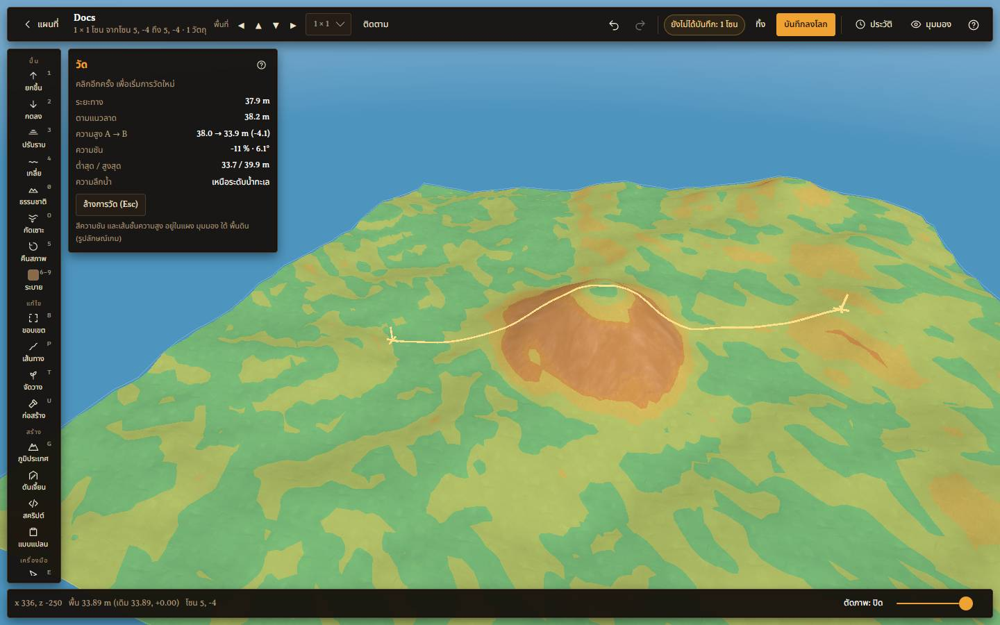
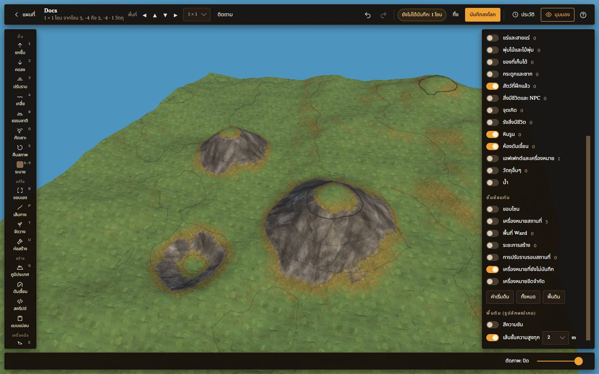
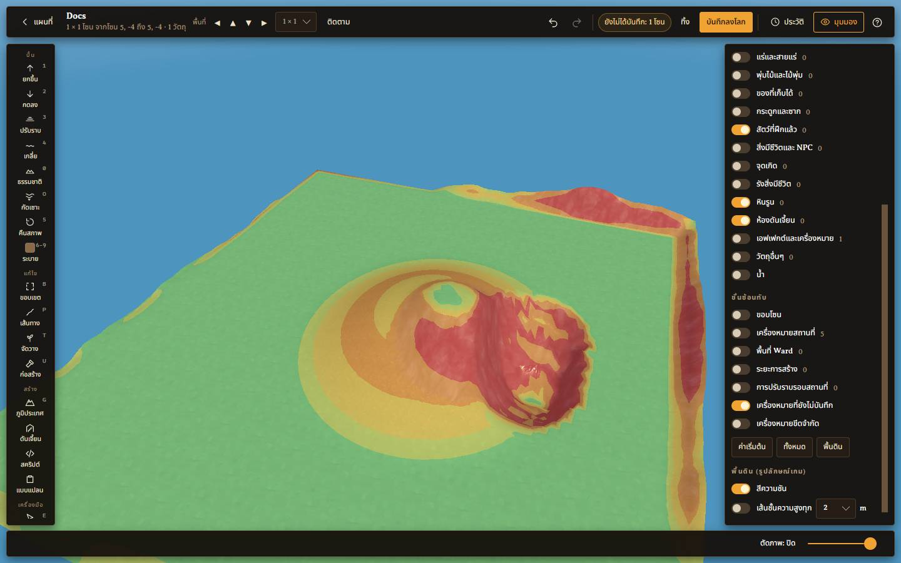

<!-- source: 164ad5c4 -->
# การวัดและชั้นซ้อนทับ

คลิกสองจุด แล้วอ่านระยะทาง ความต่างของความสูง และความชันระหว่างสองจุดนั้น ชั้นซ้อนทับพื้นดินสองแบบ คือ
สีความชัน และเส้นชั้นความสูง แสดงความชันและความสูง ทั่วทุกที่ในคราวเดียว ขณะที่คุณใช้เครื่องมือใดก็ได้

**ที่อยู่:** แถบเครื่องมือ ส่วน **เครื่องมือ** ส่วนชั้นซ้อนทับอยู่ในแผง มุมมอง · **ปุ่ม:** `M` · **ใช้ได้กับ:**
โลกที่บันทึกไว้ ไลฟ์

*การวัดจากตีนเนิน ข้ามยอดเนิน โดยเปิดสีความชัน เส้นวัดไปตามพื้นดิน แผงแสดงระยะทาง ความสูง
และความชัน*

## ใช้งาน

1. ในแถบเครื่องมือ คลิก **วัด** (`M`)
2. คลิกจุดแรกบนพื้น เส้นจะตามเคอร์เซอร์
3. คลิกจุดที่สอง เพื่อกำหนดการวัด แผงจะแสดงค่าที่อ่านได้
4. คลิกอีกครั้ง เพื่อเริ่มการวัดใหม่ หรือกด **ล้างการวัด (Esc)** เพื่อลบการวัด

เส้นวาดไปตามพื้นดิน จึงแสดงภาพตัดของพื้น ระหว่างสองจุด คำแนะนำที่ด้านบนของแผง
บอกว่าคลิกถัดไปจะทำอะไร

## ค่าที่อ่านได้

| ค่าที่อ่านได้ | ความหมาย |
|---|---|
| **ระยะทาง** | ระยะทางตรง เมื่อมองจากด้านบน เหมือนบนแผนที่ (m) |
| **ตามแนวลาด** | ความยาวของเส้นตรงจาก A ถึง B โดยรวมความต่างของความสูง (m) |
| **ความสูง A → B** | ความสูงของพื้นที่ทั้งสองจุด และผลต่าง เช่น `35.0 → 42.5 m (+7.5)` |
| **ความชัน** | ความชันเฉลี่ยจาก A ถึง B เป็น % และเป็นองศา ความชัน 100% คือ 45° |
| **ต่ำสุด / สูงสุด** | พื้นที่ต่ำสุดและสูงสุดตามแนวเส้น อ่านทุกหนึ่งเมตร: เนินหรือแอ่ง จะปรากฏที่นี่ แม้ A และ B อยู่ระดับเดียวกัน |
| **ความลึกน้ำ** | จุดที่ต่ำกว่าอยู่ใต้ทะเลลึกเท่าไร (ทะเลอยู่ที่ 30 m) หรือ "เหนือระดับน้ำทะเล" |

ความสูงเป็นค่าของเกม เหมือนในแถบสถานะ คุณเลือกค่าในแผง แล้วคัดลอกได้

## ชั้นซ้อนทับพื้นดิน

ในแผง มุมมอง (`V`) ใต้ **พื้นดิน (รูปลักษณ์เกม)**:

| การตั้งค่า | สิ่งที่ทำ |
|---|---|
| **สีความชัน** | ระบายสีพื้นตามความชัน เพื่อให้เห็นว่า ทางลาดหรือพื้นที่ก่อสร้างตรงไหน ชันเกินไป: เขียว ต่ำกว่า 10° เขียวอมเหลือง 10–20° เหลือง 20–30° ส้ม 30–45° แดง มากกว่า 45° เนินเขายังคงมีแสงและเงา ของตัวเอง |
| **เส้นชั้นความสูงทุก** *N* **m** | วาดเส้นชั้นความสูง (คอนทัวร์) ทุก **1** **2** (ค่าเริ่มต้น) **5** หรือ **10** m ทุกเส้นที่ห้า จะเข้มและหนากว่า เส้นที่อยู่ชิดกัน หมายถึงพื้นที่ชัน |

ทั้งสองต้องใช้ **รูปลักษณ์เกม** (รูปลักษณ์พื้นดินของแผง มุมมอง) เปิดค้างไว้ได้ขณะใช้เครื่องมืออื่น
และจะถูกจำไว้ เส้นชั้นความสูง อยู่ที่ผลคูณของระยะห่าง ระดับน้ำทะเล (30 m) จึงมีเส้นเสมอ
และติดตามแนวชายฝั่งได้ง่าย

*เส้นชั้นความสูงทุก 2 m บนเนินดินสองลูก และแอ่งหนึ่งแห่ง โดยปิดเส้นขอบโซน แผง มุมมอง แสดง **เส้นชั้นความสูงทุก**
2 m ใต้ **พื้นดิน (รูปลักษณ์เกม)** ทุกเส้นที่ห้าเข้มกว่า*

*สีความชันบนเนินดินลูกหนึ่ง: เขียวบนพื้นราบ แล้วเป็นเขียวอมเหลือง เหลือง และส้ม ขึ้นไปตามด้านที่ลาดเอียงเล็กน้อย และแดง
บนหน้าผาที่ตัดเข้าไปในเนิน แผง มุมมอง แสดงว่าติ๊ก **สีความชัน** ไว้ ใต้ **พื้นดิน (รูปลักษณ์เกม)***

## ปุ่มลัด

| ปุ่มหรือเมาส์ | สิ่งที่ทำ |
|---|---|
| `M` | เลือก วัด |
| คลิก | กำหนดจุด A แล้วจุด B แล้วเริ่มใหม่ |
| `Esc` | ล้างการวัด กด `Esc` ครั้งที่สอง เพื่อออกจากเครื่องมือ |
| `V` | แสดงหรือซ่อนแผง มุมมอง (ชั้นซ้อนทับ) |

## เคล็ดลับและข้อจำกัด

- **การวัดไม่เปลี่ยนอะไร** ในโลก และไม่ถูกบันทึก
- **ค่าที่อ่านได้ ตามพื้นดิน** เปลี่ยนพื้นดินด้วยเครื่องมืออื่น แล้วกลับมาที่ วัด หรือเลิกทำ: ความสูง ความชัน
  และจุดต่ำสุดและสูงสุด จะถูกอ่านใหม่ ที่ A และ B เดิม
- **วางแผนทางลาด:** วัดจากตีนทางลาด ถึงยอด **ความชัน** คือความชัน ที่ **ทางลาด** ของเครื่องมือ
  [เส้นทาง](path.md) ให้ ตามเส้นตรง ระหว่างจุดเดียวกัน
- **เครื่องหมายขีดจำกัด** ในแผง มุมมอง เดียวกัน จะแต้มสีแดงบนพื้นดิน ที่ถึง ±8 m ของเกม ดู
  [เครื่องหมายขีดจำกัด](concepts/ground-limits.md#เครองหมายขดจำกด)

## หัวข้อที่เกี่ยวข้อง

- [ทำถนน หรือทางลาดขึ้นเนิน](guides/make-a-road.md)
- [เคลียร์ต้นไม้และหิน ปรับพื้นที่ก่อสร้างให้ราบ](guides/clear-an-area.md)
- [หน้าต่างเอดิเตอร์](editor-basics.md): แผง มุมมอง
- [เส้นทาง](path.md) [ปั้นและระบาย](terrain.md)
