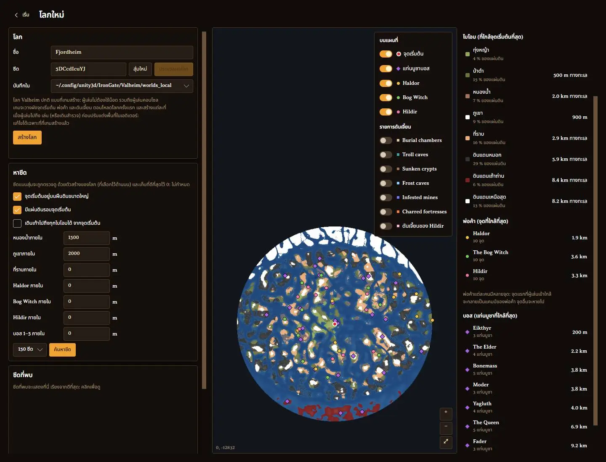
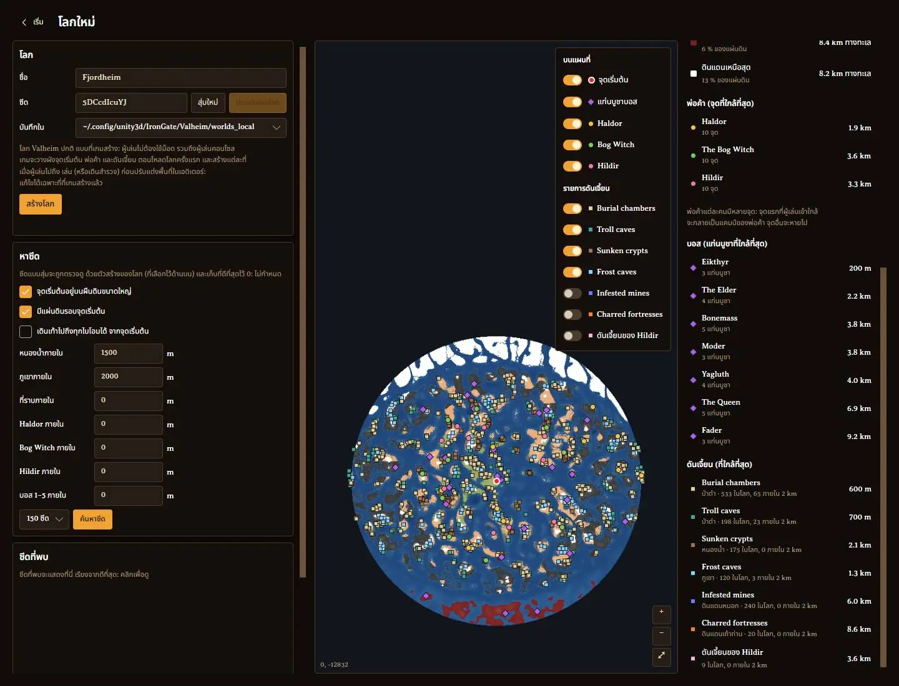
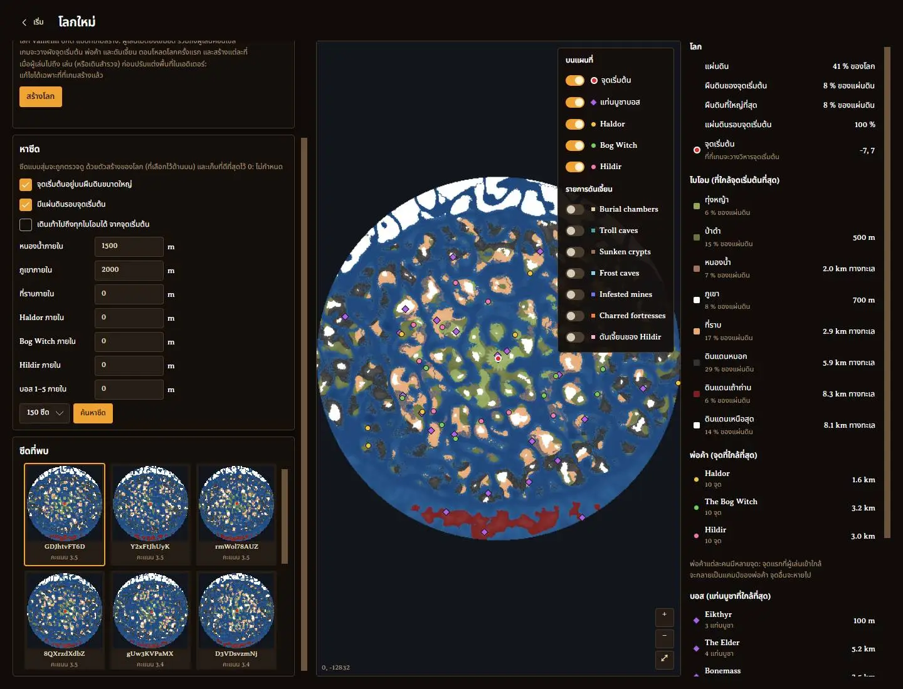

<!-- source: eca6c42a -->
# โลกใหม่

ดูโลกของซีด ก่อนที่โลกจะมีอยู่จริง ค้นหาซีดจำนวนมาก เพื่อหาซีดที่ถูกใจ แล้วสร้างโลก

**ที่อยู่:** หน้าเริ่มต้น **สร้าง** → **โลกใหม่** → **สร้างโลกใหม่** · **ปุ่ม:** ไม่มี · **ใช้ได้กับ:** หน้าเริ่มต้น
(ไม่ต้องเปิดโลกใด)

*จุดสีแดงคือจุดเริ่มต้น เพชรสีม่วงคือแท่นบูชาบอส จุดสีเหลือง เขียว และชมพู คือจุดของพ่อค้า
คอลัมน์ทางขวา แสดงข้อมูลของซีด ในภาพนี้เลื่อนลงไป ที่แท่นบูชาบอสที่ใกล้ที่สุด*

โลกที่คุณสร้าง เป็นโลก Valheim ปกติ สร้างตามกฎของเกมเอง จากซีด: ผู้เล่นเข้าได้
โดยไม่ต้องใช้ม็อด รวมถึงผู้เล่นคอนโซลผ่าน crossplay (เว้นแต่คุณจะเลือกตัวสร้าง ของม็อดสร้างโลก ดู
[เคล็ดลับและข้อจำกัด](#เคลดลบและขอจำกด))

## ใช้งาน

1. ที่หน้าเริ่มต้น เลือก **โลกใหม่** ใต้ **สร้าง** แล้ว **สร้างโลกใหม่** โลกของซีดแบบสุ่ม
   จะแสดงขึ้น
2. พิมพ์ซีด แล้วกด **ประมวลผลโลก** (หรือ `Enter`) หรือกด **สุ่มใหม่** เพื่อสุ่มอีกซีด ถ้าจะให้
   เอดิเตอร์ค้นหา ดู [หาซีด](#หาซด)
3. ดูแผนที่ และข้อมูลข้างๆ ไม่บังคับ: เปิดชนิดดันเจี้ยน ที่คุณสนใจ
4. พิมพ์ **ชื่อ** ของโลก เลือกตำแหน่งใน **บันทึกใน** แล้วกด **สร้างโลก** เอดิเตอร์จะเขียนโลก
   และเปิดแผนที่
5. เปิด Valheim โหลดโลกใหม่ แล้วเดินไปรอบๆ ส่วนที่คุณต้องการแก้ไข เกมจะสร้างแต่ละที่
   เมื่อผู้เล่นเข้าใกล้เท่านั้น
6. เปิดโลกอีกครั้งในเอดิเตอร์ เพื่อปรับแต่งสิ่งที่เกมสร้างไว้

**เริ่ม** (มุมซ้ายบน) กลับไปหน้าเริ่มต้น โดยไม่สร้างอะไร

## การตั้งค่า

| การตั้งค่า | ทำอะไร |
|---|---|
| **ซีด** | ตัวอักษรและตัวเลข ไม่เกิน 10 ตัว เหมือนในเกม ซีดเดียวกัน สร้างโลกเดียวกันเสมอ ตัวพิมพ์เล็กหรือใหญ่มีผล: `Valheim` และ `valheim` คือสองโลก |
| **สุ่มใหม่** | ใส่ซีดสุ่มอีกซีดในช่อง และแสดงโลกของซีดนั้น |
| **ประมวลผลโลก** | แสดงโลกของซีด (หรือ `Enter` ในช่องซีด) เป็นสีเทา ขณะที่ซีดในช่อง คือซีดที่แสดงอยู่ |
| **บนแผนที่** | แสดงหรือซ่อน **จุดเริ่มต้น** **แท่นบูชาบอส** **Haldor** **Bog Witch** และ **Hildir** |
| **รายการดันเจี้ยน** | แสดงตำแหน่งของดันเจี้ยน แต่ละชนิด (ปิดไว้ตอนแรก) ดู [ดันเจี้ยน](#ดนเจยน) |
| **ชื่อ** | ชื่อของโลก ตามที่เกมแสดง ยังเป็นชื่อโฟลเดอร์ด้วย จึงมี `/ \ : * ? " < > \|` ไม่ได้ |
| **บันทึกใน** | โฟลเดอร์โลกของเกม ที่จะเก็บโลก: โลกในเครื่องของคุณ (`worlds_local`) หรือโลกบนคลาวด์ของ Steam (`worlds`) เฉพาะที่มีบนคอมพิวเตอร์เครื่องนี้ โฟลเดอร์ที่เกมที่ติดตั้งไว้ใช้บันทึก จะมาก่อน (บน Linux บิลด์ Windows ที่รันผ่าน Proton เก็บโลกไว้ใน Steam prefix ของตัวเอง) เกมจึงแสดงโลกนี้ |
| **ตัวสร้าง** | แสดงเฉพาะเมื่อใช้แอดออน ของม็อดสร้างโลก และพบม็อดนั้น: ตัวสร้างของม็อด หรือ **ของเกม** ดู [เคล็ดลับและข้อจำกัด](#เคลดลบและขอจำกด) |
| **สร้างโลก** | สร้างโลก และเปิดแผนที่ โลกที่มีชื่อเดียวกัน ในโฟลเดอร์นั้นอยู่แล้ว จะไม่ถูกเขียนทับ: จะมีการถามหาชื่ออื่น |

## แผนที่

แผนที่แสดงโลกของซีด แบบที่เกมจะสร้าง: แผ่นดินลงสีตามไบโอม (พื้นที่สูงสีอ่อนกว่า) น้ำบนแผ่นดิน
เป็นสีฟ้า ทะเลไล่เฉดตามความลึก ทิศเหนืออยู่ด้านบน ใช้เวลาไม่กี่วินาที ระหว่างนั้นจะแสดง "กำลังดูโลกของ ……"
เมื่อซูมเข้า มุมมองจะวาดใหม่ ที่หนึ่งจุดต่อหนึ่งพิกเซลบนจอ ชายฝั่งและแม่น้ำ จึงคมชัดอยู่เสมอ มุมซ้ายล่าง
แสดงพิกัดใต้ตัวชี้

บนแผนที่ มีที่ต่างๆ ที่เกมวางผังไว้ ตอนโหลดโลกครั้งแรก:

- **จุดเริ่มต้น** (จุดสีแดง มีวงแหวนสีขาว): วิหารจุดเริ่มต้น ที่ผู้เล่นใหม่มาถึง
- **แท่นบูชาบอส** (เพชรสีม่วง): Eikthyr, The Elder, Bonemass, Moder, Yagluth, The Queen และ Fader
- **จุดของพ่อค้า**: Haldor (เหลือง) The Bog Witch (เขียว) และ Hildir (ชมพู) พ่อค้าแต่ละคนมีหลายจุด:
  จุดแรกที่ผู้เล่นเข้าใกล้ จะกลายเป็นแคมป์ จุดอื่นจะหายไป

ชี้ที่เครื่องหมาย เพื่อดูพิกัด และระยะจากจุดเริ่มต้น จุดเหล่านี้อยู่ตรงที่เกมจะวาง
ทุกประการ: เอดิเตอร์ทำตามกฎการวาง ของเกม ที่อ่านจากไฟล์ของ Valheim ของคุณ (ไม่กี่วินาที ในครั้งแรก)

## ดันเจี้ยน

*เปิดไว้สี่ชนิด: สี่เหลี่ยมเล็กแต่ละอัน คือดันเจี้ยนหนึ่งแห่ง สีบอกชนิด เหมือนในสวิตช์ และใน
**ดันเจี้ยน (ที่ใกล้ที่สุด)** (ระยะ ไบโอม จำนวนในโลก และภายใน 2 km)*

สวิตช์ **รายการดันเจี้ยน** แสดง **Burial chambers** **Troll caves** **Sunken crypts** **Frost caves** **Infested
mines** **Charred fortresses** และ **ดันเจี้ยนของ Hildir** เอดิเตอร์เริ่มหาดันเจี้ยน ทันทีที่แสดงซีด
(ไม่กี่วินาที) ชนิดที่คุณเปิด จะแสดงทันทีที่พบ ดันเจี้ยนของ 20 ซีดล่าสุด ที่คุณดู
จะเก็บไว้ การกลับไปดูซีดเหล่านั้น จึงแสดงทันที

**ดันเจี้ยน (ที่ใกล้ที่สุด)** บอกสำหรับแต่ละชนิดว่า แห่งที่ใกล้ที่สุด อยู่ห่างจากจุดเริ่มต้นเท่าไร ไบโอม จำนวน
ในโลก และจำนวนภายใน 2 km คลิกแถว เพื่อเปิดชนิดนั้น และดูแห่งที่ใกล้ที่สุดบนแผนที่

รวมชนิดที่ **ไบโอมย่อย** (แบบแปรผัน เช่น Dark Meadows) เพิ่มเข้ามา หรือกันออกไปด้วย หมู่บ้าน ซากปรักหักพัง และ
ที่เล็กๆ อื่นๆ จะไม่แสดง

## ข้อมูลของซีด

ข้างแผนที่ คือโลกของซีด ในรูปแบบรายการ คลิกแถวที่มีเครื่องหมาย เพื่อดูตำแหน่ง หรือตำแหน่งที่ใกล้ที่สุดของชนิดนั้น บนแผนที่

- **โลก**: **แผ่นดิน** (โลกเป็นแผ่นดินมากเท่าไร) **ผืนดินของจุดเริ่มต้น** และ **ผืนดินที่ใหญ่ที่สุด** (แต่ละอัน
  เป็นสัดส่วนของแผ่นดินทั้งหมด) **แผ่นดินรอบจุดเริ่มต้น** (แผ่นดินภายใน 400 m จากจุดเริ่มต้น) และ
  พิกัดของจุดเริ่มต้น
- **ไบโอม (ที่ใกล้จุดเริ่มต้นที่สุด)**: สัดส่วนแผ่นดินของแต่ละไบโอม และแผ่นดินที่ใกล้ที่สุด อยู่ห่างเท่าไร พร้อม "ทางทะเล"
  เมื่ออยู่บนผืนดินอื่น (ต้องใช้เรือ)
- **พ่อค้า (จุดที่ใกล้ที่สุด)**: จุดที่ใกล้ที่สุดของพ่อค้าแต่ละคน อยู่ห่างเท่าไร และมีกี่จุด
- **บอส (แท่นบูชาที่ใกล้ที่สุด)**: แท่นบูชาที่ใกล้ที่สุดของบอสแต่ละตัว อยู่ห่างเท่าไร และมีกี่แท่น
- **ดันเจี้ยน (ที่ใกล้ที่สุด)**: ดู [ดันเจี้ยน](#ดนเจยน)

แผ่นดินในที่นี้ คือพื้นที่ที่ยืนหรือลุยน้ำผ่านได้: อยู่ใต้น้ำไม่เกิน 1 m หรือ 3 m ใน หนองน้ำ ผืนดิน คือ
แผ่นดินที่ต่อกับแผ่นดิน โดยไม่ต้องข้ามน้ำที่ลึกกว่านั้น

## หาซีด

*สิ่งที่ต้องการ (ในภาพคือ ผืนดินขนาดใหญ่ มีแผ่นดินรอบด้าน หนองน้ำภายใน 1500 m และภูเขาภายใน 2000 m 150
ซีด) ซีดที่ดีที่สุดที่พบ ใต้ **ซีดที่พบ** เรียงจากดีที่สุด อันแรกถูกคลิก: เส้นขอบสว่างขึ้น และ
โลกของซีดนั้น เต็มแผนที่ใหญ่*

**หาซีด** ดูซีดสุ่มจำนวนมาก ในเบื้องหลัง และเก็บซีดที่ดีที่สุด ตามสิ่งที่คุณต้องการ 0 ในช่องระยะ
หมายถึง "ไม่กำหนด" สำหรับการค้นหาทีละขั้นตอน ดู [หาซีดที่มีสิ่งที่ต้องการ ใกล้จุดเริ่มต้น](guides/find-a-seed.md)

| การตั้งค่า | ทำอะไร |
|---|---|
| **จุดเริ่มต้นอยู่บนผืนดินขนาดใหญ่** | เลือกซีด ที่จุดเริ่มต้นอยู่บนผืนดินขนาดใหญ่ (เปิดไว้ตอนแรก) |
| **มีแผ่นดินรอบจุดเริ่มต้น** | เลือกซีด ที่มีน้ำน้อย ภายใน 400 m จากจุดเริ่มต้น (เปิดไว้ตอนแรก) |
| **เดินเท้าไปถึงทุกไบโอมได้ จากจุดเริ่มต้น** | เลือกซีด ที่ไบโอมแต่ละชนิดที่ใกล้ที่สุด อยู่บนผืนดินเดียวกับจุดเริ่มต้น |
| **หนองน้ำภายใน** **ภูเขาภายใน** **ที่ราบภายใน** | เลือกซีด ที่แผ่นดินที่ใกล้ที่สุดของไบโอมนั้น อยู่ภายในระยะที่กำหนด (0 ถึง 8,000 m ทีละ 250 ตอนแรกตั้ง 1,500 สำหรับ หนองน้ำ และ 2,000 สำหรับ ภูเขา) |
| **Haldor ภายใน** **Bog Witch ภายใน** **Hildir ภายใน** | เลือกซีด ที่มีจุดหนึ่งของพ่อค้าคนนั้น อยู่ภายในระยะที่กำหนด |
| **บอส 1–5 ภายใน** | เลือกซีด ที่มีแท่นบูชาของ Eikthyr, The Elder, Bonemass, Moder และ Yagluth แต่ละตัว อยู่ภายในระยะที่กำหนด |
| รายการจำนวนซีด | จำนวนซีดสุ่มที่จะดู: **60 ซีด** **150 ซีด** (ค่าเริ่มต้น) หรือ **400 ซีด** |
| **ค้นหาซีด** | เริ่มค้นหา แถบด้านล่าง แสดงความคืบหน้า |
| **หยุด** | หยุดค้นหา และแสดงซีดที่ดีที่สุด ที่พบจนถึงตอนนั้น |

ซีดที่ดีที่สุด 12 ซีด จะแสดงใต้ **ซีดที่พบ** แต่ละอันเป็นแผนที่เล็ก พร้อมซีดและคะแนน ชี้ที่อันหนึ่ง เพื่อดูข้อมูล
คลิกเพื่อดูบนแผนที่ใหญ่ (จะมีเส้นขอบสี)

### การให้คะแนนซีด

- **จุดเริ่มต้นอยู่บนผืนดินขนาดใหญ่** ให้สูงสุด 3 (สัดส่วนแผ่นดิน ของผืนดินจุดเริ่มต้น คูณ 3) **มีแผ่นดินรอบจุดเริ่มต้น**
  ให้สูงสุด 2 (สัดส่วนแผ่นดิน ภายใน 400 m คูณ 2)
- สิ่งที่ต้องการด้านระยะ ที่ทำได้ ให้ 1 ถึง 2 ยิ่งใกล้ยิ่งมาก ที่ทำไม่ได้ จะหักคะแนน ยิ่งไกลยิ่งหักมาก
  ไบโอมหรือพ่อค้า ที่ซีดไม่มีเลย หัก 2 **บอส 1–5 ภายใน** นับค่าเฉลี่ย ของบอส
  ทั้งห้าตัว
- **เดินเท้าไปถึงทุกไบโอมได้** ให้ 0.25 ต่อไบโอม ที่แผ่นดินที่ใกล้ที่สุด อยู่บนผืนดินของจุดเริ่มต้น

คะแนนไม่ต่ำกว่า 0 การค้นหาดูแต่ละซีด หยาบกว่าแผนที่ใหญ่ (จุดห่างกันประมาณ 210 m
แทนที่จะเป็นประมาณ 40 m) จึงอาจพลาดเกาะเล็กๆ และช่องแคบ: ตรวจซีดที่พบ บนแผนที่ใหญ่ ก่อน
เลือก สิ่งที่ต้องการด้านพ่อค้าหรือบอส ทำให้การค้นหาช้าลงหลายเท่า

## ปุ่มลัด

| อินพุต | การกระทำ |
|---|---|
| `Enter` (ในช่องซีด) | แสดงโลกของซีด |
| ล้อเมาส์ | ซูมตรงที่ตัวชี้อยู่ |
| ลาก | เลื่อนแผนที่ (จากที่ใดก็ได้ รวมถึงบนเครื่องหมาย) |
| ดับเบิลคลิก | แสดงทั้งโลกอีกครั้ง |
| **+** **−** **⤢** (มุมขวาล่าง) | ใกล้ขึ้น ไกลออก ทั้งโลก |

## เคล็ดลับและข้อจำกัด

- **เล่นโลกก่อนแก้ไข** โลกใหม่ยังไม่มีต้นไม้ หิน หรือสิ่งก่อสร้าง มีแค่ชื่อ ซีด และ
  รายการโซนว่าง เกมจะวางผังจุดเริ่มต้น พ่อค้า แท่นบูชา และดันเจี้ยน ตอนโหลดโลกครั้งแรก
  (ตรงที่หน้านี้แสดง) และสร้างแต่ละโซน เมื่อผู้เล่นเข้าใกล้ เอดิเตอร์ปรับแต่งได้เฉพาะโซน ที่เกม
  สร้างแล้ว ก่อนหน้านั้น แผนที่จะแสดงแผ่นดินของซีด โดยไม่มีอะไรอยู่บนนั้น
- โลกจะเขียนในรูปแบบเซฟ ของ Valheim 1.0.20 ขึ้นไป แบบที่เกมเขียนโลกใหม่: เกมหรือเซิร์ฟเวอร์
  ที่เก่ากว่า จะไม่รับ จึงต้องอัปเดตก่อน โลกที่มีชื่อเดียวกัน จะไม่ถูกเขียนทับ
- ถ้าอ่านบอสและพ่อค้า จากไฟล์ของเกมไม่ได้ หน้านี้จะบอกไว้: แผนที่ยังแสดงไบโอม
  แต่ไม่มีเครื่องหมาย และการค้นหาจะหาสิ่งเหล่านี้ไม่ได้ ล็อก (**เปิดล็อก** ที่หน้าเริ่มต้น) บอกสาเหตุ
- เมื่อใช้[แอดออน Expand World](../../addons/ExpandWorld/README.md) ซีดที่ดู และโลกที่สร้าง
  จะเป็นไปตามการตั้งค่า และไฟล์ข้อมูลของม็อด (หน้านี้บอกไว้ เหนือ **สร้างโลก**): โลกที่กว้างขึ้น ไบโอมและ
  สถานที่อื่นๆ ระดับทะเลของม็อด ไบโอมที่ม็อดเพิ่ม และอาณาเขต จะแสดงด้วยสีแผนที่ของตัวเอง
- เมื่อใช้[แอดออน Riverheim](../../addons/Riverheim/README.md) และติดตั้ง Riverheim ไว้ **ตัวสร้าง** จะให้เลือก
  Riverheim (เลือกไว้ตอนแรก เพราะเกมสร้างโลกใหม่ทุกโลก เป็นโลก Riverheim ขณะที่ติดตั้งม็อด) หรือ **ของเกม**
  โลก Riverheim ต้องมี Riverheim ในเกมของผู้เล่นทุกคน ผู้เล่นคอนโซลผ่าน crossplay จึงเข้าไม่ได้
  แต่ละซีดใช้เวลาไม่กี่วินาที: Riverheim วางผังทั้งโลกก่อน
- ไม่มีอะไรถูกสร้าง จนกว่าจะกด **สร้างโลก**: **เริ่ม** และการปิดหน้า ไม่ทิ้งร่องรอยไว้ ถ้าจะลบโลกที่สร้างแล้ว
  ให้ลบโฟลเดอร์ของโลก ออกจากโฟลเดอร์โลกที่บันทึกไว้

*เมื่อใช้แอดออน Riverheim **ตัวสร้าง** แสดง Riverheim และเวอร์ชัน และหมายเหตุด้านล่าง บอกว่าโลก
Riverheim ต้องการอะไรจากผู้เล่น แผนที่และข้อมูล คือโลกของ Riverheim เองสำหรับซีดนี้*

## หัวข้อที่เกี่ยวข้อง

- [หาซีดที่มีสิ่งที่ต้องการ ใกล้จุดเริ่มต้น](guides/find-a-seed.md)
- [แก้ไขโลกที่สร้างด้วย Expand World, Riverheim หรือ Tunnelheim](guides/use-mods-worlds.md)
- [พื้นที่และโซน](concepts/areas-and-zones.md#โซน): ทำไมเกมต้องสร้างโซนก่อน คุณจึงแก้ไขได้
- [ดันเจี้ยน](dungeons.md): แก้ไขดันเจี้ยน เมื่อเกมสร้างแล้ว
