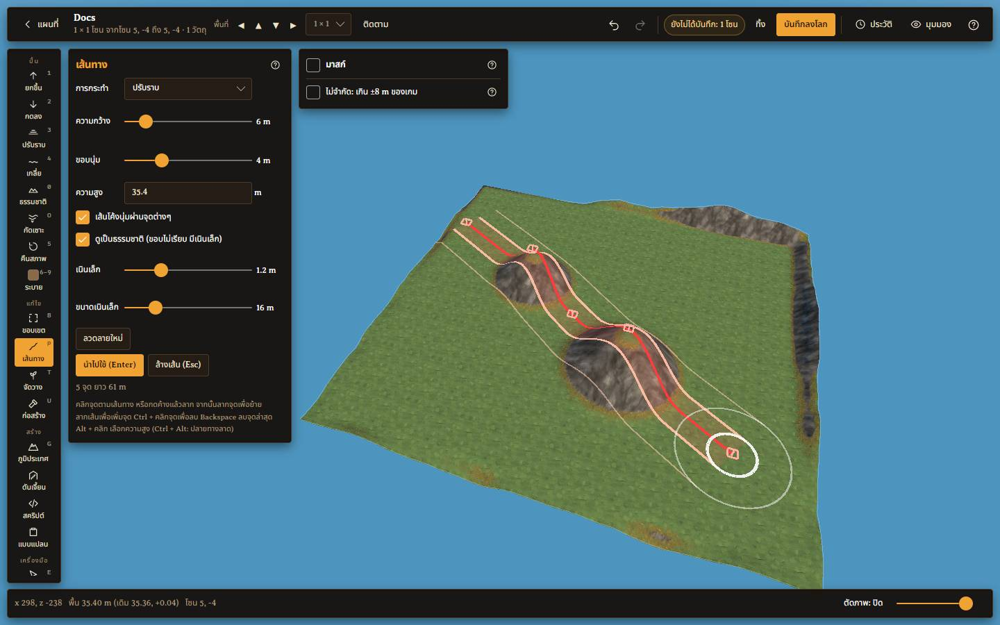
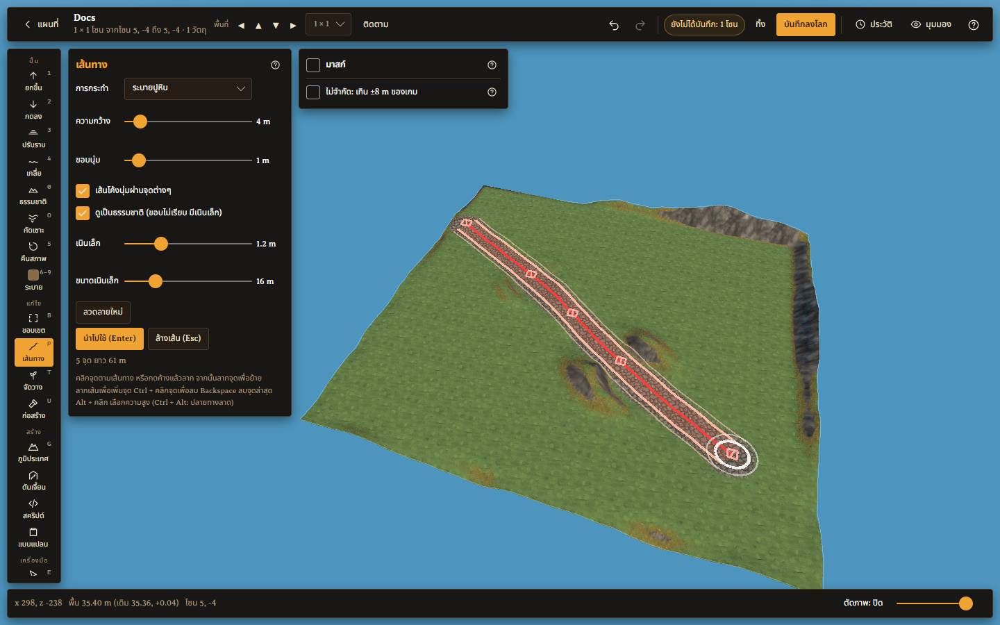
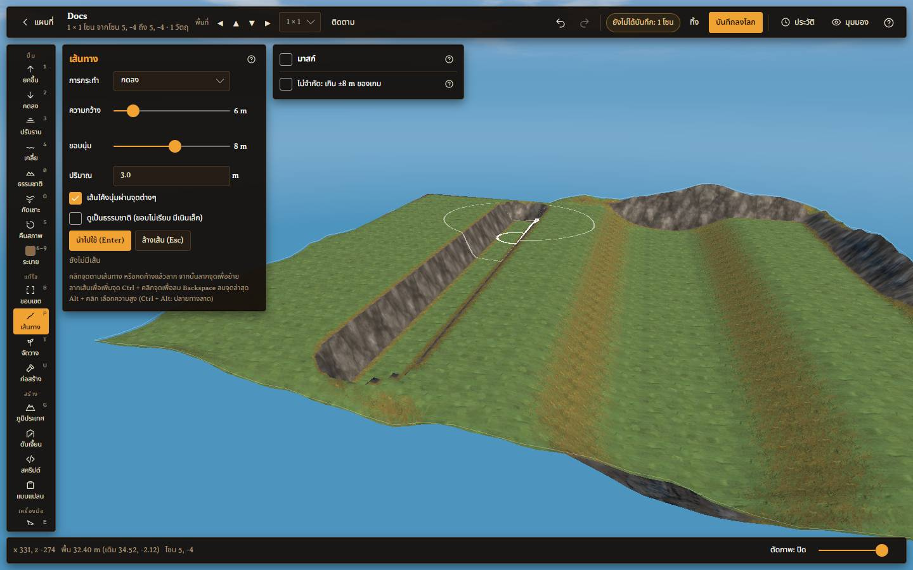
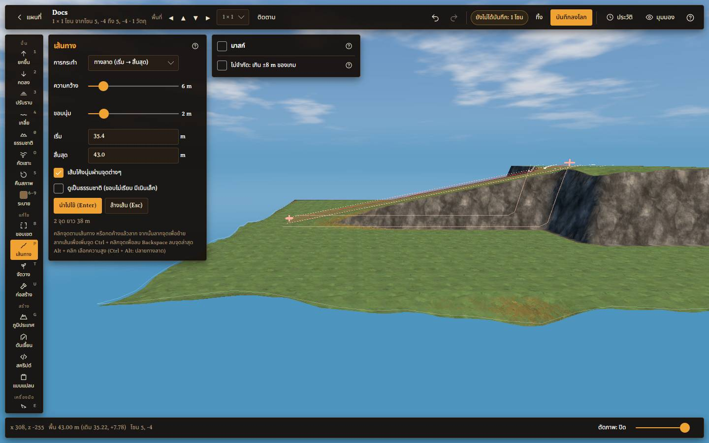
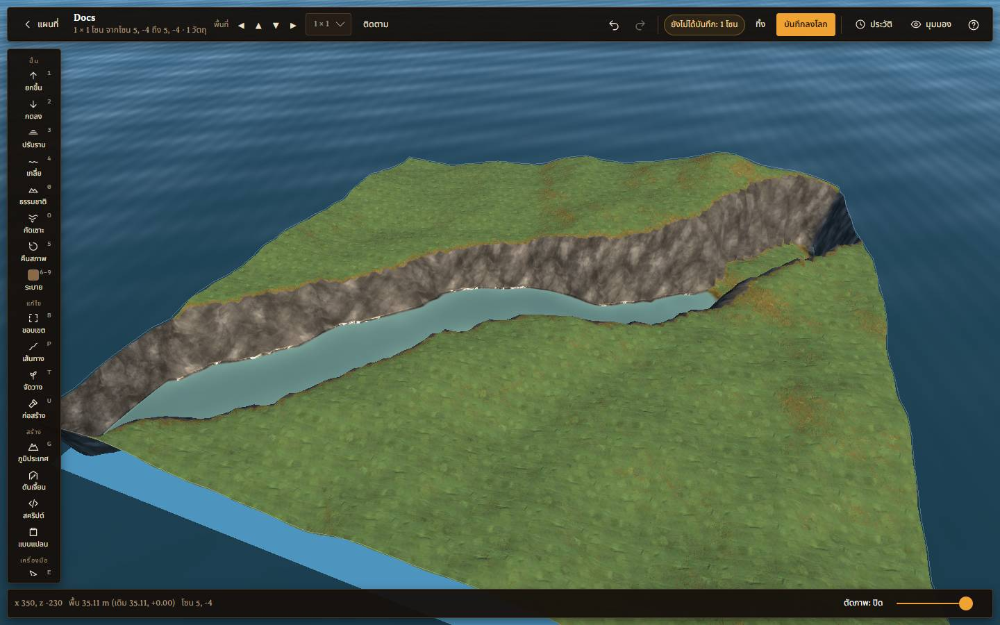

<!-- source: 2d41926b -->
# เส้นทาง

วาดเส้น แล้วปรับราบ ทำทางลาด ยกขึ้น กดลง เกลี่ย ขุด หรือระบายพื้นดินไปตามเส้น: ถนน ทางลาด
ทางยกระดับ คูน้ำ และแม่น้ำ

**ที่อยู่:** แถบเครื่องมือ ส่วน **แก้ไข** · **ปุ่ม:** `P` · **ใช้ได้กับ:** โลกที่บันทึกไว้ ไลฟ์

*เส้นห้าจุด วาดผ่านเนินสองลูก เลือก **ปรับราบ** ไว้ **ความสูง** ได้มาจากพื้นราบ
ด้วย `Alt`+คลิก และเปิด **ดูเป็นธรรมชาติ** ไว้ ยังไม่มีอะไรเปลี่ยน: แถบแสดงความกว้าง และขอบนุ่มของเส้นทาง
จนกว่าคุณจะกด **นำไปใช้ (Enter)** ส่วนวงกลมที่จุดสุดท้าย เป็นของตัวชี้*

## ใช้งาน

1. ในแถบเครื่องมือ คลิก **เส้นทาง** (`P`)
2. คลิกจุดไปตามเส้นทาง หรือกดค้างแล้วลาก เพื่อวาดอย่างอิสระ ใต้ตัวชี้ วงกลมแสดงความกว้าง ของเส้นทาง
   และวงที่จางกว่า แสดงขอบนุ่ม เมื่อมีจุดแล้ว แถบจะแสดงทั้งสองอย่าง ไปตามเส้น
3. ไม่บังคับ: ปรับเส้นอย่างละเอียด ลากจุดเพื่อย้าย ลากเส้นระหว่างสองจุด เพื่อเพิ่มจุดตรงนั้น
   `Ctrl`+คลิกจุด เพื่อลบ และ `Backspace` เพื่อลบจุดสุดท้าย
4. ในแผง เลือก **การกระทำ** แล้วตั้งค่าของการกระทำนั้น
5. กด **นำไปใช้ (Enter)** การเปลี่ยนแปลง เป็นการเลิกทำหนึ่งขั้นตอน ตั้งชื่อตามการกระทำ ("เส้นทาง: ปรับราบ")
6. ไม่บังคับ: เลือกการกระทำอื่น แล้วนำไปใช้กับเส้นเดิม (ปรับราบ แล้วปูหิน) หรือย้ายจุด แล้วนำไปใช้
   อีกครั้ง เส้นจะยังอยู่ จนกว่าคุณจะกด **ล้างเส้น (Esc)**

แผงแสดงจำนวนจุดของเส้น และความยาวของเส้น

*เส้นจากรูปแรก มุมกล้องเดิม: **ปรับราบ** ตัดถนนราบ ผ่านเนินทั้งสองลูก จากนั้น
**ระบายปูหิน** ด้วย **ความกว้าง** 4 m และ **ขอบนุ่ม** 1 m ปูหินตรงกลาง เส้นยังอยู่ สำหรับการกระทำถัดไป*

## การตั้งค่า

| การตั้งค่า | ทำอะไร |
|---|---|
| **การกระทำ** | สิ่งที่เกิดขึ้นตามเส้น (ดู [การกระทำ](#การกระทำ)) |
| **ความกว้าง** | ความกว้างของเส้นทาง 1 ถึง 40 m (ค่าเริ่มต้น 8 m) การกระทำมีผลเต็มที่ ตลอดความกว้างนี้ |
| **ขอบนุ่ม** | ระยะที่การเปลี่ยนแปลง ค่อยๆ จางลงในแต่ละด้าน 0 ถึง 15 m (ค่าเริ่มต้น 4 m) เพื่อให้เส้นทาง กลืนเข้ากับพื้นดิน ที่ **0** ขอบจะคม: เป็นร่องที่มีผนังตรงและชัน |
| **ความสูง** | **ปรับราบ**: ความสูงของเส้นทาง (m) `Alt`+คลิกพื้นดิน เพื่อเลือกค่า |
| **ปริมาณ** | **ยกขึ้น** / **กดลง**: มากเท่าใด (m ค่าเริ่มต้น 2) |
| **เริ่ม**, **สิ้นสุด** | **ทางลาด**: ความสูงที่จุดแรก และจุดสุดท้าย (m) ดู [ทางลาด](#ทางลาด) |
| **ความลึก** | **แม่น้ำ / คลอง**: ความลึกของท้องน้ำ ใต้ระดับน้ำทะเลตรงกลาง (m ค่าเริ่มต้น 2) |
| **เส้นโค้งนุ่มผ่านจุดต่างๆ** | เปิด (ค่าเริ่มต้น): เส้นโค้งนุ่ม ผ่านจุดของคุณ ปิด: เส้นตรงระหว่างจุด |
| **ดูเป็นธรรมชาติ (ขอบไม่เรียบ มีเนินเล็ก)** | ความกว้างที่เปลี่ยนไปตามทาง (มากหรือน้อยลงได้ถึง 45%) และขอบไม่เรียบ สำหรับทุกการกระทำ และเนินเล็กๆ บนผิว สำหรับ **ปรับราบ** **ทางลาด** **ยกขึ้น** **กดลง** และ **แม่น้ำ / คลอง** ด้วย เส้นทางจะดูเหมือนผ่านการใช้งาน มากกว่าทำด้วยเครื่องมือ |
| **เนินเล็ก**, **ขนาดเนินเล็ก**, **ลวดลายใหม่** | **ธรรมชาติ** และ **ดูเป็นธรรมชาติ**: เนินสูงและกว้างเท่าใด และลวดลายสุ่มชุดใหม่ ค่าเหล่านี้เป็นของแปรง [ธรรมชาติ](terrain.md#ธรรมชาต): ตั้งที่นี่ ที่นั่น หรือในเครื่องมือ [ขอบเขต](area.md) ก็เป็นค่าเดียวกัน |
| **มุมพักตัว** | **กัดเซาะ**: ความชันมากที่สุด ที่ยังคงตัวอยู่ได้ 10° ถึง 60° (ค่าเริ่มต้น 33°) เป็นค่าของแปรง [กัดเซาะ](terrain.md#กดเซาะ) ค่าเดียวกัน |

*เส้นตรงสองเส้นบนพื้นราบ แต่ละเส้น **กดลง** 3 m ด้วย **ความกว้าง** 6 m มองตามแนวเส้น ซ้าย: **ขอบนุ่ม** 0
ร่องที่มีผนังชันและตรง ขวา: **ขอบนุ่ม** 8 m ตลิ่งค่อยๆ ลาดลงไปในพื้นดิน*

## การกระทำ

| การกระทำ | ทำอะไร |
|---|---|
| **ปรับราบ** | ปรับเส้นทางให้ราบ ที่ **ความสูง**: ถนน ขั้นบันไดดินตามทางลาด หรือทางยกระดับข้ามแอ่ง |
| **ทางลาด (เริ่ม → สิ้นสุด)** | ทางลาดที่ขึ้นหรือลงสม่ำเสมอ จาก **เริ่ม** ถึง **สิ้นสุด** |
| **ยกขึ้น** | ยกเส้นทางขึ้น ตาม **ปริมาณ** โดยคงความสูงต่ำเดิมไว้: ตลิ่ง หรือคันดิน |
| **กดลง** | ขุดเส้นทางลง ตาม **ปริมาณ**: คูน้ำ หรือทางเดินที่จมลง |
| **เกลี่ย** | เกลี่ยพื้นดินตามเส้นทางให้เรียบ: แต่ละจุดเลื่อนเข้าหาค่าเฉลี่ย ของพื้นดินภายใน 3 m นำไปใช้อีกครั้ง เพื่อให้มากขึ้น |
| **ธรรมชาติ** | เนินเล็กๆ ที่ดูเป็นธรรมชาติ ไปตามเส้นทาง บนรูปทรงกว้างของพื้นดิน ด้วย **เนินเล็ก** **ขนาดเนินเล็ก** และลวดลาย: สิ่งที่เส้นทาง ที่ปรับราบหรือยกขึ้น ต้องมี เพื่อให้ดูเป็นพื้นดินอีกครั้ง |
| **กัดเซาะ** | ทำให้พื้นดินตามเส้นทาง ผุกร่อนในครั้งเดียว: ทางลาดทรุดตัวลงถึง **มุมพักตัว** ฝนกัดเป็นร่องน้ำ และทิ้งตะกอนรูปพัด แล้วทางลาดทรุดตัวอีกครั้ง |
| **คืนสภาพ** | กลับเป็นแบบที่โลกสร้างไว้ ตามเส้นทาง ลบการระบาย รวมถึงพื้นดินที่ยกหรือขุดด้วย ไม่จำกัด: เลิกทำถนนหรือคูน้ำ ได้แม้ประวัติการเลิกทำ จะหมดไปนานแล้ว |
| **แม่น้ำ / คลอง (น้ำ)** | ขุดท้องน้ำ ใต้ระดับน้ำทะเล ให้น้ำเข้ามาเติม (ดู [แม่น้ำหรือคลอง](#แมนำหรอคลอง)) |
| **ระบายดิน**, **ระบายปูหิน**, **ระบายดินพรวน** | ระบายเส้นทาง สีเต็มตลอดความกว้าง และค่อยๆ จางลงบนขอบนุ่ม |
| **ล้างการระบาย** | ระบายพื้นดินเปล่าของไบโอม ตามเส้นทาง (ดู [แปรงระบาย](terrain.md#แปรงระบาย)) |

**ปรับราบ** **ยกขึ้น** **กดลง** **เกลี่ย** **ธรรมชาติ** **กัดเซาะ** **คืนสภาพ** และการระบาย เป็นการกระทำเดียวกับ
[แปรง](terrain.md) และของเครื่องมือ [ขอบเขต](area.md) ในชื่อเดียวกัน (ขอบเขต แสดง คืนสภาพ เป็น
**กลับเป็นพื้นดินที่เกมสร้าง** ในกลุ่ม **กู้คืน**): แปรงกำหนดตำแหน่งด้วยการลาก เครื่องมือ ขอบเขต ด้วยส่วนที่เลือก
เครื่องมือ เส้นทาง ด้วยเส้น และพื้นดินเปลี่ยนไปแบบเดียวกัน

### ทางลาด

*ทางลาดสองจุด มองจากด้านข้าง จากพื้นดินที่เชิงทาง (**เริ่ม** 35.2 m) ถึงยอดแท่น
ที่ยกขึ้น 8 m (**สิ้นสุด** 43 m) ทางลาดขึ้นสม่ำเสมอ ตลอดทาง*

จนกว่าคุณจะพิมพ์หรือเลือกความสูง **เริ่ม** และ **สิ้นสุด** จะตามพื้นดินใต้จุดแรก และจุดสุดท้าย
การย้ายปลายทั้งสอง จึงอัปเดตค่าเหล่านี้ `Alt`+คลิกพื้นดิน เพื่อเลือกความสูงเริ่มต้น `Ctrl`+`Alt`+คลิก
เพื่อเลือกความสูงปลายทาง **ล้างเส้น (Esc)** ทำให้ค่าเหล่านี้ กลับไปตามพื้นดินอีกครั้ง ทางลาดที่คดเคี้ยว
มีความชันเท่ากันตลอดทาง

### แม่น้ำหรือคลอง

*แม่น้ำที่ขุดข้ามโซน ด้วย **แม่น้ำ / คลอง (น้ำ)**: น้ำทะเลไหลเข้ามาเติม*

Valheim ไม่มีน้ำไหล: น้ำในแม่น้ำ คือน้ำทะเล ที่ระดับเดียวกัน (30 m) ทุกที่ แม่น้ำจึงมีน้ำ
เฉพาะที่ท้องน้ำ อยู่ต่ำกว่าระดับน้ำทะเล การกระทำนี้ขุดท้องน้ำรูปตัว U ลึก **ความลึก** ใต้ระดับน้ำทะเลตรงกลาง
และสูงขึ้นถึงระดับน้ำ ที่ **ความกว้าง** ส่วน **ขอบนุ่ม** สร้างตลิ่ง การกระทำนี้ขุดอย่างเดียว: พื้นดินที่ต่ำกว่าอยู่แล้ว
ยังคงเดิม แม่น้ำจึงไหลลงทะเลสาบ หรือทะเลได้

ผ่านพื้นที่สูง แม่น้ำต้องตัดลึก และขีดจำกัด ±8 m ของเกม หยุดไว้ที่ความลึก 8 m (แถบสถานะจะแจ้ง)
ลดระดับพื้นดินใกล้ทะเลก่อน เดินตามพื้นที่ต่ำ หรือเปิด [ไม่จำกัด](terrain.md#ไมจำกด)

## ปุ่มลัด

| ปุ่มหรือเมาส์ | ทำอะไร |
|---|---|
| `P` | เลือก เส้นทาง |
| คลิก / กดค้างแล้วลาก | เพิ่มจุด / วาดเส้นอย่างอิสระ (หนึ่งจุดทุก 2 m) |
| ลากจุด / ลากเส้น | ย้ายจุด / เพิ่มจุดตรงนั้น แล้วย้าย |
| `Ctrl`+คลิกจุด | ลบจุดนั้น |
| `Backspace` | ลบจุดสุดท้าย |
| `Alt`+คลิก | เลือกความสูง (ปรับราบ) หรือจุดเริ่มของทางลาด |
| `Ctrl`+`Alt`+คลิก | เลือกความสูงปลายทางลาด |
| `Alt`+`Shift`+คลิก | ตั้งช่วงความสูงของ [มาสก์](masks.md) เป็น 2 m เหนือและใต้จุดนั้น เหมือนกับแปรง |
| `Enter` | นำการกระทำไปใช้ |
| `Esc` | ล้างเส้น `Esc` ครั้งที่สอง ออกจากเครื่องมือ |
| `Ctrl+Z` | เลิกทำ นำไปใช้ ครั้งล่าสุด |

## เคล็ดลับและข้อจำกัด

- **[มาสก์](masks.md) มีผลกับทุกการกระทำ** และขีดจำกัด ±8 m ก็เช่นกัน เว้นแต่เปิด
  [ไม่จำกัด](terrain.md#ไมจำกด) ไว้ ตรงที่เส้นทางถึงขีดจำกัด จุดจะเป็นสีแดง และแถบสถานะจะแจ้ง
  สวิตช์ ไม่จำกัด อยู่บนการ์ด **มาสก์** ข้างแผง เส้นทาง: สวิตช์เดียว สำหรับทุกเครื่องมือพื้นดิน
- **มุมแหลม** ต้องใช้สองจุดที่อยู่ใกล้กัน หรือปิด **เส้นโค้งนุ่มผ่านจุดต่างๆ**: เส้นโค้งนุ่ม
  ผ่านทุกจุดที่คุณคลิก
- **ตรวจความชันของทางลาดก่อน** ด้วย [วัด](measure.md): วัดจากเชิงถึงยอด **ความชัน** คือค่าที่ทางลาด
  จะได้
- **ล้างเส้น (Esc) ลบแค่เส้น** สิ่งที่นำไปใช้แล้ว ยังอยู่ `Ctrl+Z` ย้อนการ นำไปใช้ ทีละครั้ง
- **เส้นทางทำงานเฉพาะ ในพื้นที่ที่เปิดอยู่** และไม่เคยย้ายแถวจุดด้านนอกสุด (ดู
  [ขอบที่ล็อก](concepts/areas-and-zones.md#ขอบทลอก))

## หัวข้อที่เกี่ยวข้อง

- [ทำถนน หรือทางลาดขึ้นเนิน](guides/make-a-road.md)
- [ขุดแม่น้ำหรือบ่อน้ำ](guides/make-a-river.md)
- [ขีดจำกัดของพื้นดิน](concepts/ground-limits.md)
- [ปั้นและระบาย](terrain.md), [วัด](measure.md)
- [ขอบของเส้นทาง ค่อยๆ จางอย่างไร](concepts/ground-limits.md#ขอบของเสนทางจางอยางไร)
