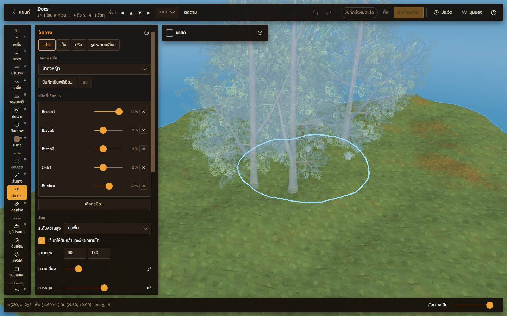
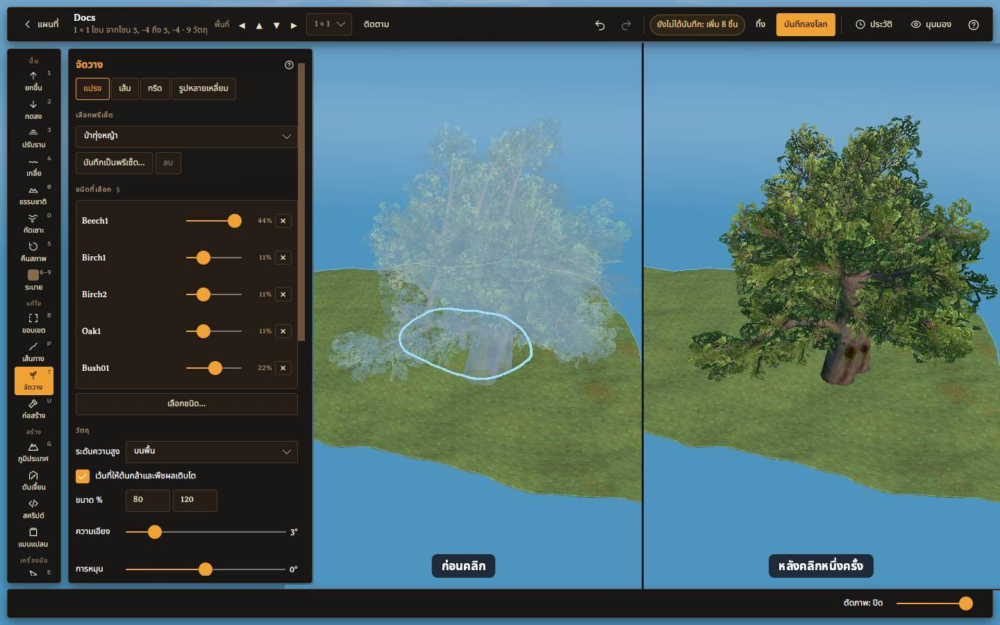
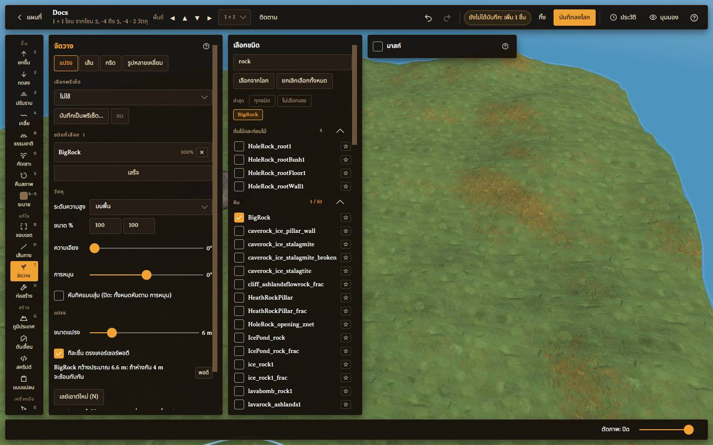
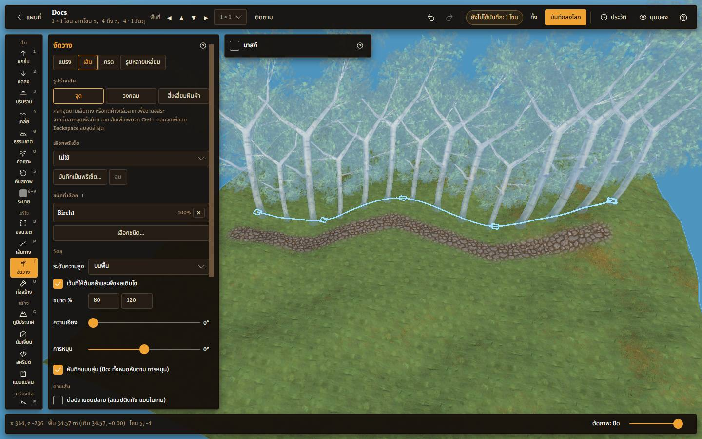
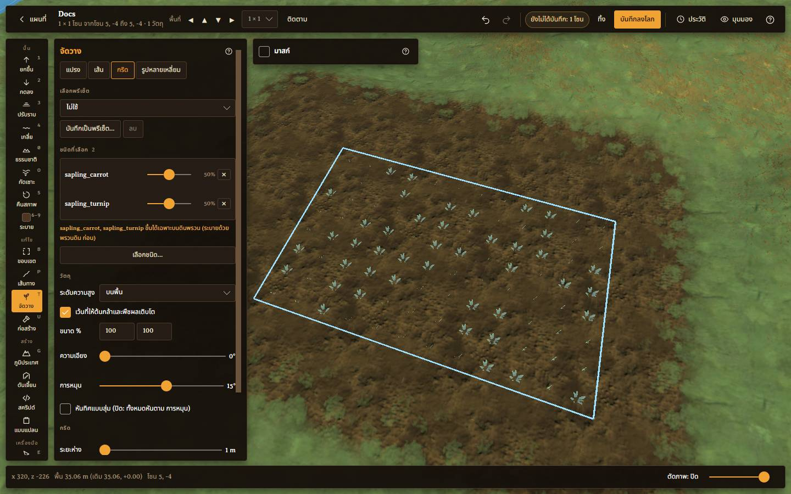
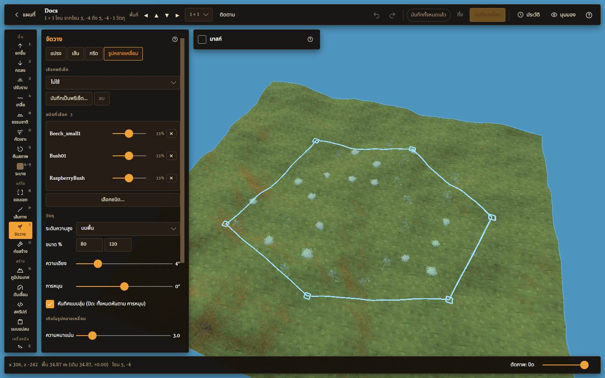
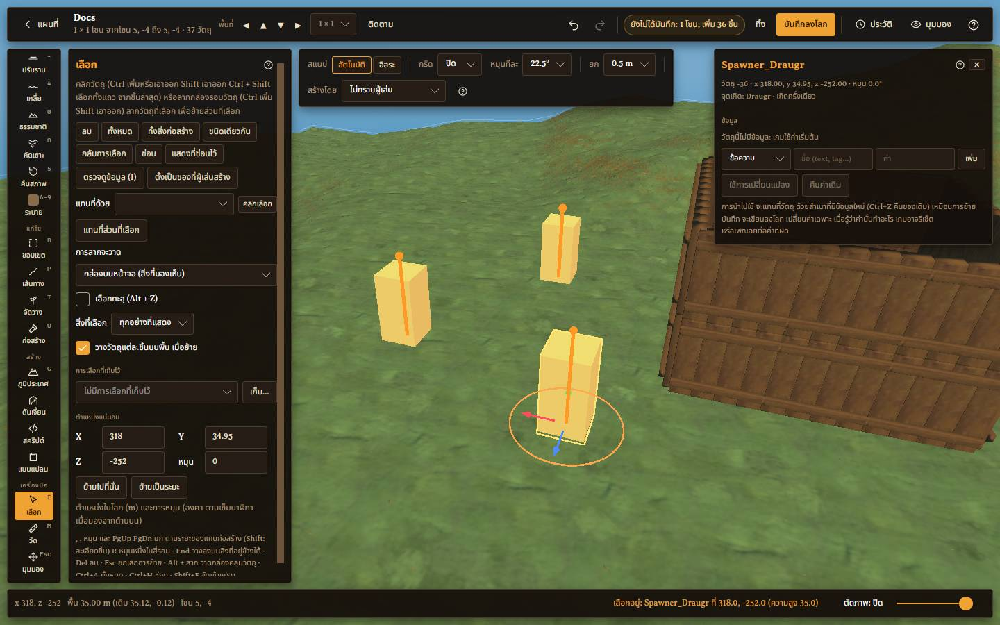

<!-- source: c6106c48 -->
# จัดวาง

ใส่ต้นไม้ หิน พุ่มไม้ พืชผล และจุดเกิด ลงในโลก ทีละชิ้น หรือทีละหลายร้อยชิ้น ชิ้นส่วนที่ผู้เล่น
สร้าง (กำแพง พื้น รั้ว เฟอร์นิเจอร์) วางด้วย [ก่อสร้าง](build.md) เครื่องมือที่อยู่ถัดลงไป บนแถบเครื่องมือ

**ที่อยู่:** แถบเครื่องมือ ส่วน **แก้ไข** · **ปุ่ม:** `T` · **ใช้ได้กับ:** โลกที่บันทึกไว้ ไลฟ์ (เวิร์กช็อป
มีแค่ [ก่อสร้าง](build.md))

*ต้นไม้และพุ่มไม้โปร่งใส ที่ตั้งอยู่ในวงแปรง คือสิ่งที่การคลิกหนึ่งครั้ง จะจัดวางพอดี แผงแสดง
พรีเซ็ต ป่าทุ่งหญ้า และชนิดในพรีเซ็ต*

*ซ้าย: ตัวอย่างโปร่งใส ในวงแปรง ขวา: จุดเดียวกัน หลังคลิกหนึ่งครั้ง ต้นไม้และพุ่มไม้
ตั้งอยู่ตรงที่ตัวอย่างแสดงไว้*

## ใช้งาน

ถ้าต้องการปลูกป่าเล็กๆ:

1. กด `T`
2. ในแผง **จัดวาง** ใต้ **เลือกพรีเซ็ต** เลือก **ป่าทุ่งหญ้า**
3. ที่ด้านบนของแผง เลือก **แปรง**
4. ชี้ไปที่พื้นดิน: ตัวอย่างโปร่งใส แสดงสิ่งที่การคลิกจะจัดวาง
5. คลิกเพื่อจัดวาง หรือลากเพื่อเพิ่มต่อไปเรื่อยๆ

สำหรับ เส้น กริด และ รูปหลายเหลี่ยม ให้วาดรูปทรงแทน ตรวจตัวอย่าง แล้วกด `Enter` (**จัดวาง (Enter)**)
รูปทรงจะยังอยู่หลังจัดวาง แต่ตัวอย่างว่างแล้ว (สิ่งที่จะจัดวาง อยู่ตรงนั้นแล้ว): กด **ล้างรูปทรง (Esc)** เพื่อวาด
รูปทรงถัดไป

การคลิก การลาก หรือ `Enter` แต่ละครั้ง เป็นการเลิกทำหนึ่งขั้นตอน (`Ctrl+Z`) ไม่มีอะไรถูกเขียนลงในโลก จนกว่าคุณจะ
**บันทึกลงโลก** (หรือ **นำไปใช้แบบไลฟ์**) ถ้าต้องการย้ายหรือลบ สิ่งที่จัดวางไว้ ให้ใช้ [เลือก](select.md)

## การตั้งค่า

แผง จากบนลงล่าง แถวที่ไม่เกี่ยวกับโหมด หรือชนิดที่เลือก จะถูกซ่อน ชนิดที่ติ๊กพร้อมสัดส่วน **อัตรา**
พรีเซ็ตของคุณ รายการโปรด และชนิดล่าสุด จะถูกเก็บไว้ ข้ามการเปิดโปรแกรม การตั้งค่าอื่น จะเริ่มใหม่
จากค่าเริ่มต้น [มาสก์](masks.md) อยู่บนการ์ดของตัวเอง ข้างแผง และมีผลกับทุกโหมด

| การตั้งค่า | ทำอะไร |
|---|---|
| **แปรง**, **เส้น**, **กริด**, **รูปหลายเหลี่ยม** | โหมด: ดู [โหมด](#โหมด) |
| **รูปร่างเส้น** | เฉพาะโหมด เส้น: **จุด** **วงกลม** หรือ **สี่เหลี่ยมผืนผ้า** ดู [เส้น](#เสน) |
| **เลือกพรีเซ็ต** | โหลดชุดผสม: ชนิดพร้อมสัดส่วน รวมถึง ความหนาแน่น ระยะห่าง การจับกลุ่ม ขนาดหย่อม ขนาด และ ความเอียง โดยเปิดการหันทิศแบบสุ่ม พรีเซ็ตในตัว: **ป่าทุ่งหญ้า** **แนวป่าดำ** **หนองน้ำ** **ดงเบอร์รี** **พื้นป่า** **หินทุ่งหญ้า** พรีเซ็ตของคุณ ตามมาเป็น **ของคุณ: *ชื่อ*** ชนิดที่โลกจัดวางไม่ได้ จะถูกข้ามไป (แถบสถานะบอกจำนวน) **ไม่ใช้** ไม่โหลดอะไร เมื่อเลือกหลังพรีเซ็ต จะยกเลิกการติ๊กทุกชนิด |
| **บันทึกเป็นพรีเซ็ต…** / **ลบ** | บันทึกชนิดที่เลือก สัดส่วน และการตั้งค่าเหล่านั้น ภายใต้ชื่อหนึ่ง **ลบ** ลบพรีเซ็ตของคุณ หลังถามก่อน |
| **ชนิดที่เลือก** | ชนิดที่คุณเลือก แต่ละชนิดมีแถบเลื่อนสัดส่วน และ ✕ เพื่อเอาออก ("ยังไม่มี" เมื่อยังไม่มีชนิดใด) เมื่อมีสองชนิดขึ้นไป ลากแถบเลื่อน เพื่อตั้งสัดส่วนของชนิดนั้น: ชนิดอื่นจะปรับตาม ให้สัดส่วนรวมเป็น 100% และแต่ละชนิด ได้อย่างน้อย 1% Beech ที่ 75% กับ Birch ให้ต้น Beech สามต้น ต่อ Birch หนึ่งต้น |
| **เลือกชนิด…** | เปิดการ์ด **เลือกชนิด**: ดู [เลือกสิ่งที่จะจัดวาง](#เลอกสงทจะจดวาง) |
| **วัตถุ: ระดับความสูง** | **บนพื้น**: วัตถุแต่ละชิ้นตั้งบนพื้นดิน (ส่วนของซากปรักหักพัง ตั้งด้วยฐาน) **เหนือพื้น**: สูง **ความสูง** เมตร เหนือพื้นดินข้างใต้ **ที่ความสูงเดียว**: ฐานของทุกวัตถุ อยู่ที่ **ความสูง** เดียวกัน ไม่ว่าพื้นดินจะเป็นอย่างไร (กำแพงระดับเดียว แท่น) |
| **ความสูง** | จำนวนเมตร สำหรับ เหนือพื้น หรือความสูง สำหรับ ที่ความสูงเดียว |
| **สแนปกับชิ้นส่วนที่มีอยู่** | แสดงเมื่อชนิดที่ติ๊ก เป็นส่วนของซากปรักหักพัง หรือดันเจี้ยน ที่มีจุดสแนป (ชิ้นส่วนที่ผู้เล่นสร้าง เป็นของ [ก่อสร้าง](build.md)) เปิด: ส่วนนั้นจะล็อกกับชิ้นส่วนรอบๆ เหมือนค้อน ในโหมด แปรง **ข้างๆ** วางต่อปลายชนปลาย กับชิ้นส่วนข้างเคอร์เซอร์ และ **ด้านบน** วางบนชิ้นส่วนใต้เคอร์เซอร์ บรรทัดด้านล่างของแผง บอกว่าสแนปกับอะไร ("สแนปข้างๆ *ชื่อ*") ดู [การสแนป](concepts/objects.md#การสแนป) |
| **เว้นที่ให้ต้นกล้าและพืชผลเติบโต** | แสดงเมื่อติ๊กต้นกล้า พืชผล หรือต้นไม้ที่โตจากต้นกล้า เปิด: เว้นที่ที่เกมต้องการ ให้เติบโตได้ ปิด: ชิดกันเท่าที่ต้องการ (อาจไม่เติบโต) ดู [กฎการเติบโต](concepts/objects.md#กฎการเตบโต) |
| **ขนาด %** ต่ำสุด / สูงสุด | วัตถุแต่ละชิ้น ได้ขนาดสุ่มระหว่างสองค่า 10 ถึง 300% (80 ถึง 120 ตั้งแต่แรก) |
| **ความเอียง** | การเอียงแบบสุ่ม 0 ถึง 20° |
| **การหมุน** | หมุนลวดลายของแปรง และทิศที่วัตถุทุกชิ้นหัน -180 ถึง 180° |
| **หันทิศแบบสุ่ม (ปิด: ทั้งหมดหันตาม การหมุน)** | เปิด: วัตถุแต่ละชิ้น หันไปทางสุ่ม ปิด: ทั้งหมดหันตาม การหมุน |
| **แปรง: ขนาดแปรง** | รัศมีแปรง 1 ถึง 30 m เป็นขนาดของแปรงปั้นด้วย: ค่าเดียวสำหรับทั้งสอง |
| **อัตรา** | แปรง: การลากปลูกเร็วเท่าใด 0.05 ถึง 1 ค่าที่สูงขึ้น เติมวงแปรงถึง ความหนาแน่น เร็วขึ้น เป็นค่าของแปรง จัดวาง เอง: **ความแรง** ของแปรงปั้น ไม่เปลี่ยนค่านี้ ซ่อนเมื่อเลือก ทีละชิ้น |
| **ทีละชิ้น ตรงเคอร์เซอร์พอดี** | แปรง: วัตถุหนึ่งชิ้น ตรงใต้เคอร์เซอร์พอดี ต่อหนึ่งคลิก การลาก ไม่เพิ่มอีก มีเพียงวัตถุ ที่อยู่ตรงจุดนั้นพอดี ที่ขวางได้ |
| **ความหนาแน่น** | แปรง และ รูปหลายเหลี่ยม: จำนวนวัตถุต่อ 100 m² 0.2 ถึง 20 |
| **ระยะห่าง** | แปรง และ รูปหลายเหลี่ยม: ระยะน้อยที่สุดระหว่างวัตถุ 0.5 ถึง 15 m รวมถึงวัตถุที่มีอยู่แล้วด้วย ใน กริด: ขนาดช่อง 1 ถึง 30 m |
| **การจับกลุ่ม** | แปรง และ รูปหลายเหลี่ยม: รวมวัตถุเป็นดง โดยมีที่โล่งคั่นระหว่างดง 0 ถึง 100% ค่า 0 คือกระจายสม่ำเสมอ |
| **ขนาดหย่อม** | เมื่อใช้ การจับกลุ่ม: ดงและที่โล่ง ใหญ่เท่าใด 5 ถึง 120 m |
| **พอดี** | แสดงเมื่อชนิดที่ติ๊ก กว้างกว่าระยะห่าง ("Beech1 กว้างประมาณ 6.2 m: ถ้าห่างกัน 4 m จะซ้อนทับกัน") คลิกเพื่อตั้งระยะห่าง เป็นความกว้างนั้น |
| **จัดวาง (Enter)**, **ล้างรูปทรง (Esc)**, **ลบจุดล่าสุด (Backspace)** | เส้น กริด และ รูปหลายเหลี่ยม: จัดวางสิ่งที่ตัวอย่างแสดง ลบรูปทรง หรือย้อนจุดล่าสุดที่คลิก |
| **เลย์เอาต์ใหม่ (N)** | สุ่มตำแหน่ง ชนิด ขนาด และทิศที่หัน ของตัวอย่างใหม่ (และดงใหม่ เมื่อใช้ การจับกลุ่ม) |

บรรทัดด้านล่าง บอกจำนวนวัตถุ ที่ตัวอย่างแสดง และปุ่มที่ใช้ได้ บรรทัดสีส้ม ใต้ชนิดที่เลือก
จะเตือนเมื่อมีสิ่งที่ต้องระวัง: "ยังไม่มีอะไรให้จัดวาง" หรือพืชผลที่ "ขึ้นได้เฉพาะบนดินพรวน
(ระบายด้วย พรวนดิน ก่อน)"

## เลือกสิ่งที่จะจัดวาง

**เลือกชนิด…** เปิดการ์ดข้างแผง ที่มีทุกชนิด ที่เกมบันทึกในโลก รวมถึงชนิดที่โลกของคุณ
ยังไม่มี และชนิดจากม็อดของคุณ สิ่งมีชีวิต ไอเทมที่ตก และร่างแร็กดอลล์ ไม่อยู่ในนี้ รวมถึงชิ้นส่วนของ
ค้อน และถาดเสิร์ฟ: สิ่งเหล่านั้นอยู่ในแผง [ก่อสร้าง](build.md) ต้นกล้าและพืชผล ของเครื่องพรวนดิน อยู่ทั้งสองที่
**เสร็จ** ปิดการ์ด

*การ์ด เลือกชนิด ค้นหา "rock" โดยติ๊ก BigRock ไว้: หมวด หิน นับชนิดที่ติ๊ก 1 ชนิด ข้างจำนวนทั้งหมด
และ BigRock อยู่หัวแถว ล่าสุด*

| ตัวควบคุม | ทำอะไร |
|---|---|
| **ค้นหาชนิด (oak, rock, bush…)** | กรองรายการตามชื่อ และเปิดทุกหมวด ที่มีผลตรงกัน จุดเกิดและรัง ค้นหาได้จากสิ่งมีชีวิตด้วย (`boar` พบ `Spawner_Boar`) |
| ช่องติ๊ก | ทุกชนิดที่ติ๊ก จะถูกจัดวาง วัตถุแต่ละชิ้น สุ่มเลือกชนิดหนึ่ง ตามสัดส่วน คลิกชื่อหมวด เพื่อพับหรือเปิด หลังชื่อ คือจำนวนชนิดในหมวด หรือ "ที่ติ๊ก / ทั้งหมด" |
| **เลือกจากโลก** | คลิกวัตถุในโลก เพื่อจัดวางเฉพาะชนิดของวัตถุนั้น `Shift` + คลิก เพิ่มเข้าในชนิดที่ติ๊ก (หรือเอาออก) `Esc` ยกเลิก ชิ้นส่วนก่อสร้างจะไม่ถูกเลือก: แถบสถานะ จะบอกให้วางด้วย ก่อสร้าง |
| **ยกเลิกเลือกทั้งหมด** | ยกเลิกการติ๊กทุกชนิด |
| **รายการโปรด** | คลิก ☆ หลังชนิด เพื่อติดดาว ชนิดที่ติดดาว จะแสดงเป็นปุ่ม เหนือรายการ |
| **ล่าสุด** | แปดชนิดล่าสุด ที่คุณจัดวาง ใหม่สุดก่อน ต่อจากชนิดที่เลือกอยู่ตอนนี้ |
| ปุ่มรายการโปรด และปุ่มล่าสุด | คลิก: ติ๊กหรือยกเลิกติ๊กชนิดนั้น `Shift` + คลิก: จัดวางเฉพาะชนิดนั้น **ทุกชนิด** / **ไม่เลือกเลย** ติ๊กหรือยกเลิกติ๊กทั้งแถว |

หมวดต่างๆ: **ต้นไม้และท่อนไม้** **หิน** **พุ่มไม้และไม้พุ่ม** **ของที่เก็บได้** **แร่และสายแร่**
**ซากปรักหักพังและโครงสร้าง** **เฟอร์นิเจอร์และของประดับ** **กระดูกและซาก** **จุดเกิด** **รังสิ่งมีชีวิต** **สิ่งมีชีวิตและ NPC**
(พ่อค้า นก) **เอฟเฟกต์และเครื่องหมาย** (หมอก เพลง โซนเหตุการณ์บอส) และ **วัตถุอื่นๆ** ชนิดที่ไม่มีโมเดล จะแสดงเป็นกล่อง ในตัวอย่าง

## โหมด

| โหมด | ทำงานอย่างไร |
|---|---|
| **แปรง** | ตัวอย่างตามเคอร์เซอร์ ภายในวงแปรง การคลิก จัดวางตามที่แสดงพอดี การลาก จะเพิ่มต่อไปเรื่อยๆ (ความเร็ว เป็นไปตาม ความหนาแน่น และ **อัตรา**) `Shift` + ลาก ลบชนิดที่ติ๊ก ใต้แปรง เมื่อติ๊กเฉพาะส่วน ของซากปรักหักพัง ที่สแนปได้ **ทีละชิ้น** จะเปิดเอง และแต่ละส่วนจะสแนป |
| **เส้น** | คลิกจุดไปตามเส้นทาง หรือวาดวงกลม หรือสี่เหลี่ยมผืนผ้า วัตถุจะวางทุก **ทุก** เมตร หรือต่อปลายชนปลาย |
| **กริด** | ลากกล่อง วัตถุหนึ่งชิ้น อยู่กลางแต่ละช่อง กล่องจะได้ช่องเต็ม เท่าที่ใส่ได้ |
| **รูปหลายเหลี่ยม** | คลิกจุดรอบผืนดิน หรือกดค้างแล้วลาก เพื่อวาดเส้นรอบอย่างอิสระ วัตถุจะอยู่ที่ตำแหน่งสุ่ม ข้างใน (ความหนาแน่น ระยะห่าง) |

ใน เส้น และ รูปหลายเหลี่ยม ลากจุดเพื่อย้าย ลากเส้นรอบ เพื่อเพิ่มจุด และ `Ctrl` + คลิกจุด เพื่อลบ
การดับเบิลคลิกจุดสุดท้าย จะจัดวางรูปทรง เหมือน `Enter` ใน กริด และ รูปหลายเหลี่ยม `,` `.` และ `Alt` + ล้อเมาส์ หมุน
ทั้งกล่องหรือรูปหลายเหลี่ยม พร้อมช่อง `R` หมุนหนึ่งในสี่รอบ

### เส้น

*โหมด เส้น กับ **จุด**: ต้นเบิร์ชทุก 4 m ตามเส้นโค้งนุ่ม ผ่านห้าจุด ข้างทางปูหิน แสดง
ก่อน **จัดวาง (Enter)** ต้นไม้สีจาง คือตัวอย่าง*

| ตัวควบคุม | ทำอะไร |
|---|---|
| **จุด** | คลิกจุดไปตามทาง หรือกดค้างแล้วลาก เพื่อวาดอย่างอิสระ **ปิดวง (กลับไปจุดแรก)** กลับไปที่จุดแรก เพื่อปิดรั้วรอบพื้นที่ **เส้นโค้งนุ่มผ่านจุดต่างๆ** วาดเส้นโค้ง แทนช่วงเส้นตรง |
| **วงกลม** | กดที่จุดศูนย์กลาง แล้วลากออก จนได้ขนาด ปล่อยเพื่อดู |
| **สี่เหลี่ยมผืนผ้า** | กดที่มุมหนึ่ง แล้วลากไปยังมุมตรงข้าม |
| **ต่อปลายชนปลาย (สแนปติดกัน แบบในเกม)** | แต่ละส่วนเริ่ม ตรงที่ส่วนก่อนหน้าจบ หมุนไปตามเส้น เหมือนที่ค้อนสแนป: กำแพงของซากปรักหักพัง แถวพื้นเก่า เมื่อติ๊กหลายชนิด จะสลับกัน เปิดเอง เมื่อทุกชนิดที่ติ๊ก เป็นส่วนที่เกมสแนป เมื่อเปิด วงกลมจะปรับขนาด ให้พอดีกับจำนวนส่วนเต็ม และด้านของสี่เหลี่ยมผืนผ้า จะเติมจากมุม ให้มุมมาบรรจบกัน ถ้าต้องการวางชิ้นส่วนของค้อน ต่อปลายชนปลาย (รั้ว กำแพงไม้แหลม) ให้ใช้ **วางเรียง** ของ [ก่อสร้าง](build.md#วางชนสวนเรยงตามเสน-หรอเปนกรด) |
| **เลเยอร์** | เมื่อใช้ ต่อปลายชนปลาย: ซ้อนเส้นขึ้นไป สูง 1 ถึง 20 ส่วน |
| **ทุก** | เมื่อไม่ใช้ ต่อปลายชนปลาย: ระยะระหว่างวัตถุ 0.5 ถึง 30 m |
| **ความคดเคี้ยว** | การเยื้องด้านข้างแบบสุ่ม จากเส้น 0 ถึง 5 m |
| **หันตามเส้น (บวก การหมุน แทนการหันแบบสุ่ม)** | เปิด (ค่าเริ่มต้น): วัตถุแต่ละชิ้น หันไปตามเส้น บวก การหมุน ปิด: หันทิศแบบสุ่ม วงกลมและสี่เหลี่ยมผืนผ้า หันตามเส้นรอบเสมอ |

- เมื่อเส้นไม่จบที่ส่วนเต็ม บรรทัดด้านล่าง จะบอกว่าเหลือเท่าใด ("เหลือเส้น 0.8 m ที่ปลาย: ย้ายจุด
  เพื่อปิด")
- เส้นที่เริ่มภายใน 1 m จากชิ้นส่วนที่มีอยู่ (เมื่อเปิด **สแนปกับชิ้นส่วนที่มีอยู่**) จะต่อจากชิ้นส่วนนั้น ที่ระดับ
  เดียวกัน
- บนทางลาด ส่วนที่ต่อปลายชนปลาย จะอยู่ระดับเดิม และขยับขึ้นหรือลงเป็นขั้น ตามพื้นดิน ถ้าต้องการแถวที่เรียบสม่ำเสมอ ให้ปรับพื้นดิน
  ตามเส้นให้ราบก่อน ([เส้นทาง](path.md) ปรับราบ) หรือใช้ **ที่ความสูงเดียว**

### กริด

*แครอทและหัวผักกาด บนกริดที่หมุน 15° มองจากด้านบนใกล้ๆ จึงเห็นพืชผลในแต่ละช่อง บรรทัดสีส้ม ใน
แผง เตือนว่าพืชผล ต้องการดินพรวน*

### รูปหลายเหลี่ยม

*รูปหลายเหลี่ยม ที่วาดทีละจุด พร้อมตัวอย่างพุ่มไม้ และต้นไม้อ่อน ที่ตำแหน่งสุ่มข้างใน*

ตำแหน่งจะถูกสุ่มครั้งเดียว และเก็บไว้ ตราบที่รูปหลายเหลี่ยม ยังเหมือนเดิม **เลย์เอาต์ใหม่ (N)** สุ่มตำแหน่งใหม่

## จุดเกิดและรัง

จุดเกิด คือเครื่องหมาย ที่มองไม่เห็นของเกม ที่ใส่สิ่งมีชีวิต ในค่าย หมู่บ้าน และดันเจี้ยน หาได้ใน
**เลือกชนิด** ใต้ **จุดเกิด** (ค้นหาสิ่งมีชีวิต: `boar`) แล้วจัดวางเหมือนชนิดอื่น แต่ละชนิดแสดง
สิ่งที่เกิด ซึ่งอ่านจากเกมของคุณ:

- สิ่งมีชีวิต และดาว (`Boar · 0–2 ★`)
- **เกิดครั้งเดียว** (ครั้งแรกที่ผู้เล่นเข้าใกล้ และไม่เกิดอีก เมื่อตายแล้ว) หรือ **เกิดใหม่ *N* นาทีหลังตาย**
- **เฉพาะกลางคืน** **เฉพาะกลางวัน** หรือ **เมื่อมีเหตุการณ์ปลุก** สำหรับไม่กี่ชนิด ที่รออยู่

สิ่งมีชีวิต ดาว และเวลาเกิดใหม่ กำหนดตายตัวตามชนิด: เลือกชนิดที่เกิดสิ่งที่คุณต้องการ **รังสิ่งมีชีวิต**
(รัง greydwarf กองกระดูก...) จะเกิดสิ่งมีชีวิตรอบตัวเรื่อยๆ จนกว่าจะถูกทำลาย บรรทัดของรัง บอกจำนวนและระยะ
("Greydwarf, Greydwarf_Elite · สูงสุด 3 ตัวรอบๆ ภายใน 5 m") ดู [จุดเกิด](concepts/objects.md#จดเกด)

*ภาพใกล้ของจุดเกิดหมูป่าสองจุด และจุดเกิด draugr หนึ่งจุด ข้างกระท่อม บรรทัดใน ตัวตรวจดูข้อมูล ของ draugr ที่เลือก
บอกสิ่งที่เกิด และบอกว่าจะกลับมาหรือไม่*

ในมุมมอง 3D จุดเกิดและรังแต่ละจุด แสดงเป็นกล่องเรียบๆ มีเครื่องหมายอยู่ด้านบน มองทะลุสิ่งที่บังอยู่ได้
ภายใน 250 m: สีส้มสำหรับจุดเกิด (สีแดง เมื่อสิ่งมีชีวิตเกิดใหม่ได้) สีม่วงสำหรับรัง ตั้งแต่แรกจะซ่อนไว้: เปิด **จุดเกิด**
และ **รังสิ่งมีชีวิต** ใน [แผง มุมมอง](editor-basics.md)

## ปุ่มลัด

| ปุ่มหรือเมาส์ | ทำอะไร |
|---|---|
| `T` | เปิด จัดวาง |
| คลิก / ลาก | แปรง: จัดวาง / เพิ่มต่อไปเรื่อยๆ เส้น และ รูปหลายเหลี่ยม: เพิ่มจุด กริด: วาดกล่อง |
| `Shift` + ลาก | แปรง: ลบชนิดที่ติ๊ก ใต้แปรง |
| `Ctrl` + คลิกจุด | เส้น และ รูปหลายเหลี่ยม: ลบจุดนั้น |
| `Enter` | จัดวางเส้น กริด หรือรูปหลายเหลี่ยม |
| `Esc` | ยกเลิก **เลือกจากโลก** หรือล้างรูปทรง เมื่อไม่มีอะไรวาดอยู่ กลับไปที่ **มุมมอง** |
| `Backspace` | ลบจุดล่าสุด |
| `N` | เลย์เอาต์ใหม่ |
| `,` `.` หรือ `Alt` + ล้อเมาส์ | หมุนทีละ 15° (`Shift` ละเอียดขึ้น: 1°): ทิศที่หัน หรือใน กริด และ รูปหลายเหลี่ยม ทั้งกล่องหรือรูปหลายเหลี่ยม |
| `R` | หมุนแบบเดียวกัน หนึ่งในสี่รอบ |
| `[` `]` | ขนาดแปรง |
| `PgUp` / `PgDn` หรือ `Ctrl` + ล้อเมาส์ | ยกหรือลดระดับความสูง ทีละ 0.5 m (`Shift` ละเอียดขึ้น: 0.1 m) จาก บนพื้น จะเริ่มยกขึ้นเหนือพื้น |
| `Alt` + คลิก | เปลี่ยนเป็น ที่ความสูงเดียว ที่ยอดของชิ้นส่วนที่คลิก (เพื่อวางบนชิ้นส่วนนั้น) หรือของพื้นดินตรงนั้น |
| `Ctrl+Z` | เลิกทำการจัดวางครั้งล่าสุด |

ปุ่มทั้งหมดของเอดิเตอร์ อยู่ใน [ปุ่มลัด](help/shortcuts.md)

## เคล็ดลับและข้อจำกัด

- **เลิกทำ:** `Ctrl+Z` ย้อนการคลิก การลาก หรือรูปทรง หลังบันทึกก็ได้ (แล้วบันทึกอีกครั้ง) ดู
  [เลิกทำการเปลี่ยนแปลง](guides/undo-changes.md)
- สูงสุด 2000 วัตถุ ต่อหนึ่งเส้น กริด หรือรูปหลายเหลี่ยม และ 400 ต่อการคลิกแปรงหนึ่งครั้ง
- วัตถุจะอยู่ได้เฉพาะ ในพื้นที่ที่เปิดอยู่ ไม่อยู่บนแถวจุดด้านนอกสุด และเฉพาะที่ มาสก์ อนุญาต
- วัตถุบนพื้น จะถูกข้ามไป ตรงที่พื้นดินอยู่ใต้น้ำ ลึกกว่า 0.3 m (ยกเว้นสาหร่ายทะเล)
  เมื่อใช้ เหนือพื้น หรือ ที่ความสูงเดียว วัตถุอาจตั้งอยู่เหนือน้ำได้
- แปรง และ รูปหลายเหลี่ยม เว้น ระยะห่าง จากสิ่งที่ตั้งอยู่แล้ว เส้น และ กริด ไม่สนใจค่านี้ ยกเว้นวัตถุที่อยู่ตรงจุดพอดี
  การจัดวางรูปทรงเดิมสองครั้ง จึงไม่ซ้อนกันเป็นสองเท่า
- พืชผลขึ้นได้เฉพาะ บนดินพรวน: ระบายด้วย **พรวนดิน** (หรือ ระบาย ของเครื่องมือ ขอบเขต) ก่อน
- ต้นกล้าและพืชผลที่คุณจัดวาง นับเป็นของที่ผู้เล่นสร้าง โดยผู้เล่นที่เลือกไว้ใน **สร้างโดย** บน
  [แถบก่อสร้าง](build.md#แถบกอสราง) ต้นไม้ หิน จุดเกิด และส่วนของซากปรักหักพัง ไม่นับ ดู
  [ชิ้นส่วนที่ผู้เล่นสร้าง](concepts/objects.md#ชนสวนทผเลนสราง)
- วัตถุใหม่ เป็นของใหม่เอี่ยม: ไม่มีของข้างใน ไม่มีพลังชีวิต ถ้าต้องการเติมหีบ ดู
  [เปลี่ยนของในหีบ](guides/fill-a-chest.md)

## หัวข้อที่เกี่ยวข้อง

- [ปลูกป่า ไร่ หรือแนวพุ่มไม้](guides/plant-a-forest.md)
- [เคลียร์ต้นไม้และหิน ปรับพื้นที่ก่อสร้างให้ราบ](guides/clear-an-area.md)
- [วัตถุคืออะไร](concepts/objects.md#วตถคออะไร)
- [ก่อสร้าง](build.md) · [เลือก](select.md) · [มาสก์](masks.md)
