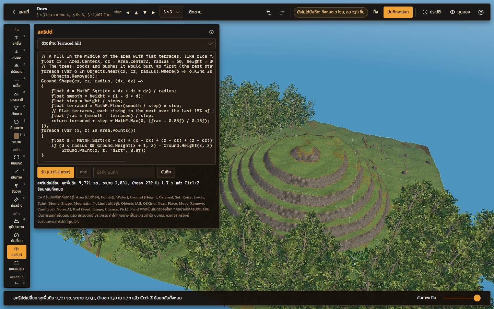
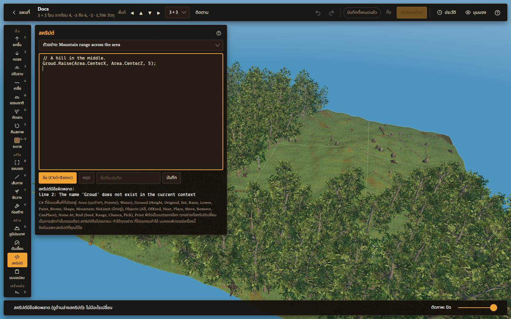

<!-- source: f2b8214d -->
# สคริปต์

เขียน C# ไม่กี่บรรทัด ที่ปั้น ระบาย และเติมพื้นที่ที่เปิดอยู่ ตามกฎที่กำหนด: เทือกเขา ป่าเฉพาะบนทางลาดเอียงเล็กน้อย
ขั้นบันได ลานปูหินที่ความสูงเฉลี่ยพอดี

**ที่อยู่:** แถบเครื่องมือ ส่วน **สร้าง** · **ปุ่ม:** ไม่มี (`Ctrl+Enter` รันสคริปต์) · **ใช้ได้กับ:** โลกที่บันทึกไว้ ไลฟ์
(ไม่รวมเวิร์กช็อป)


*ตัวอย่าง Terraced hill ที่รันบนพื้นที่ 3 × 3: โค้ดอยู่ในแผง และใต้โค้ด คือบรรทัดผลลัพธ์ ที่บอกว่า
สคริปต์เปลี่ยนอะไร*

ไม่ต้องติดตั้งอะไร: เอดิเตอร์คอมไพล์สคริปต์เอง หากไม่เคยเขียน C# มาก่อน ให้เริ่มจาก
[ตัวอย่าง](#ตวอยาง) แล้วเปลี่ยนตัวเลข หรือทำตาม [สคริปต์แรกของคุณ](#สครปตแรกของคณ)

## ใช้งาน

1. เปิดพื้นที่ในเอดิเตอร์ 3D สคริปต์ทำงานบน **พื้นที่ที่เปิดอยู่** (โซนที่คุณเห็น)
2. เลือก **สคริปต์** ในส่วน **สร้าง** ของแถบเครื่องมือ
3. เลือกตัวอย่าง หรือสคริปต์ที่บันทึกไว้ในรายการ หรือเขียนเองในช่องโค้ด
4. กด **รัน (Ctrl+Enter)** ช่องผลลัพธ์จะแสดง "กำลังคอมไพล์…" "กำลังรัน…" แล้วแสดงสิ่งที่สคริปต์พิมพ์ออกมา และ
   สิ่งที่สคริปต์เปลี่ยน หรือสิ่งที่ผิดพลาด
5. ดูผลลัพธ์ เลิกทำ (ลูกศรในแถบด้านบน) จะย้อนการรันทั้งหมด ในขั้นตอนเดียว `Ctrl+Z` ก็ทำได้เช่นกัน เมื่อ
   คุณคลิกในมุมมอง 3D แล้ว (ในช่องโค้ด จะเลิกทำการพิมพ์แทน) เปลี่ยนตัวเลข แล้วรันอีกครั้ง จนกว่า
   จะพอใจ
6. กด **บันทึกลงโลก** (หรือ **นำไปใช้แบบไลฟ์**) เพื่อเก็บไว้ เหมือนการเปลี่ยนแปลงอื่นๆ

ไม่มีอะไรเปลี่ยน ขณะที่สคริปต์รัน: เมื่อรันเสร็จ ทุกอย่างที่สคริปต์เปลี่ยน จะเข้าสู่พื้นที่พร้อมกัน เป็น
การเลิกทำหนึ่งขั้นตอน หากสคริปต์มีข้อผิดพลาด ล้มเหลว ถูกหยุด หรือรันครบ 2 นาที จะไม่มีอะไรเปลี่ยน

## สคริปต์แรกของคุณ

บทเรียนนี้ ยกเนินดินขึ้นตรงกลางพื้นที่ แล้วทำให้สูงขึ้น

1. เปิดพื้นที่ แล้วเลือก **สคริปต์**
2. เลือกข้อความทั้งหมดในช่องโค้ด แล้วแทนที่ด้วย:

   ```csharp
   // เนินดินสูง 10 m กว้าง 30 m ตรงกลางพื้นที่
   Ground.Shape(Area.CenterX, Area.CenterZ, 15, (dx, dz) =>
   {
       float d = MathF.Sqrt(dx * dx + dz * dz) / 15;   // 0 ตรงกลาง 1 ที่ขอบ
       return 10 * (1 - d);                            // เมตรที่จะเพิ่ม
   });
   Print($"The top is at {Ground.Height(Area.CenterX, Area.CenterZ):0.0} m.");
   ```

3. กด `Ctrl+Enter` เนินดินจะยกขึ้นตรงกลางพื้นที่ ผลลัพธ์บอกว่ายอดอยู่ที่ไหน และจุดพื้นดิน
   เปลี่ยนไปกี่จุด
4. คลิกในมุมมอง 3D แล้วกด `Ctrl+Z` เนินดินจะหายไป
5. คลิกในช่องโค้ด เปลี่ยน `10 *` เป็น `20 *` แล้วกด `Ctrl+Enter` อีกครั้ง เนินดินจะสูงเป็นสองเท่า
6. ไม่บังคับ: พิมพ์ชื่อในช่องชื่อ แล้วกด **บันทึก** เพื่อหาสคริปต์ในรายการ ครั้งถัดไป

`Ground.Shape` เพิ่มเมตร ที่ฟังก์ชันของคุณคืนค่า ให้ทุกจุด ภายใน 15 m จากตรงกลาง `dx` และ `dz` คือ
ระยะเป็นเมตรจากตรงกลาง คำสั่งอื่นทั้งหมด อยู่ใน [ข้อมูลอ้างอิง API](#ขอมลอางอง-api)

## การตั้งค่า

| การตั้งค่า | สิ่งที่ทำ |
|---|---|
| **รายการ** | ตัวอย่างเจ็ดแบบ ("ตัวอย่าง: …") แล้วตามด้วยสคริปต์ที่คุณบันทึกไว้ เรียงจากใหม่สุด การเลือกรายการ จะ **แทนที่** ข้อความในช่องโค้ด: บันทึกสคริปต์ของคุณเองก่อน ตัวอย่างจะล้างช่องชื่อ สคริปต์ที่บันทึกไว้ จะใส่ชื่อของตัวเองในช่องนั้น |
| **ช่องโค้ด** | สคริปต์ `Tab` เยื้องบรรทัด `Ctrl+Enter` รันสคริปต์ `Ctrl+Z` เลิกทำการพิมพ์ ไม่ใช่การรัน |
| **รัน (Ctrl+Enter)** | คอมไพล์และรันสคริปต์ บนพื้นที่ที่เปิดอยู่ การเปลี่ยนแปลงของสคริปต์ เป็น **การเลิกทำหนึ่งขั้นตอน** ชื่อ "สคริปต์: " ตามด้วยชื่อรายการ ใน ประวัติ |
| **หยุด** | หยุดสคริปต์ที่กำลังรัน ไม่ว่ากำลังทำอะไรอยู่: สิ่งที่ทำไปแล้ว จะไม่ถูกเก็บไว้ |
| ช่องชื่อ **บันทึก** | บันทึกโค้ด ภายใต้ชื่อที่พิมพ์ และเลือกในรายการ อักขระที่ชื่อไฟล์ใช้ไม่ได้ จะกลายเป็น `_` การบันทึกทับสคริปต์อื่น ที่บันทึกไว้ จะถามก่อน |
| **ผลลัพธ์** | สิ่งที่สคริปต์พิมพ์ออกมา (`Print`) แล้วตามด้วยสิ่งที่สคริปต์เปลี่ยน หรือข้อผิดพลาด พร้อมบรรทัดที่ผิด |

สคริปต์ที่บันทึกไว้ คือไฟล์ `<name>.csx` ในโฟลเดอร์ `scripts` ของโฟลเดอร์ข้อมูลของเอดิเตอร์
(`~/.local/share/ValheimWorldEditor/scripts` บน Linux, `%LOCALAPPDATA%\ValheimWorldEditor\scripts` บน Windows,
`~/Library/Application Support/ValheimWorldEditor/scripts` บน macOS) แก้ไขด้วยโปรแกรม แก้ข้อความใดก็ได้ หรือแชร์ได้:
ไฟล์ `.csx` ที่วางไว้ที่นั่น จะแสดงในรายการ เมื่อเปิดเอดิเตอร์ใหม่ หรือหลังจากคุณบันทึกสคริปต์

## ตัวอย่าง

ตัวอย่างแต่ละแบบ เป็นสคริปต์ที่สมบูรณ์ พร้อมรันบนพื้นที่ใดก็ได้ อ่านเพื่อดูว่าใช้ API อย่างไร

| ตัวอย่าง | สิ่งที่ทำ |
|---|---|
| **Mountain range across the area** (เทือกเขาข้ามพื้นที่) | ภูเขาแบบ ยอดเขาเดี่ยว สี่ลูก เรียงเป็นแนว จากตะวันตกเฉียงใต้ ไปตะวันออกเฉียงเหนือ แต่ละลูกสูง 35 ถึง 60 m `Rnd.Seed = 7` จึงได้เทือกเขาเดิมทุกครั้งที่รัน การบันทึกจะเปลี่ยนเป็นแผ่นพื้นดิน (เกินขีดจำกัด 8 m ของเกม) |
| **Terraced hill** (เนินขั้นบันได) | เนินสูง 30 m รัศมี 60 m ตัดเป็นขั้นบันไดราบหกขั้น เหมือนนาขั้นบันได ต้นไม้ หิน และพุ่มไม้ ที่จะถูกฝัง จะถูกนำออกก่อน (สิ่งอื่นยังอยู่) ขั้นที่ชัน จะระบายเป็นดิน |
| **Canyon with a river** (หุบผาที่มีแม่น้ำ) | หุบผาคดเคี้ยว จากตะวันตกไปตะวันออก กว้างข้างละ 18 m จากแนวเส้น ขุดลึกถึง 3 m ใต้ระดับน้ำทะเล ให้น้ำเต็ม และค่อยๆ จางหายไป ในช่วง 30 m สุดท้าย ที่ขอบพื้นที่ |
| **Scatter boulders** (โปรยก้อนหินใหญ่) | ก้อนหินใหญ่ (`rock4_forest`, `rock4_coast`, `rock4_heath`) ทุก 6 m ในที่ที่นอยส์สูง มากขึ้นบนทางลาด แต่ละก้อนหมุนและกำหนดขนาด แบบสุ่ม พิมพ์จำนวนออกมา |
| **Ring of trees** (วงต้นไม้) | วงต้นบีช 36 ต้น ห่างจากตรงกลาง 40 m ต้นไม้ภายในวง จะถูกนำออก |
| **Flat paved base** (ฐานราบปูหิน) | สี่เหลี่ยม 40 × 40 m ที่ปรับระดับ ไปที่ความสูงเฉลี่ยของตัวเอง และปูหิน พร้อมทางลาดเรียบ 10 m ไปยังพื้นดินรอบๆ อยู่ภายในขีดจำกัด 8 m (`Ground.NoLimit = false`) พิมพ์ความสูงออกมา |
| **Noise landscape** (ภูมิประเทศจากนอยส์) | แผ่นดินลูกคลื่นทั่วทั้งพื้นที่: เนินเขาและหุบเขา สูงหรือต่ำได้ถึง 25 m มีเนินเล็กๆ อยู่ด้านบน และค่อยๆ กลับเป็นพื้นดินเดิม ในช่วง 40 m สุดท้ายที่ขอบ |

## สคริปต์มองโลกอย่างไร

- **C# ธรรมดา** สคริปต์คือรายการคำสั่ง ที่รันจากบนลงล่าง ประกาศตัวแปร ลูป ฟังก์ชัน
  และคลาสได้ และใช้ .NET ได้ (`MathF`, `System.Linq`…) `using System`, `System.Linq` และ
  `System.Collections.Generic` มีอยู่แล้ว
- **เมตรของโลก** ทุกตำแหน่งเป็นเมตร: **x** ไปทางตะวันออก **z** ไปทางเหนือ เป็นตัวเลขเดียวกับในแถบสถานะ และ
  คำสั่ง `pos` ของเกม ความสูงเป็นเมตร เหนือศูนย์ของโลก ทะเลอยู่ที่ `Area.Water` (30 m)
- **หนึ่งจุดต่อหนึ่งเมตร** `Ground.Set(x, z, …)` เปลี่ยนจุดที่ใกล้ (x, z) ที่สุด `Ground.Height` อ่านค่าอย่างต่อเนื่อง
  ระหว่างจุด ตามที่วาดพื้นดิน
- **การเปลี่ยนแปลงของตัวเอง** สคริปต์เห็นสิ่งที่ตัวเอง เปลี่ยนไปแล้ว (ยกจุดหนึ่ง แล้ว `Ground.Height` จะให้ความสูง
  ใหม่) แต่ `Objects.All` จะคงเป็นพื้นที่ ตามที่เป็นตอนสคริปต์เริ่ม
- **เฉพาะพื้นที่ที่เปิดอยู่** แถวจุดด้านนอก คงเดิม พื้นที่จึงยังต่อกับพื้นที่ข้างเคียง การเปลี่ยนแปลง
  ตรงนั้น หรือนอกพื้นที่ จะถูกเพิกเฉย โดยไม่มีข้อผิดพลาด เปิดพื้นที่ที่ใหญ่ขึ้น (ได้ถึง 17 × 17 โซน) สำหรับงานที่ใหญ่ขึ้น
- **เกินขีดจำกัด 8 m** `Ground.NoLimit` เปิดอยู่ เหมือนสวิตช์ [ไม่จำกัด](concepts/ground-limits.md#ไมจำกด): พื้นดิน
  ไปได้ถึง 400 m เหนือหรือใต้พื้นดินที่เกมสร้าง และการบันทึก จะเปลี่ยนเป็นแผ่นพื้นดิน ที่เกมของผู้เล่นทุกคน
  นับเป็นพื้นดินที่เกมสร้าง `Ground.NoLimit = false;` จะอยู่ภายใน 8 m ของเกม: จุดที่เกินจะหยุดที่นั่น และ
  บรรทัดผลลัพธ์ จะบอกว่ากี่จุด
- **ไม่มีมาสก์** [มาสก์](masks.md) จำกัดเครื่องมือที่คุณใช้ด้วยมือ ไม่ใช่สคริปต์ ให้ตรวจสิ่งที่ต้องการในสคริปต์เอง
  (`Ground.Biome` ความสูง ความชัน)
- **เริ่มใหม่ทุกครั้งที่รัน** ตัวแปร `Rnd` และ `Objects.All` เริ่มใหม่ รันได้ทีละสคริปต์

## ข้อมูลอ้างอิง API

### Area

พื้นที่ที่เปิดอยู่

| สมาชิก | สิ่งที่ให้ |
|---|---|
| `Area.MinX`, `Area.MinZ`, `Area.MaxX`, `Area.MaxZ` | มุมของพื้นที่ (เมตรของโลก) พื้นที่ 3 × 3 กว้าง 192 m |
| `Area.CenterX`, `Area.CenterZ` | ตรงกลางของพื้นที่ |
| `Area.Points()` | ทุกจุดพื้นดิน ที่สคริปต์เปลี่ยนได้ (ไม่รวมแถวด้านนอก) เป็น `(x, z)` ทีละแถว จากทางใต้: `foreach (var (x, z) in Area.Points()) { … }` `Area.Points(step: 4)` เอาทุกเมตรที่ 4 สำหรับการโปรย ระยะ 0 หรือน้อยกว่า หรือระยะที่เล็กเกินกว่า จะเลื่อนไปตามพื้นที่ได้ จะหยุดสคริปต์พร้อมข้อผิดพลาด |
| `Area.Inside(x, z)` | จุดนั้นอยู่ในพื้นที่หรือไม่ (ไม่อยู่บนขอบ) |
| `Area.Water` | ระดับน้ำทะเล (30 m หรือตามที่การตั้งค่า Expand World Rivers ของโลกกำหนด) |
| `Area.WorldSeed`, `Area.World` | ซีดของโลก (ตัวเลข) และชื่อโลก |

### Ground

| สมาชิก | สิ่งที่ทำ |
|---|---|
| `Ground.Height(x, z)` | ความสูงของพื้นดินตรงนั้น ในตอนนี้ (รวมการเปลี่ยนแปลงของสคริปต์ จนถึงตอนนี้) |
| `Ground.Original(x, z)` | พื้นดินก่อนการแก้ไขใดๆ ตามที่โลกสร้างไว้ (รวมแผ่นพื้นดิน ที่บันทึกไว้แล้ว) ผลต่างกับ `Height` คือสิ่งที่ถูกขุด หรือถมขึ้น |
| `Ground.Set(x, z, height)` | ตั้งจุดพื้นดินตรงนั้น ที่ความสูงนั้น |
| `Ground.Raise(x, z, metres)`, `Ground.Lower(x, z, metres)` | เลื่อนขึ้นหรือลง ตามจำนวนนั้น |
| `Ground.Shape(x, z, radius, (dx, dz) => metres)` | เพิ่มเมตร ที่ฟังก์ชันของคุณให้ กับทุกจุดภายในรัศมีของ (x, z) `dx`, `dz`: เมตรจากตรงกลาง `MathF.Sqrt(dx * dx + dz * dz)` คือระยะทาง ค่าติดลบจะขุด |
| `Ground.Mountain(x, z, "Lone peak", height:, radius:, rough:, turn:, seed:)` | ภูเขาของเครื่องมือ [ภูมิประเทศ](landform.md#ภเขา) ที่มีตรงกลางอยู่ที่ (x, z): `"Lone peak"`, `"Ridge"`, `"Mountain range"`, `"Mesa"`, `"Volcano"` หรือ `"Rolling hills"` `height` และ `radius` เป็นเมตร `rough` จาก 0 ถึง 1 `turn` เป็นองศา (ทิศทางของสันเขา) เว้นค่าใดไว้ จะได้ค่าสุ่มในช่วงของพรีเซ็ต `seed` เดียวกัน ให้ภูเขาลูกเดิม ภูเขาไปถึงประมาณ 1.15 × รัศมี ต้นไม้ หิน แร่ พุ่มไม้ และของที่เก็บได้ ที่ถูกฝังลึกเกิน 2 m จะถูกนำออก ภูเขาจากสคริปต์ ต่างจากเครื่องมือ ตรงที่ไม่ปลูกต้นไม้บนภูเขาภายหลัง |
| `Ground.Paint(x, z, "dirt")` | ระบายจุดนั้น: `"dirt"`, `"cultivated"`, `"paved"` หรือ `"clear"` (กลับเป็นพื้นดินของไบโอม) ตัวเลขสุดท้าย จาก 0 ถึง 1 จะระบายเพียงบางส่วน (`0.5f`) ผสมกับการระบายที่มีอยู่ |
| `Ground.Biome(x, z)` | ไบโอมตรงนั้น: `"Meadows"`, `"BlackForest"`, `"Swamp"`, `"Mountain"`, `"Plains"`, `"Ocean"`, `"Mistlands"`, `"AshLands"` หรือ `"DeepNorth"` (`"None"` นอกพื้นที่) |
| `Ground.NoLimit` | ค่าเริ่มต้น `true`: การเปลี่ยนแปลง เกิน 8 m ของเกมได้ `false`: จะหยุดที่ขีดจำกัด ค่าตอนที่สคริปต์จบ คือค่าที่ใช้ |

### Objects

สิ่งที่อยู่ในพื้นที่ ตามที่เป็นตอนสคริปต์เริ่ม วัตถุแต่ละชิ้น (`Obj`) มีชื่อ `Prefab` ตำแหน่ง
`X`, `Y`, `Z` การหมุน `Yaw` และการเอียง `Pitch` และ `Roll` (องศา) ขนาด `Scale` (1: ขนาดของเกมเอง)
`Kind` และ `Building` (ชิ้นส่วนที่ผู้เล่นสร้าง) `Objects.All` ไม่เปลี่ยน ขณะที่สคริปต์รัน: วัตถุที่คุณ
วาง จะไม่อยู่ในนั้น และวัตถุที่คุณนำออก ยังอยู่ในรายการ

| สมาชิก | สิ่งที่ทำ |
|---|---|
| `Objects.All` | ทุกวัตถุของพื้นที่ |
| `Objects.OfKind("Trees")` | วัตถุของชนิดหนึ่ง (ตัวพิมพ์ใหญ่เล็กไม่มีผล): `Buildings`, `Ruins`, `Furniture`, `Trees`, `Rocks`, `Ore`, `Bushes`, `Pickables`, `Remains`, `Animals` (ที่ฝึกแล้ว), `Creatures` (สัตว์ป่า พ่อค้า นก), `SpawnPoints`, `Nests`, `Runestones`, `Dungeons`, `Effects`, `Other`: ชนิดเดียวกับในแผง มุมมอง |
| `Objects.Near(x, z, radius)` | วัตถุภายในรัศมี ของจุดหนึ่ง วัดในแนวราบ |
| `Objects.Remove(o)` | นำวัตถุออก |
| `Objects.Place("Beech1", x, z, yaw:, scale:, y:, pitch:, roll:, snap:)` | วัตถุใหม่ตามชื่อพรีแฟบ (`Beech1`, `Pinetree_01`, `rock4_forest`, `piece_chest_wood`…: ชื่อที่เครื่องมือ [จัดวาง](place.md) แสดง สำหรับชิ้นส่วนก่อสร้าง ให้ชี้ที่ไทล์ของชิ้นส่วนใน [ก่อสร้าง](build.md)) หากไม่มี `y` วัตถุจะตั้งอยู่บนพื้นดิน **ตามที่สคริปต์ทิ้งไว้** (ขุดก่อน แล้ววาง: วัตถุจะอยู่ในหลุม) `yaw` หมุนวัตถุ (0: ด้านหน้าหันไปทางเหนือ 90: ตะวันออก) `pitch` และ `roll` เอียงวัตถุ `scale` กำหนดขนาด (`0.5f` ครึ่งหนึ่ง `2` สองเท่า) เมื่อใช้ `snap: true` ชิ้นส่วนก่อสร้าง จะเลื่อนไปต่อกับจุดสแนป ของชิ้นส่วนภายใน 0.5 m เหมือนที่ค้อนทำ สิ่งมีชีวิตที่วางไว้ในชิ้นส่วนก่อสร้าง จะถูกยกไปยืนด้านบน (ข้อความบอกว่ากี่ตัว) ชิ้นส่วนก่อสร้าง เป็นของที่ผู้เล่นสร้าง โดยผู้สร้างที่เลือกไว้ใน **สร้างโดย** บน [แถบก่อสร้าง](build.md#แถบกอสราง) (ดู [ชิ้นส่วนที่ผู้เล่นสร้าง](concepts/objects.md#ชนสวนทผเลนสราง)) จุดนอกพื้นที่ (ขอบนับเป็นส่วนของพื้นที่) ค่าที่ไม่ใช่ตัวเลข หรือขนาดต่ำกว่า 0 จะหยุดสคริปต์ |
| `Objects.Move(o, x:, z:, y:, yaw:, pitch:, roll:, scale:)` | ย้าย หมุน หรือกำหนดขนาดวัตถุ ค่าที่คุณเว้นไว้ จะคงเดิม (หรือตามที่ `Move` ก่อนหน้าทิ้งไว้) วัตถุยังเก็บสิ่งที่มีอยู่ (ของในหีบ ผู้สร้าง…) ขนาดต้องมากกว่า 0 ตำแหน่งต้องอยู่ในพื้นที่ และทุกค่าต้องเป็นตัวเลข |
| `Objects.CanPlace("Beech1")` | เอดิเตอร์สร้างวัตถุนั้นได้หรือไม่ ใช้ก่อน `Place` เมื่อชื่ออาจผิด: `Place` ด้วยชื่อที่สร้างไม่ได้ จะหยุดสคริปต์ |

### นอยส์และตัวเลขสุ่ม

| สมาชิก | สิ่งที่ให้ |
|---|---|
| `Noise.At(x, z, scale, seed)` | นอยส์ธรรมชาติแบบเรียบ ประมาณ -1 ถึง 1 แบบเดียวกับ ที่ใช้สร้างภูมิประเทศของ Valheim และภูเขาของเครื่องมือ ภูมิประเทศ `scale` คือขนาดของเนิน เป็นเมตร (ค่าเริ่มต้น 32) `seed` อื่น (ค่าเริ่มต้น 0) ให้ลวดลายอื่น ลวดลายซ้ำทุก 256 × `scale` เมตร |
| `Rnd.Seed = 42;` | ทำให้ตัวเลขสุ่มด้านล่าง เหมือนกันทุกครั้งที่รัน (หากไม่มี แต่ละครั้งจะต่างกัน) |
| `Rnd.Next()` | ตัวเลขสุ่มจาก 0 ถึง 1 |
| `Rnd.Range(min, max)` | ตัวเลขสุ่ม ระหว่าง `min` และ `max` |
| `Rnd.Int(min, max)` | จำนวนเต็มสุ่ม ตั้งแต่ `min` จนถึง แต่ไม่รวม `max` |
| `Rnd.Chance(0.3f)` | `true` 30% ของครั้ง |
| `Rnd.Pick("Beech1", "Oak1", "Birch1")` | ค่าหนึ่งในนั้น แบบสุ่ม |

### การพิมพ์

`Print(anything)` เขียนบรรทัดหนึ่งในช่องผลลัพธ์: ค่า จำนวน สิ่งที่สคริปต์กำลังทำ (ไม่เกิน 2,000 บรรทัด)
หากต้องการตรวจตัวเลข ก่อนเปลี่ยนอะไร ให้ใส่คอมเมนต์ บรรทัดที่เปลี่ยนแปลง (`//`) แล้วพิมพ์ค่าแทน

## สูตรสำเร็จ

สูตรแต่ละแบบ เป็นสคริปต์ที่สมบูรณ์: วางลงในช่องโค้ด แล้วรันบนพื้นที่ใดก็ได้

**เนินกลมตรงกลางพื้นที่** สูง 25 m กว้าง 40 m:

```csharp
Ground.Shape(Area.CenterX, Area.CenterZ, 40, (dx, dz) =>
{
    float d = MathF.Sqrt(dx * dx + dz * dz) / 40;   // 0 ตรงกลาง 1 ที่ขอบ
    return 25 * (1 - d * d) * (1 - d * d);           // ทรงระฆังเรียบ
});
```

**ทะเลสาบ**: ขุดแอ่งกลม ให้ต่ำกว่าระดับน้ำทะเล ทะเลจะเติมน้ำให้ (พื้นดินต่ำกว่า 30 m อยู่ใต้น้ำ):

```csharp
float cx = Area.CenterX, cz = Area.CenterZ, radius = 35;
Ground.Shape(cx, cz, radius, (dx, dz) =>
{
    float d = MathF.Sqrt(dx * dx + dz * dz) / radius;
    float bed = Area.Water - 4 * (1 - d * d);         // ลึก 4 m ตรงกลาง
    float now = Ground.Height(cx + dx, cz + dz);
    return d < 0.8f ? bed - now : (bed - now) * (1 - d) / 0.2f;   // ชายฝั่งลาดนุ่ม
});
```

**ป่าสน เฉพาะบนทางลาดเอียงเล็กน้อย** หนาแน่นขึ้นในที่ที่นอยส์สูง และไม่มีในน้ำ:

```csharp
Rnd.Seed = 1;
int planted = 0;
foreach (var (x, z) in Area.Points(step: 5))
{
    float slope = MathF.Abs(Ground.Height(x + 1, z) - Ground.Height(x - 1, z)) / 2;   // ความสูงที่เพิ่มต่อเมตร
    if (slope > 0.45f || Ground.Height(x, z) < Area.Water + 1) continue;             // ประมาณ 25° และต้องเป็นพื้นแห้ง
    if (Noise.At(x, z, 50, seed: 2) < 0 || !Rnd.Chance(0.6f)) continue;
    string tree = Rnd.Pick("Pinetree_01", "FirTree");
    float px = x + Rnd.Range(-2, 2), pz = z + Rnd.Range(-2, 2);   // เยื้องจากกริดเล็กน้อย
    if (!Area.Inside(px, pz)) continue;
    Objects.Place(tree, px, pz, yaw: Rnd.Range(0, 360));
    planted++;
}
Print($"{planted} trees planted.");
```

**เคลียร์พืชพื้นล่าง**: นำพุ่มไม้ และของที่เก็บได้ทั้งหมดในพื้นที่ออก (ต้นไม้และสิ่งก่อสร้างยังอยู่):

```csharp
int n = 0;
foreach (var o in Objects.OfKind("Bushes").Concat(Objects.OfKind("Pickables")))
{
    Objects.Remove(o);
    n++;
}
Print($"{n} removed.");
```

**ถนนปูหิน** ระหว่างสองจุด กว้าง 6 m ปรับระดับจากความสูง ของปลายหนึ่ง ไปยังอีกปลายหนึ่ง:

```csharp
float x1 = Area.MinX + 20, z1 = Area.CenterZ, x2 = Area.MaxX - 20, z2 = Area.CenterZ + 30;
float h1 = Ground.Height(x1, z1), h2 = Ground.Height(x2, z2);
float length = MathF.Sqrt((x2 - x1) * (x2 - x1) + (z2 - z1) * (z2 - z1));
for (float s = 0; s <= length; s += 0.5f)
{
    float t = s / length, x = x1 + (x2 - x1) * t, z = z1 + (z2 - z1) * t;
    // ขวางถนน: ข้างละ 3 m จากแนวเส้น
    float ax = -(z2 - z1) / length, az = (x2 - x1) / length;
    for (float w = -3; w <= 3; w += 0.5f)
    {
        Ground.Set(x + ax * w, z + az * w, h1 + (h2 - h1) * t);
        Ground.Paint(x + ax * w, z + az * w, "paved");
    }
}
```

**ภูเขาตามไบโอม**: เมซาใน ที่ราบ ยอดเขาเดี่ยวในที่อื่น ตรงกลางพื้นที่:

```csharp
float cx = Area.CenterX, cz = Area.CenterZ;
string preset = Ground.Biome(cx, cz) == "Plains" ? "Mesa" : "Lone peak";
Ground.Mountain(cx, cz, preset, height: 40, radius: 70, seed: 123);
Print($"{preset} in the {Ground.Biome(cx, cz)}.");
```

**ฟังก์ชันของคุณเอง**: ฟังก์ชันทำให้สคริปต์ที่ใหญ่ขึ้น อ่านง่าย ในที่นี้ คือวงหินตั้ง:

```csharp
void Stone(float x, float z) =>
    Objects.Place("highstone", x, z, yaw: Rnd.Range(0, 360), scale: Rnd.Range(0.7f, 1.1f));

Rnd.Seed = 5;
for (int i = 0; i < 12; i++)
{
    float a = i * MathF.Tau / 12;
    Stone(Area.CenterX + MathF.Cos(a) * 18, Area.CenterZ + MathF.Sin(a) * 18);
}
```

**ตั้งหินให้ตรง**: หินทุกก้อนที่เอียงในพื้นที่ จะถูกตั้งตรง โดยคงการหมุนไว้:

```csharp
int n = 0;
foreach (var o in Objects.OfKind("Rocks"))
{
    if (o.Pitch == 0 && o.Roll == 0) continue;
    Objects.Move(o, pitch: 0, roll: 0);
    n++;
}
Print($"{n} rocks stood up.");
```

**พื้นไม้** จากชิ้นส่วนพื้นขนาด 2 m ที่สแนปต่อกัน เหมือนที่ค้อนทำ บนลานที่ปรับระดับไว้ข้างใต้:

```csharp
float cx = Area.CenterX, cz = Area.CenterZ, level = Ground.Height(cx, cz);
for (float z = cz - 6; z <= cz + 6; z++)
    for (float x = cx - 6; x <= cx + 6; x++)
        Ground.Set(x, z, level);
for (int i = -2; i <= 2; i++)
    for (int j = -2; j <= 2; j++)
        Objects.Place("wood_floor", cx + i * 2, cz + j * 2, y: level, snap: true);
```

## เมื่อมีอะไรผิดพลาด

ช่องผลลัพธ์บอกว่าเกิดอะไรขึ้น แถบสถานะบอกแบบสั้นๆ ในทุกกรณีด้านล่าง ไม่มีอะไรเปลี่ยน

- **ข้อผิดพลาดในโค้ด**: คอมไพล์สคริปต์ไม่ได้ จะแสดงพร้อมบรรทัด ไม่เกิน 20 รายการ: `line 4: The name
  'Groud' does not exist in the current context` คือพิมพ์ผิดที่บรรทัด 4
- **ข้อผิดพลาด** ระหว่างรัน จะหยุดสคริปต์ พร้อมบรรทัด: ชื่อวัตถุที่เอดิเตอร์สร้างไม่ได้ (`the editor cannot make
  a “Beech” (a prefab name, like Beech1 or rock4_forest)`) การระบาย หรือพรีเซ็ตภูเขาที่ไม่รู้จัก (ข้อความจะแสดง
  ชื่อที่ถูกต้อง) ขนาด 0 หรือน้อยกว่าใน `Move` การหารด้วยศูนย์…
- "**สคริปต์ไม่มีคำสั่งให้รัน**": ช่องโค้ดว่าง หรือมีแต่คอมเมนต์ เขียนโค้ดอย่างน้อยหนึ่งบรรทัด
  หรือเลือกตัวอย่างในรายการ
- "**สคริปต์รันแล้ว และไม่ได้เปลี่ยนอะไร**" ตรวจด้วย `Print` ว่าลูปพบสิ่งที่คุณคาดไว้หรือไม่: ชื่อชนิด
  สะกดต่างไป จุดอยู่นอกพื้นที่ หรืออยู่บนขอบ
- "**พื้นที่เปลี่ยนไป ระหว่างที่สคริปต์รัน: ไม่มีอะไรเปลี่ยน รันอีกครั้ง**" คุณแก้ไข เลิกทำ หรือบันทึก ขณะที่สคริปต์
  รันอยู่ (หรือมีการเปิดพื้นที่อื่น) รันอีกครั้ง แล้วรอให้เสร็จ


*ชื่อที่สะกดผิด: ผลลัพธ์ระบุบรรทัด และข้อผิดพลาด แถบสถานะบอกว่า ไม่มีอะไรเปลี่ยน*

### หยุดสคริปต์

**หยุด** และขีดจำกัด 2 นาที ใช้ได้เสมอ สคริปต์จะจบ ที่รอบถัดไปของลูปใดๆ ของตัวเอง ที่จุดถัดไป
ของ `Area.Points()` หรือแถวถัดไปของ `Ground.Shape` หรือ `Ground.Mountain` การเรียกครั้งเดียว ที่ใช้เวลานาน
ในตัวเอง (คิวรี LINQ ขนาดใหญ่ `Thread.Sleep` การเรียกซ้ำที่ไม่มีวันจบ) จะถูกจบในวินาทีถัดมา พร้อมโปรเซส
ที่สคริปต์รันอยู่ ไม่ว่าแบบใด สิ่งที่สคริปต์ทำไปแล้ว จะไม่ถูกเก็บไว้

ลูปทั่วทั้งพื้นที่ 17 × 17 มีประมาณ 1.2 ล้านจุด ใช้เวลาทำงานไม่กี่วินาที ใช้ `Area.Points(step: 4)` เมื่อ
ไม่จำเป็นต้องใช้ทุกจุด

## ปุ่มลัด

| ปุ่ม | การกระทำ |
|---|---|
| `Ctrl+Enter` (ในช่องโค้ด) | รันสคริปต์ |
| `Tab` (ในช่องโค้ด) | เยื้องบรรทัด |
| `Ctrl+Z` (นอกช่องโค้ด) | ย้อนการรันทั้งหมด |

## เคล็ดลับและข้อจำกัด

- **สคริปต์คือโปรแกรม** สคริปต์รันด้วยสิทธิ์ของคุณ และอ่านเขียนไฟล์ของคุณได้ เหมือนโปรแกรมทั่วไป
  โปรเซสที่สคริปต์รันอยู่ ไม่ใช่แซนด์บ็อกซ์ รันเฉพาะสคริปต์ที่คุณเขียนเอง หรือไว้ใจ ดู
  [สคริปต์และ Claude](concepts/safety.md#สครปตและ-claude)
- `Rnd.Seed` ทำให้การรันซ้ำได้: สคริปต์และซีดเดียวกัน ให้ผลเดียวกัน บนพื้นที่เดียวกัน เปลี่ยนซีด
  เพื่อได้รูปแบบอื่น
- การเปลี่ยนแปลงของสคริปต์ เป็นการแก้ไขธรรมดา: **ทิ้ง** จะทิ้งการเปลี่ยนแปลงนั้น ประวัติ แสดงการรัน เป็นหนึ่งขั้นตอน และในโหมดไลฟ์
  **นำไปใช้แบบไลฟ์** จะส่งไปเหมือนการเปลี่ยนแปลงอื่น
- วัตถุที่คุณนำออก จะหายไปเมื่อบันทึก การนำหินรูนออก จะลบสถานที่ของหินรูนไปถาวร เหมือนกับ
  เครื่องมือ [เลือก](select.md)
- วัตถุที่ย้าย ยังเก็บข้อมูลทั้งหมด ในโหมดไลฟ์ วัตถุจะย้ายในเกม เป็นวัตถุชิ้นเดิม เมื่อทำได้ (ดู
  [การย้ายสิ่งต่างๆ](live-mode.md#การยายสงของ))
- ส่วนหนึ่งของกลุ่มที่เชื่อมกันของม็อด (เรือและชิ้นส่วนของเรือ) ไม่เคยหายไป หรือย้ายเพียงลำพัง: `Objects.Remove` หรือ
  `Objects.Move` กับส่วนหนึ่ง จะนำออก หรือย้ายทั้งกลุ่ม ตามรูปทรงของกลุ่ม เหมือนเครื่องมือ เลือก
- สคริปต์เป็น C# 12 [Claude](claude.md) รันสคริปต์ผ่านเอนจินเดียวกัน และลองรันได้ ซึ่งจะบอกเพียงว่า
  สคริปต์จะเปลี่ยนอะไร

## หัวข้อที่เกี่ยวข้อง

- [ให้ Claude ปั้นพื้นดินหรือก่อสร้าง](guides/connect-claude.md)
- [ขีดจำกัดของพื้นดิน](concepts/ground-limits.md#ไมจำกด): สิ่งที่เกิดกับพื้นดินที่เกิน 8 m เมื่อคุณบันทึก
- [ความปลอดภัย](concepts/safety.md#สครปตและ-claude): สิ่งที่สคริปต์เข้าถึงได้ บนคอมพิวเตอร์ของคุณ
- [ภูมิประเทศ](landform.md) [จัดวาง](place.md) และ [ก่อสร้าง](build.md): เครื่องมือที่คำสั่งของสคริปต์ทำตาม
