<!-- source: 24266405 -->
# เลือก

เลือกวัตถุ เพื่อย้าย หมุน ยก คัดลอก แทนที่ หรือลบ หรือเปิดวัตถุหนึ่งชิ้น ในตัวตรวจดูข้อมูล เพื่อดูและเปลี่ยนสิ่งที่วัตถุนั้นเก็บไว้

**ที่อยู่:** แถบเครื่องมือ ส่วน **เครื่องมือ** · **ปุ่ม:** `E` · **ใช้ได้กับ:** โลกที่บันทึกไว้ ไลฟ์ เวิร์กช็อป

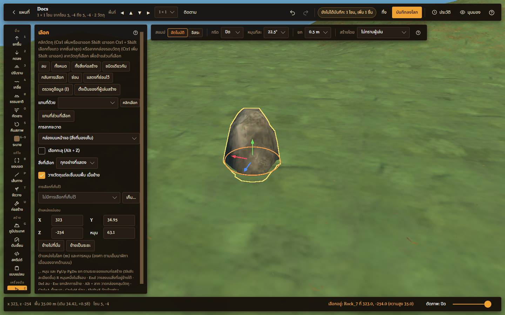
*ภาพใกล้ของหินที่ถูกเลือก: เส้นขอบสีส้ม ลูกศร X สีแดง Y สีเขียว และ Z สีน้ำเงิน ที่ย้ายหินไปตามแกนเดียว และวงแหวนสีส้ม ที่หมุนหิน แผง เลือก อยู่ทางซ้าย*

## ใช้งาน

วิธีย้ายวัตถุไม่กี่ชิ้น:

1. กด `E`
2. คลิกวัตถุ `Ctrl` + คลิก เพื่อเลือกเพิ่ม หรือลากกล่องบนหน้าจอ รอบวัตถุเหล่านั้น
3. ลากวัตถุที่เลือกไว้ เพื่อย้ายทั้งหมด หรือลากลูกศร เพื่อย้ายตามแกนเดียว หรือลากวงแหวน เพื่อหมุน
4. ไม่บังคับ: พิมพ์ค่าที่แน่นอน ใต้ **ตำแหน่งแน่นอน** แล้วคลิก **ย้ายไปที่นั่น**

จากเครื่องมือ **มุมมอง** การดับเบิลคลิกที่วัตถุ จะสลับไปที่ เลือก โดยเลือกวัตถุนั้นไว้ เลือกได้เฉพาะวัตถุ ที่แสดงอยู่: เปิดชนิดของวัตถุใน [แผงมุมมอง](editor-basics.md) ก่อน วัตถุที่อยู่ใต้เคอร์เซอร์ มีกล่องจางๆ: นั่นคือวัตถุที่คลิกจะเลือก

การย้าย หมุน ลบ หรือเปลี่ยนแต่ละครั้ง เป็นการเลิกทำหนึ่งขั้นตอน (`Ctrl+Z`) ไม่มีอะไรถูกเขียนลงโลก จนกว่าคุณจะกด **บันทึกลงโลก** (หรือ **นำไปใช้แบบไลฟ์**)

## การตั้งค่า

แผง เลือก จากบนลงล่าง

| การตั้งค่า | สิ่งที่ทำ |
|---|---|
| **ลบ** | นำวัตถุที่เลือกออก (`Del`) `Ctrl+Z` นำกลับมา |
| **ทั้งหมด** | เลือกวัตถุทุกชิ้น ที่แสดงอยู่ในพื้นที่ (`Ctrl+A`) |
| **ทั้งสิ่งก่อสร้าง** | เพิ่มชิ้นส่วนก่อสร้างทุกชิ้น ที่เชื่อมกับชิ้นที่เลือก ผ่านชิ้นส่วนที่แตะกัน: ผนัง พื้น หลังคา คาน ชิ้นส่วนที่ตั้งแยกอยู่ จะไม่ถูกรวม |
| **ชนิดเดียวกัน** | เลือกวัตถุทุกชิ้นที่แสดงอยู่ ของชนิดที่เลือกอยู่ตอนนี้: เลือกต้นบีชหนึ่งต้น จะได้ต้นบีชทั้งหมด |
| **กลับการเลือก** | เลือกวัตถุทุกชิ้นที่แสดงอยู่ ที่ไม่ได้ถูกเลือกตอนนี้ และเฉพาะวัตถุเหล่านั้น (`Ctrl+I`) |
| **ซ่อน** / **แสดงที่ซ่อนไว้** | ซ่อนวัตถุที่เลือกในมุมมอง เพื่อเข้าถึงสิ่งที่ถูกบังอยู่ (`Ctrl+H`) และแสดงอีกครั้ง (`Alt+H`) วัตถุที่ซ่อน จะไม่ถูกวาด หรือเลือก ไม่มีอะไรเปลี่ยนในโลก การเปิดพื้นที่อื่น จะลืมสิ่งที่ซ่อนไว้ |
| **ตรวจดูข้อมูล (I)** | เปิด [ตัวตรวจดูข้อมูล](#ตวตรวจดขอมล) กับวัตถุหนึ่งชิ้นที่เลือก |
| **ตั้งเป็นของที่ผู้เล่นสร้าง** | ให้ชิ้นส่วนที่เลือก ที่ไม่มีผู้สร้าง มีผู้สร้างเป็นผู้เล่น ที่เลือกไว้ใน **สร้างโดย** บน [แถบก่อสร้าง](build.md#แถบกอสราง) เพื่อให้เกมถือว่า เป็นของที่ผู้เล่นสร้าง ใช้กับซากปรักหักพัง ที่คุณต้องการซ่อมแซม และเก็บไว้ ดู [ชิ้นส่วนที่ผู้เล่นสร้าง](concepts/objects.md#ชนสวนทผเลนสราง) |
| **แทนที่ด้วย** + **คลิกเลือก** + **แทนที่ส่วนที่เลือก** | เลือกชนิด (หรือคลิก **คลิกเลือก** แล้วคลิกวัตถุในโลก) แล้วแทนที่วัตถุที่เลือกทุกชิ้น ด้วยชนิดนั้น ที่ตำแหน่งและทิศเดิม วัตถุใหม่ ไม่มีข้อมูลของวัตถุเดิมเลย |
| **การลากจะวาด** | **กล่องบนหน้าจอ (สิ่งที่มองเห็น)** หรือ **เส้นรอบบนพื้น (ทุกอย่างที่อยู่เหนือ)**: ดู [เลือกหลายชิ้นพร้อมกัน](#เลอกหลายชนพรอมกน) |
| **เลือกทะลุ (Alt + Z)** | กล่องจะรวมสิ่งที่ซ่อนอยู่ หลังสิ่งอื่นในกล่องด้วย: เฟอร์นิเจอร์ในบ้าน ผนังที่อยู่หลังผนังอีกด้าน |
| **สิ่งที่เลือก** | สิ่งที่การคลิก กล่อง และเส้นรอบ จะเลือก: **ทุกอย่างที่แสดง** **เฉพาะชิ้นส่วนที่สร้าง** (สิ่งที่ผู้เล่นสร้าง) หรือ **เฉพาะธรรมชาติ** (ต้นไม้ หิน แร่ พุ่มไม้ ของที่เก็บได้ ซาก) สิ่งที่ไม่รวม ยังวาดอยู่ แต่ไม่เกะกะ: เมื่อใช้ เฉพาะชิ้นส่วนที่สร้าง กล่องจะเลือกผนัง ที่อยู่หลังต้นไม้ได้ ใช้กับการคลิก ของเครื่องมือ มุมมอง ด้วย ส่วน **ด้านบน** ของเครื่องมือ จัดวาง และหลอดดูดสี เลือกได้ทุกชนิด |
| **วางวัตถุแต่ละชิ้นบนพื้น เมื่อย้าย** | เปิด: วัตถุแต่ละชิ้น จะลงบนพื้นห้อง โต๊ะ หรือหิน ที่อยู่ข้างใต้ ตรงที่ไปถึง ไม่เช่นนั้น ลงบนพื้นดิน (ต้นไม้ พุ่มไม้ และสิ่งมีชีวิต ไม่รองรับอะไร: ต้นไม้ที่ย้ายในป่า จะตั้งอยู่บนพื้นดิน) สิ่งก่อสร้าง ย้ายเป็นก้อนเดียว และวางบนสิ่งที่อยู่ข้างใต้ ปิด: ส่วนที่เลือกทั้งหมด ย้ายเป็นก้อนเดียว ที่ความสูงเหนือพื้นดินเดิม ตอนแรกเปิดอยู่ |
| **การเลือกที่เก็บไว้**: **เก็บ…** | เก็บส่วนที่เลือกไว้ ภายใต้ชื่อหนึ่ง สำหรับโลกนี้ เลือกรายการในลิสต์ เพื่อใช้ปุ่มของรายการ: **เลือก** (แทนส่วนที่เลือกปัจจุบัน) **เพิ่ม** (เข้าไป) และ **ลืม** (หลังจากถาม) วัตถุที่ถูกย้าย หรือลบไปในระหว่างนั้น นับเป็นหายไป แถบสถานะบอกจำนวน |
| **ตำแหน่งแน่นอน**: **X** **Y** **Z** **หมุน** | แสดงเมื่อมีส่วนที่เลือก X (ตะวันออก–ตะวันตก) และ Z (เหนือ–ใต้) คือกลางส่วนที่เลือก Y คือความสูงของวัตถุ ที่ต่ำที่สุด หมุน คือทิศของวัตถุชิ้นแรก เป็นองศา ตามเข็มนาฬิกา เมื่อมองจากด้านบน |
| **ย้ายไปที่นั่น** | ย้ายและหมุนส่วนที่เลือก ไปที่ค่าที่พิมพ์ เป็นการเลิกทำหนึ่งขั้นตอน ค่าที่พิมพ์ เป็นค่าแน่นอน: ไม่มีการสแนปทับค่าเหล่านั้น |
| **ย้ายเป็นระยะ** | สลับช่องเป็นระยะ: เมตรไปทางตะวันออก ขึ้น และเหนือ และองศาที่จะหมุน **ย้ายตามค่าเหล่านี้** ดำเนินการ |

## เลือกทีละชิ้น

| การกระทำ | สิ่งที่ทำ |
|---|---|
| คลิก | เลือกวัตถุนั้น และเฉพาะวัตถุนั้น |
| คลิกอีกครั้ง ที่จุดเดิม | เลือกวัตถุถัดไป ที่อยู่ข้างหลัง แล้วชิ้นถัดไป: หีบบนพื้น พื้น คานข้างใต้ |
| `Ctrl` + คลิก | เพิ่มวัตถุ หรือเอาออก เมื่อเลือกไว้แล้ว |
| `Shift` + คลิก | เอาวัตถุออก |
| `Ctrl` + `Shift` + คลิก | เพิ่มทั้งแถว จากวัตถุที่คลิกล่าสุด ถึงชิ้นนี้: คลิกผนัง 1 แล้วผนัง 3 ผนัง 1 ถึง 3 จะถูกเลือก |
| ดับเบิลคลิกชิ้นส่วนก่อสร้าง | เลือกทั้งสิ่งก่อสร้าง ยกเว้นหีบ (ภาชนะใดๆ): จะถูกเลือกเพียงชิ้นเดียว และเปิดในตัวตรวจดูข้อมูล |
| ดับเบิลคลิกส่วนหนึ่งของเรือ | เลือกทั้งลำ: ดู [เรือและวัตถุอื่นที่เชื่อมกัน](#เรอและวตถอนทเชอมกน) |
| คลิกพื้นดินว่าง หรือ `Alt+A` | ล้างส่วนที่เลือก |

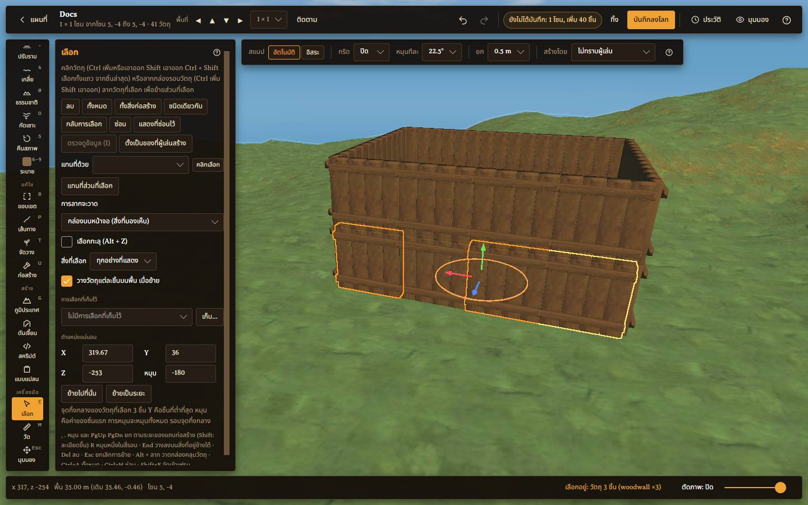
*คลิกผนังหนึ่งชิ้น แล้ว `Ctrl` + คลิกอีกสองชิ้น: ชิ้นที่คลิกล่าสุด มีเส้นขอบสีเหลืองอ่อนกว่า ชิ้นอื่นๆ สีส้ม และแถบสถานะ นับทั้งสามชิ้น*

## เลือกหลายชิ้นพร้อมกัน

การลากบนพื้นดินว่าง จะวาดกล่องบนหน้าจอ เมื่อปล่อย วัตถุที่ **มองเห็น** ในกล่อง จะถูกเลือก ไม่รวมวัตถุ ที่ซ่อนอยู่หลังสิ่งอื่น หมุนกล้องเพื่อเลือก: จากด้านบน ได้พื้นและยอดผนัง ของสิ่งก่อสร้าง จากด้านข้าง ได้ผนังหนึ่งด้าน

| การกระทำ | สิ่งที่ทำ |
|---|---|
| ลากบนพื้นดินว่าง | วาดกล่อง สิ่งที่มองเห็นในกล่อง จะเป็นส่วนที่เลือก |
| `Alt` + ลาก | วาดกล่อง แม้จะเริ่มบนวัตถุ (สิ่งก่อสร้าง ป่า) |
| `Ctrl` + ลาก | เพิ่มสิ่งที่กล่องเลือก |
| `Shift` + ลาก | เอาออก |

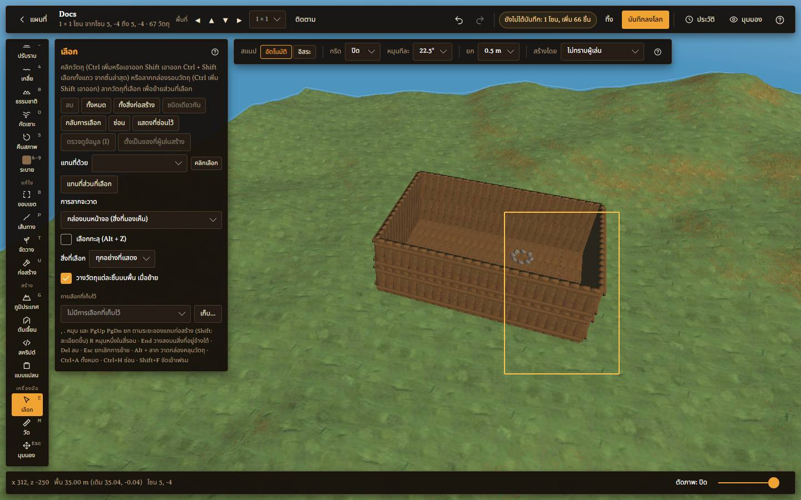
*`Alt` + ลาก จากกลางกระท่อม ทับครึ่งขวา: กล่องวาดบนหน้าจอ*

*หลังปล่อย: ชิ้นส่วน 27 ชิ้นมีเส้นขอบ ผนัง พื้นที่มองเห็น ระหว่างผนัง และเตาไฟ พื้นและหีบ ที่ซ่อนอยู่หลังผนังด้านหน้า ไม่ถูกรวม แถบสถานะนับวัตถุ*

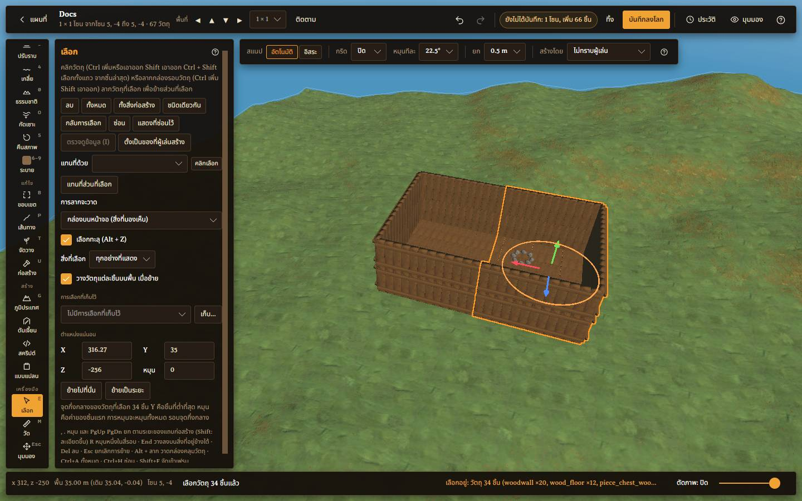
*กล่องเดียวกัน เมื่อเปิด **เลือกทะลุ**: 34 ชิ้น รวมพื้น และหีบหลังผนังด้านหน้าด้วย*

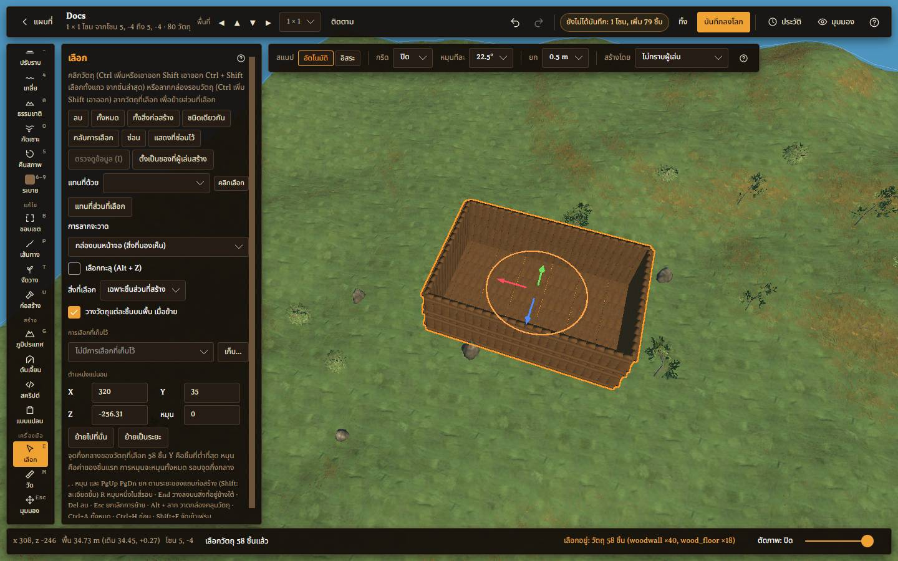
***สิ่งที่เลือก: เฉพาะชิ้นส่วนที่สร้าง** และกล่องทับทั้งกระท่อม ท่ามกลางหินและพุ่มไม้: ได้เฉพาะชิ้นส่วน 58 ชิ้นของกระท่อม*

เมื่อใช้ **การลากจะวาด: เส้นรอบบนพื้น (ทุกอย่างที่อยู่เหนือ)** การลากจะวาดเส้นรอบ บนพื้นดินแทน และวัตถุทุกชิ้นที่แสดงอยู่ ซึ่งตั้งอยู่ในเส้นรอบ จะถูกเลือก ไม่ว่าจะถูกบังหรือไม่ `Alt` `Ctrl` และ `Shift` ทำงานแบบเดียวกับกล่อง

ถ้าจะเลือกตามชนิด ในกล่อง หรือรูปหลายเหลี่ยมที่แน่นอน (ต้นไม้ทุกต้น หรือเฉพาะต้นบีช และเฉพาะตรงที่ [มาสก์](masks.md) ให้ผ่าน) ให้ใช้เครื่องมือ [ขอบเขต](area.md#การกระทำกบวตถ): ใต้ **วัตถุ** ปุ่ม **เลือกวัตถุเหล่านั้น (Enter)** จะเลือกวัตถุ แล้วสลับไปที่ เลือก ซึ่ง **ลบ** และ **แทนที่ส่วนที่เลือก** ทำงานกับวัตถุเหล่านั้น

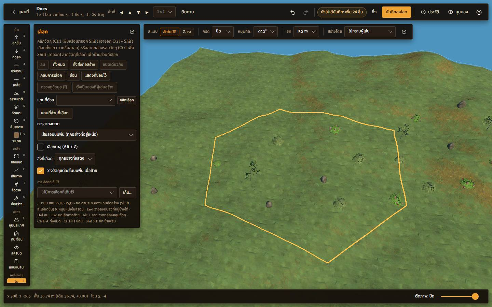
*`Alt` + ลาก รอบหินและพุ่มไม้: เส้นรอบถูกวาด แม้การลาก จะเริ่มบนพุ่มไม้*

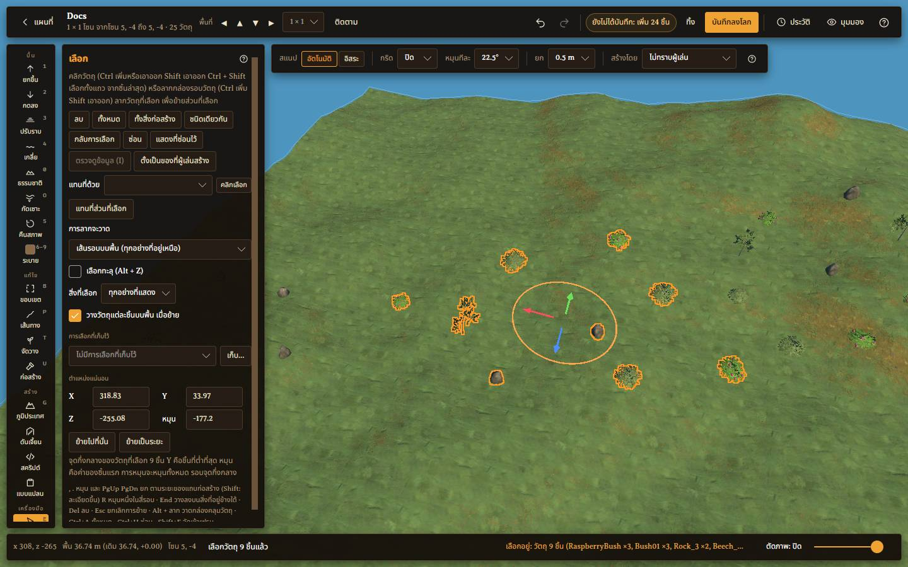
*ทุกอย่างที่แสดงอยู่ข้างใน ถูกเลือก และ **ตำแหน่งแน่นอน** แสดงว่าส่วนที่เลือกอยู่ตรงไหน*

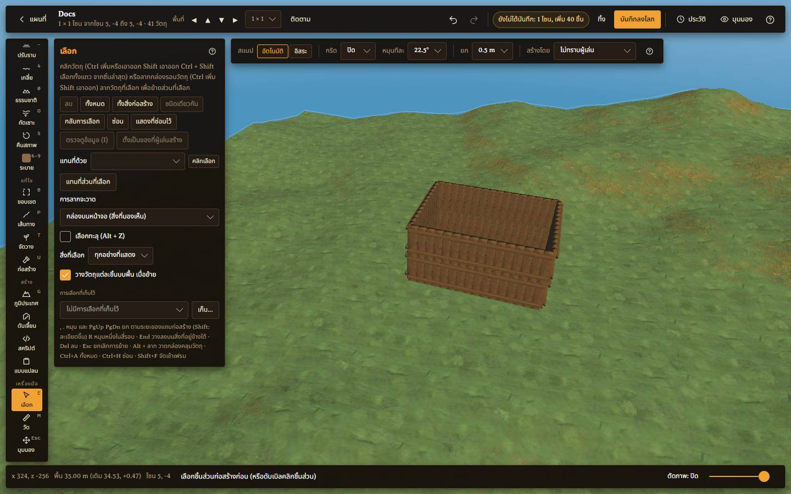
*คลิกผนังครั้งเดียว แล้ว **ทั้งสิ่งก่อสร้าง**: ชิ้นส่วนทุกชิ้นที่เชื่อมกัน ของกระท่อม ถูกเลือก*

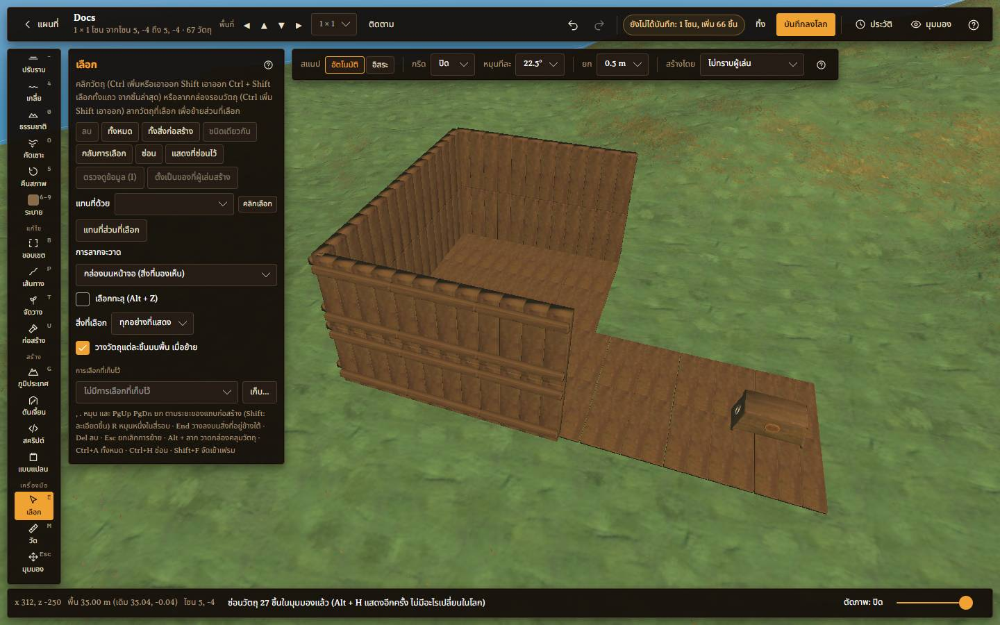
*ภาพใกล้ของกระท่อม หลัง `Ctrl+H` ซ่อนครึ่งขวา ที่อยู่ในกล่อง: หีบบนพื้นข้างใน มองเห็นได้ชัด `Alt+H` นำผนังกลับมา*

## ย้ายและหมุน

| การกระทำ | สิ่งที่ทำ |
|---|---|
| ลากวัตถุที่เลือก | ย้ายส่วนที่เลือกทั้งหมด ตามเคอร์เซอร์บนพื้นดิน ชิ้นส่วนจะสแนป กับชิ้นส่วนรอบๆ หรือตามกริด แล้วแต่การตั้งค่า [แถบก่อสร้าง](build.md#แถบกอสราง) |
| ลากลูกศร | ย้ายตามแกนเดียว: **X สีแดง** ตะวันออก–ตะวันตก **Y สีเขียว** ขึ้น–ลง **Z สีน้ำเงิน** เหนือ–ใต้ กด `Ctrl` ค้างไว้ เพื่อขยับทีละ 0.5 m |
| ลากวงแหวนสีส้ม | หมุนส่วนที่เลือก รอบจุดกลาง กด `Ctrl` ค้างไว้ เพื่อหมุนทีละ 15° |
| `End` | วางวัตถุแต่ละชิ้น ลงตรงๆ บนสิ่งที่อยู่ข้างใต้ (พื้นห้อง โต๊ะ หิน) ไม่เช่นนั้น ลงบนพื้นดิน |

แถบก่อสร้างข้างแผง เป็นแถบเดียวกับที่ [ก่อสร้าง](build.md) และ วาง ใช้: **สแนป** (**อัตโนมัติ**: ชิ้นส่วนที่ย้าย จะยึดกับจุดสแนป ที่ใกล้ที่สุด ภายใน 0.75 m แบบค้อน **อิสระ**: ชิ้นส่วนอยู่ตรงที่คุณลากไป) **กริด** (ชิ้นส่วนที่ไม่สแนป จะเป็นไปตามกริด) **หมุนทีละ** และ **ยก** (ระยะของปุ่มด้านล่าง) และ **สร้างโดย**

แถบสถานะติดตามการย้าย: "กำลังย้ายวัตถุ 12 ชิ้น: 4.5 m, หมุน 15°, +0.25 m · สแนปกับ woodwall" วัตถุที่ย้าย ยังเก็บข้อมูลไว้: หีบเก็บของข้างใน ป้ายเก็บข้อความ ชิ้นส่วนเก็บผู้สร้าง ดู [การสแนป](concepts/objects.md#การสแนป) เรื่องการย้ายลงตรงไหน

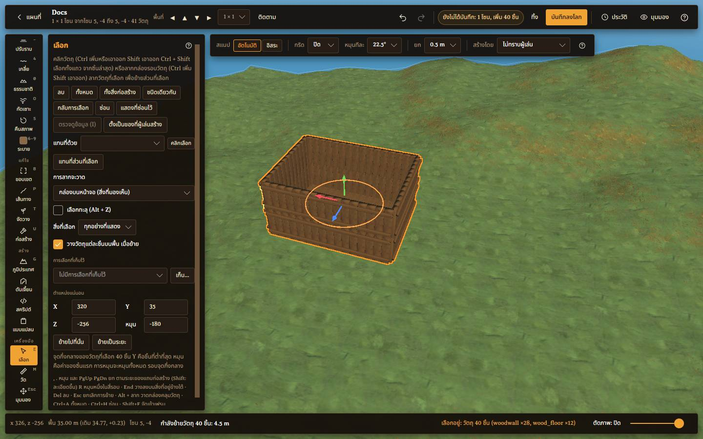
*การลากลูกศร X สีแดง ของกระท่อมที่เลือกทั้งหลัง: แถบสถานะติดตามการย้าย "กำลังย้ายวัตถุ 40 ชิ้น: 4.5 m"*

## คัดลอก ตัด และวาง

`Ctrl+C` คัดลอกส่วนที่เลือก `Ctrl+V` วางด้วยเครื่องมือวาง (`R` หมุน `X` กลับด้าน) ที่นี่ หรือในพื้นที่อื่น: ดู [ขอบเขต](area.md) สำเนาเก็บทุกอย่าง ที่ต้นฉบับเก็บไว้ ต้นไม้และสิ่งที่คล้ายกัน เก็บความสูงเหนือพื้นดิน ตรงที่ลงไป ชิ้นส่วนก่อสร้าง เก็บรูปทรงของสิ่งก่อสร้าง และนำพื้นดินข้างใต้ไปด้วย (ไม่รวมการระบาย) `Ctrl+X` ตัด: คัดลอกแบบเดียวกัน แล้ววัตถุจะออกจากโลก ดังนั้นการวาง คือการย้ายวัตถุเหล่านั้น

ถ้าจะเก็บสำเนาเป็นพิมพ์เขียว ให้เปิด **แบบแปลน** บนแถบ แล้วคลิก **บันทึกเป็นพิมพ์เขียว…** ในแถว **คลิปบอร์ด**: ดู [แผงแบบแปลน](workshop.md#แผง-แบบแปลน)

## ตัวตรวจดูข้อมูล

ตัวตรวจดูข้อมูล แสดงทุกอย่าง ที่วัตถุหนึ่งชิ้นเก็บไว้ในเซฟ และให้คุณเปลี่ยนได้ เปิดด้วย **ตรวจดูข้อมูล (I)** หรือดับเบิลคลิกหีบ (หรือวัตถุใดๆ ที่ไม่ใช่ชิ้นส่วนก่อสร้าง)

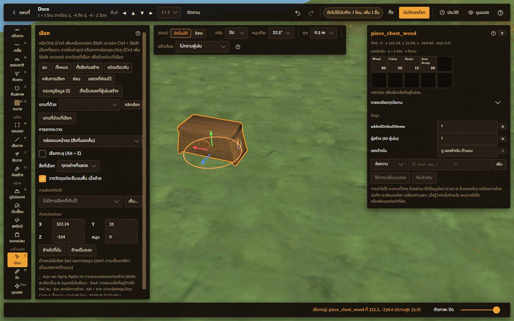
*ภาพใกล้ของหีบ ที่มีไอเทมสี่ชิ้น เปิดในตัวตรวจดูข้อมูล: ช่องต่างๆ แบบในเกม แต่ละช่องมีชื่อไอเทม และจำนวน ตามด้วยทุกค่า ใต้ ข้อมูล*

ด้านบน: ชื่อ ID ตำแหน่ง และการหมุนของวัตถุ สำหรับจุดเกิดหรือรัง จะบอกว่าเกิดอะไร (`จุดเกิด: Boar · 0–2 ★ · เกิดครั้งเดียว`) สำหรับวัตถุของม็อด จะบอกว่ามาจากม็อดไหน

| ส่วน | สิ่งที่ทำ |
|---|---|
| **ของข้างใน** | หีบและภาชนะอื่นๆ: ช่องแบบในเกม ("5 × 2 ช่อง · 4 ไอเทม") คลิกช่อง แล้ว **ค้นหาไอเทม…** (พิมพ์ไม่กี่ตัวอักษร) **จำนวน** และ **ระดับคุณภาพ** **ทำให้ว่าง** เอาไอเทมออก **ย้าย** แล้วคลิกอีกช่อง เพื่อย้าย (ไอเทมสองชิ้นจะสลับกัน) จำนวนจะถูกตัด ไม่ให้เกินกองใหญ่สุดของเกม |
| **รายละเอียดทุกไอเทม** | ไอเทมทุกชิ้น พร้อมกอง คุณภาพ ความทนทาน และช่อง **เพิ่มไอเทม** ใส่ไอเทมใหม่ ในช่องว่างแรก **✕** เอาออกทีละชิ้น **จัดเรียงช่อง** ย้ายไอเทมทุกชิ้น ไปไว้ในช่องว่างแรกๆ ทีละแถว |
| **ถืออยู่** / **สวมใส่** | ขาตั้งไอเทม และขาตั้งชุดเกราะ รายการมีให้เลือก เฉพาะสิ่งที่เกม ยอมให้ขาตั้งนั้นรับ (ขาตั้งแบบแบน รับอาหารได้ด้วย สำหรับจัดโต๊ะ) **คุณภาพ** คือระดับคุณภาพ **รูปแบบ** คือรูปลักษณ์ **แขวนอยู่** คือวิธีแขวน **ท่าทาง** คือท่าของขาตั้งชุดเกราะ **✕** ถอดออก |
| **ข้อมูล** | ทุกค่า ตามชื่อของเกม พร้อมป้ายสำหรับค่าที่พบบ่อย: ข้อความ (ป้าย) แท็ก (ประตูมิติ) ผู้สร้าง (ID ผู้เล่น) พลังชีวิต เชื้อเพลิง เลเวล (ดาว)... เปลี่ยนตัวเลขและข้อความ ได้ในที่ **✕** นำค่าออก (แล้วเกมจะใช้ค่าเริ่มต้น) ข้อมูลไบนารีอื่นๆ แสดงในรายการ แต่ไม่ถูกเปลี่ยน |
| **เพิ่ม** | เพิ่มค่าที่วัตถุยังไม่มี: เลือกชนิด พิมพ์ชื่อ แบบที่เกมเรียก (`text` สำหรับป้าย `tag` สำหรับประตูมิติ) และค่า |
| **ใช้การเปลี่ยนแปลง** | แทนที่วัตถุ ด้วยสำเนาที่มีข้อมูลใหม่ ที่ตำแหน่งเดิม: เลิกทำได้ในขั้นตอนเดียว **บันทึกลงโลก** หรือ **นำไปใช้แบบไลฟ์** จะเขียนลงไป |
| **คืนค่าเดิม** | ลืมการเปลี่ยนแปลง ที่ทำในการ์ด |

- ขนาดของภาชนะ มาจากเกม รถลากและเรือ เก็บภาชนะไว้ในส่วนหนึ่ง จึงไม่ทราบขนาด
- ไอเทมที่อยู่นอกช่อง จะถูกซ่อนในเกม: เอดิเตอร์จะถามก่อนนำไปใช้
- ของข้างในที่เปลี่ยนแล้ว กลายเป็นของหีบเอง: หีบที่ยังไม่เคยเปิด จะไม่เติมสมบัติของเกม ทับลงไป
- ไอเทมที่ตั้งบนขาตั้ง เป็นของใหม่ และมีความทนทานเต็ม ตามระดับคุณภาพ ใน **รูปลักษณ์เกม** มุมมอง 3D จะวาดไอเทมนั้น บนขาตั้ง
- ชื่อค่า มาจากโค้ดของเกม และของม็อดของคุณ (อ่านเท่านั้น ไม่เคยรัน) ชื่อที่ไม่รู้จัก แสดงเป็นตัวเลข

> [!WARNING]
> เปลี่ยนค่า เฉพาะเมื่อคุณรู้ว่าค่านั้นทำอะไร: เกมอาจรีเซ็ต หรือไม่สนใจค่าที่ไม่คาดคิด `Ctrl+Z` นำวัตถุเดิมกลับมา จนกว่าคุณจะบันทึก

## เรือและวัตถุอื่นที่เชื่อมกัน

ม็อดบางตัว สร้างวัตถุจากวัตถุอื่น: เรือของม็อดเรือ คือฐานหนึ่งชิ้น และชิ้นส่วนที่สร้างบนนั้น หัวรถจักรของม็อดรถไฟ และตู้ที่ลากไป เมื่อม็อดอธิบายวัตถุเหล่านี้ไว้ (`worldeditor.json` ของม็อด ดู [การทำม็อด](modding.md) หรือแอดออน เช่น แอดออน [ValheimRAFT](../../addons/ValheimRAFT/README.md) หรือ [Railroads](../../addons/Railroads/README.md)) เอดิเตอร์จะวาดกลุ่มนั้น แบบที่ม็อดสร้าง และเก็บไว้ด้วยกัน:

- **ย้ายทั้งกลุ่ม** การเลือกส่วนใดก็ได้ แล้วย้าย หมุน หรือลบ จะรวมทั้งกลุ่ม (แถบสถานะบอกไว้ ด้วยคำของม็อด: "ทั้ง vehicle") กลุ่มที่ย้าย เก็บความสูงไว้ (เรือยังลอยอยู่) ไม่สแนป และไม่ตกลงด้วย `End`
- **คัดลอกทั้งกลุ่ม** `Ctrl+C` บนส่วนใดก็ได้ คัดลอกทั้งกลุ่ม ไม่รวมพื้นดิน การวางแต่ละครั้ง เป็นกลุ่มของตัวเอง พร้อม ID ใหม่ ส่วนที่คัดลอก โดยไม่มีฐาน จะถูกวางเป็นชิ้นส่วนธรรมดา
- **นำออกทั้งกลุ่ม** การลบส่วนใดก็ได้ จะลบทั้งกลุ่ม รวมถึงเมื่อเครื่องมือ [ขอบเขต](area.md#การกระทำกบวตถ) เป็นผู้เลือก

เครื่องมือของ Claude ทำแบบเดียวกัน ดู [วัตถุคืออะไร](concepts/objects.md#วตถคออะไร)

## ปุ่มลัด

| ปุ่มหรือเมาส์ | สิ่งที่ทำ |
|---|---|
| `E` | เปิด เลือก |
| `Ctrl+A` / `Alt+A` | เลือกทั้งหมดที่แสดง / ล้างส่วนที่เลือก |
| `Ctrl+I` | กลับการเลือก |
| `Ctrl+H` / `Alt+H` | ซ่อนวัตถุที่เลือก / แสดงอีกครั้ง |
| `Alt+Z` | สลับ **เลือกทะลุ** |
| `Shift+F` หรือ `.` บนแป้นตัวเลข | จัดมุมมองให้พอดีกับส่วนที่เลือก (`F` อย่างเดียว สลับมุมมองสายตา) |
| `Del` | ลบส่วนที่เลือก |
| `I` | เปิดตัวตรวจดูข้อมูล กับวัตถุหนึ่งชิ้นที่เลือก |
| `,` `.` หรือ `Alt` + ล้อเมาส์ | หมุนตามระยะ **หมุนทีละ** ของแถบก่อสร้าง ตอนแรก 22.5° (`Shift` ละเอียดขึ้น: 1°) |
| `R` | หมุนหนึ่งในสี่รอบ |
| `PgUp` / `PgDn` หรือ `Ctrl` + ล้อเมาส์ | ยกขึ้นหรือลดลง ตามระยะ **ยก** ของแถบก่อสร้าง ตอนแรก 0.5 m (`Shift` ละเอียดขึ้น: หนึ่งในห้า) |
| `End` | วางวัตถุแต่ละชิ้น ลงบนสิ่งที่อยู่ข้างใต้ |
| `Esc` | ปิดตัวตรวจดูข้อมูล ไม่เช่นนั้น ยกเลิกกล่อง เส้นรอบ หรือการย้าย ที่ทำอยู่ ไม่เช่นนั้น กลับไปที่เครื่องมือ มุมมอง (ส่วนที่เลือกยังอยู่) |
| `Ctrl+C` / `Ctrl+X` / `Ctrl+V` | คัดลอก ตัด วาง |
| `Ctrl+Z` | เลิกทำ ปุ่มที่กดติดๆ กัน ในช่วงสั้นๆ นับเป็นขั้นตอนเดียว |

ปุ่มทั้งหมดของเอดิเตอร์ อยู่ใน [ปุ่มลัด](help/shortcuts.md)

## เคล็ดลับและข้อจำกัด

> [!CAUTION]
> หินรูนเลือกและลบได้ แต่ย้าย หมุน คัดลอก หรือตรวจดูข้อมูลไม่ได้: เกมสร้างหินรูนแต่ละก้อน จากสถานที่ของมัน ทุกครั้งที่โหลดโซน ดังนั้นการลบหินรูน จะนำสถานที่นั้นออกถาวร (พร้อมการปรับระดับพื้น เล็กน้อยรอบๆ) บันทึกลงโลก ทำให้ถาวร ก่อนหน้านั้น `Ctrl+Z` นำกลับมาได้

- **กู้คืน:** ลบหรือย้ายผิด: `Ctrl+Z` แม้หลังบันทึกแล้ว (แล้วบันทึกอีกครั้ง) ซ่อนบางอย่างไว้: `Alt+H` ดู [เลิกทำการเปลี่ยนแปลง](guides/undo-changes.md)
- กล่อง เส้นรอบ **ทั้งหมด** **ชนิดเดียวกัน** **กลับการเลือก** และ **ทั้งสิ่งก่อสร้าง** ไม่รวมสิ่งที่อยู่ลึกกว่า 10 m ใต้พื้นดิน (วัตถุที่ม็อดซ่อนไว้ตรงนั้น เช่น สถานีคราฟต์ใต้บ้าน)
- การคลิก เลือกวัตถุตามรูปทรงที่วาด ไม่ใช่กล่อง: หินใต้กิ่งไม้ คลิกได้ ระหว่างกิ่ง ใบไม้และหญ้า นับเฉพาะตรงที่ ไม่มีสิ่งทึบอยู่ข้างหลัง ดู [วัตถุคืออะไร](concepts/objects.md#วตถคออะไร)
- วัตถุที่ถูกเลือก จะไม่มีจุดสีเขียว ที่บอกว่ายังไม่บันทึก ขณะที่ถูกเลือก
- ในโหมดไลฟ์ วัตถุที่ย้าย จะเก็บ ID เดิมในเกมที่กำลังรัน เมื่อไม่มีอย่างอื่นของวัตถุนั้นเปลี่ยน ดู [ส่งอะไร และเมื่อไร](concepts/live-editing.md#สงอะไร-และเมอไร)

## หัวข้อที่เกี่ยวข้อง

- [ย้ายหรือคัดลอกสิ่งก่อสร้าง](guides/move-a-building.md)
- [เปลี่ยนของในหีบ หรือข้อความบนป้าย](guides/fill-a-chest.md)
- [หาวัตถุ ไอเทมในหีบ หรือป้าย](guides/find-things.md)
- [วัตถุ](concepts/objects.md#วตถคออะไร) · [การสแนป](concepts/objects.md#การสแนป)
- [ก่อสร้าง](build.md) · [จัดวาง](place.md) · [ขอบเขต](area.md)
