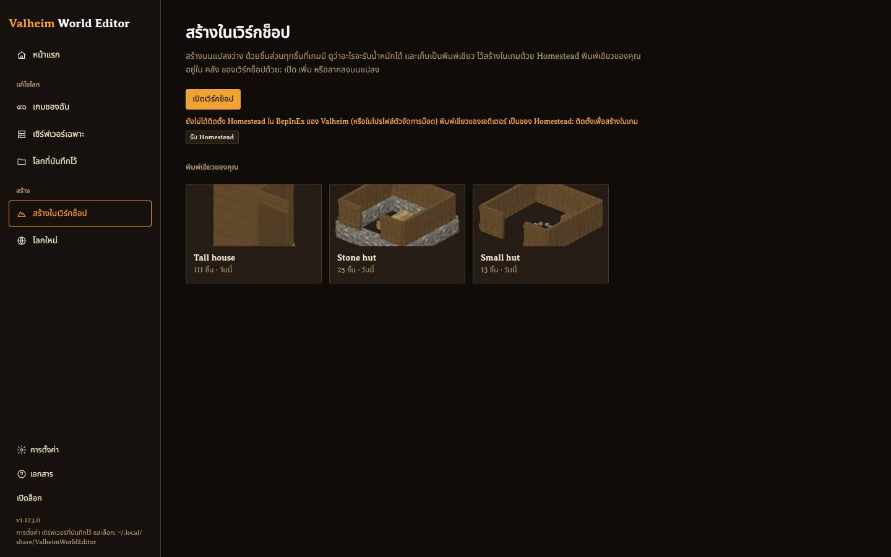
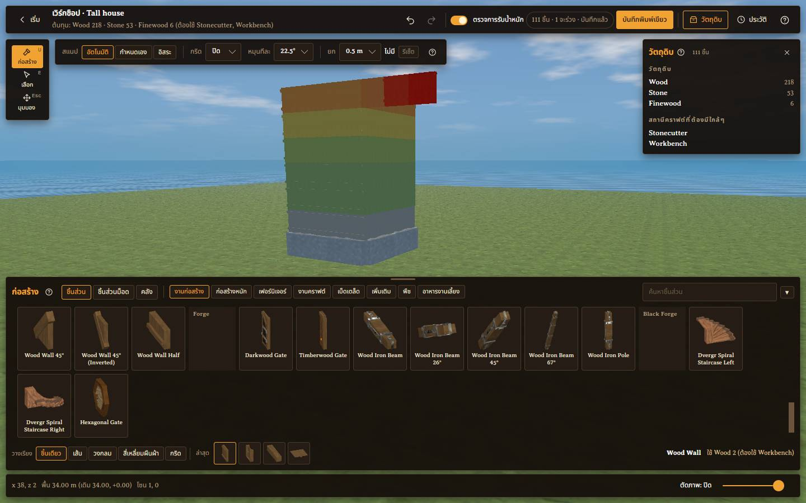
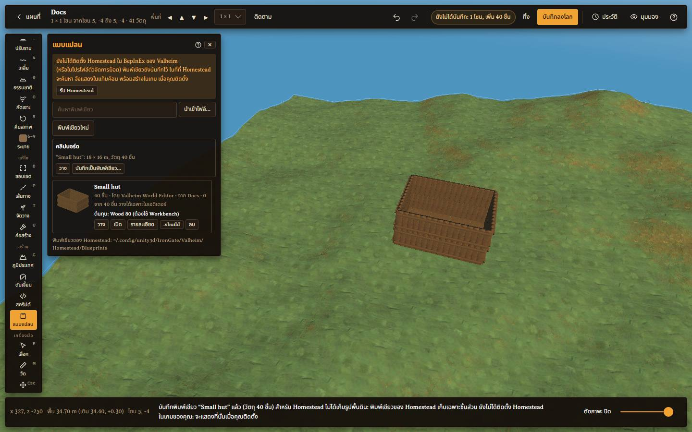

<!-- source: 491b2a7c -->
# การก่อสร้างครั้งแรก

ในเวลาประมาณสิบห้านาที คุณจะสร้างกระท่อมไม้หลังเล็ก ในเวิร์กช็อป ดูการตรวจการรับน้ำหนักลงสี เก็บไว้
เป็นพิมพ์เขียว แล้ววางลงในโลก ส่วนแรกไม่ต้องใช้โลก: เวิร์กช็อปคือแปลงว่าง

**สิ่งที่ต้องมี:** เอดิเตอร์ที่ติดตั้งแล้ว ([ติดตั้งเอดิเตอร์](install.md)) สำหรับส่วนสุดท้าย ต้องมีโลกที่มีสำเนาสำรอง
อยู่ข้างกัน แบบใน [การแก้ไขครั้งแรกของคุณ](first-edit.md)

## 1. เปิดเวิร์กช็อป

1. ที่หน้าเริ่มต้น คลิก **สร้างในเวิร์กช็อป** แล้วคลิก **เปิดเวิร์กช็อป**

*ส่วน **สร้างในเวิร์กช็อป** ของหน้าเริ่มต้น: **เปิดเวิร์กช็อป** สถานะการติดตั้ง Homestead และพิมพ์เขียวของคุณ
(ที่นี่มีสามอัน ของคุณจะว่างในครั้งแรก)*

**สิ่งที่ควรเห็น:** แปลงทุ่งหญ้าว่างที่ราบเรียบ แผง **ก่อสร้าง** ตามด้านล่าง ที่แท็บ **ชิ้นส่วน** และ
แถบด้านบนขึ้นว่า "ยังไม่มีชิ้นส่วน" แถบเครื่องมือมีแค่ **ก่อสร้าง** **เลือก** และ **มุมมอง** โดยมีแถบก่อสร้าง
อยู่ข้างๆ

## 2. วางพื้น

1. ในแผง **ก่อสร้าง** พิมพ์ `wood floor` ใน **ค้นหาชิ้นส่วน**
2. คลิกไทล์ของพื้นไม้ ชื่อและต้นทุน จะแสดงที่ด้านล่างของแผง และชิ้นนั้นจะเข้าไปอยู่ใน **ล่าสุด** ตรงนั้น
3. คลิกตรงกลางแปลง พื้นจะถูกวางลง
4. ชี้ข้างขอบของพื้น แล้วคลิกอีกครั้ง พื้นใหม่จะสแนปกับพื้นแรก ขอบชนขอบ เหมือนค้อนของเกม
   วางพื้นสี่ชิ้น เป็นสี่เหลี่ยมจัตุรัส

**สิ่งที่ควรเห็น:** พื้นสี่เหลี่ยมจัตุรัส แต่ละชิ้นเป็นสีฟ้าอ่อน: ชิ้นเหล่านี้ตั้งอยู่บนพื้นดิน จึงรับน้ำหนักได้เต็มที่
แถบด้านบนนับ "4 ชิ้น · ยังไม่ได้บันทึกเป็นพิมพ์เขียว" และใต้ชื่อ จะแสดงต้นทุนของกระท่อม

## 3. ตั้งผนัง

1. ค้นหา `wood wall` แล้วคลิกไทล์ของผนังไม้
2. ชี้ที่ขอบด้านนอกของพื้น แล้วคลิก: ผนังจะสแนปเข้ากับขอบ ถ้าผนังหันผิดทาง กด `,` หรือ `.`
   เพื่อหมุนก่อน
3. วางผนังให้รอบพื้น เว้นช่องไว้หนึ่งช่อง สำหรับประตู
4. ค้นหา `wood door` คลิกไทล์ แล้ววางประตูในช่องนั้น
5. วางผนังแถวที่สอง ซ้อนบนแถวแรก

*การตรวจการรับน้ำหนัก บนบ้านหลังสูง: ฐานหินเป็นสีฟ้าอ่อน ผนังด้านบนเป็นสีเขียว แล้วเหลืองและส้ม
เมื่อการรับน้ำหนักลดลง และส่วนที่ยื่นออกไปเป็นสีแดง: จะร่วง*

**สิ่งที่ควรเห็น:** ผนังบนพื้นเป็นสีเขียว (แข็งแรง) แถวที่สองเป็นสีเขียวอ่อนกว่า หรือสีเหลือง เพราะรับน้ำหนักได้น้อยกว่า
ชิ้นที่จะร่วงในเกม จะเป็นสีแดง และแถบด้านบน บอกจำนวนชิ้นที่จะร่วง เหตุผล: ดู
[การตรวจการรับน้ำหนัก](../concepts/objects.md#การตรวจการรบนำหนก)

วางชิ้นผิดที่? กด `Ctrl+Z` เพื่อเลิกทำ หรือกด `E` (**เลือก**) คลิกชิ้นนั้น กด `Del` แล้ว
กด `U` เพื่อกลับไปก่อสร้าง

## 4. บันทึกพิมพ์เขียว

1. คลิก **บันทึกพิมพ์เขียว** ในแถบด้านบน (หรือกด `Ctrl+S`)
2. พิมพ์ `My first hut` เป็น **ชื่อ** คำสั้นๆ เป็น **คำอธิบาย** และ `hut, wood` เป็น **แท็ก**
3. คลิก **บันทึก** ถ้ามีบางชิ้นจะร่วงในเกม เอดิเตอร์จะถามก่อน: **สร้างต่อ** เพื่อแก้ไข (ชิ้นเหล่านั้นเป็นสีแดง)
   หรือ **บันทึกเลย**

**สิ่งที่ควรเห็น:** ข้อความ "บันทึกพิมพ์เขียว “My first hut” แล้ว (… ชิ้น) สำหรับ Homestead" และแถบด้านบน
ขึ้นว่า "บันทึกแล้ว" ตอนนี้พิมพ์เขียวอยู่ในคลังของคุณ พร้อมรูปของกระท่อม ถ้ามีม็อด
[Homestead](https://thunderstore.io/c/valheim/p/sighsorry/Homestead/) ในเกมของคุณ พิมพ์เขียวจะแสดงในแท็บค้อน
ของ Homestead ด้วย พร้อมสร้างในเกม

## 5. วางลงในโลก

1. คลิก **เริ่ม** ที่มุมซ้ายบน เพื่อกลับไปหน้าเริ่มต้น
2. คลิก **โลกที่บันทึกไว้** แล้วคลิกโลกของคุณ (ไม่ใช่สำเนาสำรอง) บนแผนที่ของโลก คลิกจุดพื้นโล่ง ที่คุณเคยไปมาแล้ว
   แล้วคลิก **แก้ไขใน 3D**
3. บนแถบเครื่องมือ ใต้ **สร้าง** คลิก **แบบแปลน** ถ้าหน้าต่างเตี้ย ให้เลื่อนแถบเครื่องมือด้วยล้อเมาส์
   เพื่อไปถึง
4. หา **My first hut** ในรายการ แล้วคลิกปุ่ม **วาง** ของพิมพ์เขียวนั้น
5. เลื่อนเมาส์ไปบนพื้นโล่ง: กระท่อมจะตามเมาส์ไป แบบโปร่งใส กด `R` เพื่อหมุนหนึ่งในสี่รอบ
6. คลิกเพื่อวางลง แล้วกด `Esc` เพื่อหยุดวาง

*แผง **แบบแปลน** ข้างแถบเครื่องมือ: กระท่อมที่บันทึกไว้ พร้อมรูป ต้นทุน และปุ่ม **วาง***

**สิ่งที่ควรเห็น:** กระท่อมตั้งอยู่บนพื้น ถ้าเปิด **เคลียร์พื้นที่** ในแผง วาง (เปิดไว้ตั้งแต่แรก)
พื้นดินที่ขวางอยู่ จะถูกขุดออก และต้นไม้กับหินในที่ตั้ง จะหายไป แถบด้านบนขึ้นว่า "ยังไม่ได้บันทึก: …
เพิ่ม …"

ถ้ามีเส้นขอบสีแดงก่อนคลิก แสดงว่ากระท่อมไม่พอดี กับพื้นที่ที่เปิดอยู่: เปิดพื้นที่ใหญ่ขึ้นจากแผนที่

## 6. บันทึกโลก

1. ปิด Valheim ถ้ารันอยู่
2. คลิก **บันทึกลงโลก** ตรวจ **โฟลเดอร์โลก** ในคำถาม แล้วคลิก **บันทึก**
3. เปิด Valheim โหลดโลก แล้วเดินไปที่จุดนั้น

**สิ่งที่ควรเห็น:** กระท่อมของคุณ ตั้งอยู่ตรงที่คุณวาง ชิ้นส่วนเป็นของที่ผู้เล่นสร้าง เกมจึงถือว่า
เป็นฐานของคุณ (ดู [ชิ้นส่วนที่ผู้เล่นสร้าง](../concepts/objects.md#ชนสวนทผเลนสราง))

## ถ้าไม่ได้ผล

- **ชิ้นส่วนไม่สแนป**: ชี้ให้ใกล้ขอบหรือด้านบน ของชิ้นที่มีอยู่แล้วมากขึ้น การสแนปใช้จุดสแนปที่ใกล้ที่สุด
  ภายในครึ่งเมตร
- **เวิร์กช็อปบอกว่าไม่ได้ติดตั้ง Homestead**: ไม่เป็นไร พิมพ์เขียวถูกบันทึก ในที่ที่ Homestead จะหา
  และการวางลงในโลก ใช้ได้โดยไม่ต้องมี Homestead
- **เส้นขอบของการวางเป็นสีแดง**: กระท่อมอยู่ใกล้ขอบของพื้นที่เกินไป เลื่อนเมาส์เข้ามาด้านใน หรือเปิดพื้นที่ใหญ่ขึ้น
- **ไม่ชอบผลลัพธ์**: `Ctrl+Z` ย้อนการวาง ก่อนที่คุณจะบันทึก หลังบันทึกแล้ว ให้เลิกทำ แล้วกด **บันทึกลงโลก**
  อีกครั้ง: ดู [เลิกทำขั้นตอน ย้อนการเปลี่ยนแปลงหนึ่งรายการ หรือทิ้งทั้งหมด](../guides/undo-changes.md)

## ถัดไป

- [เวิร์กช็อป](../workshop.md): แท็บชิ้นส่วนทุกแท็บ คลัง ตัดภาพ และวิธีที่ชิ้นส่วนสแนป
- [วางพิมพ์เขียวลงในโลก](../guides/paste-a-blueprint.md)
- [ย้ายหรือคัดลอกสิ่งก่อสร้าง](../guides/move-a-building.md)
