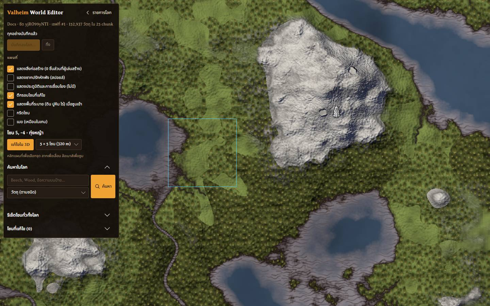
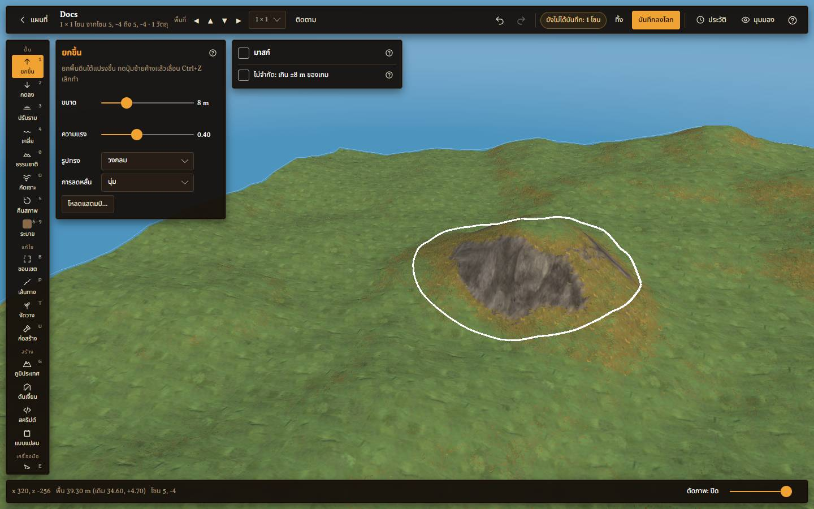
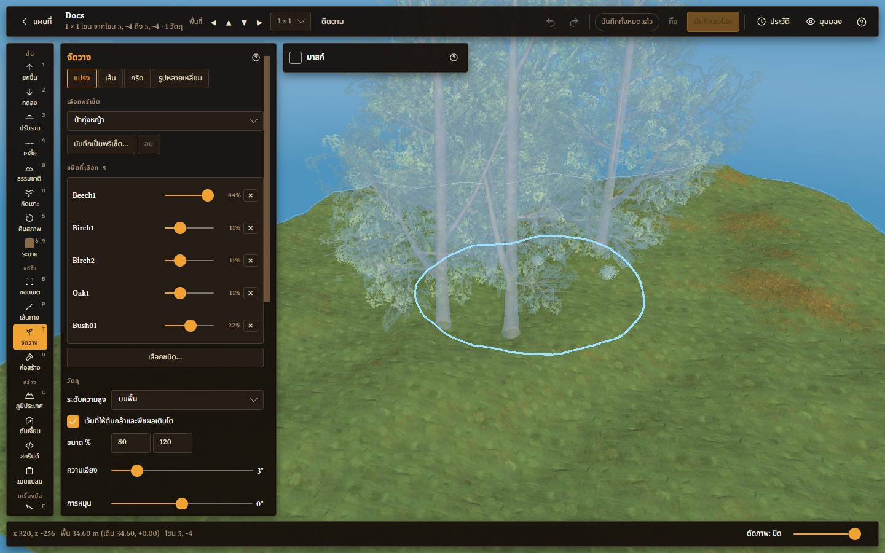
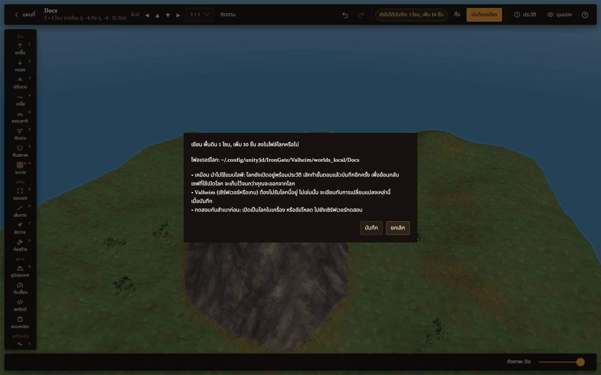

<!-- source: b94e61af -->
# การแก้ไขครั้งแรกของคุณ

ในเวลาประมาณสิบนาที คุณจะคัดลอกโลก ยกเนินเล็กๆ และปลูกต้นไม้สองสามต้น ข้างฐานของคุณ เลิกทำและทำซ้ำ บันทึก แล้วเดินไปดูผลลัพธ์ใน Valheim สำเนาเก็บโลกไว้ตามเดิม จึงไม่มีอะไรสูญหาย

**สิ่งที่ต้องมี:** เอดิเตอร์ที่ติดตั้งแล้ว ([ติดตั้งเอดิเตอร์](install.md)) และโลกผู้เล่นคนเดียว ที่คุณเคยเล่น: โลกที่คุณสร้างฐานไว้ และใช้จอบหรือพลั่วขุดแร่ อย่างน้อยหนึ่งครั้ง ต้องปิด Valheim ไว้

## 1. คัดลอกโลก

สำเนาคือทางกลับของคุณ: ไม่ว่าคุณจะทำอะไรต่อจากนี้ คุณนำโลกกลับมา ให้เหมือนตอนนี้ทุกประการได้

1. ปิด Valheim
2. ในเอดิเตอร์ ที่หน้าเริ่มต้น คลิก **โลกที่บันทึกไว้** แล้ววางเมาส์บนการ์ดโลกของคุณ คำแนะนำเครื่องมือ จะจบด้วยโฟลเดอร์ของโลก เช่น `…/IronGate/Valheim/worlds_local/Midgard`
3. ในตัวจัดการไฟล์ เปิดโฟลเดอร์ `worlds_local` ที่มีโลกนั้นอยู่
4. คัดลอกโฟลเดอร์ของโลก แล้ววางสำเนา ลงในโฟลเดอร์ `worlds_local` เดียวกัน
5. เปลี่ยนชื่อสำเนาเป็น `<World>_backup_<date>` เช่น `Midgard_backup_2026-10-22`

**สิ่งที่ควรเห็น:** หลังไม่กี่วินาที **โลกที่บันทึกไว้** แสดงทั้งสองรายการ: โลกของคุณ และ `Midgard_backup_2026-10-22` คุณแก้ไขตัวโลกเอง สำเนาอยู่ข้างๆ โดยไม่ถูกแตะ เรื่องสำเนาเพิ่มเติม: [สำรองโลกก่อนแก้ไข](../guides/back-up-a-world.md)

## 2. เปิดโลก

1. ใน **โลกที่บันทึกไว้** คลิกโลกของคุณ (ไม่ใช่สำเนา) โลกจะเปิดที่แผนที่
2. บนแผนที่ คลิกจุดที่เป็นพื้นโล่ง ใกล้ฐานของคุณ
3. ในแผงด้านข้าง เลือก **3 × 3 โซน (192 m)** ในรายการขนาด ข้าง **แก้ไขใน 3D** แล้วคลิก **แก้ไขใน 3D**

*แผนที่: คลิกเลือกโซนแล้ว (สี่เหลี่ยมสีน้ำเงิน) **แก้ไขใน 3D** เปิดโซนนั้น ด้วยขนาดที่เลือกไว้ข้างๆ*

**สิ่งที่ควรเห็น:** มุมมอง 3D ของฐานคุณ และพื้นที่รอบๆ แถบเครื่องมือทางซ้าย และแถบด้านบน ที่แสดง "บันทึกทั้งหมดแล้ว" ถ้ามุมมองอยู่ไกล ให้หมุนล้อเมาส์ เพื่อเข้าใกล้ ลากปุ่มขวา เพื่อหมุนมุมมอง

## 3. ยกเนิน

1. กด `1` หรือคลิก **ยกขึ้น** บนแถบ แผงของเครื่องมือ จะเปิดข้างแถบ
2. ในแผง ลาก **ขนาด** ไปที่ประมาณ 10 m
3. บนพื้นโล่ง ข้างฐานของคุณ กดปุ่มซ้ายของเมาส์ค้างไว้ แล้วขยับเมาส์ เป็นวงเล็กๆ สองสามวินาที

*ยกขึ้น: เส้นขอบของแปรงบนพื้นดิน เนินที่ยกขึ้นข้างๆ และแผง ที่มี **ขนาด** และ **ความแรง***

**สิ่งที่ควรเห็น:** พื้นดินสูงขึ้นใต้แปรง และแถบด้านบน แสดง "ยังไม่ได้บันทึก: 1 โซน" เป็นสีเหลืองอำพัน ยังไม่มีอะไรถูกเขียนลงโลก: การเปลี่ยนแปลง [รอดำเนินการ](../concepts/saving-and-history.md#การเปลยนแปลงทรอดำเนนการ) อยู่

## 4. ปลูกต้นไม้

1. กด `T` หรือคลิก **จัดวาง** บนแถบ
2. ในแผง **จัดวาง** คลิก **แปรง** แล้วเลือก **ป่าทุ่งหญ้า** ใต้ **เลือกพรีเซ็ต**
3. ลากเมาส์ไปตามตีนเนินของคุณ

*จัดวาง ด้วย **แปรง** และพรีเซ็ต **ป่าทุ่งหญ้า**: แปรงแสดงต้นไม้ถัดไป แบบโปร่งใส ต้นที่ปลูกแล้ว ยืนอยู่รอบๆ*

**สิ่งที่ควรเห็น:** ต้นบีช ต้นเบิร์ช ต้นโอ๊ก และพุ่มไม้ ปรากฏตรงที่คุณลาก แต่ละต้น มีจุดสีเขียวเล็กๆ (ยังไม่ได้บันทึก) และแถบด้านบน เพิ่ม "เพิ่ม … ชิ้น"

## 5. เลิกทำและทำซ้ำ

1. กด `Ctrl+Z` (`Cmd+Z` บน Mac) ต้นไม้ที่คุณปลูกล่าสุด จะหายไป
2. กด `Ctrl+Y` ต้นไม้กลับมา
3. กด `L` เพื่อเปิด **ประวัติ**

**สิ่งที่ควรเห็น:** ประวัติ แสดงขั้นตอนของคุณ เรียงจากใหม่สุด: "จัดวาง …" แล้วจึง ยกขึ้น **ย้อนถึงตรงนี้** บนแถวหนึ่ง จะย้อนกลับไปถึงแถวนั้น **นำออก** เอาออกเฉพาะการเปลี่ยนแปลงนั้น กด `L` อีกครั้ง เพื่อปิด

เพิ่มเติม: [เลิกทำขั้นตอน ย้อนการเปลี่ยนแปลงหนึ่งรายการ หรือทิ้งทั้งหมด](../guides/undo-changes.md)

## 6. บันทึก

1. คลิก **บันทึกลงโลก** ในแถบด้านบน (หรือกด `Ctrl+S`)
2. อ่านคำถาม: คำถามบอกสิ่งที่จะเขียน และ **โฟลเดอร์โลก** ตรวจว่าโฟลเดอร์ เป็นโลกของคุณ ไม่ใช่สำเนา แล้วคลิก **บันทึก**

*คำถามก่อนบันทึก: ตรวจบรรทัด **โฟลเดอร์โลก** แล้วคลิก **บันทึก***

**สิ่งที่ควรเห็น:** แถบสถานะแสดง "บันทึก 1 โซน, วัตถุใหม่ … ชิ้น ลงเซฟที่ #… แล้ว" แถบด้านบนแสดง "บันทึกทั้งหมดแล้ว" และจุดสีเขียว หายไป เอดิเตอร์เขียนเซฟใหม่ ข้างเซฟเก่า และอ่านกลับมา เพื่อตรวจสอบ

โลกยังเปิดอยู่ พร้อม ประวัติ: คุณยังเลิกทำขั้นตอน แล้วบันทึกอีกครั้ง เพื่อย้อนกลับได้

## 7. ดูในเกม

1. คลิก **แผนที่** ที่มุมซ้ายบน แล้วคลิก **รายการโลก** เพื่อออกจากโลก
2. เปิด Valheim และโหลดโลก
3. เดินไปที่จุดข้างฐานของคุณ

**สิ่งที่ควรเห็น:** เนินและต้นไม้ของคุณ เหมือนในเอดิเตอร์ ตั้งแต่นี้ไป เกมจะบันทึกสิ่งเหล่านั้นตามปกติ

## ถ้าไม่ได้ผล

- **"ไม่ได้บันทึก: … not generated yet"** (ยังไม่ถูกสร้าง): คุณแก้ไขโซน ที่ยังไม่มีผู้เล่นคนใดไป โลกจึงไม่มีข้อมูลตรงนั้น เลือกจุดที่คุณเคยเดินผ่าน หรือไปที่นั่นในเกมก่อน
- **"… โลกยังไม่มีวัตถุพื้นดินให้คัดลอก"**: ไม่เคยมีใคร ขุดหรือปรับระดับพื้น ในโลกนี้ ในเกม ให้ใช้จอบ หรือพลั่วขุดแร่สักครั้ง ที่ไหนก็ได้ บันทึก ออกจากเกม แล้วบันทึกอีกครั้งในเอดิเตอร์
- **"Valheim บันทึกโลกนี้ … หลังจากที่เอดิเตอร์อ่าน"**: เกมรันอยู่ หรือบันทึกโลก ขณะที่คุณแก้ไข ดู [บันทึกลงโลก](../editor-basics.md#บนทกลงโลก)
- **คุณไม่ชอบผลลัพธ์**: เปิดโลกอีกครั้ง เลิกทำ (หรือ **นำออก** ขั้นตอนใน ประวัติ) แล้วกด **บันทึกลงโลก** หรือนำสำเนากลับมาใช้: ดู [สำรองโลกก่อนแก้ไข](../guides/back-up-a-world.md#เลกทำ)

## ถัดไป

- [การก่อสร้างครั้งแรก](first-build.md): สร้างกระท่อมในเวิร์กช็อป แล้ววางลงในโลกนี้
- [หน้าต่างเอดิเตอร์](../editor-basics.md): ทุกส่วนของหน้าต่าง
- [ปุ่มลัด](../help/shortcuts.md): ทุกปุ่ม และการกระทำของเมาส์

ในเอดิเตอร์ `F1` (หรือ **?** เล็กๆ ที่ด้านบนของแผง) เปิดวิธีใช้นี้ ที่หน้าของเครื่องมือที่คุณใช้อยู่
