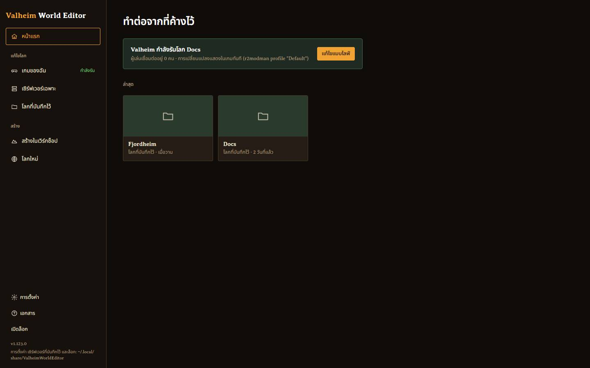
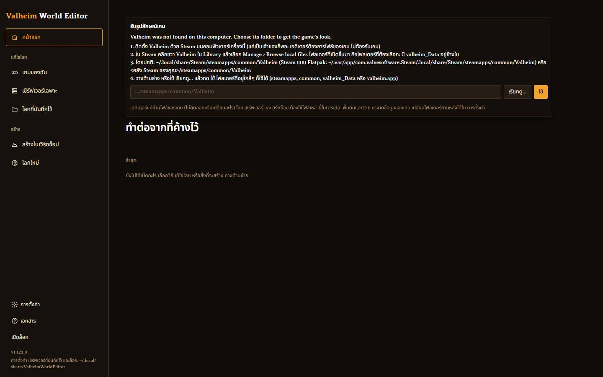
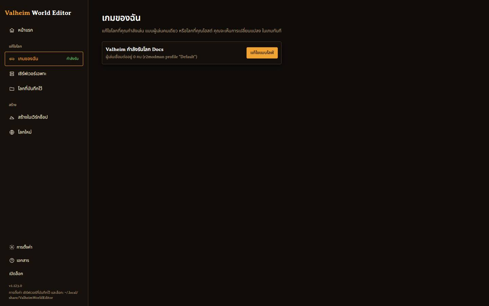
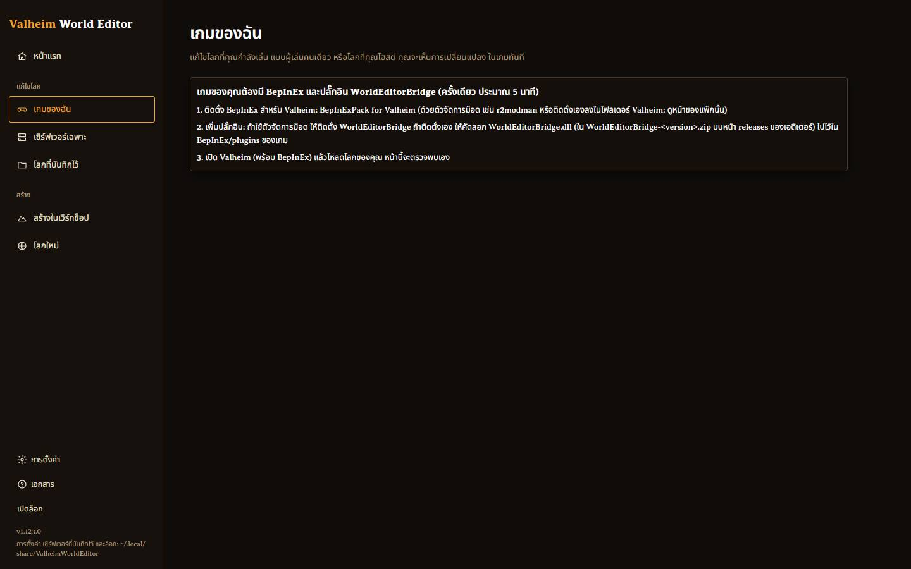

<!-- source: 68ffaeda -->
# ติดตั้งเอดิเตอร์

ดาวน์โหลดเอดิเตอร์ เปิดใช้งาน แล้วให้เอดิเตอร์หา Valheim ของคุณ เมื่อเสร็จแล้ว เอดิเตอร์จะเปิดอยู่ที่หน้าเริ่มต้น
และอ่านไฟล์ของเกมแล้ว พร้อมสำหรับ [การแก้ไขครั้งแรก](first-edit.md)

## สิ่งที่ต้องมี

- **Windows 10 หรือ 11** หรือ **Linux** แบบ 64 บิต หรือ **macOS 12 ขึ้นไป บน Mac ที่ใช้ชิป Apple silicon** (M1 ขึ้นไป)
  รุ่นสำหรับ Mac ยังอยู่ในขั้นทดลอง: ยังไม่เคยลองบน Mac จริง และไม่รองรับ Mac ที่ใช้ชิป Intel
- **Valheim** ที่ติดตั้งผ่าน Steam บนคอมพิวเตอร์เครื่องเดียวกัน แค่เป็นเจ้าของก็พอ: เอดิเตอร์อ่านไฟล์ของเกม
  (เท็กซ์เจอร์ โมเดล พื้นดิน และแผนที่) โดยไม่ต้องรันเกม ไม่มีอะไรถูกคัดลอก หรือเปลี่ยนแปลง

ไม่ต้องติดตั้งอะไรเพิ่ม ทุกอย่างที่เอดิเตอร์ต้องใช้ มาพร้อมกับไฟล์ที่ดาวน์โหลด

## ดาวน์โหลด

1. เปิด [หน้ารุ่นเผยแพร่](https://github.com/Shuiei/valheim-world-editor/releases/latest)
2. ดาวน์โหลดไฟล์ สำหรับคอมพิวเตอร์ของคุณ:
   - Windows: `ValheimWorldEditor-v<version>-win-x64.zip`
   - Linux: `ValheimWorldEditor-v<version>-linux-x64.tar.gz`
   - macOS: `ValheimWorldEditor-v<version>-macos-arm64-experimental.zip`

เอดิเตอร์มีอยู่บน [Nexus Mods](https://www.nexusmods.com/valheim/mods/4348) ด้วย เอดิเตอร์เป็นโปรแกรม ไม่ใช่ม็อด:
Thunderstore และ Hexium มีเฉพาะปลั๊กอินของเอดิเตอร์ (ดู [ปลั๊กอินสำหรับการแก้ไขแบบไลฟ์](#ปลกอนสำหรบการแกไขแบบไลฟ))

## เปิดบน Windows

1. แตกไฟล์ zip ที่ดาวน์โหลด ไว้ที่ใดก็ได้ เช่น บนเดสก์ท็อป เก็บไฟล์ไว้ด้วยกัน: `ValheimWorldEditor.exe` ต้องมี
   ไฟล์ `.dll` อยู่ข้างๆ อย่ารันจากภายในไฟล์ zip
2. ดับเบิลคลิก `ValheimWorldEditor.exe`
3. หาก Windows แสดง "Windows protected your PC" ให้คลิก **More info** (จะแสดงชื่อผู้เผยแพร่) แล้วคลิก **Run anyway**
   Windows จะถามแบบนี้ จนกว่า SmartScreen จะรู้จักลายเซ็นของเอดิเตอร์

<!-- picture: install-smartscreen.jpg: Windows 11, the blue "Windows protected your PC" dialog after More info was clicked, the publisher line and the Run anyway button visible, nothing else on screen -->

## เปิดบน Linux

1. แตกไฟล์ที่ดาวน์โหลด ไว้ที่ใดก็ได้ เช่น ในโฟลเดอร์ home ของคุณ
2. ดับเบิลคลิก `ValheimWorldEditor` ในโฟลเดอร์ หากตัวจัดการไฟล์ เปิดเป็นข้อความ หรือถามว่าจะทำอะไร ให้เลือก
   **Run** (หรือคลิกขวา **Run as program**) จากเทอร์มินัล: `./ValheimWorldEditor`

เอดิเตอร์วาดภาพด้วย OpenGL 3.3 ซึ่งไดรเวอร์กราฟิกทุกตัว ในสิบปีที่ผ่านมามี (Mesa, AMD, NVIDIA, Intel)

## เปิดบน macOS (ขั้นทดลอง)

1. แตกไฟล์ที่ดาวน์โหลด แล้วย้าย **ValheimWorldEditor.app** ไปไว้ที่ที่คุณต้องการ เช่น ใน Applications
2. ดับเบิลคลิกหนึ่งครั้ง macOS จะไม่ยอมเปิด เพราะเอดิเตอร์ไม่ได้ลงนาม ด้วยใบรับรอง Apple Developer
   ปิดข้อความนั้น
3. เปิด **System Settings › Privacy & Security** เลื่อนลงไปที่ **Security** คลิก **Open Anyway** ข้าง
   ValheimWorldEditor แล้วยืนยันด้วยรหัสผ่านของคุณ
4. ดับเบิลคลิกแอปอีกครั้ง ต่อจากนี้ แอปจะเปิดได้ด้วยการดับเบิลคลิก

แทนขั้นตอนที่ 2 และ 3 คุณรันคำสั่งนี้ใน Terminal ได้:
`xattr -dr com.apple.quarantine /Applications/ValheimWorldEditor.app` (ใช้พาธที่คุณวางแอปไว้)

บน Mac ใช้ `Cmd` ได้ทุกที่ ที่เอกสารเขียนว่า `Ctrl`: `Cmd+Z` เลิกทำ `Cmd`+คลิก เพิ่มในการเลือก
พื้นดินของเกม วาดด้วยเชเดอร์ของเกมเอง เมื่อเกมบน Mac มีเชเดอร์ ที่เอดิเตอร์อ่านได้ หากไม่มี จะใช้สีเรียบๆ
หากมีอะไรไม่ทำงาน
[เปิด issue](https://github.com/Shuiei/valheim-world-editor/issues) พร้อมล็อกของเอดิเตอร์ (**เปิดล็อก** ที่หน้าเริ่มต้น)

## การเปิดครั้งแรก

เอดิเตอร์เปิดในหน้าต่าง ของตัวเอง ที่ **หน้าแรก** ของหน้าเริ่มต้น ในครั้งแรก และหลัง Valheim อัปเดตแต่ละครั้ง
การ์ดจะแสดง **กำลังเตรียมรูปลักษณ์เกม** ขณะที่เอดิเตอร์อ่านไฟล์ของเกม สักครู่หนึ่ง โลก เซิร์ฟเวอร์
และเวิร์กช็อป จะเปิดได้ เมื่อการ์ดแสดง **รูปลักษณ์เกมพร้อมแล้ว**

*หน้าเริ่มต้น: เมนูด้านข้างอยู่ทางซ้าย หน้าแรก อยู่ทางขวา เมื่อเปิดโลกแล้ว โลกจะแสดงใต้ ล่าสุด*

## เมื่อไม่พบ Valheim

เอดิเตอร์ค้นหาในทุกคลัง Steam เอง (รวม Steam แบบ Flatpak) หากไม่พบเกม การ์ดจะแสดง
**รับรูปลักษณ์เกม** และ "ไม่พบ Valheim บนคอมพิวเตอร์เครื่องนี้"

*ขั้นตอนในการ์ด บอกว่าจะหาโฟลเดอร์ได้ที่ไหน วางพาธลงในช่อง (หรือ **เรียกดู…**) แล้วกด **ใช้***

1. ใน Steam คลิกขวา Valheim ใน Library แล้วเลือก **Manage › Browse local files** โฟลเดอร์ที่เปิดขึ้นมา
   คือโฟลเดอร์ที่ต้องเลือก: มี `valheim_Data` อยู่ข้างใน (`valheim.app` บน Mac)
2. คัดลอกพาธ วางลงในช่องของการ์ด (หรือคลิก **เรียกดู…** แล้วเลือก) แล้วคลิก **ใช้**

ตำแหน่งที่ใช้กันทั่วไปคือ:

- Windows: `C:\Program Files (x86)\Steam\steamapps\common\Valheim`
- Linux: `~/.local/share/Steam/steamapps/common/Valheim` (Steam แบบ Flatpak:
  `~/.var/app/com.valvesoftware.Steam/.local/share/Steam/steamapps/common/Valheim`)
- macOS: `~/Library/Application Support/Steam/steamapps/common/Valheim`
- คลัง Steam อื่น: `<library>/steamapps/common/Valheim`

โฟลเดอร์ที่อยู่ใกล้ๆ ก็ใช้ได้ (`steamapps`, `common`, `valheim_Data` หรือ `valheim.app`): เอดิเตอร์จะหาโฟลเดอร์เกม
จากโฟลเดอร์นั้น คุณเปลี่ยนได้ภายหลัง ใน **การตั้งค่า** (**โฟลเดอร์เกม Valheim**) ดู
[การตั้งค่า](../editor-basics.md#การตงคา)

## ปลั๊กอินสำหรับการแก้ไขแบบไลฟ์

หากต้องการแก้ไขโลก ขณะที่เกมรันอยู่ (เกมของคุณเอง หรือเซิร์ฟเวอร์เฉพาะ ขณะที่มีคนเล่น) เกมที่โฮสต์โลกนั้น
ต้องมี **BepInEx** และปลั๊กอิน **WorldEditorBridge** ของเอดิเตอร์ ผู้เล่นที่เข้าร่วม ไม่ต้องมีทั้งสองอย่าง
รวมถึงผู้เล่นคอนโซล หากแก้ไขโลกที่บันทึกไว้ โดยปิดเกม หรือก่อสร้างในเวิร์กช็อป ก็ไม่ต้องมีทั้งสองอย่าง

สำหรับเกมของคุณเอง:

1. ติดตั้ง BepInEx หนึ่งครั้ง: [BepInExPack for Valheim](https://thunderstore.io/c/valheim/p/denikson/BepInExPack_Valheim/)
   ด้วยตัวจัดการม็อด (r2modman, Thunderstore Mod Manager) หรือติดตั้งเองลงในโฟลเดอร์ Valheim ตามหน้าของแพ็ก
2. เพิ่มปลั๊กอิน หากใช้ตัวจัดการม็อด ให้ติดตั้ง WorldEditorBridge จาก
   [Thunderstore](https://thunderstore.io/c/valheim/p/Tie/WorldEditorBridge/) หรือ
   [Hexium](https://valheim.hexium.gg/mods/Tie/WorldEditorBridge) (มี BepInEx มาด้วย) หากติดตั้งเอง ให้คัดลอก
   `WorldEditorBridge.dll` จาก `WorldEditorBridge-<version>.zip` (บน
   [หน้ารุ่นเผยแพร่](https://github.com/Shuiei/valheim-world-editor/releases/latest) หรือ
   [Nexus Mods](https://www.nexusmods.com/valheim/mods/4348)) ไปไว้ใน `BepInEx/plugins` ของ Valheim ใช้เวอร์ชัน
   เดียวกับเอดิเตอร์
3. เปิด Valheim พร้อม BepInEx แล้วโหลดโลกของคุณ (ผู้เล่นคนเดียว หรือเซิร์ฟเวอร์ที่คุณเปิดจากในเกม) ในการเปิดครั้งแรกนี้
   ปลั๊กอินจะเขียนการตั้งค่า `BepInEx/config/Tie.WorldEditorBridge.cfg` พร้อม **โทเค็น** แบบสุ่ม
4. ที่หน้าเริ่มต้นของเอดิเตอร์ ตอนนี้ **หน้าแรก** จะแสดง "Valheim กำลังรันโลก …" และ **เกมของฉัน** แสดง
   *กำลังรัน* เอดิเตอร์หาปลั๊กอินและโทเค็นเอง รวมถึงในโปรไฟล์ ของตัวจัดการม็อด คลิก **แก้ไขแบบไลฟ์**

***เกมของฉัน** ขณะเกมรันอยู่: การ์ดแสดงชื่อโลก ผู้เล่นที่เชื่อมต่อ และที่ที่พบปลั๊กอิน
(ในที่นี้คือโปรไฟล์ r2modman) พร้อม **แก้ไขแบบไลฟ์***

ก่อนที่เกมจะรัน **เกมของฉัน** จะบอกว่าขาดอะไร ทีละขั้นตอน

***เกมของฉัน** ก่อนติดตั้ง BepInEx: สามขั้นตอน ที่ทำครั้งเดียว หน้านี้จะตรวจพบเกมเอง เมื่อเกมรัน*

จากนั้นทำตาม [แก้ไขโลกที่คุณกำลังเล่น](../guides/edit-your-game-live.md)

สำหรับ **เซิร์ฟเวอร์เฉพาะ** ให้ติดตั้ง BepInEx (ตามคำแนะนำของ BepInExPack สำหรับเซิร์ฟเวอร์เฉพาะ) และคัดลอก
`WorldEditorBridge.dll` ไปไว้ใน `BepInEx/plugins` ของเซิร์ฟเวอร์ (หรือติดตั้งปลั๊กอิน ในโปรไฟล์เซิร์ฟเวอร์
ของตัวจัดการม็อด) แล้วเปิดเซิร์ฟเวอร์หนึ่งครั้ง เพื่อให้เขียนโทเค็น เอดิเตอร์เชื่อมต่อผ่าน SSH ด้วยทันเนลเข้ารหัส
ของตัวเอง เซิร์ฟเวอร์จึงต้องให้คุณ เข้าถึงเครื่องผ่าน SSH ได้: ดู
[แก้ไขเซิร์ฟเวอร์เฉพาะ ขณะที่มีคนเล่น](../guides/edit-a-server-live.md) เซิร์ฟเวอร์เกม ที่เช่าจากผู้ให้บริการ
มักเข้าถึงผ่าน SSH ไม่ได้: ดู [แก้ไขเซิร์ฟเวอร์ที่เช่า หรือโฮสต์ผ่านแผงควบคุม](../guides/edit-a-rented-server.md)

## แอดออนสำหรับม็อด

ม็อดสร้างโลก และม็อดก่อสร้างบางตัว ต้องใช้ **แอดออน** เพื่อให้เอดิเตอร์ วาดหรือแก้ไขสิ่งที่ม็อดสร้างได้
แอดออนแต่ละตัว ดาวน์โหลดแยกกันจาก [หน้ารุ่นเผยแพร่](https://github.com/Shuiei/valheim-world-editor/releases/latest):
`ValheimWorldEditor-addon-<Name>-<version>.zip`

1. แตกไฟล์แอดออน ลงในโฟลเดอร์ `addons` ข้างเอดิเตอร์ (บน macOS ข้าง `ValheimWorldEditor.app`)
2. เปิด **การตั้งค่า**: ใต้ **แอดออน** จะแสดงแอดออน และบอกว่าใช้งานอยู่หรือไม่ แอดออนจะถูกใช้ ขณะที่ม็อด
   ของแอดออนนั้น อยู่ในโฟลเดอร์ปลั๊กอิน BepInEx ของคุณ สวิตช์ของแอดออน ปิดใช้งานได้โดยไม่ต้องลบ

| แอดออน | สำหรับ |
|---|---|
| [Expand World](../../../addons/ExpandWorld/README.md) | โลกที่สร้างด้วยม็อด Expand World (Size, Rivers, Data) |
| [Riverheim](../../../addons/Riverheim/README.md) | โลกที่สร้างด้วย Riverheim |
| [Tunnelheim](../../../addons/Tunnelheim/README.md) | อุโมงค์ที่ Tunnelheim ขุด และเครื่องมืออุโมงค์ |
| [Railroads](../../../addons/Railroads/README.md) | ราง สถานี และรถไฟของ Railroads |
| [ValheimRAFT](../../../addons/ValheimRAFT/README.md) | เรือและยานพาหนะบนบกของ ValheimRAFT แต่ละลำ ย้าย คัดลอก และลบได้เป็นชิ้นเดียว |

แอดออนคือโค้ด ที่รันภายในเอดิเตอร์: ติดตั้งเฉพาะตัวที่คุณไว้ใจ ดู
[แก้ไขโลกที่สร้างด้วย Expand World, Riverheim หรือ Tunnelheim](../guides/use-mods-worlds.md)

## ที่ที่เอดิเตอร์เก็บไฟล์

การตั้งค่า เซิร์ฟเวอร์ที่บันทึกไว้ (`servers.cfg`) สิ่งที่จำไว้ ระหว่างการเปิดแต่ละครั้ง ดัชนีไฟล์ของเกม
(`game-index.json`) และล็อก (`ValheimWorldEditor.log` ไฟล์ใหม่ทุกครั้งที่เปิด) อยู่ใน:

- Windows: `%LOCALAPPDATA%\ValheimWorldEditor`
- Linux: `~/.local/share/ValheimWorldEditor`
- macOS: `~/Library/Application Support/ValheimWorldEditor`

ด้านล่างของเมนูในหน้าเริ่มต้น แสดงโฟลเดอร์นี้ และ **เปิดล็อก** จะเปิดล็อก พิมพ์เขียวของคุณ
อยู่ในโฟลเดอร์ของ Homestead ดู [เวิร์กช็อป](../workshop.md)

## ถัดไป

[การแก้ไขครั้งแรกของคุณ](first-edit.md): สำรองโลก ยกเนินเขา ปลูกต้นไม้ บันทึก แล้วดูในเกม
