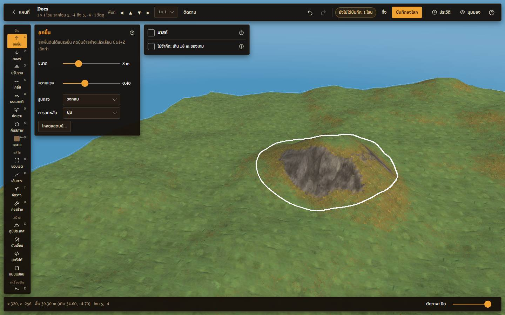
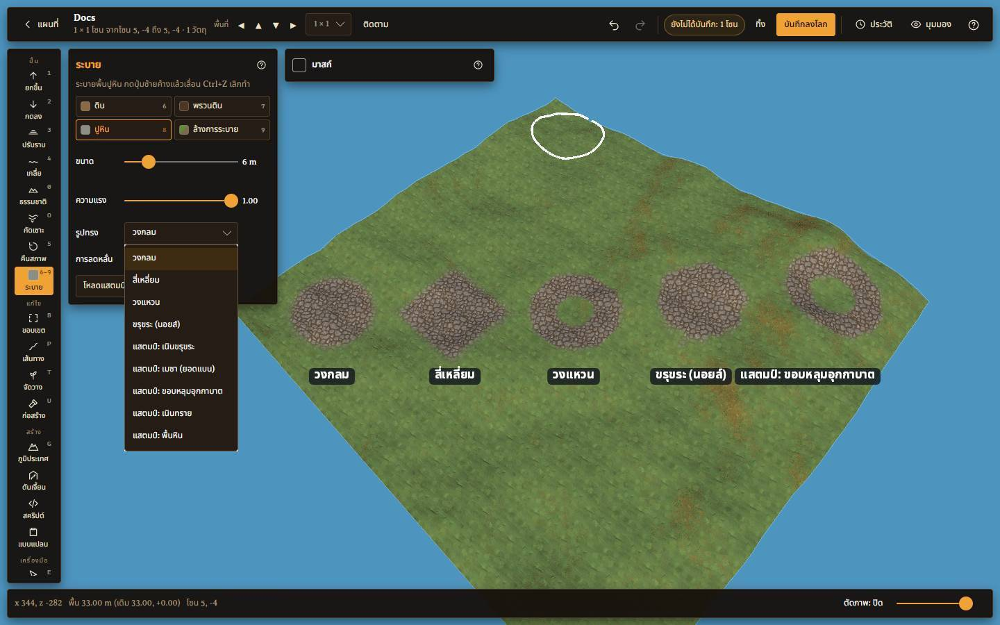
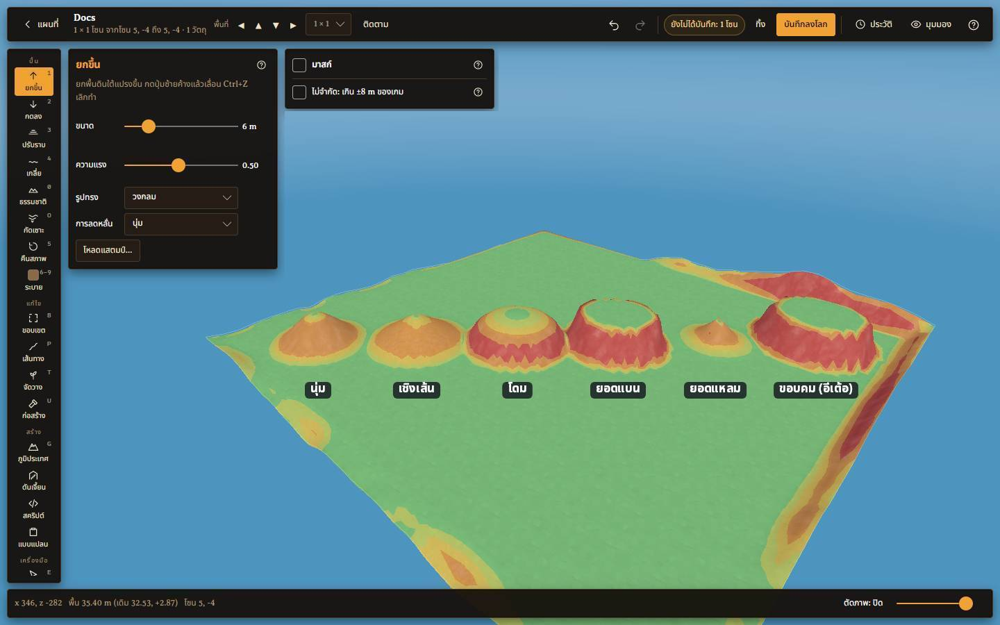
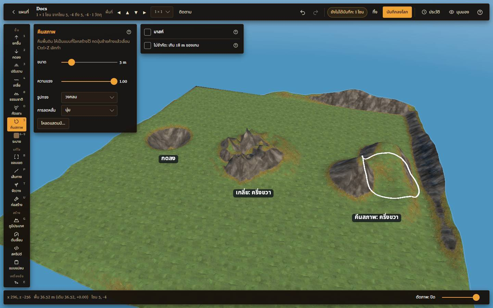
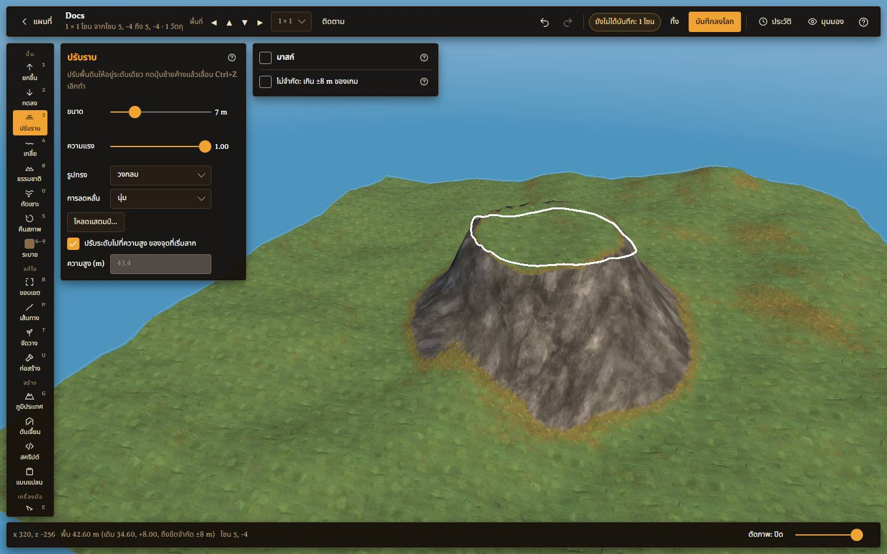
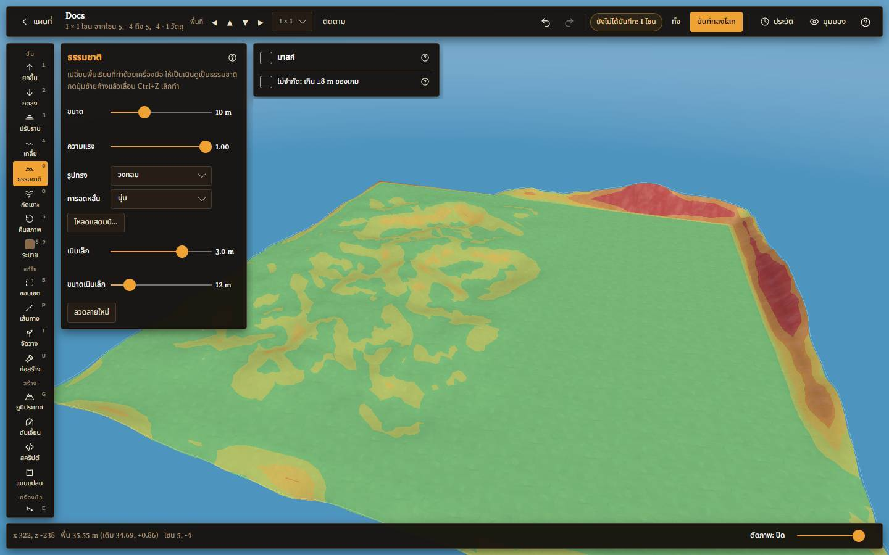
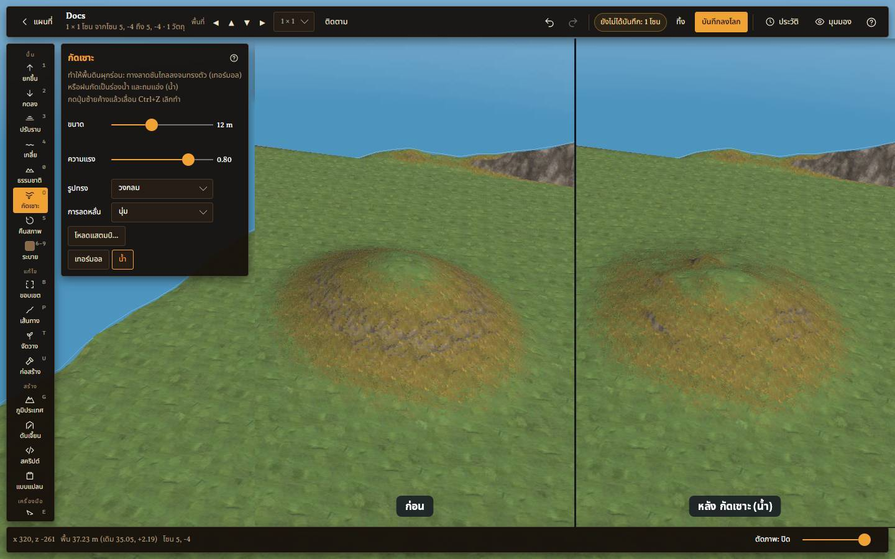
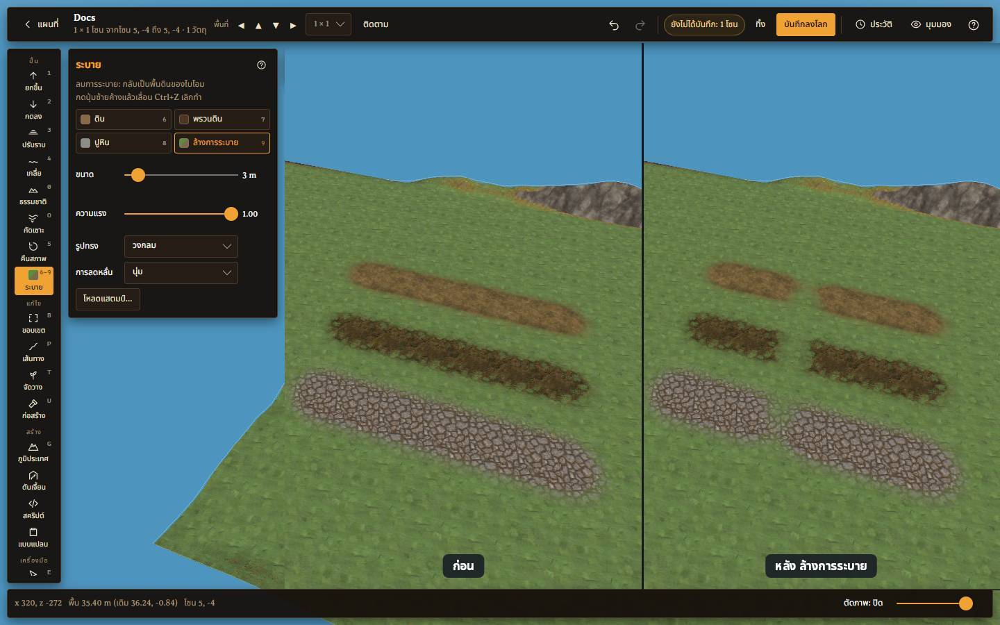
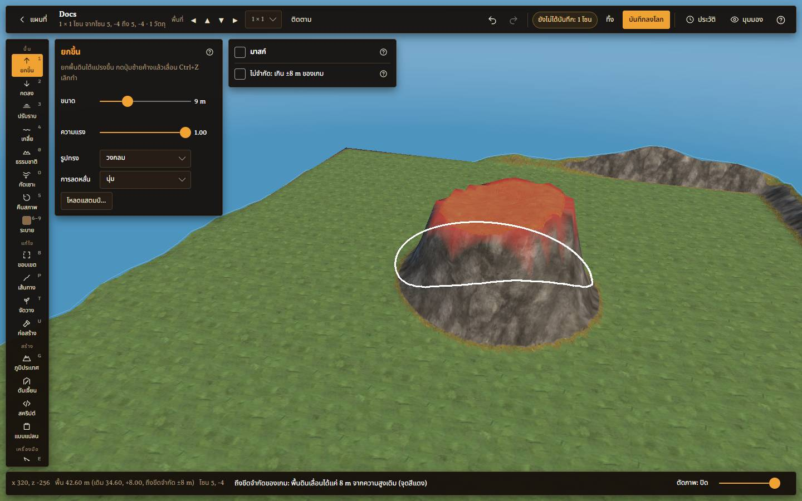
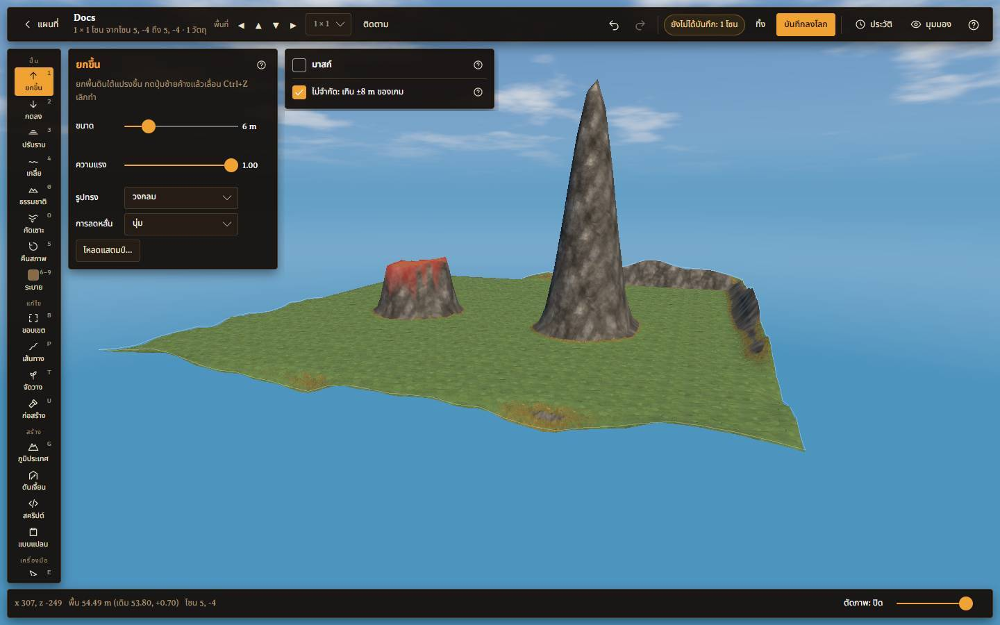

<!-- source: 9d7cf01c -->
# ปั้นและระบาย

ยกขึ้น กดลง ปรับระดับ เกลี่ย และระบายพื้นดิน ด้วยแปรงที่คุณกดค้างแล้วลาก เหมือนจอบ อีเต้อ
และคราดพรวนดินของเกม แต่เร็วกว่าและใหญ่กว่า

**ที่อยู่:** แถบเครื่องมือ ส่วน **ปั้น** · **ปุ่ม:** `1` ถึง `9`, `0`, `O` · **ใช้ได้กับ:** โลกที่บันทึกไว้
ไลฟ์

*เนินดินที่ทำด้วยการลาก ยกขึ้น สามครั้ง วงสีขาวบนยอดคือแปรง แผงทางซ้าย
มีการตั้งค่าของแปรง*

ทุกการเปลี่ยนแปลง เป็นไปตามกฎของเกมเอง โลกจึงโหลดได้ ในเกมของผู้เล่นทุกคน รวมถึงผู้เล่นคอนโซล
โดยไม่ต้องใช้ม็อด การลากแต่ละครั้ง เป็นการเลิกทำหนึ่งขั้นตอน (`Ctrl+Z`)

## ใช้งาน

1. ในแถบเครื่องมือ คลิกแปรงในส่วน **ปั้น** หรือกดปุ่มของแปรง (ดู [ปุ่มลัด](#ปมลด)) หากต้องการระบาย ให้คลิก
   **ระบาย** แล้วเลือกการระบายในแผง (ดู [แปรงระบาย](#แปรงระบาย))
2. ในแผง ตั้ง **ขนาด** และ **ความแรง** `[` และ `]` เปลี่ยนขนาดได้ ระหว่างทำงาน
3. กดปุ่มซ้ายของเมาส์ค้างบนพื้น แล้วเลื่อน แปรงทำงานต่อไป ขณะที่กดปุ่มอยู่ การกดค้างนิ่งๆ
   จึงทำงานกับจุดเดิมมากขึ้นเรื่อยๆ
4. ปล่อยปุ่ม การลากทั้งหมด เป็นการเลิกทำหนึ่งขั้นตอน ตั้งชื่อตามแปรง ("ยกขึ้น")
5. หากต้องการเก็บการเปลี่ยนแปลง ให้กด **บันทึกลงโลก** (หรือ **นำไปใช้แบบไลฟ์** ใน [โหมดไลฟ์](live-mode.md)) ก่อนหน้านั้น
   การเปลี่ยนแปลงจะ [รอดำเนินการ](concepts/saving-and-history.md#การเปลยนแปลงทรอดำเนนการ)

วงบนพื้น จะไปตามเนินที่อยู่ข้างใต้ และแสดงรูปทรงของแปรง: สี่เหลี่ยมหรือแสตมป์ แสดงเส้นขอบที่หมุนแล้ว
รูปทรง วงแหวน แสดงเส้นขอบด้านในอีกเส้นหนึ่ง

## การตั้งค่า

แผงแสดงการตั้งค่า ที่แปรงทุกอันใช้ร่วมกัน แล้วตามด้วยการตั้งค่า ของแปรงที่เลือก รูปทรง และ การลดหลั่น จะถูกจำไว้

| การตั้งค่า | สิ่งที่ทำ |
|---|---|
| **ขนาด** | รัศมีของแปรง 1 ถึง 30 m (สำหรับสี่เหลี่ยม คือครึ่งหนึ่งของด้าน) ค่าเริ่มต้น 6 m |
| **ความแรง** | ความเร็วที่แปรงทำงาน 0.05 ถึง 1 (ค่าเริ่มต้น 0.40) |
| **รูปทรง** | **วงกลม** **สี่เหลี่ยม** **วงแหวน** **ขรุขระ (นอยส์)** หรือรูปภาพ (**แสตมป์: …** ดู [แสตมป์](#แสตมป)) |
| **การลดหลั่น** | วิธีที่ผลค่อยๆ จาง จากกลางไปขอบ (ด้านล่าง) ซ่อนไว้สำหรับแสตมป์: รูปภาพมีการจางของตัวเอง |
| **หมุน** | เฉพาะ **สี่เหลี่ยม** และแสตมป์: หมุนแปรง -180° ถึง 180° |
| **โหลดแสตมป์…** / **ลืมแสตมป์** | เพิ่มรูปภาพเป็นรูปทรงแปรง หรือลบรูปที่คุณเพิ่มไว้ (ดู [แสตมป์](#แสตมป)) |
| การตั้งค่าของ ปรับราบ ธรรมชาติ กัดเซาะ | แสดงเฉพาะสำหรับแปรงนั้น (ดู [แปรงปั้น](#แปรงปน)) |

การตั้งค่าสองอย่าง ใช้กับเครื่องมือพื้นดินทุกอัน ไม่ใช่แค่แปรง จึงอยู่ในการ์ด **มาสก์** ข้างแผง:
ตัว [มาสก์](masks.md) เอง และ **ไม่จำกัด: เกิน ±8 m ของเกม** ที่อยู่ใต้มาสก์ (ดู [ไม่จำกัด](#ไมจำกด))

### รูปทรง

| รูปทรง | สิ่งที่ครอบคลุม |
|---|---|
| **วงกลม** | แปรงทรงกลม |
| **สี่เหลี่ยม** | สี่เหลี่ยมกว้างเท่าแปรง หมุนได้ด้วย **หมุน** |
| **วงแหวน** | เฉพาะแถบหนึ่ง: ไม่มีผลภายใน 40% ของขนาด เต็มแรงที่ 70% ไม่มีผลที่ขอบ สำหรับขอบหลุมอุกกาบาต คูน้ำ และกำแพงดิน |
| **ขรุขระ (นอยส์)** | แปรงทรงกลม ที่ขอบเว้าเข้าออก ได้ถึงหนึ่งในสามของขนาด ลวดลายผูกกับโลก การลากสองครั้ง บนที่เดียวกัน จึงได้ขอบแบบเดียวกัน |

*การระบาย ปูหิน หนึ่งจุด ต่อหนึ่งรูปทรง แต่ละจุดมีป้ายชื่อ: วงกลม สี่เหลี่ยม วงแหวน ขรุขระ (นอยส์) และแสตมป์ ขอบหลุมอุกกาบาต
รายการ รูปทรง เปิดอยู่ในแผง*

### การลดหลั่น

| การลดหลั่น | วิธีที่จาง | เหมาะกับ |
|---|---|---|
| **นุ่ม** (ค่าเริ่มต้น) | เส้นโค้งรูปตัว S: นุ่มนวลทั้งตรงกลางและที่ขอบ | งานส่วนใหญ่ |
| **เชิงเส้น** | สม่ำเสมอ จากกลางไปขอบ | กรวย ทางลาดสม่ำเสมอ |
| **โดม** | แรงอยู่ไกลออกไป แล้วลดลงเร็ว ใกล้ขอบ | เนินกลมที่มีตีนชัน |
| **ยอดแบน** | เต็มแรงตลอด 80% ด้านใน จางเฉพาะหนึ่งในห้าด้านนอก | ลานราบ ขั้นบันได เนินยอดแบน |
| **ยอดแหลม** | แรงเฉพาะใกล้ตรงกลาง | ยอดแหลมและหลุม |
| **ขอบคม (อีเต้อ)** | เต็มแรงจนถึงขอบ เลยขอบไปไม่มีผล | ผนังชันและรอยตัดตรง |

*การลาก ยกขึ้น แบบเดียวกัน กับการลดหลั่นแต่ละแบบ มีป้ายชื่อ: นุ่ม เชิงเส้น โดม ยอดแบน ยอดแหลม ขอบคม (อีเต้อ) เปิด
สีความชัน ไว้: ด้านที่ชันกว่า จะแดงกว่า*

## แปรงปั้น

| แปรง (ป้ายบนแถบ) | ปุ่ม | สิ่งที่ทำ |
|---|---|---|
| **ยกขึ้น** | `1` | ยกพื้นดินขึ้น ขณะที่คุณกดปุ่มค้าง |
| **กดลง** | `2` | ขุดพื้นดินลง |
| **ปรับราบ** | `3` | ปรับพื้นดินให้อยู่ระดับเดียว: พื้นที่ต่ำกว่าถูกยกขึ้น พื้นที่สูงกว่าถูกตัดออก |
| **เกลี่ย** | `4` | เกลี่ยเนิน และขอบคมให้เรียบ ผ่านที่เดิมอีกครั้ง เพื่อให้เรียบขึ้น |
| **ธรรมชาติ** | `0` | เปลี่ยนพื้นเรียบ ที่ทำด้วยเครื่องมือ ให้เป็นเนินที่ดูเป็นธรรมชาติ |
| **กัดเซาะ** | `O` | ทำให้พื้นดินผุกร่อน: ทางลาดชันไถลลง หรือฝนกัดเป็นร่องน้ำ |
| **คืนสภาพ** | `5` | คืนพื้นดิน ให้เป็นแบบที่โลกสร้างไว้ และลบการระบาย |

*มีป้ายชื่อ จากซ้าย: หลุมที่ขุดด้วย กดลง เนินขรุขระ ที่ เกลี่ย ทำให้ครึ่งขวาเรียบ เนินที่ยกขึ้น ที่ครึ่งขวา
ถูก คืนสภาพ กลับเป็นพื้นดินที่สร้างไว้ โดยมีวงของแปรงอยู่บนเนิน*

ปรับราบ เกลี่ย ธรรมชาติ และ คืนสภาพ ไม่เคยเกินเป้า: ในแต่ละช่วงขณะ แปรงจะเลื่อนพื้นดิน ไปทางเป้าหมายเพียงส่วนหนึ่ง
การกดค้างนานขึ้น จึงแค่เข้าใกล้เป้าหมายมากขึ้น

เครื่องมือ [ขอบเขต](area.md) และ [เส้นทาง](path.md) มีการกระทำเดียวกัน ในชื่อเดียวกัน ซึ่งใช้ในครั้งเดียว กับส่วนที่เลือก
หรือไปตามเส้น แทนที่จะใช้ใต้แปรงที่คุณกดค้าง (ขอบเขต แสดง คืนสภาพ เป็น **กลับเป็นพื้นดินที่เกมสร้าง**
ในกลุ่ม **กู้คืน**) เครื่องมือเหล่านี้ เปลี่ยนพื้นดินแบบเดียวกัน: **เกลี่ย** หนึ่งครั้งที่นั่น จะเลื่อนแต่ละจุด ไปที่ค่าเฉลี่ย
ของพื้นดินภายใน 3 m ประมาณเท่ากับ การกดแปรง เกลี่ย ค้างบนจุดหนึ่ง หนึ่งถึงสองวินาที ที่ความแรง
ค่าเริ่มต้น

### ปรับราบ

*การลาก ปรับราบ หนึ่งครั้ง ที่เริ่มบนยอดเนิน ปรับยอดให้ราบ **ปรับระดับไปที่ความสูง ของจุดที่เริ่มลาก** เปิดอยู่
**ความสูง (m)** จึงเป็นสีเทา และแสดงความสูงที่ใช้: 43.4 m*

| การตั้งค่า | สิ่งที่ทำ |
|---|---|
| **ปรับระดับไปที่ความสูง ของจุดที่เริ่มลาก** | เปิด (ค่าเริ่มต้น): พื้นดินตรงที่คุณกดปุ่ม จะกำหนดความสูง สำหรับการลากทั้งครั้ง **ความสูง (m)** แสดงค่านี้ |
| **ความสูง (m)** | ใช้เมื่อปิดตัวเลือกด้านบน: การลากทุกครั้ง จะปรับระดับไปที่ความสูงนี้ |

หากต้องการปรับระดับ ไปที่ความสูงที่คุณเลือก ให้ `Alt`+คลิกพื้น ด้วยแปรงใดก็ได้: เอดิเตอร์จะสลับไปที่ **ปรับราบ** ปิด
ตัวเลือกด้านบน และใส่ความสูงนั้นใน **ความสูง (m)** ใช้เพื่อทำให้ลานราบหลายแห่ง สูงเท่ากัน หรือปรับระดับพื้นที่
ให้สูงเท่ากับประตู ที่คุณสร้างไว้แล้ว

### ธรรมชาติ

| การตั้งค่า | สิ่งที่ทำ |
|---|---|
| **เนินเล็ก** | ความสูงของเนินเล็ก 0.2 ถึง 4 m (ค่าเริ่มต้น 1.2 m) |
| **ขนาดเนินเล็ก** | ความกว้างของเนินเล็ก 4 ถึง 60 m (ค่าเริ่มต้น 16 m): ค่าน้อยให้พื้นขรุขระ ค่ามากให้เนินลาดนุ่มนวล |
| **ลวดลายใหม่** | ลวดลายเนินแบบสุ่มใหม่ สำหรับการใช้ ธรรมชาติ ครั้งถัดไป (แปรงนี้ ของ ขอบเขต หรือของเครื่องมือ เส้นทาง) และสำหรับเส้นทาง ที่ใช้ ดูเป็นธรรมชาติ ขอบของรูปทรง **ขรุขระ (นอยส์)** และนอยส์ในสูตรของ [ภูมิประเทศ](landform.md#เขยนสตร) มาจากลวดลายเดียวกัน จึงเปลี่ยนไปด้วย |

การลากครั้งที่สอง บนที่เดิม จะไม่ทับถมเนินเพิ่ม ลวดลายผูกกับโลก การลากที่อยู่ติดกัน
จึงต่อกันโดยไม่มีรอยต่อ **ธรรมชาติ** และ **ดูเป็นธรรมชาติ** ของเครื่องมือ [เส้นทาง](path.md) และ **ธรรมชาติ**
ของเครื่องมือ [ขอบเขต](area.md) ใช้การตั้งค่าและลวดลายเดียวกัน และแสดงไว้ในแผงของตัวเอง: ค่าที่ตั้งในที่หนึ่ง
จะถูกตั้งในทั้งสามที่

*พื้นที่ปรับระดับแล้ว โดยเปิดสีความชัน ครึ่งซ้ายใช้ ธรรมชาติ (เนินเล็ก 3 m ขนาดเนินเล็ก 12 m): เนินแสดงเป็น
หย่อมสีเหลือง ครึ่งขวายังราบ และเป็นสีเขียวล้วน*

### กัดเซาะ

| การตั้งค่า | สิ่งที่ทำ |
|---|---|
| **เทอร์มอล** | พื้นดินที่ชันกว่า **มุมพักตัว** จะไถลลง ไปหาจุดข้างเคียงที่ต่ำกว่า จนทรงตัว: ลานหินร่วงใต้หน้าผา ผนังที่ทำด้วยเครื่องมือ ที่มนลง พื้นดินแค่ถูกย้าย ไม่เคยหายไป |
| **น้ำ** | ฝน: หยดน้ำตกลงใต้แปรง ไหลลงเนิน พาพื้นดินไป ตรงที่ไหลเร็ว และทิ้งไว้ตรงที่ไหลช้าลง หยดน้ำจำนวนมาก ทำให้เกิดร่องน้ำ เนินตะกอนรูปพัด ที่ตีนทางลาด และพื้นหุบเขาที่เรียบขึ้น **ความแรง** กำหนดจำนวนหยดน้ำ |
| **มุมพักตัว** | เฉพาะ **เทอร์มอล**: ความชันมากที่สุด ที่ยังทรงตัวได้ 10° ถึง 60° (ค่าเริ่มต้น 33°) ค่าน้อยจะทำให้ราบมากขึ้น |

ดินที่ไถลหรือถูกชะ ออกจากแปรง อาจตกอยู่นอกแปรงเล็กน้อย **กัดเซาะ** ของเครื่องมือ [ขอบเขต](area.md) และ [เส้นทาง](path.md)
ทำทั้งสองแบบพร้อมกัน ทั่วทั้งส่วนที่เลือก หรือไปตามเส้น ด้วย **มุมพักตัว** นี้ (แผงของเครื่องมือเหล่านั้น
ก็แสดงค่านี้)

*เนินดินเดียวกัน จากมุมกล้องเดียวกัน ซ้าย: ตามที่ยกขึ้น ขวา: หลัง กัดเซาะ (น้ำ) สองวินาที: ฝน
กัดยอดเนินให้ต่ำลง และทำให้ด้านข้าง เป็นริ้วร่องน้ำเล็กๆ*

### คืนสภาพ

**คืนสภาพ** นำการแก้ไขของคุณออก ทีละน้อยในแต่ละช่วงขณะ จนพื้นดินเป็นแบบที่โลกสร้างไว้ และยังย้อน
พื้นดินที่ยกหรือขุดด้วย [ไม่จำกัด](#ไมจำกด) ทั้งที่บันทึกแล้วหรือยัง: การบันทึกครั้งถัดไป จะนำแผ่นพื้นดิน
ที่ไม่ต้องใช้แล้วออก แปรงนี้ลบการระบาย เฉพาะในส่วนด้านในของแปรง ขอบของการระบายจึงยังเรียบร้อย

## แปรงระบาย

**ระบาย** ปุ่มสุดท้ายในส่วน **ปั้น** ของแถบเครื่องมือ เป็นแปรงเดียว สำหรับการระบายทั้งสี่แบบ แผงของแปรงแสดง
สี่แบบเป็นตัวอย่างสี: คลิกหนึ่งอัน เพื่อระบายด้วยแบบนั้น ตัวอย่างสีที่เลือก จะมีกรอบ และปุ่มบนแถบ จะเปลี่ยนเป็นสีนั้น

| การระบาย | ปุ่ม | สิ่งที่ทำ |
|---|---|---|
| **ดิน** | `6` | ดินเปล่า เหมือนทางเดินที่ถูกเหยียบ |
| **พรวนดิน** | `7` | ดินพรวน แบบที่คราดพรวนดินทำ ในเกม ปลูกพืชผลได้บนดินนี้เท่านั้น |
| **ปูหิน** | `8` | พื้นปูหิน |
| **ล้างการระบาย** | `9` | ระบายพื้นดินธรรมดา ของไบโอม |

แต่ละปุ่ม จะเลือกแปรง ระบาย พร้อมการระบายแบบนั้น จากเครื่องมือใดก็ได้ ปุ่มบนแถบ จะกลับมาพร้อมการระบาย
ที่คุณใช้ล่าสุด (ดิน ในตอนแรก)

ระบาย ใช้ ขนาด ความแรง รูปทรง การลดหลั่น และ มาสก์ เดียวกับแปรงปั้น เปลี่ยนรูปลักษณ์ของพื้นดิน
และสิ่งที่ขึ้นบนพื้น แต่ไม่เคยเปลี่ยนความสูง การลากเบาๆ หรือขอบนุ่มของแปรง ให้การผสมสี กดค้างนานขึ้น
เพื่อให้ได้สีเต็มที่

**ล้างการระบาย หรือ คืนสภาพ?** **ล้างการระบาย** ระบายพื้นดินธรรมดาของไบโอม ทับทุกอย่าง จึงซ่อนดิน
ที่โลกสร้างไว้ตรงนั้นด้วย **คืนสภาพ** ลบการระบายของคุณ พื้นดินจึงแสดง สิ่งที่โลกสร้างไว้อีกครั้ง

*ซ้าย: แถบปูหิน ดินพรวน และดิน ขวา: แถบเดียวกัน หลังลาก ล้างการระบาย หนึ่งครั้ง พาดผ่านทั้งสาม (แผง
ระบาย อยู่ทางซ้าย)*

## แสตมป์

แสตมป์คือรูปภาพ ที่ใช้เป็นรูปทรงแปรง: ส่วนสีขาวมีผลเต็มที่ ส่วนสีเทามีผลบางส่วน ส่วนสีดำไม่มีผลเลย
เลือกได้ใน **รูปทรง** ซึ่งแสดงแสตมป์เป็น **แสตมป์: …** แสตมป์ครอบคลุมสี่เหลี่ยม ที่กว้างเป็นสองเท่าของ **ขนาด**
และหมุนได้ด้วย **หมุน** ใช้ได้กับแปรงปั้นทุกอัน และกับ ระบาย

| แสตมป์ | รูปทรง |
|---|---|
| **เนินขรุขระ** | ยอดเขาเล็ก ที่มีด้านข้างขรุขระ |
| **เมซา (ยอดแบน)** | ยอดแบน ที่มีด้านข้างชัน และขรุขระเล็กน้อย |
| **ขอบหลุมอุกกาบาต** | กำแพงวงแหวน สำหรับหลุมอุกกาบาต (ใช้ กดลง ข้างในภายหลัง) และคันดินโบราณ |
| **เนินทราย** | สันเนินขนานกัน ภายในหย่อมทรงกลม |
| **พื้นหิน** | พื้นดินเป็นก้อน และแตกระแหง |

| การตั้งค่า | สิ่งที่ทำ |
|---|---|
| **โหลดแสตมป์…** | ใช้รูปภาพใดก็ได้ (PNG, JPEG…) เป็นแสตมป์: แผนที่ความสูงจากเครื่องมืออื่น โลโก้ รูปทรงที่วาดด้วยมือ ความสว่างคือความแรง ส่วนที่โปร่งใส นับเป็นสีดำ รูปจะถูกปรับขนาด เป็นสี่เหลี่ยม 128 × 128 จุด รูปที่กว้าง จึงถูกบีบ และรายละเอียดเล็กๆ จะหายไป รูปจะถูกเก็บไว้ใช้ครั้งหน้า ภายใต้ชื่อไฟล์ |
| **ลืมแสตมป์** | ลบรูปภาพที่โหลดไว้ ที่เลือกอยู่ใน **รูปทรง** แสดงเฉพาะสำหรับรูปภาพที่โหลด: แสตมป์ในตัวยังอยู่ |

**หากต้องการใส่รูปภาพทั้งรูป ลงในพื้นดิน ในคลิกเดียว** ที่ความสูงที่คุณกำหนด ให้ใช้ชนิด **รูปภาพ**
ของเครื่องมือ [ภูมิประเทศ](landform.md#รปภาพ) แทนแปรง: มีรูปภาพชุดเดียวกัน และรูปที่คุณโหลดไว้ที่นี่

## ไม่จำกัด

เกมจำกัดทุกการเปลี่ยนแปลงพื้นดิน ให้อยู่ภายใน 8 m จากพื้นดินที่เกมสร้าง แปรงจะหยุดที่นั่น แต้มสีแดงที่จุดนั้น
และแถบสถานะแสดง "ถึงขีดจำกัดของเกม: พื้นดินเลื่อนได้แค่ 8 m จากความสูงเดิม (จุดสีแดง)"
ดู [ขีดจำกัด 8 m ของเกม](concepts/ground-limits.md#ขดจำกด-8-m-ของเกม)

*กด ยกขึ้น ค้างไว้ จนพื้นดินหยุดที่ความสูง 8 m เมื่อเปิด **เครื่องหมายขีดจำกัด** ยอดจะเป็นสีแดง แถบสถานะแสดง
ข้อความ และค่าที่อ่านได้ของเคอร์เซอร์ ลงท้ายด้วย "ถึงขีดจำกัด ±8 m"*

**ไม่จำกัด: เกิน ±8 m ของเกม** ในการ์ด **มาสก์** ข้างแผงของเครื่องมือ (ใต้มาสก์) ทำให้เครื่องมือพื้นดิน
ไปได้ถึง 400 m จากพื้นดินที่เกมสร้าง: หน้าผา หุบผา ยอดแหลม หลุมลึก เป็นสวิตช์เดียว สำหรับทุกเครื่องมือ
ที่สวิตช์นี้ควบคุม และการ์ดแสดงสวิตช์นี้ กับเครื่องมือเหล่านั้นทุกอัน: แปรงปั้นทุกอัน [ภูมิประเทศ](landform.md) (ชนิด **สูตร**
และ **รูปภาพ**) [เส้นทาง](path.md) และ [ขอบเขต](area.md) (รวมถึงการนำเข้าแผนที่ความสูง) สวิตช์จะเปิดค้าง สำหรับทุกเครื่องมือ
จนกว่าคุณจะปิด และจะปิดทุกครั้งที่เปิดเอดิเตอร์ ชนิด **ภูเขา** ของ ภูมิประเทศ และการวางที่ที่คัดลอกมา
เกินขีดจำกัดเสมอ

> [!IMPORTANT]
> การบันทึกพื้นดินแบบ ไม่จำกัด จะอ่านพื้นที่จากโลกอีกครั้ง และ **ล้าง ประวัติ ของพื้นที่**: คุณเลิกทำย้อนไปก่อน
> การบันทึกนั้นไม่ได้ ตรวจรูปทรงก่อนบันทึก

*การลาก ยกขึ้น แบบเดียวกัน เมื่อปิด ไม่จำกัด (ซ้าย: หยุดที่ 8 m ยอดเป็นสีแดง) และเมื่อเปิด (ขวา: สูงกว่ามาก) สวิตช์
อยู่ในการ์ด มาสก์ ติ๊กไว้ เหมือนสำหรับรูปขวา*

เมื่อคุณบันทึก พื้นดินที่เกิน ±8 m จะกลายเป็นแผ่นพื้นดินที่มองไม่เห็น ซึ่งเกมของผู้เล่นทุกคน สร้างขึ้นแบบเดียวกัน ข้อความ
การบันทึก จะบอกว่าสร้างแผ่นพื้นดินกี่แผ่น และนำต้นไม้และหินออกกี่ชิ้น เช่น "พื้นดินแบบไม่จำกัด: แผ่นพื้นดิน 312
แผ่น, นำต้นไม้/หิน 40 ชิ้นออก; พื้นดินบางส่วนคลาดเคลื่อนได้ถึง 2.5 m (ชันเกินไป)" วิธีการทำงาน และสิ่งที่
เปลี่ยนไปในเกม: [ไม่จำกัด](concepts/ground-limits.md#ไมจำกด)

หลังบันทึก:

- ต้นไม้ หิน แร่ พุ่มไม้ และของที่เก็บได้ ในที่ที่พื้นดินเลื่อนเกิน 2 m จะหายไป (มิฉะนั้นจะถูกฝัง หรือ
  ลอยอยู่) ชิ้นส่วนก่อสร้างยังอยู่
- พื้นดินใหม่ นับเป็นพื้นดินที่เกมสร้าง: จอบและอีเต้อของเกม ทำงานได้ ±8 m จากพื้นนั้น หากต้องการนำรูปทรง ที่บันทึกแล้วออก
  ให้ใช้ **คืนสภาพ** (กลับเป็นพื้นดินที่โลกสร้างไว้) หรือลดระดับลงอีกครั้ง โดยเปิด ไม่จำกัด
- ผนังที่ชันมาก จะออกมานุ่มกว่า ที่วาดไว้เล็กน้อย
- โซนที่ยังไม่มีผู้เล่นไปเยือน จะเก็บพื้นดินเดิมไว้ ข้อความจะบอกว่ากี่โซน ให้ไปที่โซนเหล่านั้นในเกมก่อน
- แผนที่ในเกม ไม่แสดงรูปทรงใหม่

## ปุ่มลัด

| ปุ่มหรือเมาส์ | สิ่งที่ทำ |
|---|---|
| `1` `2` `3` `4` `0` `O` `5` | ยกขึ้น กดลง ปรับราบ เกลี่ย ธรรมชาติ กัดเซาะ คืนสภาพ |
| `6` `7` `8` `9` | แปรง ระบาย แบบ ดิน พรวนดิน ปูหิน ล้างการระบาย |
| `[` / `]` | ขนาดแปรง เล็กลง / ใหญ่ขึ้น 1 m |
| กดปุ่มซ้ายค้างแล้วลาก | ทำงานกับพื้นดิน |
| `Alt`+คลิก | เลือกความสูงตรงนั้น: สลับไปที่ ปรับราบ ที่ความสูงนั้น |
| `Alt`+`Shift`+คลิก | เปิด [มาสก์](masks.md) สำหรับช่วงต่ำกว่า 2 m ถึงสูงกว่า 2 m จากจุดนั้น (ใช้กับเครื่องมือ เส้นทาง ได้ด้วย) |
| ลากปุ่มกลาง | เลื่อนมุมมอง (ใช้ได้ขณะเลือกแปรงอยู่ด้วย) |
| `Ctrl+Z` | เลิกทำการลากครั้งล่าสุด |
| `Esc` | ออกจากแปรง (กลับไปที่ มุมมอง) |

ปุ่มทั้งหมดของเอดิเตอร์: [ปุ่มลัด](help/shortcuts.md)

## เคล็ดลับและข้อจำกัด

- **อ่านพื้นดินใต้เคอร์เซอร์** ในแถบสถานะ: `พื้น 41.20 m (เดิม 35.00, +6.20)` จะเพิ่ม "ถึงขีดจำกัด
  ±8 m" เมื่อจุดนั้นถึงขีดจำกัด ทะเลอยู่ที่ 30 m
- **แนวจุดด้านนอกสุดของพื้นที่ ไม่เคยเปลี่ยน** พื้นที่จึงต่อกับแผ่นดินรอบๆ หากต้องการทำงานตรงนั้น ให้ย้าย
  หรือขยายพื้นที่: ดู [ขอบที่ล็อก](concepts/areas-and-zones.md#ขอบทลอก)
- **พื้นดินมีความสูงเดียว ต่อหนึ่งเมตร** ผนังจึงกว้างประมาณ หนึ่งเมตรเสมอ และพื้นดินยื่นเป็นชะง่อนไม่ได้ (ม็อด
  เช่น Tunnelheim ขุดอุโมงค์จริงได้: ดู [แก้ไขโลกที่สร้างด้วย Expand World, Riverheim หรือ Tunnelheim](guides/use-mods-worlds.md)) ขอบที่วาดจากตะวันออกเฉียงเหนือ ไปตะวันตกเฉียงใต้ จะเป็นฟันเลื่อยเล็กๆ
  ในเกมด้วย
- **หมู่บ้าน พ่อค้า และทางเข้าดันเจี้ยน ปรับพื้นดินรอบตัวให้ราบ** การแก้ไขของคุณ จะอยู่บนพื้นนั้น เปิด
  **การปรับราบรอบสถานที่** ในแผง มุมมอง เพื่อดูว่าตรงไหน ดู
  [สถานที่ปรับพื้นดินให้ราบ](concepts/ground-limits.md#สถานทปรบพนดนใหราบ)
- **ความเร็ว:** ยกขึ้น และ กดลง เลื่อนกลางแปรง ประมาณ 2.4 m ต่อวินาที ที่ความแรงค่าเริ่มต้น และ 6 m
  ต่อวินาที ที่ความแรง 1
- **ไม่มีอะไรเปลี่ยน?** [มาสก์](masks.md) อาจกันพื้นดินใต้แปรงออกทั้งหมด แถบสถานะจะบอกไว้
- **หากต้องการย้อนการเปลี่ยนแปลง:** `Ctrl+Z` สำหรับการลากครั้งล่าสุด **คืนสภาพ** สำหรับที่หนึ่ง **ทิ้ง** สำหรับทุกอย่างที่ยังไม่ได้
  บันทึก ดู [เลิกทำการเปลี่ยนแปลง](guides/undo-changes.md)

## หัวข้อที่เกี่ยวข้อง

- [ยกหรือขุดเกินขีดจำกัด 8 m ของเกม](guides/raise-past-the-limit.md)
- [เคลียร์ต้นไม้และหิน ปรับพื้นที่ก่อสร้างให้ราบ](guides/clear-an-area.md)
- [ขีดจำกัดของพื้นดิน](concepts/ground-limits.md)
- [มาสก์](masks.md) [ภูมิประเทศ](landform.md)
- [วิธีเก็บพื้นดิน](concepts/ground-limits.md#พนดนถกเกบอยางไร) [ความเร็วในการทำงานของแปรง](concepts/ground-limits.md#แปรงทำงานเรวแคไหน)
