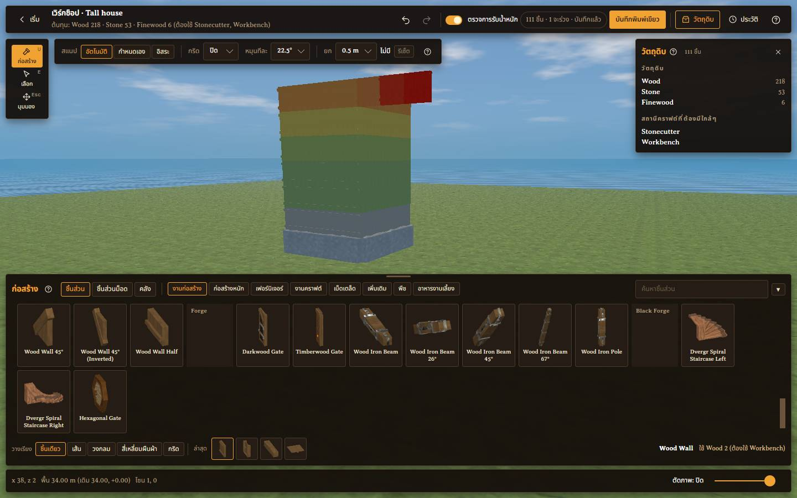
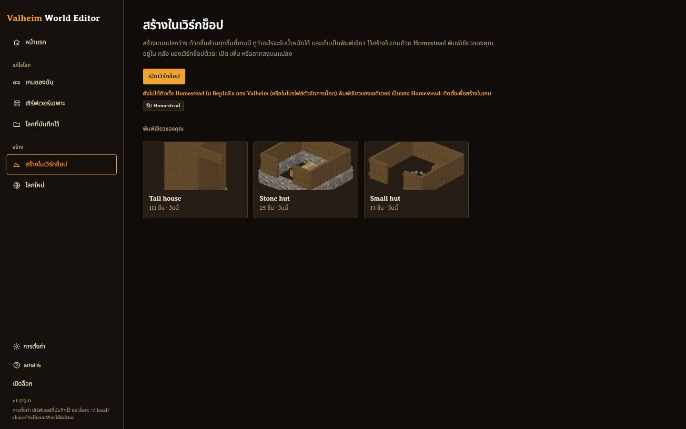
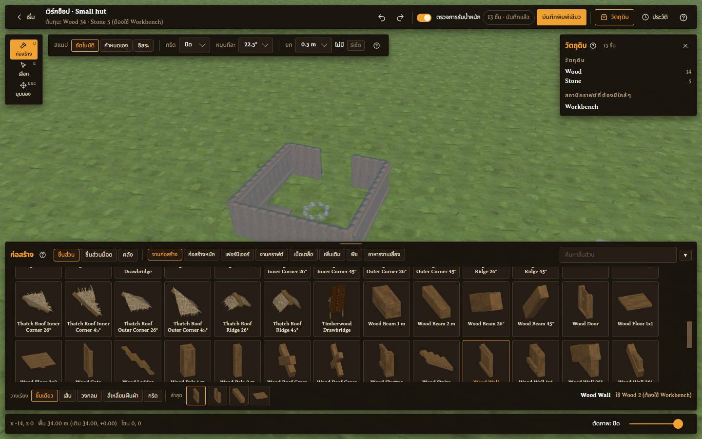
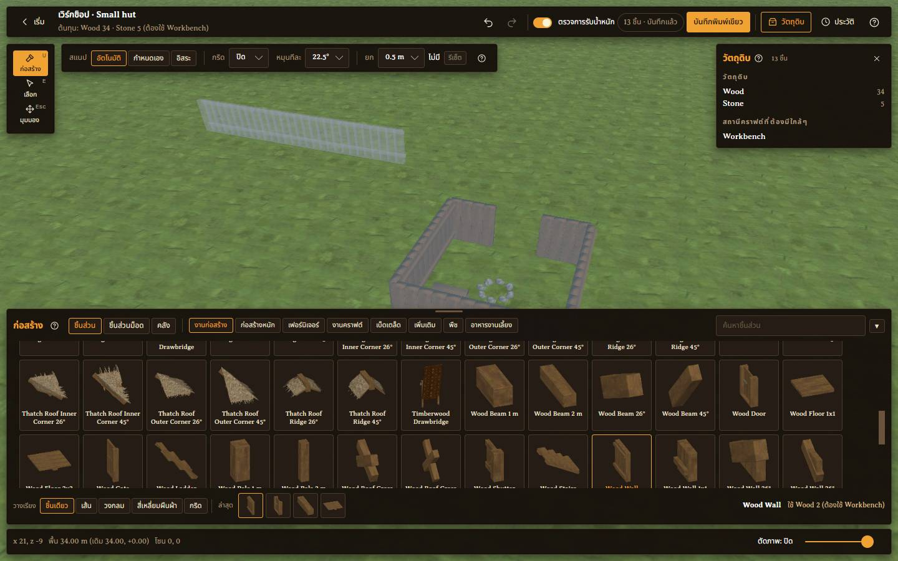
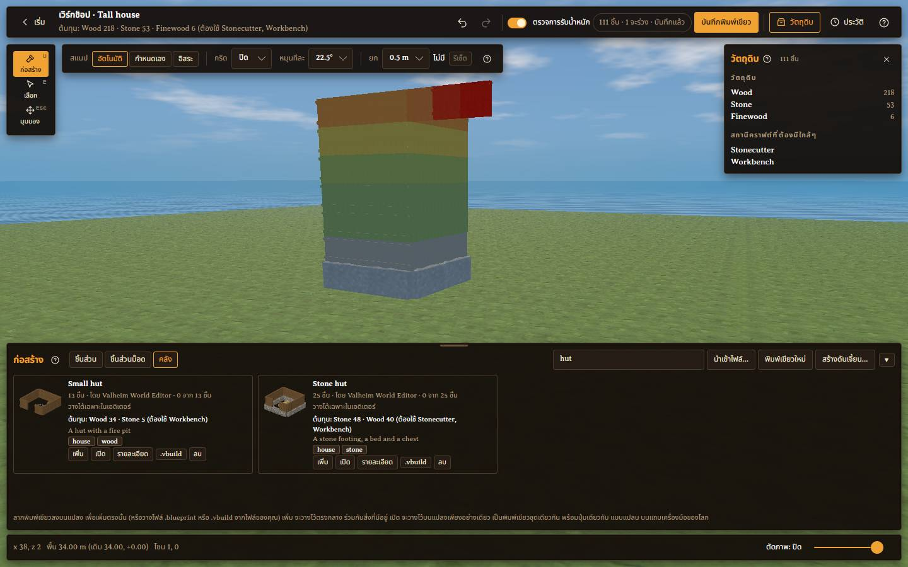
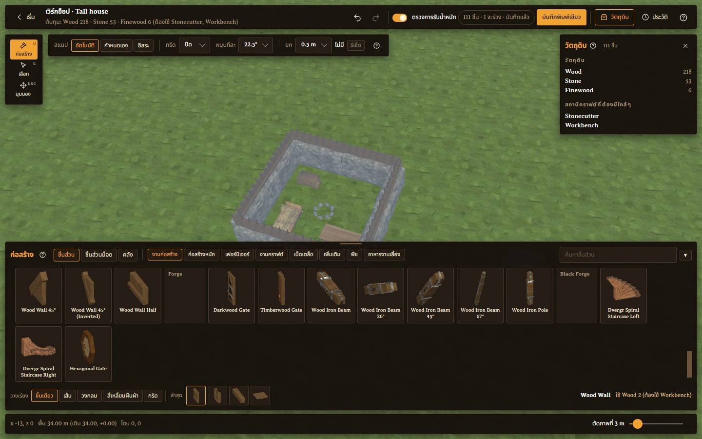
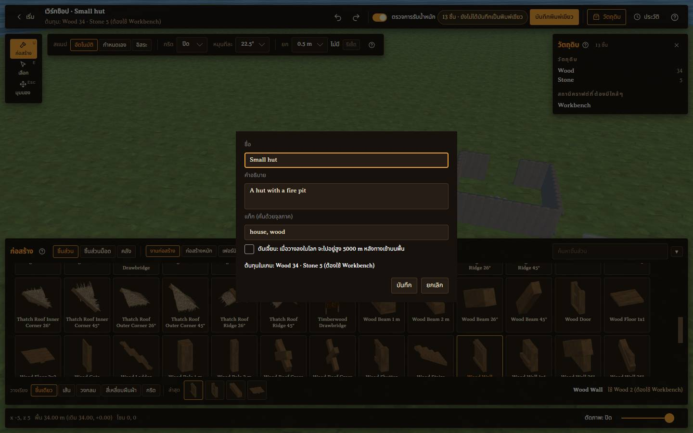
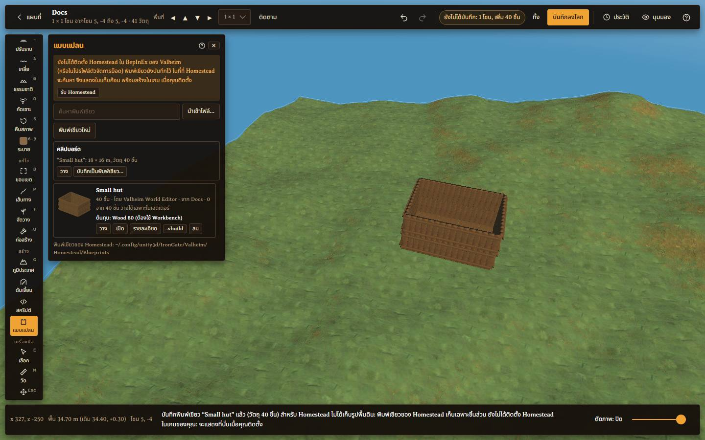

<!-- source: 820eb141 -->
# เวิร์กช็อป

ก่อสร้างบนแปลงว่าง ด้วยชิ้นส่วนทุกชิ้นที่เกมมี ดูว่าอะไรจะรับน้ำหนักได้ และมีต้นทุนเท่าไร แล้วเก็บไว้เป็น
พิมพ์เขียว เพื่อสร้างในเกม หรือวางลงในโลกใดก็ได้

**ที่อยู่:** หน้าเริ่มต้น **สร้างในเวิร์กช็อป** → **เปิดเวิร์กช็อป** ในโลก **แบบแปลน** (แถบเครื่องมือ ส่วน **สร้าง**)
→ **พิมพ์เขียวใหม่** · **ปุ่ม:** ไม่มี · **ใช้ได้กับ:** แปลงของเวิร์กช็อปเอง (แผง
**แบบแปลน** ใช้ได้ในโลกที่บันทึกไว้ และแบบไลฟ์)

*บ้านหลังสูง ที่เปิด **ตรวจการรับน้ำหนัก**: ฐานหินเป็นสีฟ้าอ่อน ผนังไม้ด้านบนเป็นสีเขียว แล้วเหลือง แล้ว
ส้มใกล้ด้านบน และส่วนที่ยื่นออกจากแถวบนสุด เป็นสีส้ม แล้วแดง แถบด้านบนแสดง
`111 ชิ้น · 1 จะร่วง · บันทึกแล้ว`*

พิมพ์เขียวคือไฟล์ของ [Homestead](https://thunderstore.io/c/valheim/p/sighsorry/Homestead/) ม็อดก่อสร้างในเกม:
ไฟล์เดียวกันนี้ แสดงในแท็บค้อนของ Homestead พร้อมสร้างในเกม และวางลงในโลกจากเอดิเตอร์ได้

## ใช้งาน

เพื่อสร้างกระท่อมและเก็บไว้:

1. ที่หน้าเริ่มต้น คลิก **สร้างในเวิร์กช็อป** แล้วคลิก **เปิดเวิร์กช็อป** (จากโลก: **แบบแปลน** บนแถบเครื่องมือ
   แล้ว **พิมพ์เขียวใหม่** โลกที่มีการเปลี่ยนแปลง ที่ยังไม่ได้บันทึก จะถามก่อน)
2. ในแผง **ก่อสร้าง** ตามด้านล่าง เลือกชิ้นส่วนบนแท็บ **ชิ้นส่วน**
3. คลิกบนแปลงเพื่อวางลง ชิ้นส่วนจะสแนป กับชิ้นที่มีอยู่แล้ว เหมือนค้อน
4. หมุนชิ้นส่วนด้วย `,` และ `.` ยกด้วย `PgUp` และ `PgDn` (หรือ `Ctrl` + ล้อเมาส์) กด `Alt` ค้างไว้ เพื่อวางอิสระ
   ทีละหนึ่งในสี่เมตร ถ้าจะย้ายหรือลบชิ้นส่วน กด `E` (เลือก)
5. ดูสีของ **ตรวจการรับน้ำหนัก** และจำนวน "จะร่วง" ในแถบด้านบน และต้นทุน ในแผง **วัตถุดิบ**
   ทางขวา
6. คลิก **บันทึกพิมพ์เขียว** (`Ctrl+S`) แล้วตั้งชื่อ คำอธิบาย และแท็ก
7. คลิก **เริ่ม** เพื่อกลับไปหน้าเริ่มต้น

ถ้าจะเปลี่ยนพิมพ์เขียวที่บันทึกไว้ ให้คลิกพิมพ์เขียวนั้น ใต้ **พิมพ์เขียวของคุณ** บนหน้าเริ่มต้น (หรือบน **หน้าแรก**) หรือคลิก **เปิด**
ข้างพิมพ์เขียวในคลัง (แผง แบบแปลน ของโลก หรือแท็บ **คลัง** ของเวิร์กช็อป)

*ส่วน **สร้างในเวิร์กช็อป** ของหน้าเริ่มต้น: **เปิดเวิร์กช็อป** **รับ Homestead** (ที่นี่ยังไม่ได้ติดตั้ง) และพิมพ์เขียว
สามอัน ใต้ **พิมพ์เขียวของคุณ** แต่ละอันมีรูป เรียงจากใหม่สุด*

## แปลง

แปลงไม่ได้เป็นส่วนหนึ่งของโลกใด: เป็นทุ่งหญ้าราบ 3 × 3 โซน (กว้าง 192 m) ที่ความสูงเดียว กึ่งกลางของแปลง
ที่ระดับพื้น คือ **จุดยึด** ของพิมพ์เขียว ซึ่งเป็นจุดที่ Homestead ใช้วัดตำแหน่ง ของทุกชิ้นส่วน

- แถบเครื่องมือมีแค่ [ก่อสร้าง](build.md) (`U` หรือ `T`) **เลือก** (`E`) และ **มุมมอง** เครื่องมือพื้นดิน
  มีไว้สำหรับโลก
- ข้างแถบเครื่องมือ มี **แถบก่อสร้าง**: **สแนป** **กริด** **หมุนทีละ** และ **ยก** (ดู
  [แถบก่อสร้าง](#แถบกอสราง))
- ตามด้านล่าง มี **แผง ก่อสร้าง**: ชิ้นส่วน ชิ้นส่วนจากม็อดของคุณ และพิมพ์เขียวของคุณ (ดู
  [แผง ก่อสร้าง](#แผง-กอสราง))
- ทางขวา มีแผง **วัตถุดิบ**: ต้นทุนของสิ่งก่อสร้าง (ดู [วัตถุดิบ](#วตถดบ))
- ไม่มี มาสก์ ไม่มีแผง มุมมอง และไม่มีเส้นขอบโซน และสิ่งก่อสร้างจะวาดแบบทึบ
- แถบด้านบนมี **เริ่ม** เลิกทำและทำซ้ำ สวิตช์ **ตรวจการรับน้ำหนัก** **บันทึกพิมพ์เขียว** **วัตถุดิบ** และ
  **ประวัติ** แถบนี้นับชิ้นส่วน บอกว่ากี่ชิ้นจะร่วง และสิ่งก่อสร้างบันทึกแล้วหรือยัง
  (`12 ชิ้น · 2 จะร่วง · ยังไม่ได้บันทึกเป็นพิมพ์เขียว`)
- ใต้ชื่อ: ต้นทุนของสิ่งก่อสร้างในเกม แบบสั้นๆ บรรทัดยาว จะลงท้ายด้วย "…"
- แถบสถานะมีแถบเลื่อน **ตัดภาพ** เหมือนในโลก (ดู [ตัดภาพ](#ตดภาพ))

ไม่มี **ทิ้ง**: ให้เลิกทำ หรือเปิดพิมพ์เขียวอีกครั้ง การออกโดยที่สิ่งก่อสร้าง ยังไม่ได้บันทึกเป็นพิมพ์เขียว
(**เริ่ม** เปิดอันอื่น ปิดโปรแกรม) จะถามก่อน

*เวิร์กช็อป ที่มีกระท่อมเล็กบนแปลง: แถบเครื่องมือ ที่มีแค่ **ก่อสร้าง** **เลือก** และ **มุมมอง** โดยมีแถบก่อสร้าง
อยู่ข้างๆ แถบด้านบน มี **เริ่ม** **ตรวจการรับน้ำหนัก** จำนวนชิ้นส่วน **บันทึกพิมพ์เขียว** และ
**วัตถุดิบ** แผง **วัตถุดิบ** ทางขวา แผง ก่อสร้าง ตามด้านล่าง ที่แท็บ **งานก่อสร้าง** โดยมี
ชิ้นส่วนสี่ชิ้นที่เลือกล่าสุด ใต้ **ล่าสุด** และเลือกผนังไม้ไว้*

## การตั้งค่า

### แผง ก่อสร้าง

แผง **ก่อสร้าง** (ของเครื่องมือ [ก่อสร้าง](build.md) เหมือนกันในโลก) กินพื้นที่ตามด้านล่างของหน้าต่าง ให้แปลง
ได้พื้นที่ที่เหลือ แถวบนสุดมีสามแท็บ
**ชิ้นส่วน** **ชิ้นส่วนม็อด** และ **คลัง** ตามด้วยตัวเลือกของแท็บ และช่องค้นหา ลากขอบบนขึ้นหรือลง
เพื่อให้แผงสูงขึ้นหรือเตี้ยลง และคลิก **▾** ที่ปลายด้านขวา เพื่อพับแผงลง ให้เหลือแถวนั้น (**▴** เปิดอีกครั้ง)
ทั้งสองอย่าง จะเก็บไว้ใช้ครั้งหน้า

**ชิ้นส่วน** แสดงทุกอย่างที่ผู้เล่นสร้างได้ แต่ละชิ้นมีรูป จากโมเดลของเกม:

| แท็บ | มีอะไร |
|---|---|
| **งานก่อสร้าง** **ก่อสร้างหนัก** **เฟอร์นิเจอร์** **งานคราฟต์** **เบ็ดเตล็ด** **เพิ่มเติม** | แท็บของค้อนเอง ตามลำดับของเกม |
| **พืช** | ชิ้นส่วนของเครื่องพรวนดิน: พืชผล ต้นกล้า และดอกไม้ |
| **อาหารงานเลี้ยง** | ชิ้นส่วนของถาดเสิร์ฟ |

ในแต่ละแท็บ ชิ้นส่วนจะจัดกลุ่ม ตามสถานีคราฟต์ที่ต้องใช้ ตามลำดับที่ผู้เล่นได้รับ (ไม่มี โต๊ะทำงาน
โต๊ะตัดหิน เตาหลอม โต๊ะช่างฝีมือ เตาหลอมดำ โต๊ะ galdr) แล้วเรียงตามชื่อ แต่ละกลุ่มขึ้นต้นด้วยชื่อสถานี

**ชิ้นส่วนม็อด** แสดงชิ้นส่วนที่ม็อดของคุณเพิ่ม ทีละม็อด: เลือกม็อดในรายการ ด้านซ้าย (พร้อม
จำนวนชิ้นส่วน) หัวข้อคือกลุ่มของม็อดเอง (สถานีคราฟต์ของม็อด สำหรับชิ้นที่ไม่มีกลุ่ม) ชิ้นส่วน
มาจากสองแหล่ง:

- **ม็อดที่ติดตั้งบนคอมพิวเตอร์เครื่องนี้** ในโฟลเดอร์ BepInEx ที่เอดิเตอร์รู้จัก (ของ Valheim ของคุณ ของโปรไฟล์
  ตัวจัดการม็อด และที่เพิ่มใน การตั้งค่า) เวิร์กช็อปอ่านไฟล์ของม็อด ตอนเปิดครั้งแรก โดยไม่ต้องใช้เกม และอ่าน
  อีกครั้ง เฉพาะเมื่อไฟล์เปลี่ยน **สแกนม็อดใหม่** อ่านอีกครั้งทันที ชื่อและรูป มาจากไฟล์ของม็อดเอง
  ชิ้นส่วนที่อ่านแบบนี้ จะสแนปด้วยจุดสแนปของตัวเอง แต่ไม่ทราบต้นทุน (ม็อดกำหนดต้นทุน ตอนเกมเริ่ม):
  จะแสดง `ไม่ทราบต้นทุน` และ [วัตถุดิบ](#วตถดบ) จะแสดงไว้ใต้ **ไม่มีสูตรคราฟต์ที่รู้จัก**
- **เกมที่รันอยู่** ซึ่งรันม็อดพร้อม WorldEditorBridge (ดู [โหมดไลฟ์](live-mode.md#เกมทตดตงมอด)): บอกชื่อ
  และต้นทุนจริง ซึ่งใช้แทนข้อมูลจากไฟล์

ม็อดที่สร้างชิ้นส่วนในโค้ด (Railroads) จะแสดงผ่าน[แอดออน](modding.md) ของม็อด ซึ่งบอกชื่อชิ้นส่วนไว้

<!-- picture: workshop-mod-pieces.jpg, the Mod pieces tab with Moonforged Build Pieces and Railroads installed: the two mods down its side, Moonforged's walls with their pictures, two of them snapped together on the plot -->

| การตั้งค่า | ทำอะไร |
|---|---|
| **ค้นหาชิ้นส่วน** | หาชิ้นส่วนในทุกแท็บ รวมถึงของม็อด ตามชื่อหรือพรีแฟบ (`stone floor`, `woodwall`) ทุกคำต้องตรงกัน |
| ไทล์ของชิ้นส่วน | เลือกชิ้นนั้น ชื่อและต้นทุน จะแสดงที่ด้านล่างของแผง (`Wood Wall · ใช้ Wood 2 (ต้องใช้ Workbench)`) พร้อมชื่อม็อด สำหรับชิ้นส่วนของม็อด ชี้ที่ไทล์ เพื่อดูชื่อพรีแฟบ |
| **ล่าสุด** | ชิ้นส่วน 12 ชิ้นล่าสุดที่คุณเลือก เรียงจากใหม่สุด ที่ด้านล่างของแผง: คลิกเพื่อเลือกอีกครั้ง เก็บไว้ใช้ครั้งหน้า |

การคลิกแต่ละครั้ง วางหนึ่งชิ้น ถ้าไม่ได้เลือกชิ้นส่วน ก่อสร้าง จะเลือกผนังไม้ให้ **วางเรียง** ที่ด้านล่างของแผง
วางชิ้นส่วนเรียงตามเส้น รอบวงกลม หรือสี่เหลี่ยมผืนผ้า หรือเป็นกริดแทน: ดู
[วางชิ้นส่วนเรียงตามเส้น หรือเป็นกริด](build.md#วางชนสวนเรยงตามเสน-หรอเปนกรด)

**วิธีลัด** ขณะเปิด **ก่อสร้าง**:

| เมาส์ | ทำอะไร |
|---|---|
| ลาก | วางชิ้นส่วนเป็นแถว จากจุดที่กด: ต่อขอบชนขอบ ห่างกันหนึ่งความยาวของชิ้นส่วน (ความกว้างของผนัง ด้านของพื้น) ตามด้านของชิ้นส่วน ที่ใกล้กับทิศที่ลาก ที่ความสูงของชิ้นแรก ได้สูงสุด 64 ชิ้น ผนังเรียงเป็นแถวได้ ตามความกว้างเท่านั้น: หมุนก่อน เพื่อเรียงอีกทาง ปล่อยปุ่มเพื่อวางแถวลง เป็นหนึ่งขั้นตอนเลิกทำ |
| `Shift` + คลิกขวา | นำชิ้นส่วนใต้ตัวชี้ออก (`Ctrl+Z` นำกลับมา) การลากปุ่มขวา ยังคงหมุนมุมมอง และ `Shift` + ลากปุ่มขวา ยังคงเลื่อนมุมมอง |
| คลิกปุ่มกลาง | สร้างด้วยชนิด ของชิ้นส่วนใต้ตัวชี้ เหมือนหลอดดูดสี: ชิ้นนั้นจะถูกเลือกในแผง และอยู่อันดับแรกใน **ล่าสุด** การลากปุ่มกลาง ยังคงเลื่อนมุมมอง |

*การลากจากซ้าย: แถวผนังไม้ ที่วางต่อปลายชนปลาย โปร่งใสอยู่ จนกว่าจะปล่อยปุ่ม*

### แถบก่อสร้าง

แถบข้างแถบเครื่องมือ กำหนดวิธีวางชิ้นส่วน: **สแนป** (**อัตโนมัติ** **กำหนดเอง** **อิสระ**) **กริด**
**หมุนทีละ** และ **ยก** เป็นแถบเดียวกับในโลก ซึ่ง เลือก และ วาง ใช้ร่วมกัน และมี **สร้างโดย** ด้วย:
ดู [แถบก่อสร้าง](build.md#แถบกอสราง)

### แท็บ คลัง

*แท็บ **คลัง** ที่ค้นหา "hut": ช่องค้นหา **นำเข้าไฟล์…** **พิมพ์เขียวใหม่** และ **สร้างดันเจี้ยน…** ใน
แถวบนสุดของแผง ตามด้วยกระท่อมสองหลัง เคียงข้างกัน (บ้านหลังสูงไม่แสดง) แต่ละอันมีรูป ชิ้นส่วน ต้นทุน
คำอธิบาย แท็ก และปุ่ม **เพิ่ม** **เปิด** **รายละเอียด** **.vbuild** และ **ลบ***

คลัง เป็นรายการเดียวกับ[แผง แบบแปลน](#แผง-แบบแปลน) ของโลก: พิมพ์เขียวชุดเดียวกัน แสดงแบบเดียวกัน
พร้อมปุ่มเดียวกัน ต่างกันแค่การวางลง: แปลงรับด้วย **เพิ่ม** (หรือการลาก) ส่วนโลกรับด้วย
**วาง**

| การตั้งค่า | ทำอะไร |
|---|---|
| **ค้นหาพิมพ์เขียว** | แสดงพิมพ์เขียว ที่มีทุกคำที่คุณพิมพ์ ในชื่อ ผู้สร้าง คำอธิบาย หรือแท็ก |
| **เพิ่ม** | เพิ่มพิมพ์เขียวลงบนแปลง ตรงกลาง หนึ่งขั้นตอนเลิกทำ |
| ลากพิมพ์เขียวลงบนแปลง | เพิ่มพิมพ์เขียว ตรงที่คุณปล่อย |
| **เปิด** | พิมพ์เขียวอยู่บนแปลง เพียงอย่างเดียว เพื่อแก้ไข (ถามก่อน ถ้าแปลงยังไม่ได้บันทึก) **บันทึกพิมพ์เขียว** เขียนกลับไป |
| **รายละเอียด** | เปลี่ยนชื่อ คำอธิบาย แท็ก และสวิตช์ดันเจี้ยน ชื่อใหม่จะเปลี่ยนชื่อไฟล์และรูป ถ้าชื่อนั้นว่างอยู่ สำหรับพิมพ์เขียวบนแปลง เวิร์กช็อปจะใช้ชื่อใหม่ และ **บันทึกพิมพ์เขียว** จะเขียนไฟล์นั้น |
| **.vbuild** | เขียนวัตถุของพิมพ์เขียว เป็นไฟล์ `.vbuild` ลงในโฟลเดอร์ `export` ของโฟลเดอร์พิมพ์เขียว ของเอดิเตอร์ แล้วบอกตำแหน่ง |
| **ลบ** | ลบไฟล์และรูป หลังถามก่อน Homestead จะไม่มีพิมพ์เขียวนั้นด้วย การลบพิมพ์เขียวที่อยู่บนแปลง จะทิ้งสิ่งก่อสร้างไว้ที่นั่น โดยมีเครื่องหมาย *ยังไม่ได้บันทึกเป็นพิมพ์เขียว* |
| วางไฟล์ลงบนแปลง | ไฟล์ `.blueprint` และ `.vbuild` จากตัวจัดการไฟล์ จะถูกนำเข้า แล้วเพิ่มตรงที่ปล่อย ถ้าปล่อยบนโลก จะแค่นำเข้า |
| **นำเข้าไฟล์…** | นำเข้าไฟล์ `.blueprint` (Homestead, PlanBuild) หรือ `.vbuild` เข้าคลัง |
| **พิมพ์เขียวใหม่** | แปลงว่าง (ถามก่อน ถ้าแปลงยังไม่ได้บันทึก) |
| **สร้างดันเจี้ยน…** | แสดงตัวสร้างดันเจี้ยน (เฉพาะชิ้นส่วนก่อสร้าง ดู [ดันเจี้ยน](dungeons.md)) **เปิดบนแปลง** วางดันเจี้ยนไว้ที่นั่น เพียงอย่างเดียว **เพิ่มลงในแปลง** เพิ่มไว้ตรงกลาง ไม่ว่าแบบไหน พิมพ์เขียวของดันเจี้ยน จะถูกเก็บในคลัง โดยไม่มีรูป `.png` อยู่ข้างๆ **← คลัง** กลับไป |

พิมพ์เขียวที่เปิดหรือเพิ่ม จะคงรูปทรงเดิมทุกประการ โดยย้ายทั้งชุด ให้ชิ้นส่วนก่อสร้างที่ต่ำที่สุด อยู่บนแปลง
พิมพ์เขียวของ Homestead จะคงจุดยึดไว้ ที่กึ่งกลางแปลง ไฟล์อื่นจะจัดให้อยู่ตรงกลาง การบันทึกอีกครั้ง จะคงความสูง
ของจุดยึดไว้ สิ่งก่อสร้างจึงตั้งอยู่แบบเดิม เมื่อ Homestead สร้าง ชิ้นส่วนจากม็อดที่คุณไม่มี จะถูกตัดออก และ
ข้อความจะแสดงรายการไว้ พิมพ์เขียวที่เปิด จากนอกโฟลเดอร์ของ Homestead จะถามก่อน บันทึกทับพิมพ์เขียวในคลัง
ที่มีชื่อเดียวกัน

พิมพ์เขียวจากเอดิเตอร์ เวอร์ชันก่อน Homestead จะแสดงต่อท้าย ใต้ **พิมพ์เขียวรุ่นเก่าของเอดิเตอร์**:
**ไปยัง Homestead** เก็บพิมพ์เขียวนั้น เป็นพิมพ์เขียวของ Homestead ซึ่งจากนั้นเพิ่มหรือเปิดได้

### วัตถุดิบ

แผง **วัตถุดิบ** ทางขวา แสดงต้นทุนในเกม ของสิ่งก่อสร้างบนแปลง และอัปเดตตามทุกการเปลี่ยนแปลง:

| ส่วน | แสดงอะไร |
|---|---|
| **วัตถุดิบ** | วัตถุดิบแต่ละอย่าง พร้อมจำนวน เรียงจากมากสุด |
| **สถานีคราฟต์ที่ต้องมีใกล้ๆ** | สถานีคราฟต์ ที่ต้องอยู่ใกล้ๆ จึงจะสร้างได้ |
| **ไม่มีสูตรคราฟต์ที่รู้จัก** | ชิ้นส่วนที่เอดิเตอร์ ไม่รู้สูตรคราฟต์ (ของม็อด ก่อนที่เกมที่รันอยู่จะบอก) แยกตามม็อด ไม่นำมานับ |
| **วางได้เฉพาะในเอดิเตอร์** | รูปปั้น ของประดับ เรือ และสิ่งมีชีวิต: ค้อนของ Homestead ข้ามสิ่งเหล่านี้ จึงไม่นำมานับ |

**วัตถุดิบ** ในแถบด้านบน (หรือ **✕** ของแผง) ปิดและเปิดแผงนี้ เวิร์กช็อปจะจำไว้

### ตรวจการรับน้ำหนัก

**ตรวจการรับน้ำหนัก** (เปิดเป็นค่าเริ่มต้น) ลงสีชิ้นส่วนก่อสร้างแต่ละชิ้น ตามสีที่โหมดก่อสร้างของเกม ใช้แสดงการรับน้ำหนัก:

| สี | ความหมาย |
|---|---|
| **ฟ้าอ่อน** | รับน้ำหนักเต็มที่: ตั้งอยู่บนพื้นดิน |
| **เขียว** | แข็งแรง |
| **เหลือง** **ส้ม** | อ่อนลง |
| **แดง** | ใกล้พัง: ในเกมจะร่วงทันที ที่ผู้เล่นเข้าใกล้ |

แถบด้านบนบอกว่า จะร่วงกี่ชิ้น และ **บันทึกพิมพ์เขียว** จะถามก่อน ถ้ามีชิ้นที่จะร่วง (แม้ปิดสวิตช์
ก็ตาม: สวิตช์แค่ซ่อนสี) หินตั้งได้สูง แต่ยื่นออกไปไม่ได้
ไม้ยื่นออกไปได้ไกลกว่า แต่ไม่สูงเท่า ดู [การตรวจการรับน้ำหนัก](concepts/objects.md#การตรวจการรบนำหนก)

### ตัดภาพ

*บ้านหลังเดิม ที่ **ตัดภาพที่ 3 m** มองจากด้านบน: ทุกอย่างที่สูงกว่า 3 m ถูกซ่อน คุณจึงมองเห็นข้างใน
ชั้นล่าง พร้อมเตาไฟ เตียง โต๊ะ และหีบ*

แถบเลื่อน **ตัดภาพ** ในแถบสถานะ ซ่อนทุกอย่าง ที่สูงกว่าความสูงหนึ่ง 0 ถึง 39 m เหนือแปลง และเคอร์เซอร์
จะทะลุสิ่งที่ซ่อนไว้ คุณจึงก่อสร้างข้างในได้ ปลายด้านขวาคือปิด (`ตัดภาพ: ปิด`) เป็นแถบเลื่อนเดียวกับ
ในโลก และในดันเจี้ยน ซึ่งนับเมตรจากพื้นดิน หรือจากพื้นของดันเจี้ยน: ดู
[ตัดภาพ](editor-basics.md#ตดภาพ)

## บันทึกพิมพ์เขียว

**บันทึกพิมพ์เขียว** (`Ctrl+S`) ถามหา:

| ช่อง | คืออะไร |
|---|---|
| **ชื่อ** | Homestead แสดงพิมพ์เขียวด้วยชื่อนี้ และไฟล์ตั้งชื่อตามนี้ |
| **คำอธิบาย** | คำไม่กี่คำ แสดงในคลัง และแก่คนที่คุณแชร์ให้ การขึ้นบรรทัดใหม่ จะกลายเป็นช่องว่าง |
| **แท็ก (คั่นด้วยจุลภาค)** | คำที่ใช้ค้นหา: `บ้าน, ไวกิ้ง, หิน` ไม่เกิน 12 คำ คำซ้ำจะถูกตัดออก |
| **ดันเจี้ยน: เมื่อวางลงในโลก จะไปอยู่สูง 5000 m หลังทางเข้าบนพื้น** | ทำให้เป็นพิมพ์เขียวดันเจี้ยน: ดู [ดันเจี้ยน](dungeons.md) |

กล่องโต้ตอบแสดง **ต้นทุนในเกม** การบันทึกพิมพ์เขียวที่คุณเปิดไว้ จะเขียนทับ ชื่ออื่นจะสร้างอันใหม่
และแทนที่อันที่มีชื่อนั้น หลังถามก่อนเท่านั้น รูปจะถูกบันทึกไว้ข้างไฟล์ (`.png` สิ่งก่อสร้างที่มองจาก
ด้านบนเป็นมุมเฉียง บนพื้นหลังโปร่งใส) ซึ่ง Homestead ใช้เป็นไอคอน รูปจะวาดด้วยโมเดลของเกม
เมื่อเอดิเตอร์อ่านได้ ไม่เช่นนั้น จะวาดรูปทรงของแต่ละชิ้น ด้วยสีของวัสดุ พิมพ์เขียวที่สร้างจากที่อื่น โดยไม่มี
รูป จะได้รูปที่วาดในคลัง ในหน่วยความจำเท่านั้น

*การบันทึกกระท่อม: **ชื่อ** "Small hut" **คำอธิบาย** "A hut with a fire pit" **แท็ก** "house, wood" **ดันเจี้ยน**
ปิด และบรรทัด **ต้นทุนในเกม** เหนือ **บันทึก***

สิ่งที่ถูกเก็บไว้:

- **ทุกอย่างที่ตั้งอยู่บนแปลง** ไม่รวมพื้นดินของแปลง แปลงเริ่มต้นว่างเปล่า ทุกอย่างบนนั้นจึงเป็นของคุณ:
  ชิ้นส่วนที่คุณสร้าง และสิ่งที่พิมพ์เขียว ที่เปิดหรือเพิ่มเข้ามา นำมาด้วย (ต้นไม้ หิน สิ่งมีชีวิต) ต้องมี
  ชิ้นส่วนก่อสร้าง อย่างน้อยหนึ่งชิ้น
- **สิ่งที่วัตถุเก็บไว้**: ของในหีบ ข้อความบนป้าย ไอเทมบนแท่นวาง ดาวของสิ่งมีชีวิต เลือกวัตถุ
  แล้วกด `I` เพื่อดูหรือเปลี่ยน: ดู [ตัวตรวจดูข้อมูล](select.md)
- **เป็นซากปรักหักพังหรือไม่**: ชิ้นส่วนที่ไม่มีผู้สร้าง แบบซากปรักหักพังของเกม และดันเจี้ยนที่สร้างขึ้น ชิ้นอื่น
  จะไม่มีการเขียนผู้สร้าง: ใครก็ตามที่สร้างในเกม จะกลายเป็นผู้สร้าง
- **ชิ้นส่วนเฉพาะเอดิเตอร์**: รูปปั้น ของประดับ เรือ และสิ่งมีชีวิต ค้อนของ Homestead ข้ามสิ่งเหล่านี้ การวาง
  จากเอดิเตอร์จะวางให้ คลังนับไว้ (`2 จาก 40 ชิ้น วางได้เฉพาะในเอดิเตอร์`) และต้นทุนไม่รวมสิ่งเหล่านี้

## แผง แบบแปลน

*แผง **แบบแปลน** ในโลก: แบนเนอร์ Homestead **ค้นหาพิมพ์เขียว** และ **นำเข้าไฟล์…** **พิมพ์เขียวใหม่**
**คลิปบอร์ด** พร้อม **วาง** และ **บันทึกเป็นพิมพ์เขียว…** ตามด้วยกระท่อมที่บันทึกไว้ พร้อมรูป ชิ้นส่วน
ต้นทุน และปุ่ม **วาง** **เปิด** **รายละเอียด** **.vbuild** และ **ลบ***

ในโลก **แบบแปลน** บนแถบเครื่องมือ (หรือ **คลังพิมพ์เขียว…** ในแผง ขอบเขต) เปิดคลังข้างแถบเครื่องมือ
**✕** กลับไปที่ มุมมอง แบนเนอร์บอกว่า Homestead ติดตั้งแล้วหรือไม่ พร้อมเวอร์ชัน หรือเสนอ **รับ Homestead**
พิมพ์เขียวแต่ละอัน แสดงรูป ชิ้นส่วน ผู้สร้าง โลกที่มา ต้นทุน คำอธิบาย และแท็ก
**ค้นหาพิมพ์เขียว** ค้นในชื่อ ผู้สร้าง คำอธิบาย และแท็ก เป็นรายการเดียวกัน พร้อมปุ่มเดียวกับ
[แท็บ คลัง](#แทบ-คลง) ของเวิร์กช็อป พิมพ์เขียวที่ไม่มีรูป จะได้รูปที่วาดที่นี่ด้วย

| ปุ่ม | ทำอะไร |
|---|---|
| **วาง** | ปิดแผง แล้วเริ่มวางพิมพ์เขียว ลงในพื้นที่ที่เปิดอยู่ (ดู [คัดลอกและวาง](area.md#คดลอกและวาง)) ชนิดที่โลกนี้สร้างไม่ได้ จะถูกตัดออก และแสดงรายการไว้ พิมพ์เขียวดันเจี้ยน จะขึ้นไปอยู่หลังทางเข้าแทน |
| **เปิด** | เปิดในเวิร์กช็อป บนแปลงเพียงอย่างเดียว เพื่อแก้ไข |
| **รายละเอียด** | เปลี่ยนชื่อ คำอธิบาย แท็ก และสวิตช์ดันเจี้ยน ชื่อใหม่จะเปลี่ยนชื่อไฟล์และรูป ถ้าชื่อนั้นว่างอยู่ |
| **.vbuild** | เขียนวัตถุของพิมพ์เขียว (ไม่รวมพื้นดิน) เป็นไฟล์ `.vbuild` (BuildShare และเครื่องมือรุ่นเก่า) ลงในโฟลเดอร์ `export` ของโฟลเดอร์พิมพ์เขียว ของเอดิเตอร์ แล้วบอกตำแหน่ง |
| **ลบ** | ลบไฟล์และรูป หลังถามก่อน Homestead จะไม่มีพิมพ์เขียวนั้นด้วย |
| **นำเข้าไฟล์…** | นำเข้าไฟล์ `.blueprint` หรือ `.vbuild` |
| **พิมพ์เขียวใหม่** | เปิดเวิร์กช็อป บนแปลงว่าง |

แถว **คลิปบอร์ด** เหนือพิมพ์เขียว แสดงสิ่งที่คัดลอกล่าสุด ด้วยเครื่องมือ ขอบเขต หรือด้วย `Ctrl+C` ใน เลือก
(ขนาดและจำนวนวัตถุ) หรือแสดงว่ายังไม่ได้คัดลอกอะไร:

| ปุ่ม | ทำอะไร |
|---|---|
| **วาง** | วางคลิปบอร์ด เหมือน `Ctrl+V` |
| **บันทึกเป็นพิมพ์เขียว…** | บันทึกวัตถุในคลิปบอร์ด เป็นพิมพ์เขียวของ Homestead พร้อมชื่อ คำอธิบาย และแท็ก และเป็นดันเจี้ยนหรือไม่ (ดู [ดันเจี้ยน](dungeons.md)) ไม่เก็บพื้นดินและผู้สร้าง พิมพ์เขียวที่มีชื่อเดียวกัน จะถูกแทนที่ หลังถามก่อน เหมือนกับ **บันทึกพิมพ์เขียว…** ในแผง ขอบเขต |

พิมพ์เขียวจากเอดิเตอร์ เวอร์ชันก่อน Homestead อยู่ใต้ **พิมพ์เขียวรุ่นเก่าของเอดิเตอร์** พร้อม **วาง** **ไปยัง
Homestead** (เก็บเป็นพิมพ์เขียวของ Homestead โดยใส่หมายเลข ถ้าชื่อซ้ำ) **.vbuild** และ **ลบ** พิมพ์เขียวของ Homestead ไม่มีพื้นดิน:
รูปทรงพื้นดินของสำเนา จะไม่ถูกเก็บไว้ และข้อความจะบอกไว้

**ถ้าจะบันทึกพิมพ์เขียวจากโลก** ให้คัดลอกบางอย่าง ด้วยเครื่องมือ ขอบเขต หรือ เลือก (`Ctrl+C`) เปิด **แบบแปลน** บน
แถบเครื่องมือ แล้วคลิก **บันทึกเป็นพิมพ์เขียว…** ในแถว **คลิปบอร์ด** ดู
[วางพิมพ์เขียวลงในโลก](guides/paste-a-blueprint.md) สำหรับทางกลับกัน

## ไฟล์พิมพ์เขียว

Homestead สร้างพิมพ์เขียว ของเอดิเตอร์ในเกม พร้อมหีบสำหรับวัตถุดิบ หน้าเริ่มต้นและแผง แบบแปลน
มองหา `Homestead.dll` ในทุกโฟลเดอร์ `BepInEx/plugins` ที่เอดิเตอร์รู้จัก: ของ Valheim ของคุณ โปรไฟล์ตัวจัดการม็อด
ที่เอดิเตอร์รันอยู่ โฟลเดอร์ที่เพิ่มใน การตั้งค่า และโปรไฟล์ของ r2modman และ Thunderstore Mod Manager
พิมพ์เขียวจะถูกบันทึก ในที่ที่ Homestead จะหา แม้ยังไม่ได้ติดตั้ง จึงแสดงในเกม ทันทีที่คุณ
ติดตั้ง

พิมพ์เขียวอยู่ในโฟลเดอร์ของ Homestead ในโฟลเดอร์เซฟของ Valheim (โฟลเดอร์ที่มี Homestead อยู่แล้ว ไม่เช่นนั้น
คือโฟลเดอร์เซฟของโลกของคุณ):

- Linux: `~/.config/unity3d/IronGate/Valheim/Homestead/Blueprints`
- Windows: `%USERPROFILE%\AppData\LocalLow\IronGate\Valheim\Homestead\Blueprints`

ถ้าจะแชร์สิ่งก่อสร้าง ให้แชร์ไฟล์ `.blueprint` และไฟล์ `.png` ที่อยู่ข้างกัน

**นำเข้า** อ่านไฟล์ `.blueprint` ของ Homestead และ PlanBuild (เครื่องหมายพื้นดินจะไม่ถูกเก็บ) และไฟล์ `.vbuild`
ไฟล์จะกลายเป็นพิมพ์เขียวของ Homestead ด้วยชื่อของตัวเอง ใส่หมายเลข (`House (2)`) ถ้าชื่อซ้ำ ข้อความ
บอกว่า มีชิ้นส่วนที่ไม่รู้จักกี่ชิ้น และอ่านไม่ได้กี่บรรทัด

พิมพ์เขียวของ Homestead คือไฟล์ `.blueprint` ของ PlanBuild ที่มีบรรทัดหัว (`#Name:`, `#Creator:`, `#Description:`,
`#Category:`, `#HomesteadVersion:`...) และหนึ่งบรรทัดต่อชิ้นส่วน หลัง `#Pieces`:
`prefab;Building;x;y;z;qx;qy;qz;qw;"";1;1;1` คือตำแหน่งเป็นเมตร จากจุดยึด การหมุน และขนาด เอดิเตอร์เพิ่ม
บรรทัดของตัวเอง (`#Tags:`, `#EditorData:` สำหรับสิ่งที่วัตถุเก็บไว้, `#EditorRuin:1`) ซึ่ง Homestead และ PlanBuild ข้ามไป
ไฟล์จึงยังสร้างในเกมได้ ชิ้นส่วนเขียนจากต่ำสุดก่อน ละเอียดถึงมิลลิเมตร ชื่อไฟล์คือชื่อของพิมพ์เขียว
โดยตัวอักษรที่ Windows หรือ Linux ไม่ยอมรับ จะกลายเป็น `_` ยาวไม่เกิน 64 ตัวอักษร

ต้นทุนมาจากสูตรคราฟต์ ใน Valheim ของคุณเอง: วัตถุดิบของแต่ละชิ้น คูณจำนวน เรียงจากมากสุด พร้อม
สถานีที่ต้องอยู่ใกล้ๆ (`Wood 120 · Stone 64 · Core wood 20 · … (ต้องใช้ Stonecutter, Workbench)`) ชิ้นส่วนที่ไม่มี
สูตรคราฟต์ที่รู้จัก (จากม็อด) จะแสดงแยกไว้ ถ้าไม่รู้จักเลย จะแสดง `ไม่ทราบต้นทุน (ชิ้นส่วนจากม็อด?)`

## ปุ่มลัด

| ปุ่มหรือเมาส์ | ทำอะไร |
|---|---|
| `U` หรือ `T` | ก่อสร้าง ปุ่มของเครื่องมือนี้ (หมุน ยก จุดสแนป แถว เส้น) อยู่ในหน้า [ก่อสร้าง](build.md#ปมลด) |
| `E` | เลือก: ย้าย หมุน ลบชิ้นส่วน (เมื่อ **สแนป** เป็น **กำหนดเอง** ใน ก่อสร้าง: จุดสแนปถัดไป) |
| `Esc` | มุมมอง |
| `Ctrl+S` | บันทึกพิมพ์เขียว |
| `Ctrl+Z` | เลิกทำ |
| `Ctrl+Y` หรือ `Ctrl+Shift+Z` | ทำซ้ำ |

ปุ่มทั้งหมดของเอดิเตอร์ อยู่ใน [ปุ่มลัด](help/shortcuts.md)

## เคล็ดลับและข้อจำกัด

- **กู้คืน:** `Ctrl+Z` ใช้ได้บนแปลง พิมพ์เขียวที่บันทึกไว้ ยังอยู่ในคลัง: **เปิด** นำกลับมา
- แท็บหนึ่ง แสดงได้ไม่เกิน 300 ชิ้น: ค้นหาเพื่อหาชิ้นอื่น
- **อะไรที่กลับมา** เมื่อวางจากเอดิเตอร์ วัตถุของพิมพ์เขียว จะมีสิ่งที่เคยเก็บไว้ (ของในหีบ ป้าย
  บอส) เมื่อสร้างในเกมด้วย Homestead จะมีแค่ชิ้นส่วน: หีบว่างเปล่า และไม่มีสิ่งมีชีวิต
- คัดลอกและวาง มีไว้สำหรับโลก: `Ctrl+V` ไม่ทำอะไรบนแปลง ดังนั้น `Ctrl+X` บนแปลง จะแค่นำชิ้นส่วนออก
  (`Ctrl+Z` นำกลับมา) ถ้าจะเพิ่มสิ่งก่อสร้าง ใช้ **เพิ่ม** หรือลากพิมพ์เขียวเข้ามา
- พิมพ์เขียวที่ทำด้วยม็อด ที่คุณไม่มี จะเปิดโดยไม่มีชิ้นส่วนของม็อดนั้น ถ้าบันทึก ก็จะเขียนโดยไม่มีชิ้นส่วนเหล่านั้น
- สิ่งมีชีวิตที่อยู่ข้างในชิ้นส่วนก่อสร้าง จะถูกตั้งไว้ บนชิ้นส่วนที่สูงที่สุดใต้ตัวมัน (ข้อความบอกจำนวน)
  แถบด้านบนนับตัวที่ยังอยู่ ข้างในชิ้นส่วน
- การตรวจการรับน้ำหนัก ไม่รวมหินและต้นไม้ (แปลงไม่มี) และนับรูปทรงเมช ตามกล่องของรูปทรง
- Homestead ตรวจเวอร์ชันกับเซิร์ฟเวอร์: เซิร์ฟเวอร์ที่รัน Homestead จะตัดการเชื่อมต่อ ผู้เล่นที่ไม่มี (ผู้เล่นคอนโซล
  มีไม่ได้) ผู้เล่นต้องมีในเกมของตัวเอง เฉพาะเมื่อจะสร้างพิมพ์เขียว
- ถ้าจะก่อสร้างในพื้นโล่งของโลก หรือข้างในดันเจี้ยน ด้วยแผง ก่อสร้าง เดียวกัน ดู [ก่อสร้าง](build.md) และ
  [ดันเจี้ยน](dungeons.md)
- **Claude** ก่อสร้างบนแปลง และบันทึกพิมพ์เขียวได้: ดู [Claude](claude.md)

## หัวข้อที่เกี่ยวข้อง

- [วางพิมพ์เขียวลงในโลก](guides/paste-a-blueprint.md)
- [การก่อสร้างครั้งแรก](start/first-build.md)
- [การตรวจการรับน้ำหนัก](concepts/objects.md#การตรวจการรบนำหนก) · [การสแนป](concepts/objects.md#การสแนป)
- [ก่อสร้าง](build.md) · [ดันเจี้ยน](dungeons.md) · [เลือก](select.md)
