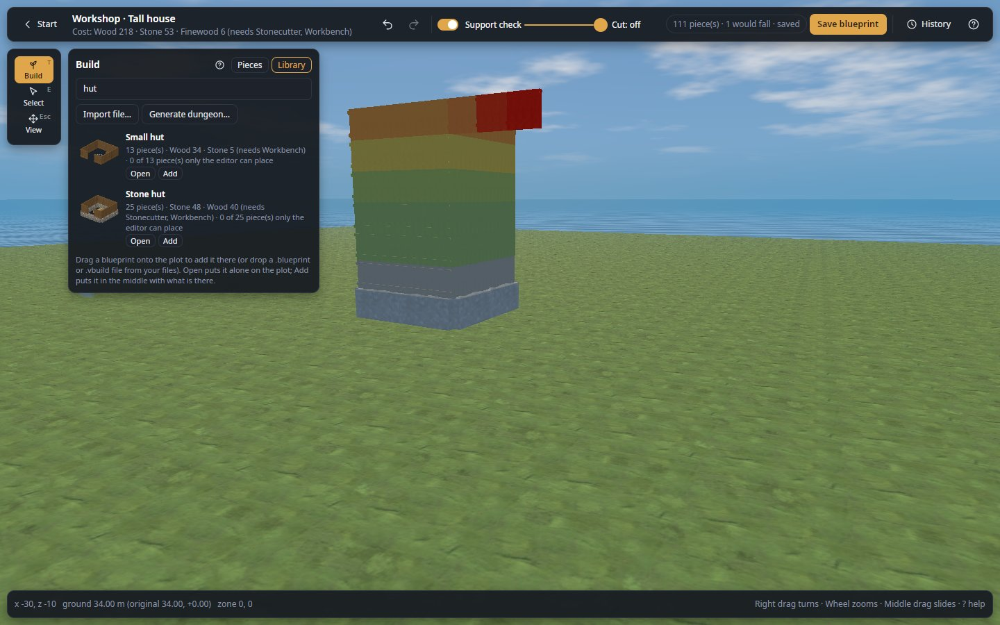
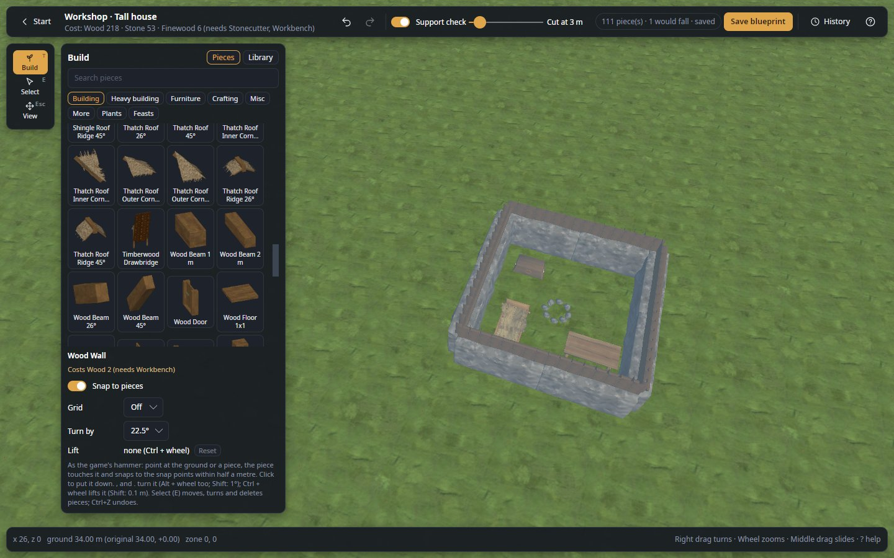

# The Workshop and the blueprint library


*A stone house on the plot with **Support check** on: the low walls are green, the upper ones turn yellow and
orange as their support runs out. The Build panel's **Pieces** tab is open beside it.*

The Workshop is a blank, flat plot where you build with every piece the game has, the way the hammer builds. It
shows what would hold and what would fall in game, and what the building costs. You keep the building as a
**blueprint** of [Homestead](https://thunderstore.io/c/valheim/p/sighsorry/Homestead/), the in-game building
mod: the same file shows in Homestead's hammer tab, ready to build in game, and can be pasted into any world from
the editor.

## How to use it

1. Open the Workshop: on the start page, **The Workshop** then **Open the Workshop** (or click one of your
   blueprints there or on **Home** to open it); in a world, **Blueprints** on the tool rail, then **New in
   Workshop** or a blueprint's **Edit**. A world with unsaved changes asks first.
2. Pick a piece in the **Build** panel (it opens by itself) and click on the plot to put it down. It snaps to the
   pieces already there, as with the game's hammer.
3. `,` and `.` turn the piece, **Ctrl + wheel** lifts it. **Select** (`E`) moves, turns and deletes pieces;
   `Ctrl+Z` undoes.
4. Watch the colours of the **Support check**, and the count of pieces that would fall in the top bar.
5. Click **Save blueprint** (or press `Ctrl+S`), and give it a name, a description and tags. It goes into the
   library.
6. **Start** goes back to the start page.


*The start page's **The Workshop**: **Open the Workshop**, whether Homestead is installed (here it is not, so
**Get Homestead** shows), and your blueprints, newest first.*

## The plot

The plot is not part of any world. It is 3 × 3 zones (192 m across) of flat meadow, all at one height. Its middle,
at ground level, is the blueprint's **anchor**: the point Homestead measures every piece from.

The Workshop keeps to building:

- The tool rail has only **Build** (`T`: the Place tool, set for building pieces), **Select** (`E`) and **View**.
  The ground tools, Area, Path, Mountain and the rest are for worlds.
- There is no Mask, no View panel, no zone borders, and buildings are drawn solid.
- The top bar has **Start** (where a world has **Map**), the **Support check** switch, the **Cut** slider and **Save
  blueprint** (where a world has **Save to world**). There is no **Discard**: undo, or open the blueprint again.
- The bar counts the pieces, says how many would fall, and whether the building is saved
  (`12 piece(s) · 2 would fall · not saved as a blueprint`).
- Under the title: what the building costs in game. Point at it for the full list of materials, the crafting
  stations needed nearby, and the pieces with no known recipe.

Leaving with a building that is not saved as a blueprint (**Start**, opening another blueprint, quitting) asks
first.

## The Build panel

The Build panel has two tabs at its top: **Pieces** (what to build with) and **Library** (your blueprints).

### Pieces

**Pieces** lists everything players build, each with a small picture drawn from the game's model:

| Tab | What it holds |
|---|---|
| **Building**, **Heavy building**, **Furniture**, **Crafting**, **Misc**, **More** | The hammer's own tabs, in the game's order: walls, floors, roofs, beams, stairs, doors, rugs, banners, torches, stations, chests... |
| **Plants** | The cultivator's pieces: crops, saplings and flowers. |
| **Feasts** | The serving tray's pieces: feasts. |
| **Mods** | The pieces your game's mods add, whatever tool builds them in game. Shown only when the editor knows some: it learns them from a live game (see [Modded games](live-mode.md#modded-games)). |

In each tab the pieces are grouped under a heading by the crafting station they need, in the order players get
them: no station first, then the workbench, stonecutter, forge, artisan table, black forge and galdr table, then
the rest; by name within each group. On the **Mods** tab a row of buttons picks one mod at a time (each with its
number of pieces), and the headings are the groups the mod gives its pieces. A tab shows at most 300 pieces:
search to find the others.

| Control | What it does |
|---|---|
| **Search pieces** | Finds pieces in every tab by name or prefab (`stone floor`, `woodwall`). Every word you type must match. |
| A piece's tile | Picks it: its name and its cost (`Costs Wood 2 (needs Workbench)`) show under the list. Point at a tile for its prefab name. |
| **Snap to pieces** | On: the piece snaps to the pieces already there, as with the game's hammer. Off: it stays where it touches what you point at (like holding Alt in game). |
| **Grid** | **Off** (as in the game), **0.5 m**, **1 m** or **2 m**: where you point at the ground is rounded to this grid, counted from the plot's middle, before the piece goes there. Pieces you point at are not rounded. |
| **Turn by** | How far `,` and `.` (or **Alt + wheel**) turn the piece: **1°**, **15°**, **22.5°** (the game's step, the default), **45°** or **90°**. Hold `Shift` to turn by 1°. |
| **Lift** | **Ctrl + wheel** lifts the piece (or lowers it) by 0.5 m a notch from where it touches, before it snaps; `Shift` + **Ctrl + wheel** by 0.1 m. The line shows the lift (`+1.5 m`); **Reset** takes it back to none. |

Each click puts down one piece: dragging does not paint more. When no piece is picked yet, the Workshop picks the
wooden wall.

### How pieces snap

Pieces go where the game's hammer would put them. The editor reads each piece's colliders (its real shape), its
snap points and its placement rules from your own Valheim, and follows the hammer's steps:

1. The cursor's ray meets the nearest thing: the ground, or a piece's real shape (not its box).
2. The piece, turned as you set it, is moved so that the point of its shape nearest to the hit touches it. Pieces
   the game places by their middle (rugs and other ground pieces, and pieces allowed to sink into the ground or
   into anything) go with their middle right at the point.
3. Of every snap point of the piece and every snap point of the pieces within 10 m, the closest pair within half a
   metre meet. Point at a wall's top to put the next one on it, near its end to put one beside it.
4. A snap that would put the piece exactly where the same piece already stands is skipped, unless the game lets
   that piece overlap itself when turned another way.

The **Lift** is added before the snap, so a lifted piece still snaps to snap points near its new height. The
**Grid** rounds only points on the ground: a piece pointed at another piece snaps as usual.

### Library


*The **Library** tab: **Search blueprints**, **Import file…** and **Generate dungeon…**, then each blueprint with its
picture, pieces, cost and its **Open** and **Add** buttons.*

**Library** lists your blueprints (Homestead's folder), by name. Each row shows the blueprint's picture (when it
has none beside it, one is drawn from its pieces, in memory only), its number of pieces and its cost.

| Control | What it does |
|---|---|
| **Search blueprints** | Shows the blueprints with every word you type somewhere in their name, description or tags. |
| **Open** | The blueprint alone on the plot, to change it (asks first when what is there is not saved). **Save blueprint** writes it back. |
| **Add** | Adds the blueprint to what is on the plot, in its middle. One undo step. |
| Drag a row onto the plot | Adds the blueprint where you drop it. |
| Drop files on the plot | `.blueprint` (Homestead, PlanBuild) and `.vbuild` files dropped from your file manager are imported into the library, then added where they land. Dropped on a world, they are only imported. |
| **Import file…** | Imports a `.blueprint` or `.vbuild` file into the library (see [Import and export](#import-and-export)). |
| **Generate dungeon…** | Shows the dungeon generator in the panel's place, made of building pieces (see [Generating a dungeon](dungeons.md#generating-a-dungeon)). Under it, **Open on the plot** puts the dungeon there alone (asking first when the plot is not saved) and **Add to the plot** adds it to what is there, in the middle (one undo step). Either way its blueprint is kept in the library. **← Library** goes back. |

## How opening and adding a blueprint works

A blueprint keeps its form exactly: every piece where it was, turned as it was. It is moved as one:

- **Up or down**, so that the lowest point of its lowest building piece (by its real shape) is on the plot. Rocks
  and other things the hoe places do not count: they are not the building.
- **Across**: a Homestead blueprint keeps its anchor at the plot's middle. Other files (PlanBuild, `.vbuild`)
  measure from a corner, so they are centred.

The editor remembers how far it lifted the blueprint. Saving it again takes that off, so the anchor keeps its
height and the building stands as before when Homestead builds it.

Pieces the game does not know (from mods you do not have) are left out, and the message lists them. A blueprint
opened from outside Homestead's folder asks before saving over a library blueprint of the same name.

## Support check

The **Support check** (on by default) tints each building piece in the colours the game's build mode gives its
structural support. The piece's own look still shows through.

| Colour | Meaning |
|---|---|
| **Light blue** | Full support: it stands on the ground. |
| **Green** | Strong: half its material's maximum support or more. |
| **Yellow**, **orange** | Weaker. |
| **Red** | About to break, or breaking: in game a breaking piece falls as soon as a player comes near. |

The top bar says how many pieces would fall. **Save blueprint** asks first when some would.

### How it works

The editor works out support the way the game does, from data it reads in your Valheim (each piece's colliders,
material and centre of mass):

- Every material has a maximum support, a minimum, and a loss for each metre between centres of mass, sideways
  and upwards:

  | Material | Maximum | Minimum | Lost per metre sideways | Lost per metre up |
  |---|---|---|---|---|
  | Wood | 100 | 10 | 20 % | 12.5 % |
  | Core wood | 140 | 10 | 17 % | 10 % |
  | Timber | 200 | 10 | 20 % | 8 % |
  | Stone | 1000 | 100 | 100 % | 12.5 % |
  | Ice | 1000 | 100 | 33 % | 12.5 % |
  | Iron | 1500 | 20 | 8 % | 8 % |
  | Black marble | 1500 | 100 | 50 % | 12.5 % |
  | Grausten | 2000 | 100 | 33 % | 10 % |
  | Ancient | 5000 | 100 | 25 % | 7 % |

- A piece whose colliders, grown by 0.15 m on every side, reach the ground has full support.
- Any other piece takes the best support of the pieces it touches (their colliders that its grown colliders
  reach), less its own material's loss for the distance between their centres of mass. A piece held from straight
  below loses the "up" rate, one held from the side the "sideways" rate, and between them a mix by the angle. Held
  from two sides at least 100° apart (seen from above), it gets the average of the two when that is better.
- This is repeated until nothing changes. Pieces below their material's minimum break; then everything is worked
  out again without them, so a collapse spreads the way it would in game.
- Pieces the game never checks for support (black marble floor slabs, for one) stay up wherever they are.

That is why stone stands tall but cannot reach out (one metre sideways takes all its support), and why wood
reaches further out than stone but not as high.

What the check leaves out: rocks and trees (the game counts them as full support; the plot has none), the exact
shape of mesh colliders (their box counts), and pieces the game gives no support at all (they are not tinted).

**The ground a blueprint stood on.** In game the building stood on uneven ground. For a blueprint opened or
added, the check takes the ground to be where the building met it: at Homestead's recorded terrain contact points
when the file has them, else under the lowest piece of each spot (the terrain reached each post). A piece with
nothing below it at its spot therefore counts as on the ground, as it was in game.

## Cut


*The same house with **Cut at 3 m**, seen from above: everything above 3 m is hidden, so you see into the
house.*

The **Cut** slider in the top bar looks at the building from a height: nothing above it is drawn (0 to 40 m above
the plot, a metre a step), and the cursor goes through what is hidden, so you can put pieces inside. Its right end
is off (`Cut: off`); its left end cuts at the ground. The text beside it shows the height (`Cut at 3 m`).

## Saving a blueprint

**Save blueprint** (`Ctrl+S`) asks for:

| Field | What it is |
|---|---|
| **Name** | Homestead lists it under this name in its hammer tab. The file is named after it. |
| **Description** | A few words, shown in the library and to people you share the file with. Line breaks become spaces. |
| **Tags (separated by commas)** | Words to find it by: `house, viking, stone`. Up to 12, duplicates dropped. |
| **A dungeon: pasted into a world, it goes 5000 m up behind an entrance on the ground** | Makes it a dungeon blueprint (the tag `dungeon`): see [Dungeons from blueprints](dungeons.md#dungeons-from-blueprints). |

The dialog also shows the **Cost in game**. Saving the blueprint you opened writes over it; another name makes a
new one, and replaces a blueprint of that name only after asking.

What is kept:

- **Building pieces only**: everything on the plot the game knows as a piece. Trees, rocks and items left on the
  plot are not.
- **What objects hold**: a chest's contents, a sign's text, an item stand's item, a creature's stars (a dungeon's
  boss). Double-click an object (or select it and press `I`) to see or change what it holds; a chest shows its
  slots as in game. See [Inspecting and changing an object's data](select.md#inspecting-and-changing-an-objects-data).
- **Whether it is a ruin**: pieces with no builder, as the game's own ruins and generated dungeons have. No builder
  is ever written for the rest: whoever builds it in game becomes its builder.

A picture is drawn and saved beside the file (see [Pictures](#pictures)).

## The library (Blueprints panel)


*The **Blueprints** panel in a world: the Homestead banner, **Search blueprints** and **Import file…**, then a saved
hut with its picture, pieces, cost and its **Paste**, **Edit**, **Details**, **.vbuild** and **Delete** buttons.*

In a world, **Blueprints** on the tool rail (or **Blueprints…** in the Area tool's panel) opens the library in the
tool's place, next to the rail; **✕** goes back to View. It lists Homestead's blueprints, the Workshop's included.

At its top a banner says whether Homestead is installed, with its version and where it was found, or warns that it
is not and offers **Get Homestead**. Under it: **Search blueprints**, **Import file…** and **New in Workshop**.
Each blueprint shows:

- its **picture**;
- its number of pieces, who made it (`by Valheim World Editor` for the editor's) and the world it came from;
- its **cost** in game: materials, most first, and the crafting stations it needs nearby;
- its **description** (up to three lines) and its **tags**.

**Search blueprints** keeps the blueprints with every word you type somewhere in their name, creator,
description or tags.

| Button | What it does |
|---|---|
| **Paste** | Puts the blueprint on the clipboard and starts pasting it into the open area (see [Copy and paste](area.md#copy-and-paste)). Kinds this world cannot make are left out and listed. A dungeon blueprint goes up behind an entrance instead (see [Dungeons from blueprints](dungeons.md#dungeons-from-blueprints)). |
| **Edit** | Opens it in the Workshop. |
| **Details** | Changes its name, description, tags and the dungeon switch, in its file. When the name changes and the new file name is free, the file and its picture are renamed with it. |
| **.vbuild** | Writes it as a `.vbuild` file (BuildShare and older tools) into the `export` folder of the editor's own blueprints folder, and says where. Only the objects are written. |
| **Delete** | Removes its file and its picture, after asking. Homestead loses it too. |
| **Import file…** | See [Import and export](#import-and-export). |
| **New in Workshop** | Opens the Workshop on a blank plot. |

Blueprints saved by editor versions from before Homestead are listed under **Older editor blueprints**, with
**Paste**, **To Homestead** (keeps it as a Homestead blueprint, numbered when the name is taken), **.vbuild** and
**Delete**. Homestead blueprints hold no ground: a copy's ground shape is not kept, and the message says so.

**Saving from a world.** Copy something with the Area or Select tool (`Ctrl+C`), then **Save blueprint…** in the
Area panel. It asks for the same details and writes a Homestead blueprint of the copy's objects, with the world's
name as where it came from.

## Homestead

Homestead builds the editor's blueprints in game, with a chest for the materials. The start page (on **The
Workshop**) and the Blueprints panel look for `Homestead.dll` in the `BepInEx/plugins` folders the editor knows:
your Valheim's, the mod manager profile the editor runs from, the folders added in Settings, and the r2modman and
Thunderstore Mod Manager profiles. They show the version found. When it is not there, they warn you and offer
**Get Homestead** (its Thunderstore page). Blueprints are still saved where Homestead looks for them, so they show
in game once you install it.

Homestead checks versions with the server: a server that runs Homestead disconnects players who do not have it
(console players cannot have it). Players only need it in their own game to build blueprints.

Blueprints live in Homestead's folder of Valheim's save folder (the editor uses the one that has it already, else
the save folder where your worlds are):

- Linux: `~/.config/unity3d/IronGate/Valheim/Homestead/Blueprints`
- Windows: `%USERPROFILE%\AppData\LocalLow\IronGate\Valheim\Homestead\Blueprints`

Sharing a building means sharing its `.blueprint` file (and the `.png` picture beside it).

## Cost

The cost of a blueprint, of the building on the plot or of one piece comes from the recipes in your own Valheim:
each piece's materials, as the hammer takes them, times how many of it there are, added up and listed most first,
with the crafting stations that must be near. The short line shows the first few materials
(`Wood 120 · Stone 64 · Core wood 20 · … (needs Stonecutter, Workbench)`); point at the Workshop's subtitle for the
whole list. Pieces with no known recipe (from mods the editor does not know) are listed apart, and the line reads
`Cost unknown (pieces from mods?)` when nothing is known.

## Pictures

Each blueprint saved by the editor gets a `.png` beside its file: the building seen from above at an angle, on a
transparent background. Homestead uses it as the blueprint's icon in its hammer tab. It is drawn with the game's
models and textures when the [game's look](../README.md) has been copied, else each piece's shape in its
material's colour (wood brown, stone grey, black marble pale...). Blueprints made elsewhere without a picture get
one drawn in the library, kept in memory only: their folder is left as it is.

## Import and export

**Import file…** (and dropping files) reads:

- **`.blueprint`** files of Homestead and PlanBuild. Their `#Terrain` marks (ground levelled and painted) are not
  kept: Homestead blueprints hold pieces only. Other mods' sections in the file are skipped.
- **`.vbuild`** files (BuildShare and older tools), one piece per line.

The file is kept as a Homestead blueprint in the library, under its own name (numbered, `House (2)`, when the
name is taken). Pieces the game does not know (from mods) are left out; the message says how many, and how many
lines could not be read.

**.vbuild** in the Blueprints panel writes a blueprint the other way.

### The file

A Homestead blueprint is a PlanBuild `.blueprint` file with Homestead's header lines:

```
#Name:Small hut
#Creator:Valheim World Editor
#Description:A hut with a fire pit
#Tags:house, wood
#Category:Blueprints
#HomesteadVersion:1
#HomesteadWorld:
#HomesteadSavedAt:2026-10-14 18:02:11 +02:00
#HomesteadRadius:6.2
#Pieces
woodwall;Building;-3;1;-2;0;0;0;1;"";1;1;1
```

- Each piece is `prefab;Building;x;y;z;qx;qy;qz;qw;"";1;1;1`: its place in metres from the anchor (the middle of
  the building at ground level), its turn as a quaternion, and its scale. Pieces are written lowest first, numbers
  to the millimetre.
- `#Tags:` is the editor's own line; Homestead skips header lines it does not know.
- What objects hold goes in the editor's own `#EditorData:` lines (one per value, by the piece's number), and a
  ruin is marked once with `#EditorRuin:1`. Homestead and PlanBuild skip them, so the same file still builds in
  game.
- The file name is the blueprint's name, with characters Windows or Linux refuse turned into `_`, at most 64
  characters.

## Good to know

- **What comes back.** When you place a blueprint in a world from the editor (**Paste**, or as a dungeon), its
  objects come back holding what they held: the chest's contents, the signs, the boss. Built in game with
  Homestead it is only the pieces: the game makes chests empty and places no creatures.
- **Copy and paste are for worlds.** On the plot, use **Add** or drag a blueprint to bring in a building: the Paste
  tool does not run in the Workshop.
- **Unknown pieces.** A blueprint made with mods you do not have opens without their pieces. Saving it then writes
  it without them.
- **Building in a dungeon** uses the same Build panel: see [Building in a dungeon](dungeons.md#building-in-a-dungeon).
- **Claude** can build on the plot and save blueprints for you: see [Claude](claude.md).
